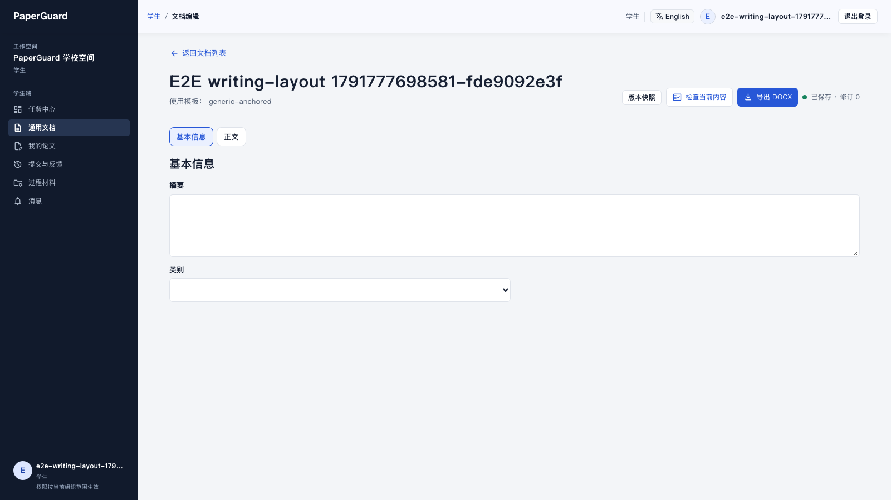
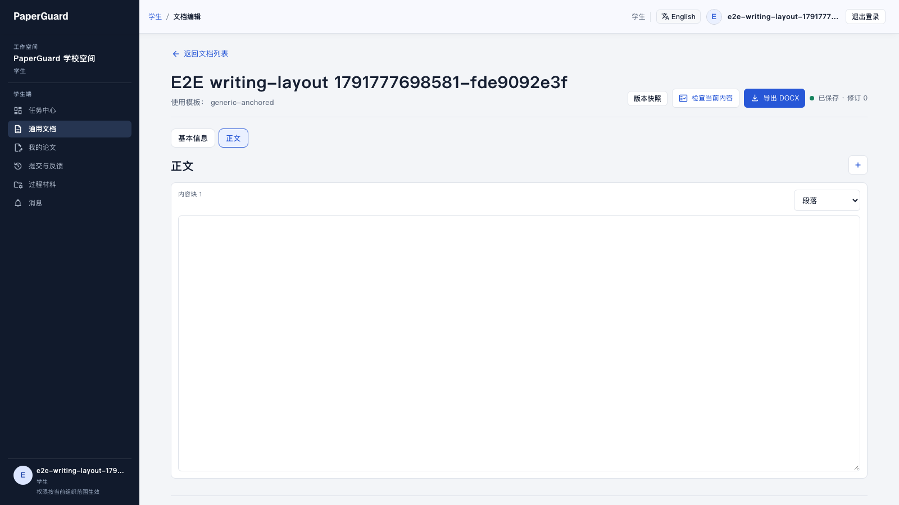

# 通用文档基本信息与正文视图修复

2026-10-12。本轮本地验证结论：**PASS**；UI 验收：**Ready（限本文覆盖范围）**。

用户提供两张截图，指出基本信息与正文视图不合理。本次沿用已授权的 UI 修复范围，仅调整共用文档编辑组件及其文案。

## 问题与调整

版本信息被移入详情面板后，编辑布局仍有 `260px + 剩余空间` 的旧侧栏列。共用组件的样式覆盖了页面统一样式，编辑区落在固定列。浏览器在 1100×640 下复现：编辑区宽度仅占可用区域约 **34.4%**；之前仅检查控件可见性的门禁没有发现这一问题。

- 改为单列编辑布局，表单及正文使用可用宽度。
- 摘要等多行字段占整行；普通字段自然排列，选择框与文字输入框不再随相邻文本框高度拉伸。
- 单个正文内容块使用剩余编辑高度，正文输入区至少 180px 高；继续支持多个内容块、图片、表格及公式。
- 顶部仅显示人可读的模板名称，内部文档类型 ID 和模板版本 ID 移出默认摘要，版本信息仍可在详情面板查看。
- 去掉重复的“字段”和内部章节类型 `content`；系统默认 Summary、Category、Body、paragraph 等按界面语言显示为“摘要、类别、正文、段落”等。
- 保留模板作者自定义的字段、章节名称，保留底层键值及保存、检查、导出行为。

## UI 验收

| 验收项 | 状态 | 证据 |
| --- | --- | --- |
| 编辑主区覆盖至少 95% 的可用宽度 | PASS | 新增浏览器宽度断言；修复前 1100×640 用例失败，修复后各窗口通过。 |
| 摘要与正文文本区宽度达到主区的 85% 以上 | PASS | 浏览器实际尺寸断言，避免仅凭“在屏幕内”判断布局合理。 |
| 正文文本区至少 180px 高，单块可使用剩余编辑空间 | PASS | 实际尺寸断言及桌面截图。 |
| 中文默认标签正确，英文切换正确 | PASS | 浏览器检查摘要、类别、正文、段落及其英文显示；自定义名称保护由组件测试覆盖。 |
| 顶部不展示内部类型及版本 ID | PASS | 组件测试与浏览器检查；版本详情可继续打开。 |
| 桌面控件可达、页面没有溢出 | PASS | 1100×640、1600×900、916×804、775×804 的检查。 |
| 移动浏览器字段、正文及语言切换可用 | PASS | 390×844 的浏览器回归与截图；未作真机结论。 |

## 最终验证

| 项目 | 执行目录与命令 | 结果 |
| --- | --- | --- |
| 后端完整测试 | `backend/`，项目 venv 的 Python 3.12 执行 `-m pytest -q` | 本轮 1100 通过，2 条现有依赖弃用警告，退出码 0 |
| 前端完整测试 | `frontend/`，`npm run test` | 30 文件、117 项通过，退出码 0 |
| 类型检查 | `frontend/`，`npm run typecheck` | 退出码 0 |
| 前端构建 | `frontend/`，`npm run build` | 退出码 0 |
| 学院管理门禁 | `frontend/`，`npm run check:college-admin` | 退出码 0，相关 5 项测试通过 |
| 文档平台浏览器回归 | `frontend/`，`npm run test:e2e -- e2e/document-platform.spec.ts`，桌面与移动项目 | 14 通过、0 失败、0 跳过 |
| 格式检查 | 仓库根目录，`git diff --check` | 退出码 0 |

浏览器回归包含教师自用模板保存及本人写作、学生访问拒绝、共享文档兼容、字段和正文自动保存、刷新恢复、校验、表格结构编辑及 DOCX 下载。导出检查包括正文、字段、静态内容、页眉页脚与占位符替换。新增的布局用例覆盖两种视图、四组桌面尺寸、移动尺寸及语言切换。

初次新增组件用例因翻译 mock 将全部翻译键原样返回，触发内容块名称的正常未知键回退而失败；补齐该 mock 的已知段落翻译后通过。未为此放宽产品逻辑或断言。截图禁用既有短暂入场动画，以显示最终稳定布局。

## 截图

基本信息：

正文：

修复前的窄列证据见 [before-fields-1100.png](screenshots/before-fields-1100.png)，其他尺寸及英文截图在 `screenshots/`。截图使用隔离测试账号及文档，共用编辑组件同时供教师和学生使用。

## 证据边界

- 真实 worktree：`/Users/a1234/.codex/worktrees/all-pages-one-screen-v3/paperguard`。
- 分支：`codex/all-pages-one-screen-20261011`；HEAD：`5971f506d889caa4bcaa26f751ddd66cf067460d`，本地工作区有既有未提交改动。
- 本轮仅变更 4 个代码/测试文件，见 [changed-files.json](changed-files.json)；开始与结束的 394 文件源码身份见 [source-before.json](source-before.json) 和 [source-after.json](source-after.json)。未覆盖既有修改。
- 去除原始日志、会话信息的浏览器结果见 [browser-results.json](browser-results.json)。测试使用独立临时数据库及文件目录，未写用户现有数据库。
- 未改后端、权限、数据库迁移、路由或检查/修复引擎；上一轮教师个人写作与学生指导的用途分离保留。
- 仅本地修复与验证；未提交、推送、合并或部署，未作小程序真机、线上或真实 UAT 结论。
