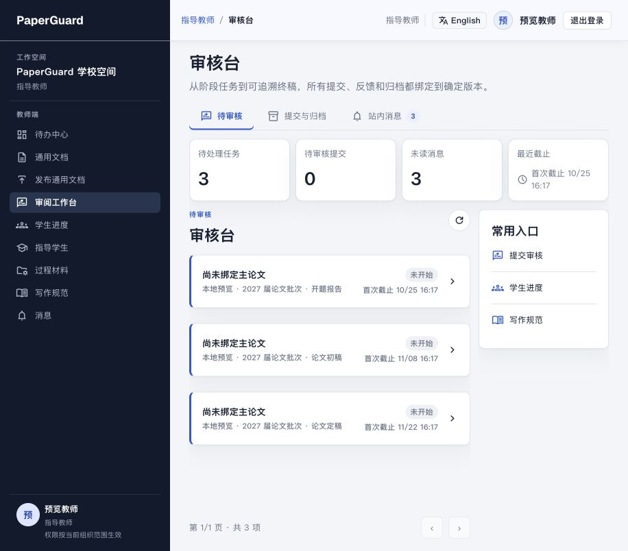
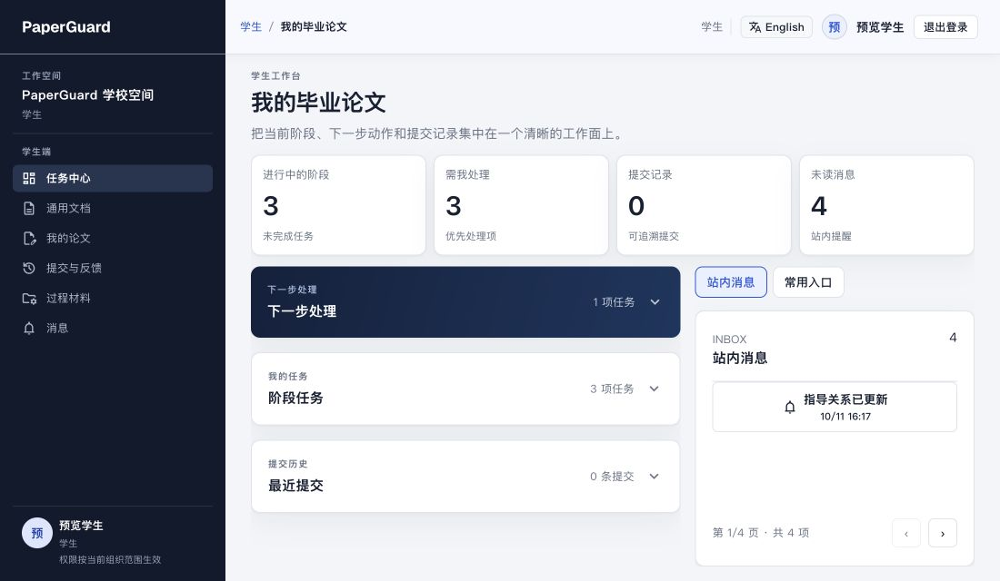
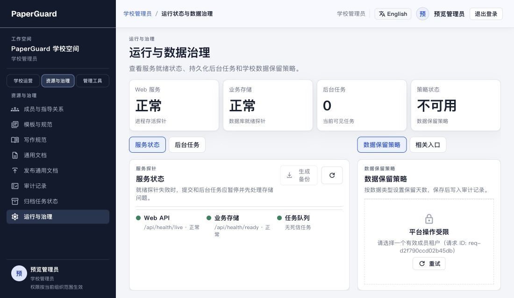

# PaperGuard 动态一屏界面本地验证 — 2026-10-11

状态：本轮动态一屏修复与本地门禁已全部通过。本轮交付为本地代码与预览，不是生产发布证据。

## 当前范围与源码身份

- 原项目：`/Users/a1234/Documents/perpetual/paperguard`。
- 实施工作区：`/Users/a1234/.codex/worktrees/all-pages-one-screen-v3/paperguard`。
- 分支：`codex/all-pages-one-screen-20261011`。
- 基础 HEAD：`5971f506d889caa4bcaa26f751ddd66cf067460d`；本轮前端修改尚未提交。
- 本轮修改前端文件摘要：`8b30b6a03ab72f37c82d2e39f908598429f29602b81187836c99576e53999101`，业务源码摘要为 `5a9ba56f3e6a833a7d3d5840299ed1185bf854178f49a38cb9ddfb7cedaeb242`。逐文件摘要见 [source-snapshot.json](dynamic-one-screen-20261011/source-snapshot.json)。
- 本轮只处理桌面页面的一屏布局、动态切换及相应本地验证；不改后端、数据库、迁移、检查/修复引擎或生产配置。

## 批准的交互与修复

桌面主页面和主面板高度受当前窗口约束，列表按实际剩余高度分页，配置和信息分组通过标签切换，详情与复杂表单放入右侧抽屉。切换保留未保存输入，正文编辑器保留实例与选区。正文和详情抽屉允许内部滚动，768px 及以下手机保留自然页面流。

- 首页、管理员/教师/学生工作台、工作流、成员与组织、模板与规范、批次、用户与 AI、审计及运行治理接入同一屏幕布局规则。
- 教师任务改为紧凑摘要，操作通过详情抽屉访问；列表分页器固定在可用区域底部。
- 学生工作台的三个入口默认收起，分别打开抽屉；消息与常用入口用标签切换。
- 通用文档发布分为上传模板、上传规范、组成发布三组；解析结果与校对表单使用抽屉，关闭后保留草稿。
- 写作/通用文档编辑保留正文主区，大纲、助手、检查和历史通过抽屉或标签访问；自动保存不会自动弹出检查抽屉。
- 登录、注册、首次登录长提示显示摘要，完整消息可以通过抽屉访问。
- 运行与治理的服务状态按三列布局，保留策略完整表单移入抽屉，短屏仍能访问重试、配置和保存按钮。
- 组织用户作用域列表接入分页；18 名成员夹具逐页验证均可访问。
- 管理员侧栏使用三组切换；英文标签可收缩换行，同组所有入口完整可见。
- 面板切换约 200ms，分页内容约 180ms，抽屉约 220ms；支持减少动态效果偏好。整面板使用轻微向内缩放和淡入，避免向外位移临时撑出窗口。

## 本地门禁

| 检查 | 本轮结果 |
| --- | --- |
| 前端构建 `npm run build` | 通过 |
| 类型检查 `npm run typecheck` | 通过 |
| 学院管理员 `npm run check:college-admin` | 通过；结构检查与 5 条测试 |
| 段落拆分 `npm run test:paragraphs` | 通过 |
| 前端单测 `npm run test` | 24 个文件、102 条通过 |
| 后端 `python -m pytest -q` | 1098 条通过，2 条警告；本轮无后端修改 |
| 全页桌面矩阵 | 9 条用例通过；176 个角色/路由/视口组合与额外边界检查，约 13.2 分钟 |
| 桌面/手机关键业务 E2E | 28 条通过，约 3.0 分钟；编辑/自动保存/失败重试/发布/检查/导出均覆盖 |
| 改动空白检查 `git diff --check` | 通过 |
| 凭据模式扫描 | 未发现私钥、GitHub/OpenAI/AWS 密钥或 JWT 字面量；测试身份均为明确的本地夹具 |

## 验收规则与覆盖

主矩阵包含管理员 20 个路由/面板 × 5 个视口，以及教师 10 个、学生 9 个路由/面板 × 4 个视口，共 176 个角色/路由/视口组合。桌面主视口为 775×804、916×804、1100×640、1280×720、1384×817；另核验 769、900、901、1024、1101、1440 的断点边界。

验证逐一切换标签、遍历分页、聚焦可见控件，要求主页面滚动位置为 0、页面与面板溢出不超过 1px、控件完整可见（ratio 1），不放宽阈值。正文编辑区的滚动属于已批准的例外。组织大列表、保留策略、中英文导航、公共认证页和加载失败态使用额外定向用例。

保留策略复合用例含 16 个尺寸/状态/语言组合，总时限为 180 秒；可见性和溢出阈值不变。首次短屏检查发现切换动画约 3px 越界，修复动效后定向复测通过。最终全矩阵 9 条用例均通过。管理员的 110 条详细测量记录见 [all-page-geometry.json](dynamic-one-screen-20261011/all-page-geometry.json)，其中页面、主工作区域最大溢出均为 0，页面滚动位置均为 0。

## 浏览器实测与截图

本地预览持续运行于 `http://127.0.0.1:5173`，由上述实施工作区提供。预览数据为本地合成账号与论文任务，不连接生产数据。

- 教师审核台：916×804，页面高度 804、滚动位置 0；主区域高度与内容高度均 483。
- 学生工作台：1100×640，页面高度 640、滚动位置 0；主/侧区域高度与内容高度均 330。
- 管理员运行与治理：1100×640，页面高度 640、滚动位置 0；服务状态与保留策略两个面板高度与内容高度均 280。

[教师任务详情抽屉](dynamic-one-screen-20261011/teacher-task-drawer.png)。

## 证据边界

真实本地预览的保留策略接口返回 403，页面按服务端授权显示受限状态与重试入口。保留策略配置前后布局的额外用例采用显式 mock；保存失败、重试及授权行为由现有单测覆盖。这不表示预览账号已获得策略管理权限。

[门禁清单与日志索引](dynamic-one-screen-20261011/verification-summary.json)。前端门禁日志保存于本机临时证据目录 `/Users/a1234/.codex/tmp/paperguard-local-preview-20261011`。本报告不会保存账号密码、token 或 Cookie。这里的本地检查不替代生产发布验证、真实 UAT 或微信真机证据。

未执行本轮提交、推送、合并或部署。历史 `viewport-overflow-fix-20261011.md` 保留作为过程记录，其早期允许主面板滚动的结论不作为当前动态一屏交互的证据。

## 最终改动审计

- 已审核暂存、未暂存与未跟踪路径；当前无暂存改动，全部变化位于前端和本任务证据目录。
- 已审阅完整行为变更及重点长模板，确认发布和工作流原有控件与业务动作保留，新增入口负责打开详情或切换标签。
- 最终 `git diff --check` 通过，凭据模式扫描未发现可用凭据字面量；截图使用本地合成数据。
- 业务回归首轮发现旧测试未先选择管理工具组、以及分页测量期间读取位置列表；已改为按用户操作顺序选择分组，并等待测量/短动效完成后检查完整控件与逐页数据。没有跳过、删除或放宽可见性和溢出门禁，最终 28 条全部通过。
- 全页矩阵后仅更新两个业务测试文件，应用源码未再修改；源码摘要绑定上述前端门禁和全页/业务回归结果。
- 审计结论：READY（本地交付）；未将结果扩大为主线、线上或真实 UAT 完成。
