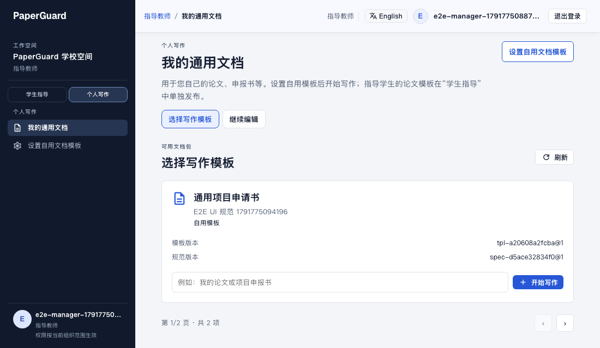
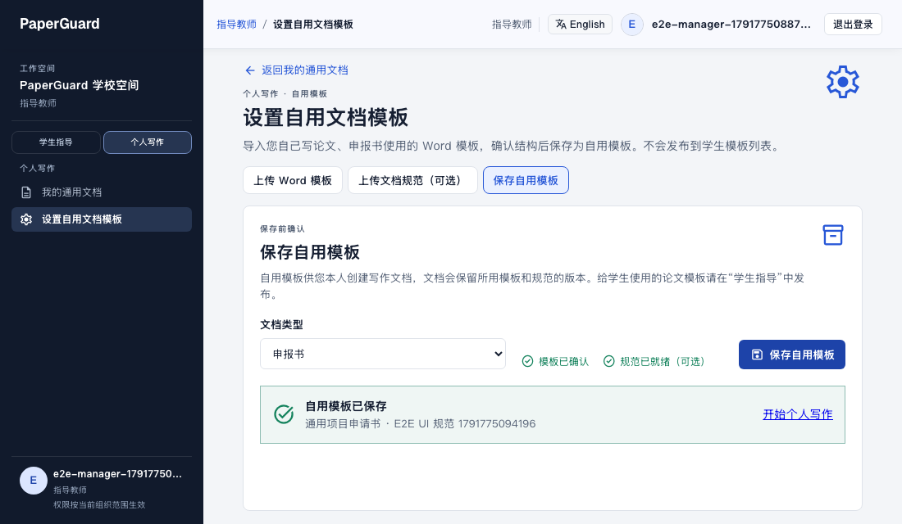
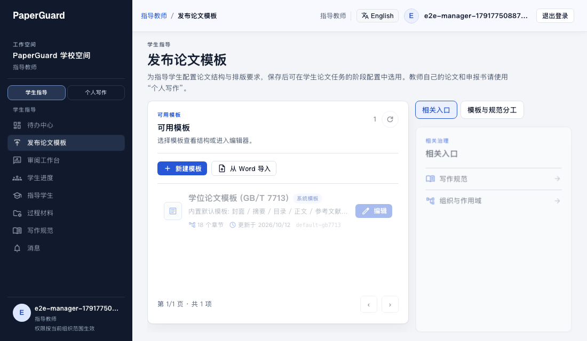

# 教师个人写作与学生指导分离验收

日期：2026-10-12。结论：**PASS（限定本轮本地实现与自动化回归范围）**。

用户确认：教师设置通用文档用于本人写论文、申报书；发布论文模板用于指导学生，两个用途分开。

## 本轮结果

| 用途 | 导航入口 | 页面与行为 |
| --- | --- | --- |
| 教师自己的写作 | 个人写作 → 我的通用文档 | 使用本人自用模板或适用的已发布共享模板，创建、继续编辑、检查和导出自己的文档。 |
| 配置教师自己的模板 | 个人写作 → 设置自用文档模板 | 上传 Word 模板、可选文档规范，人工确认后“保存自用模板”；文档类型可选择论文、申报书、其他文档。 |
| 指导学生论文 | 学生指导 → 发布论文模板 | 保存论文结构及排版要求，在学生论文任务阶段配置中选用，沿用学生写作、提交、教师审核、归档流程。 |

标题、面包屑、导航及保存成功反馈均按教师用途区分，中英文均有对应文案。截图检查发现的自用模板入口挤压换行已改为独立按钮；窄屏移至介绍下方显示。保留此前修复的章节预览和简短创建弹窗。

产品边界见 [教师个人写作与学生指导](../../product/教师个人写作与学生指导.md)。

## 服务端边界

- 教师新解析的通用模板、规范候选，以及新保存的通用文档包均为个人用途。真实所有者来自服务端认证身份，客户端传入“共享”、伪造所有者或组织范围不能覆盖它。
- 自用包列表、直接 ID 读取和创建文档统一检查真实发布者；候选列表、直接读取及确认同样检查真实所有者。
- 同组织的学生、其他教师、学院管理员及其他管理员不能从模板库读取或选用该自用包。教师本人可创建、编辑自己的文档；其他教师不能打开该文档。
- 匿名读取返回 401；未知或无权使用的包返回 404。
- 既有明确发布的共享文档包保持原组织可见范围，并标为“已发布的共享模板”。不改写存量数据。已创建文档保留原有所有者及管理访问策略，因此本轮结论不表示管理员失去已有文档治理权限。
- 使用已有 JSON 元数据，无数据库结构及迁移账本变更。

## 验证结果

全部命令在本轮真实 worktree 对应目录执行；后端使用已满足项目开发依赖的 Python 3.12 venv。

| 验证 | 命令/范围 | 最终结果 |
| --- | --- | --- |
| 后端完整测试 | `backend/`：`/Users/a1234/Documents/perpetual/paperguard/.venv/bin/python -m pytest -q` | 1100 通过，2 条现有依赖弃用警告，退出码 0 |
| 前端完整测试 | `frontend/`：`npm run test` | 30 文件、116 项通过，退出码 0 |
| 类型检查 | `frontend/`：`npm run typecheck` | 退出码 0 |
| 前端构建 | `frontend/`：`npm run build` | 退出码 0 |
| 学院管理门禁 | `frontend/`：`npm run check:college-admin` | 退出码 0；相关 5 项测试通过 |
| 教师自用文档及共享文档兼容 | `npm run test:e2e -- e2e/document-platform.spec.ts`，桌面和移动浏览器项目 | 12 通过 |
| 三角色论文闭环、短表单及可访问性 | `npm run test:e2e -- e2e/full-lifecycle.spec.ts e2e/usage-audit.spec.ts` | 4 通过、4 既定跳过 |
| 页面及中英文导航布局 | `e2e/all-pages-viewport.spec.ts`，筛选 populated teacher and student routes、all navigation groups 两项，`--project=chromium` | 2 通过 |
| 改动格式检查 | 仓库根目录：`git diff --check` | 退出码 0 |

浏览器最终去重汇总：**22 项，18 通过、4 跳过、0 失败**；详见 [browser-results.json](browser-results.json)。未自动更新视觉基线。

教师自用流程实际执行了 Word 解析、章节编辑、可选规范解析及参数纠错、确认、保存、创建本人文档、字段与正文自动保存、刷新恢复、确定性检查和 DOCX 下载；检查了导出内容、静态段落、页眉、页脚及占位符替换。另用独立学生会话验证模板列表不可见、直接访问及创建均被拒绝。

三角色论文闭环实际执行了管理员配置与发布任务、学生写作及提交、教师退回、学生修订重提、教师通过和归档；短创建表单的键盘焦点、Esc 关闭与焦点恢复通过。此次 10 处页面/弹窗的 axe 扫描记录无违规。

布局检查覆盖教师及学生有数据页面在 775×804、916×804、1100×640、1280×720 下的操作可达性，以及三角色中英文导航在 775×640、916×640、1100×640、1280×720 下的滚动、页脚及链接可见性。教师自用完整流程另外在移动浏览器项目执行。

4 个跳过均来自既有分工：完整论文闭环只在桌面执行，响应式登录检查只在移动项目执行；两项使用审计只在桌面执行。没有把跳过记为通过。

新增权限用例最初使用无结构 Markdown，因触发未配置的 AI 提取返回 503；换为仓库支持的结构化 frontmatter 确定性夹具后通过。未为此放宽产品行为或门禁。完整流程仍出现已有 Workflow/ScreenDeck 动态更新重复 key 的开发警告，本轮未改该模块，最终用例均通过。

## 截图

移动界面及两组导航截图在 [screenshots](screenshots/) 中；账号、规范与文档名均为隔离测试夹具。

## 证据与交付边界

- 真实 worktree：`/Users/a1234/.codex/worktrees/all-pages-one-screen-v3/paperguard`。
- 分支：`codex/all-pages-one-screen-20261011`；基准 HEAD：`5971f506d889caa4bcaa26f751ddd66cf067460d`。工作区有既有未提交改动，本次未覆盖或提交它们。
- 本轮 15 个代码/测试文件见 [changed-files.json](changed-files.json)。开始与结束的源码身份见 [source-before.json](source-before.json)（392 文件）、[source-after.json](source-after.json)（394 文件）。
- 浏览器测试使用独立临时数据库、模板、数据和文件目录，未操作用户现有数据库。布局样式微调后重跑前端门禁、自用流程及布局检查；后端源码与完整后端测试时一致。
- 本地预览 API 的公开 OpenAPI 已包含新增个人/共享用途字段；未在用户数据中创建验证记录。
- 本轮仅交付本地代码、产品说明和测试证据；未提交、推送、合并或部署，未执行生产操作。没有真机小程序或真实 UAT 结论，不扩大单学校试点边界。
