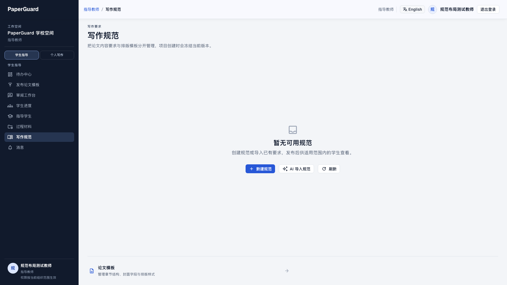
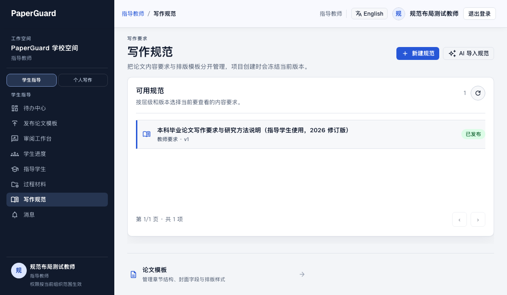

# 写作规范页面布局修复

2026-10-12。本轮本地验收：**PASS**，限本文覆盖的写作规范页面及回归流程。

## 问题与修复

用户截图中的详情已经移到弹窗，页面却仍沿用 `288px + 剩余空间` 的两列布局。浏览器在 1100×640 下复现：规范列表只占可用宽度的 **36.2%**，空卡片被拉高，右侧没有内容。

- 改为单列布局，列表使用整页可用宽度，详情继续通过弹窗查看和编辑。
- 无数据时显示居中的引导与操作入口，移除窄长卡片、重复的“可用规范”标题以及重复刷新入口。
- 教师及管理员可以直接创建规范或导入已有要求；学生提示联系指导教师或管理员，不展示管理操作。中英文提示同步更新。
- 区分加载中、加载失败和确实没有规范；失败时提供重试，已有列表刷新失败时保留原数据。
- 导入文件控件改为真正隐藏并补充名称，避免进入键盘焦点和读屏顺序。
- 修复后台刷新重新打开已关闭详情的情况，并防止旧规范响应覆盖刚开始填写的新草稿。普通列表刷新只更新数据。

教师的写作规范属于学生指导用途；先前教师个人文档模板与指导学生论文模板的用途分离保留。

## UI 验收

| 验收项 | 结果与证据 |
| --- | --- |
| 列表及空状态使用整页宽度 | PASS；浏览器断言至少使用 95% 可用宽度，修复前断言失败，修复后通过。 |
| 无重复标题、创建或刷新入口 | PASS；空状态只保留一组创建、导入和刷新操作，有数据时只有一处列表标题。 |
| 教师、管理员、学生提示及操作正确 | PASS；浏览器三角色及组件测试覆盖，学生只读详情不可编辑。 |
| 加载失败可以重试，已有数据不丢失 | PASS；浏览器失败恢复与组件状态回归。 |
| 多条规范分页可用 | PASS；隔离库中创建多条规范，管理员实际切页；窄屏仍可查看列表。 |
| 创建、发布及只读查看可用 | PASS；教师通过页面实际保存与发布，管理员发布学校规范，学生打开已发布详情。 |
| 弹窗关闭和草稿不受旧刷新影响 | PASS；修复前两个组件用例失败，修复后通过；浏览器检查发布后关闭和列表刷新不重开详情。 |
| 窗口尺寸和键盘操作 | PASS；1100×640、1600×900、916×804、775×804 以及移动浏览器 390×844。桌面页面无溢出、操作可达；详情焦点留在弹窗，Escape 关闭后返回入口。 |

自动无障碍扫描共 8 次，确认违规为 0。扫描器另有 1 项需人工判断：分页箭头与“上一页／下一页”的名称匹配。已复核箭头方向、控件名称与实际切页行为；本记录不据此作全站无障碍合规结论。原始扫描结果见 `accessibility/`。

## 本轮验证

| 验证 | 结果 |
| --- | --- |
| 后端完整测试：项目 venv 的 Python 3.12 执行 `-m pytest -q` | 1100 通过，2 条现有依赖弃用警告，退出码 0 |
| 前端完整测试：`npm run test` | 30 文件、125 项通过，退出码 0 |
| 类型检查：`npm run typecheck` | 退出码 0 |
| 构建：`npm run build` | 退出码 0 |
| 学院管理门禁：`npm run check:college-admin` | 相关 5 项通过，退出码 0 |
| 新增规范页浏览器回归：`e2e/policies-layout.spec.ts` | 桌面与移动共 8 通过、0 失败、0 跳过 |
| 原有完整三角色流程：`e2e/full-lifecycle.spec.ts` 中桌面完整流程 | 1 通过、0 失败、0 跳过 |
| `git diff --check` | 退出码 0 |

浏览器命令从 `frontend/` 使用仓库的 `npm run test:e2e`。测试使用独立端口、临时数据库及文件目录，未连接用户当前预览库。空响应和服务故障仅用于界面状态测试；创建、发布、分页及学生查看使用隔离服务的真实接口。完整三角色回归覆盖管理员管理、教师指导、学生写作及提交、审阅与归档等既有流程。

最初新增管理员用例使用了要求首次改密的引导账号，被正常重定向。随后沿用已有测试方式，通过真实注册及管理员角色授权创建独立活跃测试账号，未绕过认证或修改产品逻辑。自动扫描发现的隐藏导入控件问题以及截图发现的详情重开问题均已修复并重新验证。最终测试结果见 [checks.json](checks.json) 和 [browser-results.json](browser-results.json)。

## 修复后截图

空状态：

有规范时的列表：

其他尺寸、学生空状态及分页列表见 `screenshots/`；原窄列证据见 [修复前截图](screenshots/before-empty-1100.png)。截图来自隔离测试账号。

## 范围与证据身份

- 工作区：`/Users/a1234/.codex/worktrees/all-pages-one-screen-v3/paperguard`。
- 分支：`codex/all-pages-one-screen-20261011`；HEAD：`5971f506d889caa4bcaa26f751ddd66cf067460d`。
- 本轮仅修改规范页面、对应中英文文案及两个测试文件，共 4 个文件，见 [changed-files.json](changed-files.json)。开始保护 394 个既有源码／测试文件，结束记录包含新用例在内的 395 个文件，见 [source-before.json](source-before.json) 和 [source-after.json](source-after.json)。既有未提交修改保留。
- 未修改后端业务、权限或数据库迁移，未调用外部 AI 导入服务；本轮不验证外部 AI 提供商解析质量。
- 仅本地修复与测试；未提交、推送、合并或部署，未作线上、小程序真机或真实 UAT 结论。
