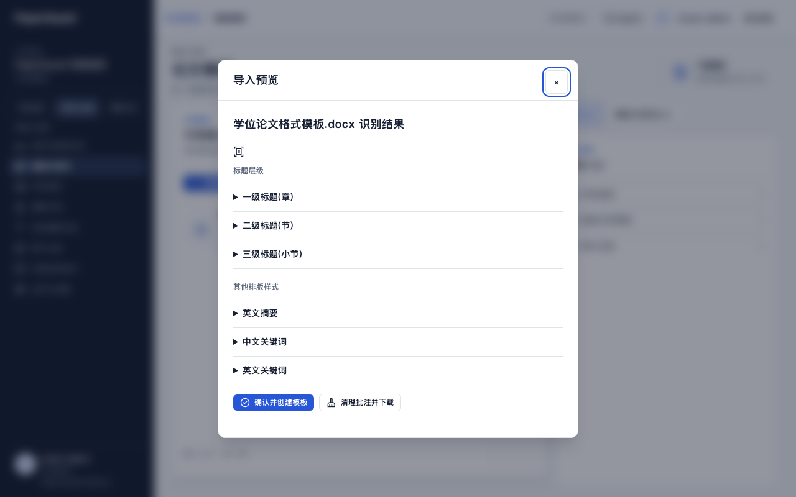

# 英文摘要与关键词的导入预览显示修复

2026-10-12。本轮本地验收：**PASS**。

## 原因与修复

截图中的折叠项来自“排版样式清单”。`Templates.vue` 的名称映射遗漏了英文摘要、中文关键词、英文关键词；未知键直接回退显示原名，因此出现 `english_abstract`、`keywords`、`english_keywords`。原列表也没有区分标题层级与其他样式，使这些条目看起来像识别出的章节标题。

导入接口会合并默认排版样式。样式清单不能当作章节树来判断：用此前的学校 Word 样例只读解析，`Abstract` 的章节类型是 `english_abstract`，关键词没有成为章节树节点。此次实际导入、创建模板后的接口检查也确认同一结果。

- 补齐三项名称，显示“英文摘要、中文关键词、英文关键词”；英文界面显示相应英文名称。
- 只有一级、二级、三级标题放入“标题层级”，摘要、关键词及其他格式放入“其他排版样式”。
- 保存仍使用原有样式键、格式参数与章节类型，不修改导出语义或识别算法。
- 强化后端测试：即使 Word 给中文关键词、Abstract 和 Key Words 套了 Heading 1，摘要仍为摘要，关键词仍不进入普通章节目录。
- 补齐组件和浏览器回归。原预览测试只有三个 heading 样式，未覆盖此次遗漏的三项。

## BUG-01：导入预览直接显示内部样式名并混淆标题层级

- **严重程度**：S2。
- **状态**：已验证关闭。
- **发现方式**：用户截图、代码定位与自动化复现。
- **复现步骤**：教师或管理员导入含英文摘要、关键词样式的 Word 模板，查看导入预览。
- **预期行为**：名称随界面语言显示，摘要和关键词与普通标题层级区分。
- **实际行为**：三项直接显示内部键，与标题样式混排。
- **证据**：[用户原截图](screenshots/before-labels.png)；新增的两个组件用例在修复前失败、修复后通过；[最终浏览器结果](browser-results.json)。
- **环境**：隔离的本地服务，Chromium 和移动浏览器项目；1280×800、900×600、390×844。
- **根因分析**：**Verified，E3**。`frontend/src/views/Templates.vue:183` 的名称映射缺项，`:343` 的回退将原始键显示为文字。原列表直接遍历完整样式表，没有分类。用户截图、修复前组件失败及修复后中英文浏览器结果互相印证。
- **影响范围**：功能面为 Word 模板导入预览；数据面在已验证样例中未发现章节类型错误，样式键保存正确；用户面为有模板管理权限的教师和管理员；安全面未发现该显示问题带来权限变化或数据暴露；修复波及面仅预览名称、展示分组和回归测试。
- **Severity 依据**：显示歧义影响模板审核体验，已验证样例的导入和存储可用，按体验问题定为 S2。
- **修复建议**：补齐名称映射，明确标题层级与其他格式的展示边界，保存逻辑保持原定义。
- **回归建议**：组件测试中的译名、分组及保存数据断言；浏览器中英文切换、三组尺寸、真实 Word 导入与保存；后端给特殊段落套 Heading 1 的语义优先级断言。以上均已执行通过。

## 验证结果

| 检查 | 结果 |
| --- | --- |
| 后端完整测试，项目 venv 的 Python 3.12 执行 `-m pytest -q` | 1100 通过，2 条现有依赖弃用警告，退出码 0 |
| 前端完整测试，`npm run test` | 30 文件、127 项通过，退出码 0 |
| `npm run typecheck` | 退出码 0 |
| `npm run build` | 退出码 0 |
| `npm run check:college-admin` | 相关 5 项通过，退出码 0 |
| `e2e/compact-previews.spec.ts` | 12 通过、0 失败、0 跳过；包含中英文样式名、分组、字段展开、原有短表单及章节预览 |
| 完整三角色浏览器流程 | 桌面完整流程 1 通过、0 失败、0 跳过，包含真实学校 Word 样例的导入预览、创建模板及存储类型检查 |
| `git diff --check` | 退出码 0 |

浏览器测试从 `frontend/` 使用 `npm run test:e2e` 执行。所有写入使用隔离测试服务、临时数据库和文件目录。预览尺寸用例采用明确的界面夹具；学校 Word 样例的实际导入和保存由完整三角色流程验证。[实际解析结果](real-template-result.json)、[门禁结果](checks.json) 与 [浏览器结果](browser-results.json) 不包含会话凭据。

修复后：

移动尺寸及其他窗口截图在 `screenshots/`。展示夹具只用于清晰呈现此次六个样式名称，不冒充真实学校 Word 的全部排版参数。

## 范围与身份

工作区：`/Users/a1234/.codex/worktrees/all-pages-one-screen-v3/paperguard`；分支：`codex/all-pages-one-screen-20261011`；HEAD：`5971f506d889caa4bcaa26f751ddd66cf067460d`。

本轮修改 6 个文件，见 [changed-files.json](changed-files.json)。[source-before.json](source-before.json) 与 [source-after.json](source-after.json) 记录 395 个既有源码／测试文件，保护此前未提交修改。未改后端业务、权限、数据库迁移或检查引擎公共接口，未改原 Word 文件或已存模板数据。

本次仅本地修复与验证，未提交、推送、合并或部署，未作线上或真实 UAT 结论。对具体用户当前文件的其他段落不作超出已验证样例的识别保证。
