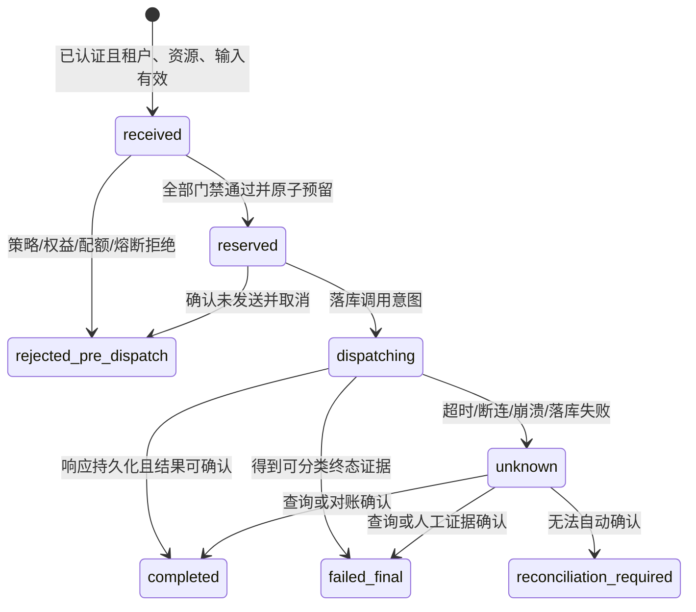

# W-08 请求·派发·结果事实、可信 usage 与用量看板 · 实施规格

> 版本：2026-10-01 · 阶段 C0 · 依赖 W-03、W-04、**W-07**（配置冻结）、**W-06**（配额/预留）
> 上游：总设计 §9.4（计量与账务对象）、§14（使用事实与 AI 请求状态机）、§23.1 W-08 行
> 下游：W-10（用量相关审计）、W-11（结算与对账）
> 状态：`design_ready` —— 规格已定稿可执行，**未实施、运行时零验证**

## 0. 本规格要解决什么

W-08 回答一个问题：**「这次 AI 调用到底发生了什么、花了多少、现在处于什么状态」**，
并且这个答案必须**在异常时刻依然为真**——包括超时、断连、进程崩溃、落库失败。

§24.2 归给它 **6 条 AT**（AT-19 后半、AT-20、AT-21、AT-22、AT-23、AT-24）。

**本包的设计哲学是「不确定即如实标记，不确定绝不自愈」。**
当前实现的根本问题不是「统计不准」，而是**它只有两个状态**
（成功/失败），而真实世界里至少需要区分**八种**——
其中最关键的三种当前**无法表达**。

### 0.1 现状取证（2026-10-01，代码只读）

| # | 事实 | 位置 | 意味着 |
|---|---|---|---|
| 1 | `ai_usage` 表**无 `tenant_id`**（只有 `user_id` + 可空 `organization_id`） | `db.py:192-204` | 与 ADR-02「租户列」方向不一致；W-04 tenant 化时**必须包含本表** |
| 2 | `ai_usage` 只记 `input_chars`/`output_chars`，**无 token 列** | `db.py:192-204` | 「字符造 token」被明确禁止（§14.4、AT-23） |
| 3 | `result` 字段**只有两个取值**：`"success"`（`ai.py:414`）与 `"upstream_error"`（`ai.py:408`） | `ai.py:404-415` | **派发前拒绝 / 已派发失败 / 结果未知 三者不可区分**，AT-21/AT-22 无判据载体 |
| 4 | `_metered_chat` 在**调用前**扣配额（`ai.py:387-388`），但**从不释放**——`refund_call`（`ai_governance.py:113`）**无生产调用方** | `refund_call` 唯一调用方是测试 `test_ai_governance.py:173` | 出站守卫拦下的请求不占额度（守卫先于配额），但**这个顺序是唯一保护**；一旦顺序调整，配额泄漏 |
| 5 | **无 AI 端点幂等**：全仓 `idempotency` 只出现在 workflow（`db.py:299`、`api/workflow.py:1489`），`api/ai.py` 零命中 | 全仓 grep | **AT-20 完全无实现基础** |
| 6 | `ai_usage_summary`（`db.py:906`）**只被测试调用**，无任何 API 端点或前端页面消费 | 全仓 grep（仅 `test_ai_governance.py`、`test_ai_breaker.py`） | **AT-24「用量聚合、明细和组织过滤」当前没有任何看板/接口** |
| 7 | 7 个真实派发点已统一收敛到 `_metered_chat`（`ai.py:357`），并有 HTTP 侧回归测试 | `test_ai_metering_coverage.py:11`（设计要点：HTTP 侧断言、逐点 action、四重过滤） | ✅ **这是本包唯一已做对的资产，必须保留**；新状态机不得绕过它 |

> **第 3 条是本包最核心的一条**：
> `result="upstream_error"` 把三件性质完全不同的事压成一种：
> ① 请求在**没发出去**之前被出站守卫/配额拒绝；② 已经**发出去了**、上游明确报错；
> ③ 已经发出去了、**响应丢失/超时**。
> ① 不该计费，② 可能计费，③ **一定可能计费且无法自动判定**——
> 三者用同一个值表达，意味着**任何基于 `ai_usage` 的对账都建立在错误的分类上**。

## 1. 请求事实：状态机（RQ）

§14.2 的状态机是本包的骨架：



### 1.1 新对象

§9.4 的 `ai_requests`（请求事实）+ `usage_events`（追加事件）替代单一 `ai_usage` 行。

| # | 规则 | 说明 |
|---|---|---|
| RQ-1 | 请求主键 `id`（服务端 `request_id`）与 `tenant_id` 必填 | `ai_requests` 是**跨租户**对象，必须有租户列（W-04 tenant 化） |
| RQ-2 | `state` 取值**严格取自** §14.2 状态机，**不得**发明别名 | 单一名词让看板与对账口径可对齐 |
| RQ-3 | **必须**记录 `credential_ref`/`credential_version`/`policy_version`/`price_version`（C0 price 为空） | §14.3 第 3 步：冻结版本，异步结算不得读「现在的学校默认」 |
| RQ-4 | `idempotency_key` + `payload_fingerprint` 唯一范围 = **租户 + 成员 + 操作 + 键** | §9.4；AT-20 |
| RQ-5 | 内容摘要**不记录正文**（存 fingerprint，非明文） | §9.4「内容摘要不记录正文」 |
| RQ-6 | 状态迁移用**乐观并发**（`UPDATE ... WHERE state = <expected>`），返回 0 行即迁移失败 | 与 W-09 `lease_epoch` CAS 同思路 |
| RQ-7 | 每个状态迁移**追加一条 `usage_events`**（`event_seq` 递增），`ai_requests` 只存当前状态 | 追加事实 + 当前态投影，便于重建 |
| RQ-13 | `rejected_pre_dispatch` **必须**同时记录**拒绝原因维度** `rejected_by` ∈ {`rate_limit`, `quota`, `entitlement`, `circuit`, `outbound_guard`, `authz`, `validation`}，**且 `state` 不得因原因不同而分裂成多个状态值** | 见下 |
| RQ-14 | `rejected_by` 为**正交维度**，**不得**与 `state` 相加或用它替代 `state` | 「派发前拒绝」是一个状态；被限流、被出站守卫拦下是**原因**。混淆两者会让看板重复计数（同 DB-3） |

### 1.2 「调用意图」是本状态机最关键的一格

§14.2 注释：「`dispatching` **不是『供应商已收到』的证明**。
写入调用意图后、真正发送前崩溃**也属于不确定窗口**，需要核查，
而不是自动重发或释放预留。」

| # | 规则 | 说明 |
|---|---|---|
| RQ-8 | `reserved → dispatching` 必须在**提交事务内原子完成**，且**只有转换成功的执行者**能调用上游 | §14.3 第 5 步；避免「A 转换、B 也发」的重复派发 |
| RQ-9 | **不得**在持有数据库锁的事务里等待上游响应 | §14.3 第 5 步原文 |
| RQ-10 | 崩溃在 `dispatching` 之后 ⇒ 进入 `unknown`，**不自动重发、不自动释放预留** | §14.3 第 8 步；AT-22 |

> **RQ-8 是「重复派发」的唯一防线。**
> 当前 `_metered_chat`（`ai.py:357-417`）里 `begin_call`（扣配额）与
> `_chat_completion`（真实派发）之间**没有任何状态记录**——
> 进程在这两步之间崩溃，事后**完全无法判断是否已派发**。
> 配额是否已扣、论文是否已发、上游是否已计费，**三个问题一个都答不了**。

### 1.3 为什么「拒绝原因」必须是独立维度（RQ-13/RQ-14 的由来）

`docs/tenancy/ai-metering-runbook.md` §7.3 原本为「尝试流水」设计了一张 `ai_attempt`，
其 `outcome` 枚举把拒绝拆成**四个不同的值**：

```text
denied_rate_limit | denied_quota | denied_circuit | denied_outbound
```

本规格初稿按 §14.2 状态机把派发前拒绝压成**单一状态** `rejected_pre_dispatch`，
**丢掉了这个原因维度**。后果是三个问题答不了：

| 问题 | 需要的维度 |
|---|---|
| 这个用户被限流了几次？ | `rejected_by = rate_limit` |
| 熔断打开期间影响了多少人？ | `rejected_by = circuit` |
| 出站守卫拦下了多少次外发尝试？ | `rejected_by = outbound_guard` |

**这三条正是 AT-21「风控尝试与消耗分开记录」的实质内容**，
也是 `ai-metering-runbook.md` §8 指出的核心风险：
「若不先做它，**熔断/限流造成的『用量归零』永远无法与『用户流失』区分**」。

> **保留 runbook 的贡献，而不是用状态机覆盖它。**
> RQ-13 的形态是「**状态不分裂、原因独立**」：
> 状态机回答「走到哪一步」，原因维度回答「为什么没走过去」。
> 若把原因塞进状态值，看板按状态求和时**同一批拒绝会被重复计进多个类别**——
> 那正是 DASH-3（独立维度不重复计总量）要防的错误。

**表名裁定**：`ai_attempt` 与本规格的 `ai_requests` **不是两张表**。
`ai_attempt` 是「被拒的尝试」子集，`ai_requests` 的
`received` / `rejected_pre_dispatch` 已完整覆盖它。
**合并为 `ai_requests` 一张表**（总设计 §9.4 命名为准），
`ai-metering-runbook.md` §7.3 的 DDL 已按此标注为被取代。

## 2. 幂等（IQ）—— AT-20

| # | 规则 | 说明 |
|---|---|---|
| IQ-1 | 客户端可提供 `idempotency_key`；**未提供则不启用幂等**（不强制） | 保持现有调用方兼容 |
| IQ-2 | **同键 + 同 fingerprint** ⇒ 返回已有请求的**状态/结果**，**不重复派发** | AT-20 前半 |
| IQ-3 | **同键 + 不同 fingerprint** ⇒ **409 冲突**，由重复请求继续派发前**必须先拒绝** | AT-20 后半；§14.3 第 2 步。**复用已登记的 `IDEMPOTENCY_KEY_REUSED`（error-codes.md §5.2），不另发明 `AI_IDEMPOTENCY_CONFLICT`** |
| IQ-4 | 幂等记录**跨请求生命周期保留**到超出重试窗口；不因请求完成即删除 | 否则重试会绕过幂等 |
| IQ-5 | 幂等唯一性由**数据库唯一约束**保证（对照 `workflow_idempotency` 的 `PRIMARY KEY(user_id, action, idem_key)`，`db.py:299-306`），不靠先查后写 | 复用仓库既有正确模式 |

> **IQ-3 的失败形态很具体**：若不判 fingerprint，用户（或重试的客户端）
> 用同一个键提交了**不同内容**，服务端会返回第一次的结果——
> 用户以为改成功了，实际拿到的是旧结果，且**无任何提示**。

## 3. 派发与 usage 适配（DS / US）

### 3.1 分开记录的维度

§14.1 明确要求区分的维度，全部要有独立表达：

| 维度 | 含义 | `usage_quality` |
|---|---|---|
| `attempted` | 有效身份发起的业务请求（含随后被门禁拒绝的） | — |
| `admitted` | 全部门禁通过且原子准入成功 | — |
| `dispatch_started` | 已记录调用意图，存在外部效果不确定窗口 | — |
| `dispatched` | 有**可靠派发证据**（不能仅凭扣过次数推断） | — |
| `completed` / `failed_final` / `unknown` | 终态三分类 | — |
| token 计量可信度 | — | `provider_reported` / `estimated` / `unavailable` / `legacy_chars` |

| # | 规则 | 说明 |
|---|---|---|
| US-1 | 协议适配**同时返回**正文结果、供应商请求标识与可信 usage；**不在转纯文本时丢弃 token** | §14.3 第 6 步；当前 `_chat_completion`（`ai.py:322`）只返回 `str`，**usage 结构性丢失** |
| US-2 | `input_tokens`/`output_tokens` **可空**；空**不得**写 0 冒充测量 | §9.4「unknown 与缺 token 不能写 0 冒充测量」 |
| US-3 | 上游未提供 token ⇒ `usage_quality = unavailable` | AT-23 |
| US-4 | 旧 `ai_usage` 记录一律标 `usage_quality = legacy_chars`；**不迁移为 token** | §14.4、AT-23「不造 token 或收费事实」 |
| US-5 | 字符数**仅作历史参考与风控**，任何报表不得由字符推算 token 或金额 | D-03「字符不做 token 依据」 |
| US-6 | 供应商返回 `usage` 但字段缺失/异常 ⇒ 降级为 `estimated` 或 `unavailable`，**不得**静默当 `provider_reported` | 防止上游格式变更污染可信度 |

> **US-1 是「可信 usage」的物理前提。**
> 当前协议层（`ai.py:322` `_chat_completion` → `_dispatch_completion`）的返回类型是
> `str`，token 在 HTTP 响应体里被解析成文本后**就消失了**——
> 不是没记录，是**根本没带到记账那一步**。
> 修 usage 适配必须**先**改协议层的返回契约，**后**谈记账。

### 3.2 「调用成功但无 token」进入计量待核对

§14.1：「『响应未知』与『计量缺失』是**两条维度**：调用成功但没有可信 token
也应进入**计量待核对**，而不是假设 0 token。」

| # | 规则 |
|---|---|
| US-7 | `state = completed` 且 `usage_quality ≠ provider_reported` ⇒ 进入**计量待核对**队列，不计入任何可计费口径 |
| US-8 | 计量待核对**不自动**降级为 0，也不自动按估算收费；处置由 C1 规则（W-11）定 |

## 4. 未知状态与对账（UQ）—— AT-22

| # | 规则 | 说明 |
|---|---|---|
| UQ-1 | 「已发出但响应丢失/超时/落库失败」⇒ `unknown`，**可见**（不隐藏在日志里） | AT-22「unknown 与未决预留可见」 |
| UQ-2 | `unknown` **不盲目重试**（§14.3 第 8 步），**不自动释放预留**（§9.4 `reservations`） | 防重复计费 |
| UQ-3 | `unknown` → `completed`/`failed_final` 的确认依据：供应商请求号 + 对账规则；或人工证据 | §14.2 |
| UQ-4 | `unknown` → `reconciliation_required`：无法自动确认时**保留**并进入对账清单 | §14.2；§9.4 `reconciliation_cases` |
| UQ-5 | 预留**不得因过期自动释放**（除非能确认未派发） | §9.4 `reservations`；与 W-06 QT-3 同一约束 |

## 5. 用量看板（DB）—— AT-24

### 5.1 现状：没有看板，只有测试里的一个 helper

§0.1 第 6 条已证：`ai_usage_summary`（`db.py:906`）**只被测试调用**，
无端点、无页面。AT-24「用量聚合、明细和组织过滤」**当前无任何用户可见载体**。

| # | 规则 | 说明 |
|---|---|---|
| DASH-1 | 租户用量查询**必须在聚合前限定租户**（SQL `WHERE tenant_id = ?`）；**禁止**复用全平台 `ai_usage_summary()` 再由前端过滤 | §14.4 原文；`db.py:906` 现有函数是全平台的，**不可直接暴露给租户** |
| DASH-2 | 只读看板**分维度**显示：尝试 / 准入 / 明确派发 / 拒绝 / 成功 / 已确认失败 / 未知 / 计量待核对 | §14.4；AT-21「风控尝试与消耗分开记录」 |
| DASH-3 | 同一「请求结果」维度内类别**互斥**，**可相加**；**派发数是另一维度，不得把所有维度相加成总调用数** | §14.4；AT-24「独立维度不重复计总量」 |
| DASH-4 | 聚合投影带 `watermark`/`as_of`/`definition_version`；延迟时**明确标注**；未刷新看板**不得**当已到账余额 | §14.4 |
| DASH-5 | BYOK 成本与平台成本**分开**；未取得成本数据时显示「**不可测**」，**不显示 0 元成本** | §14.4 |
| DASH-6 | 组织归属无法确认的历史用量显示「**未归属历史**」，**不塞给当前学校** | §14.4；与 `ai_usage.organization_id` 可空对应 |
| DASH-7 | 看板是**只读投影**，可由 `usage_events` **重建**；不得成为计费唯一依据 | §9.4 `usage_aggregates`「可重建投影，不是收费唯一依据」 |

> **DASH-1 与 DASH-3 是本节最容易被做错的两条，且都很难被现有测试发现。**
> DASH-1：全平台聚合后前端过滤，在多租户下**功能上"能用"**（数字看着对，因为过滤了），
> 但**明细行仍可能泄露他租户的存在与计数**——只有服务端过滤才安全。
> DASH-3：若把「尝试 + 准入 + 派发」相加当「总调用数」，
> 一次请求会被计 2～3 次，看板上表现为**用量虚高**——
> 而这恰恰是计费争议的起点。

## 6. 验收

| AC | 关联 AT | 判据 | 证据 |
|---|---|---|---|
| AC-08-1 | **AT-20** | 同幂等键并发/重复提交：前者**不重复调用上游**，后者 409；结果**可查询** | 本包 §2；并发幂等键压测 + 上游调用计数 |
| AC-08-2 | **AT-21** | 熔断/配额/出站拒绝：**没有上游派发**，且**风控尝试与消耗分开记录** | 本包 §1、§5；三类拒绝各一次，取 `usage_events` 分维度核对 |
| AC-08-3 | **AT-22** | HTTP 超时、响应后落库失败、进程死亡：进入 `unknown`，未决预留**可见**，**不盲目重发/不自动释放** | 本包 §4；**故障注入**（kill -9 / 超时模拟），非仅异常模拟 |
| AC-08-4 | **AT-23** | 上游成功但无 token：显示 `unavailable`/`legacy`，**不造 token、不造收费事实** | 本包 §3；`usage_quality` 断言 + 报表无 token 列 |
| AC-08-5 | **AT-24** | 用量聚合、明细、组织过滤：请求结果分区**可核对**，独立维度**不重复计总量** | 本包 §5；**服务端**限定租户的明细样本 + 维度求和不重复断言 |
| AC-08-6 | **AT-19**（后半） | 平台端点故障（5xx/超时）**按端点熔断**（与 W-07 CB-1 协同），BYOK 凭据故障不牵连 | W-07 §6 CB-1、CB-3；5xx 与 401 的熔断作用域对拍 |

**本包无法独立验证的部分**（不得混入「通过」）：

- 进程死亡/响应丢失类用例需要**故障注入**（kill -9、超时模拟），
  单元测试只能覆盖「模拟抛异常」，**不等于**真实崩溃窗口。
- 「不重复派发」需要真实并发的幂等键压测，SQLite 与 PG 语义不同。
- 多租户过滤（DASH-1）需要 `tenant_memberships` 与 `ai_requests.tenant_id` 落地。

## 7. 门禁

### 7.1 必须逐条承接 MR-FIX-1～MR-FIX-10

`docs/tenancy/ai-metering-runbook.md` §8.2 的十项落地动作**全部归属 W-08**。
**归属写了不等于承接了**——不逐条对照，实施时很容易漏掉其中几项，
而它们恰恰是 W-11 账务的硬前置（`quota-and-billing-review.md` §5.2）。

| MR-FIX | 动作（runbook §8.2） | 本规格对应 | 状态 |
|---|---|---|---|
| MR-FIX-1 | 两条协议路径解析并保存 `usage`；加 `input_tokens`/`output_tokens`/`usage_source` | **US-1/US-2/US-3** | 已定义 |
| MR-FIX-2 | 返回派发次数；加 `dispatch_count`/`fallback_used` | **§1.2 `dispatched` 维度**（`dispatch_count` 字段名见下） | 已定义 |
| MR-FIX-3 | `result` 扩展为 4 值，新增 `unknown`；熔断对 `unknown` 单独统计 | **RQ-2**（八态状态机） | 已定义 |
| MR-FIX-4 | 新增按 `organization_id` 过滤的用量端点 + 审计 | **DASH-1**（**聚合前**限定租户）+ W-10 审计 | 已定义 |
| MR-FIX-5 | **删除** `refund_call` 及其单测 | **§0.1 第 4 条** + W-06 **QT-9** | 已定义 |
| MR-FIX-6 | 建 `ai-provider-capability.md`，逐供应商登记 A/B/C/D 级 | **§3.1 US-3/US-4** 的分级依据；**文档本身待建** | ⚠️ **部分** |
| MR-FIX-7 | 执行 R-7 月度对账 | **§8 明确不做**——属 W-11 §5 | 已转交 |
| MR-FIX-8 | 建尝试记录表，在 `_metered_chat` 出口前写入 | **§1.1 `ai_requests`**（**表名分歧，见下**） | 已定义 |
| MR-FIX-9 | 用量端点支持按 `outcome`/`denied_by` 过滤 | **DASH-2** 的分维度筛选 | 已定义 |
| MR-FIX-10 | 熔断告警改看尝试表而非 `ai_usage` | **§6 AT-21** 的判据来源 | 已定义 |

> **表名分歧必须现在裁定，不能留到实施时**：
> runbook §8.2 的 MR-FIX-8 写 `ai_attempt`，
> 而总设计 §9.4 与本规格统一用 `ai_requests`。
> **总设计 §9.4 是权威**（runbook 是 27.3 文档包产出，是被总设计引用的支撑材料），
> 因此统一为 **`ai_requests`**。
> 不裁定的后果很具体：W-11 账务要按 `request_id` 关联使用事实与结算，
> 而 W-08 若建了 `ai_attempt`，**关联键就落在两张不同的表上**——
> 且两张表都"看起来对"，账务侧查不到任何 usage 记录时会以为「本期无消耗」。

### 7.2 静态与运行时判据的分工

| 判据 | 静态可查？ | 处置 |
|---|---|---|
| `ai_requests`/`usage_events` 是否登记 RLS 策略 | ✅ | `rls_policy_check` RL-1 自动覆盖（新增表自动纳入，INC-29 已补双向核对） |
| 7 个派发点是否仍统一走 `_metered_chat` | ✅ **部分** | `test_ai_metering_coverage.py` 已用 HTTP 侧逐点断言；**保留并扩展到新状态机** |
| 状态机迁移是否用了条件更新（防并发重复） | ❌ | 并发测试 |
| 幂等（IQ）唯一约束 | ⚠️ **DDL 可查** | 唯一约束本身可由 `ddl_static_check` 核对；**行为正确性不可静态查** |
| token 不得由字符推算 | ❌ | 运行时断言 |
| 看板口径（DASH-3 维度不重复相加） | ❌ | 运行时/接口测试 |

> **本包不新增静态门禁**，与 W-04/05/06/07/09/10 同一判断。
> 特别说明「幂等唯一约束」这一条：它**看起来**可以静态查（DDL 里有 `UNIQUE` 就行），
> 但**唯一约束只能保证「不重复插入」，不能保证「不重复派发上游」**——
> 真正的判据是 RQ-8 的状态转换原子性，属运行时。
> 写一个只查 `UNIQUE` 的门禁会给出**虚假的安全感**，比不写更糟。

## 8. 明确不做

| # | 不做 | 理由 |
|---|---|---|
| 1 | 任何 token→金额的换算、计费、结算 | D-03/D-07 未确认；属 W-11；本包只记录 `usage_quality` |
| 2 | 账务凭证、预留→余额的过账 | §15 属 W-11；本包只维护 `reservations` 计数（配合 W-06 QT） |
| 3 | 对账任务与差异修复 | §15.5 属 W-11；本包只保证 `unknown` 可见、可确认 |
| 4 | 字符数当 token 或当成本 | D-03 明文禁止 |
| 5 | 实时流式计费看板 | §14.4 只要求带 watermark 的只读投影 |

## 9. 交接

| 下游 | 依赖本包什么 |
|---|---|
| W-10 | `ai_requests`/`usage_events` 的**审计视角**（谁在何时对哪个租户发起了什么外发） |
| W-11 | 冻结的 `price_version`/`credential_version`/`policy_version`（RQ-3）+ `usage_quality`（US-3）作为结算输入；`reservations`（QT-3）作为未决预留 |
| W-06 | 配额/预算的 `reserved` 计数由本包的 `reservations` 驱动 |

**待裁决**：

- D-07「上游失败/超时/缺 usage 如何收费与对账」——
  **直接决定 `unknown` 与 `usage_quality≠provider_reported` 的最终处置**，
  未答复前这些状态**只记录、不产生任何资金效果**（这是安全的默认）。
- D-03「收费单位与价格、token 来源、舍入」——
  决定 US-1 协议适配要保留哪些 usage 字段的上游口径。
