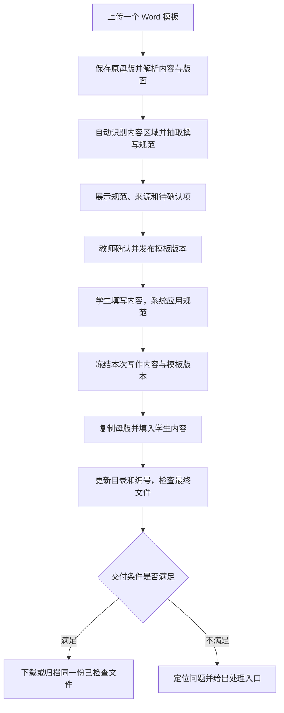

# Word 模板驱动的规范抽取与写作导出设计方案

日期：2026-10-23。状态：待评审设计，尚未按本方案完成功能开发。

适用项目：PaperGuard 单学校试点。适用流程：教师发布论文模板、学生写作、教师个人写作和通用文档。

## 1. 设计目标

用户上传一个普通 Word 模板，系统从中识别文档结构、文字格式、图表要求和页面设置，生成可阅读、可执行的撰写规范。学生根据规范写作，系统在导出时将学生内容填入原 Word 母版的对应区域，并检查最终文件。

用户不需要提前编写规则、插入程序占位符，或额外提交一份 PDF 规范。模板中的明确说明、实际格式和重复示例共同构成抽取依据。

论文模板按其实际章节识别；通用文档按自身结构识别。系统不向所有文档强制添加摘要、参考文献等论文专用区域。

系统为每个模板版本保存三项核心资产：

| 资产 | 作用 |
| --- | --- |
| 原 Word 母版 | 保存完整源文件及其版面结构，作为导出的基础 |
| 撰写规范 | 描述各类内容的要求，同时生成写作约束和检查规则 |
| 内容区域映射 | 说明封面、摘要、章节、图表等内容应填入母版的什么位置 |

三个资产绑定同一个不可变模板版本。修改任意一项，产生新版本。

本方案统一后续产品流程。此前的[导出技术设计](Word导出一致性技术设计_20261023.md)继续作为结构保留、摘要绑定和入口门禁的参考；其中需要人工提供锚点的准备流程，调整为系统自动识别区域、只对歧义项请求确认。

## 2. 完整业务流程



### 2.1 教师上传与发布

1. 教师上传普通 `.docx`，系统先保存模板草稿。
2. 系统自动完成结构识别、格式提取、规范归纳和填充区域定位。
3. 页面展示“原模板预览”“生成的撰写规范”“需要确认的问题”。点击规范可以查看来源位置。
4. 规则清晰的模板允许整体确认；教师只需处理相互冲突、用途不清或缺少依据的项目。
5. 系统用代表性内容试填，检查封面、正文、图表和分节，再发布冻结版本。

上传成功、解析成功、可发布分别显示。遇到复杂结构时仍可保存草稿，并明确指出具体待处理区域，避免只返回“无法创建”。

### 2.2 学生写作

学生选择已发布模板，系统生成章节结构和封面信息表单。正文、标题、图题、表题等自动应用对应样式。学生主要填写内容、插入图片和表格，不需要逐项设置字体、字号、行距。

写作页展示当前区域的要求，以及可以立即修正的问题。草稿允许保存未完成内容，正式导出前执行完整检查。

### 2.3 导出结果

导出使用该项目绑定的母版版本，保留页面设置、封面结构、分节策略、页眉页脚、固定图文和样式体系。学生内容替换示例内容，正文随长度自然分页。

“沿用基本版面”具体指这些结构和规则保持一致。学生写了更多内容后，页数、目录页码和后续内容位置可以变化；固定封面、图文关系及章节分页要求仍应满足规范。

## 3. 规范的来源与可信度

### 3.1 抽取事实与形成规则

系统先记录“模板中实际存在什么”，再判断“这一事实应该约束哪些内容”。两步分别保留结果。

| 证据类型 | 示例 | 处理方式 |
| --- | --- | --- |
| 明确文字要求 | “正文使用宋体小四，1.5 倍行距” | 解析适用对象、属性、数值和条件；与实际格式核对 |
| 一致的格式示例 | 多处正文均使用相同字体和段落样式 | 形成正文规则候选，保留样本及例外 |
| 单个对象的属性 | 某张图宽 8 cm | 先记录为该对象的事实，不能直接推广为所有图片宽度 |
| 文档结构 | 封面后分节，摘要使用另一套页码 | 形成母版结构约束和填充边界 |
| 无法从模板确定 | 模板没有参考文献数量要求 | 显示“模板未提供”，不补成学校规定 |

明确说明与实际格式不一致时，两份证据都展示。教师选择采用哪个要求后，系统生成相应试填结果；原文件仍保留。如果选择会改变母版的页面设置或固定布局，必须明确列出变更并确认。

### 3.2 每条规则保存的信息

| 信息 | 用途 |
| --- | --- |
| 适用范围 | 哪个章节、内容角色、语言、表格区域或图片类型 |
| 约束内容 | 属性、运算关系、数值、单位、条件和例外 |
| 来源定位 | 源文件摘要、部件、节点标识、样式继承链、相关文字 |
| 判断依据 | 明确要求、重复示例、单例观察、人工补充 |
| 可信状态 | 可直接采用、有依据的建议、冲突待确认、信息不足 |
| 使用方式 | 自动排版、实时检查、导出检查、人工核对 |
| 确认记录 | 采用或修改的人员、时间、原因及候选版本 |

可信状态必须说明依据，不能用一个没有校准过的百分比代替解释。文档中未出现的要求，教师可以补充；补充项明确标记为人工制定。

### 3.3 规则冲突处理

规则按适用范围组合，例如“正文中文”“正文英文”“表格表头”“代码段”。更具体的规则只覆盖对应区域。

同一范围出现相互矛盾的要求时，进入待确认清单。未使用的样式、示例里的强调文字和偶发异常格式，不直接升级为全文要求。教师确认一组正文规则后，系统一次应用到所有适用段落。

## 4. 需要识别和抽取的内容

| 类别 | 抽取内容 | 写作与导出用途 |
| --- | --- | --- |
| 文档结构 | 封面、摘要、目录、章节、参考文献、致谢、附录、声明及顺序 | 生成写作结构、固定内容和填充区域 |
| 文字 | 中文与西文字体、字号、加粗、斜体、上下标、颜色等 | 按内容角色应用格式，保留必要强调 |
| 段落 | 对齐、首行与悬挂缩进、段前段后、行距、分页控制 | 约束正文和特殊段落 |
| 标题 | 层级、编号格式、样式、章首页、与后文保持同页 | 自动编号，防止标题成为页尾孤行 |
| 页面 | 纸张、方向、页边距、装订线、分栏、分节类型 | 按母版的不同节保留布局 |
| 页眉页脚 | 内容、图片、横线、距离、首页和奇偶页差异、继承关系 | 保留逐节对应关系 |
| 页码与目录 | 页码格式及起始值、目录级别、引导符、域与样式 | 内容变化后更新目录和页码 |
| 表格 | 表宽类型、网格、列宽、行高规则、合并单元格、边框、内边距、表头、跨页策略 | 分别处理封面信息表与学生插入的数据表 |
| 图片 | 显示尺寸、比例、裁剪、旋转、环绕、锚定位置、清晰度信息 | 限制越界和失真，保留固定图形 |
| 图题与表题 | 字体、字号、间距、位置、编号规则、与图表的相邻关系 | 自动生成并检查图表题注 |
| 图内文字和图例 | 可编辑对象里的字体与布局；位图中的可识别内容 | 分别执行结构检查或人工核对 |
| 公式、代码、引文 | 可识别的样式、编号、对齐及专用段落要求 | 生成对应内容块及检查项 |
| 内容要求 | 模板明确写出的字数、关键词数量、必填信息等 | 写作提示和提交检查 |

“字号”和“字体大小”在规则中统一为同一属性，界面同时显示中文字号与磅值。字体名称按中文、西文及其他适用文字分别保存。

图片内部的文字如果已经成为像素，Word 不再提供其原始字体属性。系统可辅助识别并提示，但不能将估计结果标为精确字体证据。原生图表或文本框仍应读取其可编辑属性。

## 5. 自动抽取技术设计

### 5.1 保存母版与建立结构清单

保存源 DOCX 原件的受控副本和摘要，不改写用户原文件。解析文档包内的正文、样式、编号、主题、关系、页眉页脚、图片及其他关联部件。

为每个内容对象分配绑定源版本的稳定标识，保存所属节、父子关系、原始属性、有效格式和来源位置。所有对象都应有处理归属：固定保留、字段填充、可重复内容、示例内容、说明文字或待确认。

稳定定位采用“源摘要 + 部件 + 结构路径 + 节点指纹”。预览页码仅用于帮助教师定位，不能作为唯一选择器。解析过程限制文件大小和解压资源，不执行宏、嵌入代码或自动访问外部关系地址。

### 5.2 计算实际生效的格式

在已有提取器上补齐格式解析，计算每段、每个文字片段及各类对象实际采用的属性。

- 读取文档默认值、默认样式和样式继承链。
- 分别处理段落样式、字符样式、编号、表格样式及直接设置。
- 解析主题字体和适用语言，保留无法确定的依赖。
- 按属性处理覆盖和开关语义，不能仅用简单字典合并代表所有继承行为。
- 遍历实际文字片段；不能仅取第一个文字片段代表整个段落。
- 统一内部单位，同时保留原始值、原始单位和换算依据。

行距保存“倍数、固定值、最小值”等类型；缩进保存“字符单位、物理长度”等类型；表格宽度保存“自动、百分比、固定长度”等类型。不同类型不能只按裸数字比较。

空白封面字段没有现成文字格式时，结合字段所在单元格、相关样式和相邻同类字段推导候选格式，并生成试填预览。空白字段不能默认使用新建文字片段的默认字号。

### 5.3 识别内容角色与区域

综合标题层级、编号、章节名称、位置、样式、字段标签及重复结构，识别正文、摘要、标题、图题、表题、参考文献等角色。

区域映射记录：区域起止边界、允许的内容块、固定前后内容、所在分节、是否可重复，以及替换时允许修改的节点。

红色文字、括号提示和示例图片先作为候选说明或示例识别。删除依据必须是已确认的用途，不能仅凭颜色决定删除。正文为空也不能误删该段携带的分节属性。

### 5.4 从观察值生成规范

按内容角色、章节、语言和上下文分组，统计格式分布；将模板中的明确说明解析为约束候选。结合样式用途和重复证据，生成规则与例外。

例如，多张图片宽度不同但都位于正文区域内，可以建议“保持比例且不超出版心”。这是一条待采用的建议；模板未明确说明时，不能伪称抽取到了统一图片宽度要求。

有多种正常表格样式时保留多个表格类型，不把封面的单元格尺寸套用于所有正文表格。跨页表头、题注位置等要求分别建模。

### 5.5 编译为同源产物

经确认的结构化规范统一生成以下产物：

| 产物 | 消费方 |
| --- | --- |
| 人可读撰写规范 | 教师预览、学生帮助面板、规范 Markdown 导出 |
| 写作配置 | 章节树、字段表单、内容块类型、样式限制、即时提示 |
| 填充配置 | 母版区域、字段样式、内容块写入和图表编号规则 |
| 检查规则 | 内容、格式、结构及成品检查 |
| 结构保护清单 | 导出前后的固定部件、关系和允许变化范围 |

界面、渲染器和检查器都使用同一份结构化规范及其编译版本。人可读规范由确定的规则生成；语言润色不能改变规则含义。

语义模型可辅助识别角色和解释说明文字，但只产出带来源的候选结果。数字属性由文档解析确认；外部模型调用沿用项目配置和授权，不作为基础解析的必需依赖。文件内的说明只作为待分析数据，不作为系统操作指令执行。

## 6. 模板版本与数据模型

以下为建议新增或扩展的领域数据，不代表现有接口已经具备。

| 对象 | 关键内容 |
| --- | --- |
| `TemplateSource` | 源资产标识、摘要、文件类型、大小、受控存储位置 |
| `TemplateInventory` | 部件与对象清单、有效格式、依赖、定位信息和解析问题 |
| `WritingSpecification` | 语义区域、规范规则、依据、例外、确认记录和能力覆盖 |
| `LayoutMapping` | 固定区域、填充区域、字段、重复区域、分节边界、节点指纹 |
| `TemplateVersion` | 源、清单、规范、映射、保护清单、编译器版本及各自摘要 |
| `ProjectSnapshot` | 项目内容版本、引用资产、所用模板版本及内容摘要 |
| `ExportArtifact` | 成品摘要、输入快照、生成器和检查器版本、检查结果、环境信息 |

规则结构示意如下，数值仅用于解释模型，不是对用户模板的本轮抽取结论：

```json
{
  "id": "body-cn-font-size",
  "scope": {"role": "body", "script": "eastAsia"},
  "property": "font.size",
  "constraint": {"operator": "eq", "value": 12, "unit": "pt"},
  "evidence_kind": "observed_pattern",
  "source_node_ids": ["example-body-node-1", "example-body-node-2"],
  "decision": "pending",
  "enforcement": "suggestion",
  "capabilities": ["editor", "export", "output_check"]
}
```

发布时冻结所有摘要并完成编译检查。项目创建后绑定具体版本；教师上传新母版不会静默改变已在写作的论文。升级时展示规则差异和内容映射结果，经过确认后生成新项目快照，保留原版本用于历史提交和回溯。

可沿用现有候选、模板定义和规范存储能力的部分优先复用。新增持久化结构若需要迁移，实施阶段单独设计并获得迁移账本修改授权，本方案不预占迁移编号。

## 7. 写作约束设计

| 写作动作 | 系统行为 |
| --- | --- |
| 填写封面字段 | 使用该字段确认过的字体、字号和单元格布局；长内容提示或按确认策略换行 |
| 输入正文 | 自动使用该区域正文样式，允许规范许可的强调和上下标 |
| 新增标题 | 选择层级，系统应用样式和编号；限制非法层级跳转 |
| 粘贴内容 | 识别内容语义，规范化字体和段落格式；保留图片、公式、链接等允许内容 |
| 插入图片 | 按适用规则约束显示尺寸、比例、位置和题注，提示低清晰度 |
| 插入表格 | 采用相应表格类型，处理列宽、表头、题注与跨页要求 |
| 调整章节顺序 | 在模板允许的区域内移动，同时更新编号和引用 |
| 导出 | 检查必填内容、内容结构和已发布规则，再生成成品 |

写作页采用内容编辑与规范提示，按需提供服务端生成的版面预览。浏览器中的显示不作为 Word 实际分页的最终证据。

前端限制必须由后端再次验证。直接调用接口写入不允许的样式或错误结构，不能绕过约束。可以保存内容未完成的草稿，但应保留明确问题状态。

## 8. 基于母版的导出设计

### 8.1 填充过程

1. 冻结模板版本、写作内容和引用资产，校验摘要及访问权限。
2. 复制源母版，在临时工作目录生成候选文件。
3. 根据映射修改已授权区域，替换示例正文、填写字段、插入学生图表。
4. 应用已确认的语义样式，并维护编号、图片关系、书签和交叉引用。
5. 更新目录、页码等需要重新计算的域；完成后再执行成品检查。
6. 对通过检查的最终文件计算摘要并原子发布，下载和归档复用这个文件。

系统可在内部派生副本中加入稳定内容控件或标识；原母版保持不变，新增内容必须有可检查的变化记录。用户无需回到 Word 手工添加占位符。

### 8.2 结构保留规则

- 未修改的包部件优先直接复制；必须修改的部件只允许映射内的内容变化。
- 封面表格保持表格网格与布局，字段变化不能改变固定标签和单元格结构。
- 固定校徽、页眉横线、声明等按用途保留；确认过的模板说明和示例内容按策略移除。
- 按节处理首页、奇偶页和默认页眉页脚及其继承关系，避免只按部件数量判断。
- 保留页码格式、重新开始编号的位置、章节分页和不同方向页面等设置。
- 动态章节和重复块按映射复制必要结构；新增关系与编号标识必须唯一且有效。
- 不允许在母版填充失败后静默切换到空白文档重建，并继续标为母版导出成功。

新增图表超出允许区域时，按规则缩放、换行或分页。固定封面溢出时应指出字段和处理建议，不能悄悄缩小字体以获得一页效果。

### 8.3 目录和排版环境

目录域与页码需要具备相应能力的排版环境完成计算。仅设置“打开文件时更新”不能证明交付时的目录已经正确。

生成链记录排版引擎、版本和字体配置。可先在固定本地环境验证，再对 Word/WPS 做真实验收。缺失关键字体、目录未刷新或引擎不支持关键结构时，保留候选文件并显示具体问题，不发布为已验证成品。

格式刷新可能修改 DOCX，因此摘要和完整检查必须针对刷新后的最终文件。若用户在 Word 中重新保存文件，应重新检查这份新文件。

## 9. 成品检查与交付门禁

检查器重新打开实际输出文件，读取真实结构和格式。不能仅依据渲染器声称“已设置”的属性判断通过。

| 检查层 | 检查目标 |
| --- | --- |
| 文件与关系 | 包可打开，引用目标存在，图片、编号、书签等关系完整 |
| 内容完整性 | 学生内容无丢失、无重复，填入位置正确，无未清理的必删示例 |
| 格式符合性 | 各语义区域的有效字体、字号、段落和图表规则满足要求 |
| 母版结构 | 固定部件、封面、分节、页眉页脚及关系满足保护清单 |
| 排版效果 | 溢出、裁切、图题分离、标题孤行、目录与页码等符合已支持检查 |

静态部分可做逐部件或局部渲染对比；动态正文检查规则和关系。正文变化后，不要求整份输出与空模板逐页像素相同。

每条检查结果区分通过、失败、待核对和不适用。正式交付要求所有适用的必需项满足；人工验收项必须有绑定当前成品摘要的核对记录。建议项和模板未规定的事项单独展示，不伪装为必需项已通过。

“不适用”必须有内容范围和判断依据。引擎暂时不能检查的必需项保留为待核对，不能自动降级成建议项。人工核对结果也单独展示，不能计作自动检查覆盖。

将准入能力按“抽取得到、写作支持、能够生成、能够检查、可固定保留”分别报告。例如，复杂校徽不参与编辑且可完整保留，不应仅因其结构复杂阻止整个模板使用。

普通表格、多页眉、罗马页码和多分节是需要支持的正常模板结构。对这类结构的开发缺口应给出定位和修复路径，不能用一律拒绝发布代替功能完成。

同步导出、后台任务、提交附件、通用文档、教师个人写作、归档及实际下载统一执行门禁。`force`、旧文件缓存和直接下载地址都不能绕过。任何源文件、规范、内容或成品摘要不一致，都使对应检查结果失效。

## 10. 页面、接口与状态设计

### 10.1 页面调整

| 页面 | 主要内容 |
| --- | --- |
| 模板上传 | 上传 Word，展示解析进度，可恢复草稿 |
| 模板规范确认 | 原件预览、规范列表、来源高亮、冲突和信息不足清单 |
| 模板试填预览 | 普通内容与长内容试填，检查固定结构和填充位置 |
| 模板版本详情 | 已发布规范、能力范围、确认记录、版本差异 |
| 写作页 | 章节与字段、自动样式、当前规范、即时问题提示 |
| 导出结果 | 检查结论、问题位置、修复入口、通过后的下载入口 |

用户界面优先使用“正文要求”“图片要求”“需要确认”“导出检查”等表达。XML 路径、摘要和编译器版本放在管理详情或诊断信息中。

### 10.2 服务职责

复用当前模板解析、候选确认、发布和导出流程，扩展请求响应契约，避免建立另一套互不相通的模板系统。

建议增加候选规范读取、来源定位、确认决策提交、试填任务和规范下载能力。具体路由沿用现有 API 分组；实施时补齐类型定义、权限和契约测试。

候选编辑携带预期版本，服务器验证版本与归属后处理。客户端只能提交确认意见和允许修改的规则值，不能提交可信的“检查已通过”状态、源存储路径或身份授权。

### 10.3 状态流转

- 模板：草稿 → 解析中 → 待确认 → 可发布 → 已发布；失败保留原因和重试入口。
- 导出：排队 → 生成 → 排版刷新 → 检查 → 可下载；失败或待核对不会直接发布文件。
- 已发布版本保持不可变；修改从新草稿开始。

解析和生成任务需可重试。重试绑定同一输入快照并重新校验权限；任务重复执行不得产生重复发布、不同版本混用或文件覆盖。

## 11. 现有模块的复用与改造

以下判断来自本地源码阅读，反映当前工作区；不代表主线或部署状态。

| 现有模块 | 已有基础 | 本方案需要补齐 |
| --- | --- | --- |
| `backend/app/core/extract/extractor.py` | 样式、分节、段落、表格、编号、说明文字提取 | 从属性记录扩展到完整对象清单和证据；表格不能只读宽度 |
| `backend/app/core/extract/para_samples.py` | 段落样本、默认样式、部分继承解析 | 全文字片段、字符与表格样式、主题、空白字段等有效格式 |
| `backend/app/core/extract/to_pack.py` | 提取结果转换为规则包 | 保留语义范围和单位，避免把某段或某节属性套到全文 |
| `backend/app/services/template_engine.py` | 模板候选、字段、锚点与准入衔接 | 自动角色识别、规范归纳、区域映射和版本编译 |
| `backend/app/services/docx_anchors.py` | 源模板局部填充 | 自动生成定位、稳定单元格映射、动态内容与分节保护 |
| `backend/app/services/template_admission.py` | 准入报告基础 | 按对象和操作评估能力，区分可保留、可编辑及待确认 |
| `backend/app/services/docx_output_check.py` | 成品检查与摘要基础 | 独立语义复检、结构保护、图表与实际排版检查 |
| 模板、写作与通用文档前端 | 既有上传、编辑和导出界面 | 规范来源展示、一次确认、统一约束和可处理的问题提示 |

在现有职责目录中扩展服务，保留核心检查引擎公共接口，通过适配层生成其支持的规则。尚不支持的规则需显式记录能力，不能静默丢弃。

此前[真实模板引擎对比](Word模板生成路线对比_20261023.md)提供了局部填充实验依据。该实验尚未证明正式网站全流程可用，也未解决自动规范归纳。当前先补齐现有 Python 主线；新增其他引擎须针对明确失败场景验证后再决定。

## 12. 实施顺序与阶段验收

| 阶段 | 工作范围 | 阶段通过条件 |
| --- | --- | --- |
| P0：建立样本基准 | 分析用户模板，标注角色、固定区域、示例内容和实际规则 | 得到经核对的样本清单和预期规范，用作后续测试基准 |
| P1：自动生成规范 | 完善有效格式提取、角色识别、规则归纳、来源与冲突展示 | 只上传 Word 即能生成结构化规范和可读规范；无依据规则不被编造 |
| P2：规范约束写作 | 一次确认发布，绑定版本，生成字段和章节，应用写作约束 | 教师发布后，学生能按模板写作；接口和界面约束一致 |
| P3：母版填充导出 | 自动区域映射、空白字段格式、图表内容、分节与固定部件保护 | 当前真实模板完成正常及长内容导出，必留结构完整 |
| P4：统一成品检查 | 文件、内容、格式和结构检查；接入所有交付入口 | 正常样例可交付，篡改、漏项、失败与过期证据可拦截 |
| P5：完整验收与扩展 | ego-lite 业务回归、Word/WPS 验收、多种模板验证 | 一位导师和多名学生流程通过；证据绑定具体源码及文件版本 |

各阶段交付可演示的结果、测试证据和剩余问题。P1 生成规范不等于 P3 保留版面；P4 自动检查通过不替代 P5 的真实 Office 验收。

实现按纵向小切片推进：先让当前模板的封面、摘要和正文贯通，再扩展图表、参考文献等内容类型；完整交付仍以全部适用要求为准。

## 13. 验收样本与测试矩阵

### 13.1 首个真实模板

首个样本为用户提供的“毕业设计（论文）毕业论文（报告）-物联网工程-软硬件结合项目内容参考模板 - 1101.docx”。原文件摘要：

`2dc61a4635ff749d98ddfd70c2fdb8dd268cb07253d08a2d1f7c21b35eb10f76`

已有实验清单包含 1 张封面表、9 处分节属性、7 个页眉部件、2 个页脚部件和 6 个媒体文件。验收应进一步核对实际引用和用途，不能只核对数量。具体实验及其限制见[原型证据](../evidence/word-engine-comparison-20261023/README.md)。

用户提供的学校 PDF 可作为人工核对和测试参考。产品核心测试必须在不向抽取器提供 PDF 的情况下完成，避免把 PDF 中的信息当作从 Word 抽取出的结果。仅 PDF 中存在的要求单独标记。

### 13.2 必测场景

| 场景 | 预期结果 |
| --- | --- |
| 普通无占位符 Word | 自动得到规范与区域候选，教师无需手工编写规则包 |
| 同段落中英文、加粗和上下标混排 | 分别解析与应用，不取首个文字片段代表全文 |
| 样式继承、主题字体、直接格式混用 | 得到可追溯的有效格式；未解决项明确显示 |
| 不同段落、分节或表格类型使用不同格式 | 规则限定各自范围，不相互覆盖 |
| 模板说明与实际格式冲突 | 展示两份来源，经确认后生成一致的规则和试填结果 |
| 表格和图片尺寸多样 | 保留实例事实，不生成无依据的统一固定尺寸 |
| 空白姓名、学号字段 | 填入后使用确认的字段样式，解决默认字号偏小问题 |
| 罗马页码、多页眉、多分节 | 正常模板可用，引用与编号策略保持正确 |
| 正文很短、正常、很长，含宽表和大图 | 正确分页、缩放或提示，不丢文，不破坏固定区域 |
| 目录、题注和交叉引用变化 | 最终文件中编号、引用和目录与内容一致 |
| 多学生同时使用同一模板 | 各自内容、文件和任务隔离，共享母版摘要保持不变 |
| 教师发布新模板版本 | 已有项目仍使用原绑定版本，升级可预览与追溯 |
| 删除页脚、分节、图片或修改字体等负例 | 成品检查定位并拦截具体问题 |
| 直接调用接口、force、缓存、归档、直接下载 | 门禁与权限无法绕过，返回的文件绑定有效报告 |
| 模板、规则、内容或输出文件被替换 | 摘要不一致使旧证据失效，重新生成或检查 |

### 13.3 验证方式

单元测试验证格式解析、范围、单位、冲突和映射；服务与 API 测试验证版本、权限、并发任务、摘要和门禁。ego-lite 验证教师上传发布、学生写作、导出及错误处理的真实页面流程。

Word/WPS 验收打开实际成品，核对封面、长表跨页、图题位置、目录、页眉页脚、页码和分页。记录客户端版本、字体环境和被检查文件摘要；打开后若保存了新文件，保留其独立摘要及复检结果。

抽取质量使用 P0 标注样本评估：分别报告角色识别正确数、规则正确数、漏抽项、误抽项和待确认项。不能以“识别出多少条规则”单独代表质量。关键规则与母版保护项逐项验收，并加入未参与开发的新模板作为独立测试样本。

代码实施后按仓库门禁运行后端测试；前端执行当前 `package.json` 的测试、类型检查和构建。合入前执行绑定最新提交的 `release-preflight`。本设计文档交付只进行文档检查，不代表这些功能测试已执行。

## 14. 权限、兼容与失败处理

教师只能管理其授权范围内的模板，学生只能访问被分配或允许使用的版本。模板来源、项目内容和导出文件的读写均在服务端鉴权；后台任务开始及实际下载时再次校验。

模板库中的母版作为用户明确保存的模板资产留存；临时解析文件、试填文件按生命周期清理。普通上传检查仍沿用处理完清理的规则。教师停用模板不应直接删除被历史项目引用的版本。

旧模板和旧项目保留原版本身份。没有完整母版和规范证据的历史项目，不能因新功能上线就被标记为已验证。新模板按本方案发布；旧模板重新解析确认后生成新版本。

`.docx` 是本方案主要验收对象。现有 `.doc` 转换入口继续区分原件与转换后的 DOCX，增加转换差异检查，不承诺转换后与原件天然等价。

解析超时、缺少字体、排版失败、规则冲突等问题分别提供可重试或可确认的处理入口。不能通过放宽必需规则、覆盖失败状态或全面拒绝正常模板来制造完成结果。

## 15. 完成交付的判定

本需求完成时，应能演示以下全过程：教师只上传用户提供的 Word，系统自动生成带来源的撰写规范与区域映射；教师处理少量歧义项后发布；多个学生按规则写作；导出沿用同版本母版，检查后下载或归档；正常内容可以交付，错误内容和损坏版面被准确定位。

验收范围随样本库逐步扩大，并明确支持的对象与规则。对任意上传文档，系统都应给出解析结果或具体原因；对已发布模板，承诺绑定版本内已确认的规范和母版结构。单个示例文件无法表达的学校要求，应保留为缺失信息或人工补充项。

本轮交付物为设计方案。后续开发以评审确认后的范围推进，分别记录本地实现、测试、合入、部署和真实验收状态。
