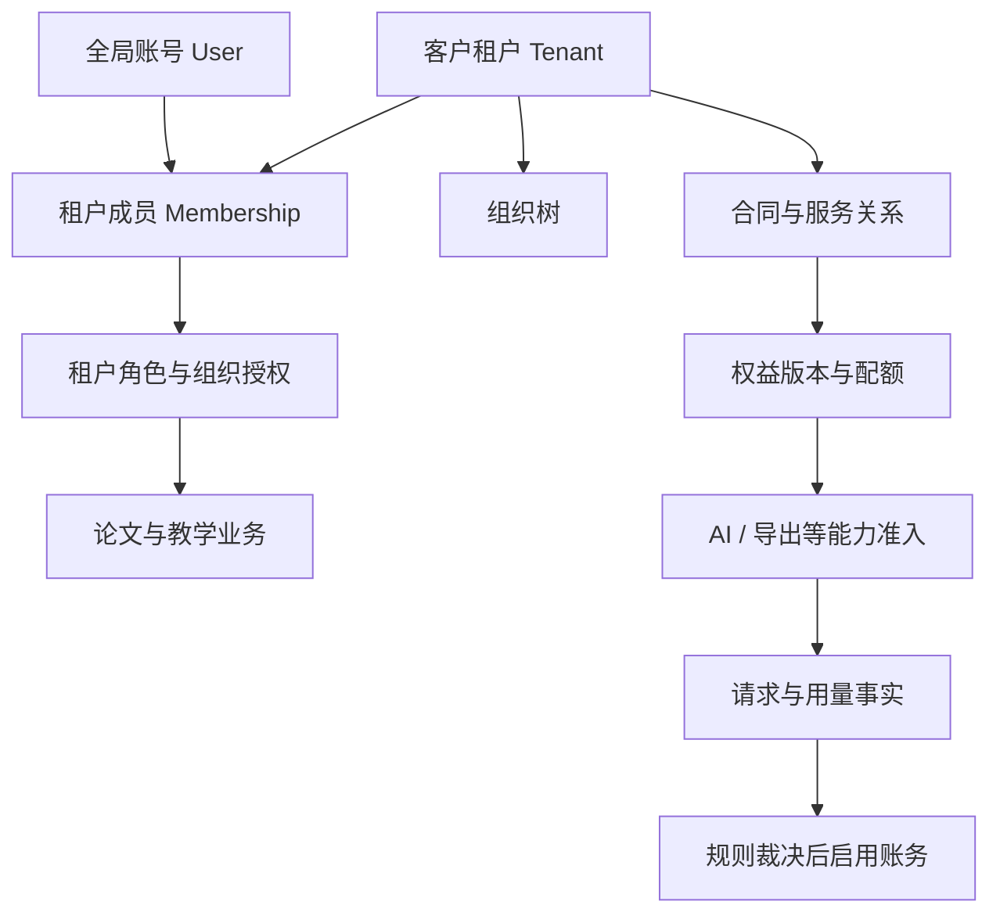
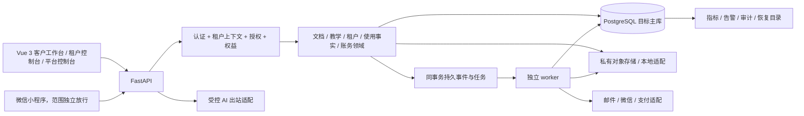
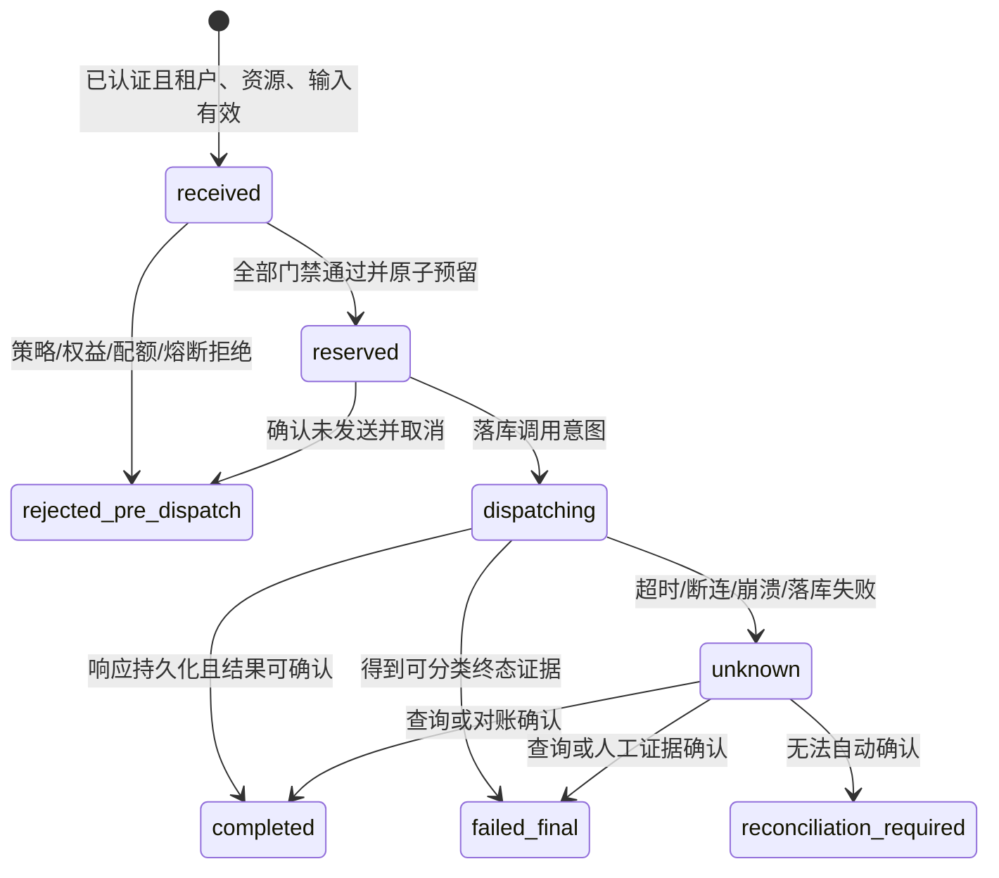

# PaperGuard SaaS 平台产品与技术设计

> 版本：v1.0 设计提案。日期：2026-10-01（Asia/Shanghai）。
> 目标读者：产品负责人、后端、前端、测试、运维、安全与客户交付人员。
> 文档性质：指导后续开发的目标设计，不是实现报告、正式报价、服务等级承诺或上线批准。
> 代码基线：`e166f97e0111528273e2dc722702481b3efa7f37`，分支 `fix/ui-review-findings-20260929`。
> 新增对象、字段、接口、页面、任务包和验收条件均为**建议设计，待评审采纳**，不得据此声称已经实现。

## 阅读导航

| 范围 | 章节 |
|---|---|
| [目标、现状与阶段](#section-01) | 1～5 |
| [角色、架构、隔离与数据模型](#section-06) | 6～10 |
| [客户启用、权益与 AI 治理](#section-11) | 11～14 |
| [账务、支付、页面与 API](#section-15) | 15～18 |
| [任务恢复、数据退出与运营](#section-19) | 19～21 |
| [迁移、发布与开发工作包](#section-22) | 22～23 |
| [验收、风险与决策](#section-24) | 24～26 |
| [来源与后续规格](#section-27) | 27 |

<a id="section-01"></a>

## 1. 目标、范围与使用方法

### 1.1 目标

把 PaperGuard 从具备论文业务闭环与 AI 治理能力的应用，演进为能够安全服务多个独立客户、可持续交付和运营、具备可追溯权益与商业能力的 SaaS（Software as a Service，软件即服务）平台。

目标不是重新开发写作系统，而是在现有业务引擎外围补齐六类平台能力：

1. 明确客户租户、组织、账号、成员身份与数据所有权。
2. 把租户隔离贯穿 API、数据库、文件、异步任务、配置、审计和恢复。
3. 独立管理权益、配额、机构预算与服务生命周期。
4. 记录可核对的 AI 使用事实，建立幂等账务和对账边界。
5. 提供客户自助管理、平台运营、支持、数据退出与交付工具。
6. 建立可重复验证的发布、监控、备份与异常恢复流程。

### 1.2 本版建议产品边界

- 先服务学校、学院等机构客户，机构通过租户成员使用现有学生、教师和教学管理能力。
- 建议首版采用“一份服务关系对应一个租户”；租户可包含一所学校及其内部组织。跨学校教育集团、多合同归属的映射必须另行评审，不自动推导。
- 保留个人邮箱注册，但“有个人账号”不等于“自动拥有收费租户、学校权限或平台 AI 额度”。个人商业租户作为后续扩展，不在机构试点中自动启用。
- 先做非付费试点运营 C0，再做权益与账务 C1，最后做支付与商业运营 C2。延续已有商业化阶段命名，不新增一套冲突的放行口径。
- 默认目标是共享多租户部署；需要独立实例的客户沿用相同领域模型，通过部署配置隔离，避免形成另一套业务代码。此交付模式是推荐方案，仍需 D-01 确认。
- 不重写模板、规范、文档编辑、提交快照、审核和 DOCX 引擎，不把微服务拆分当作 SaaS 成立的前提。

### 1.3 当前授权与非目标

本次只编写设计文档。没有实施业务功能、迁移数据库、变更生产角色、创建付费权益、接入真实收款、恢复生产数据、重试现网任务、合并 PR 或部署。

首版不包含模板交易市场、分销佣金、多币种自动兑换、复杂税务引擎、跨租户联合审阅、任意第三方插件执行、全自动机构认证。SSO（Single Sign-On，单点登录）和机构域名绑定保留扩展设计，不作为所有试点的默认依赖。

### 1.4 阅读与维护

- 产品评审：阅读第 2～7、11～18、24～26 节。
- 开发设计：阅读第 7～16、19～23 节，并从工作包领取任务。
- 测试与交付：阅读第 20～25 节，按功能、来源和环境分别收集证据。
- 价格、额度、期限、数据保留周期、容量、RPO/RTO 和 SLA 未给定数值，均需决策或测量，本文不代为承诺。
- 评审采纳后才能把建议规则转为实施要求；每次变更更新版本、决策状态、代码绑定和对应验收用例。

<a id="section-02"></a>

## 2. 当前事实与差距

### 2.1 已有能力

本节依据当前源码及仓库报告，不把历史测试结果视为本次重新执行的测试。

| 能力 | 已核对的基础 | SaaS 还需要补齐什么 |
|---|---|---|
| 业务闭环 | 模板与规范、结构化写作、导入检查、提交快照、教师审核、过程材料、消息、报表与归档 | 全资源租户归属、成员生命周期、机构交付和跨租户矩阵 |
| 账号与组织 | 用户、会话、邮箱验证、首次登录门禁、`admin/college_admin/teacher/student`、学校至批次的组织模型 | 平台身份与租户身份分离，同一账号的多租户成员身份 |
| 数据访问 | 组织可见性服务及受保护资源读取网关 | 强制租户上下文、统一查询边界、数据库防御层和负面测试 |
| 数据存储 | `Store` 直接使用 SQLite，多种业务对象以 JSON 保存 | 可查询的租户列、跨对象约束、共享部署数据库与迁移工具 |
| 文件 | 存储适配器、路径穿越保护、本地原子写入及对象存储适配基础 | 租户命名空间、私有下载、对象目录、租户退出与一致恢复 |
| AI 配置 | 个人优先、学校默认、平台默认与环境变量回退；配置只写密钥并返回脱敏值 | 显式外发策略、租户成员 BYOK、配置版本和失败关闭 |
| AI 治理 | 每用户次数配额、字符级用量记录、熔断、披露、管理员配置审计 | 请求/派发/结果分离、租户总量、可信 token 用量、机构预算和账务 |
| 后台处理 | 独立 worker、持久任务、消息事件、租约、失败重试 | 租户公平调度、长任务心跳、过期写保护、死信治理和可控恢复 |
| 交付 | CI、浏览器 E2E、Docker staging、发布身份校验与备份还原工具 | 共享 SaaS 迁移门禁、生产恢复演练、多副本证据和客户验收 |
| 商业化 | C0/C1/C2 范围和放行条件已定义 | 客户租户、权益、合同、账务、支付和客户运营尚需实施 |

### 2.2 当前证据边界

- 2026-10-01 读取 PR #34：仍为 OPEN，head 为上述代码基线，7 项检查均为 COMPLETED / SUCCESS。它不覆盖当前未提交修改或未来 SaaS 代码。
- 2026-09-30 的生产浏览器记录证明管理员配置同值保存、持久化和审计检索；不证明共享 SaaS、其他角色完整 UAT 或生产恢复已通过。
- 最近一次生产身份记录为 `1ca81d1-rc13-ai-saas`，对应源码 `1ca81d1c7b5e8b5dabb89f9152d92401187f6b77`。本次没有重新检查生产，不把该历史记录当作 10 月 1 日实时部署确认。
- 当前工作区另有账号认证、归档目录、任务退避、UI 与 E2E 等未提交修改，以及 10 月 1 日测试报告。本文保留这些工作，不提交或替其宣布远端 CI、生产部署和严格 UAT 完成。
- 10 月 1 日本地报告记载组件走查补做及部分功能回归，同时保留视觉基线失败。它们是待重新绑定的本地证据，不推翻生产未决项。

### 2.3 必须承接的未决项

| 编号 | 当前边界 | 在 SaaS 设计中的处理 |
|---|---|---|
| U-01 | 微信真机和真实 provider 尚未闭合 | 试点可明确排除微信；纳入范围时单独验收 |
| U-02 | 全角色及完整授权矩阵仍未闭合 | 纳入 C0 共享试点必需门禁 |
| U-05 | 合同租户和商业规则未裁决 | 第 26 节决策清单；不据此自动定价或收费 |
| U-06 | 生产管理员配置审计已有浏览器证据 | 保留已有结果，新增租户/账务审计另测 |
| U-07 | 恢复只有隔离环境证据 | 定义目标环境恢复流程，演练后才承诺指标 |
| U-08 | 已提交 head CI 通过，PR 尚未合并 | 未来每个 head 单独绑定审核和 CI |
| U-09 | 生产失败归档任务与排队记录未处置 | 先只读核对业务对象、任务和产物；重试另行授权 |

<a id="section-03"></a>

## 3. 核心术语与关系

| 术语 | 本文定义 | 不等同于 |
|---|---|---|
| 平台 | 运营 PaperGuard 服务的控制面 | 任意学校管理员 |
| 租户 Tenant | 客户数据、配置、权益、服务关系和支持的隔离边界 | 单个组织节点或账号 |
| 组织 Organization | 租户内部学校、学院、专业、课程、批次等结构 | 自动拥有合同或账务的主体 |
| 账号 User | 全局认证身份 | 在所有学校拥有相同角色 |
| 成员 Membership | 账号在特定租户中的身份、状态和授权集合 | 用户表上的一个全局 `role` |
| 角色 Role | 成员可以执行的业务操作类别 | 套餐或付费资格 |
| 能力 Capability | 服务端授权使用的具体操作，例如 `members.invite` | 前端是否显示按钮 |
| 权益 Entitlement | 服务关系允许使用的功能和数量 | 资源读取权限或余额 |
| 配额 Quota | 某周期内可消费的非货币资源数量 | 供应商成本或财务流水 |
| 预算 Budget | 某种额度/成本口径的上限与预留规则 | 精确已结算费用 |
| 使用事实 Usage | 请求是否接受、是否派发、结果与可信计量 | 直接扣费金额 |
| 账务 Ledger | 可追溯且不可随意覆盖的货币事实 | 字符数、次数计数器或 UI 展示余额 |
| 合同 Contract | 商业主体、期限、定价及履约约定 | 内部学校编号 |
| 服务关系 Subscription | 租户在有效期内适用的计划和权益版本 | 支付订单成功状态 |



同一账号可在 A 租户为教师，在 B 租户为学生。指导关系、教师认证、组织上下文和 BYOK 配置都属于成员范围，不能从 A 租户自动继承到 B 租户。

<a id="section-04"></a>

## 4. 目标设计不变量

评审采纳本设计后，下列规则应成为开发和验收基线。

1. 客户资源必须具有确定的 `tenant_id`；无归属历史数据不得猜测归属后直接开放。
2. 租户选择值来自请求，但授权证据来自服务器会话、成员和真实资源关系；客户端 Header、URL、邮箱域名都不能单独授予权限。
3. 查询、直接 ID、批量操作、文件、报表、后台任务、缓存和搜索使用同一租户边界。
4. 角色、组织授权、权益和账务分别判断。买套餐不能让学生变管理员，停 AI 不能取消论文读取权。
5. 平台运营身份不默认拥有客户正文读取权。代客支持使用审批、用途、期限和审计明确的授权。
6. 收费前记录使用事实，按冻结的规则结算；不把字符数当 token，不把熔断拒绝当已派发请求。
7. 未知上游结果不能自动当作失败退款、重新调用或重复扣费。
8. 幂等键相同且内容相同只产生一次业务效果；相同键不同内容必须冲突。
9. 外部调用不放在数据库长事务里；本地提交和事件入库同事务，外部效果通过可核对的状态处理。
10. 账务流水不可就地篡改；修正通过新流水关联原流水，不删除或覆盖历史。
11. 提交快照、规则版本、归档清单和使用价格版本按发生时冻结，不能用当前配置重建历史事实。
12. 密钥、正文、令牌、支付签名和原始回调不得进入通用日志或可见审计。
13. 租户退出需要完成导出、保留判断和授权流程；停用不等于物理删除。
14. 过期 worker 不得发布产物或更新任务终态；重放要收敛，不承诺所有外部系统都能“恰好一次”。
15. 本地验证、CI、部署、运行时、恢复演练和严格 UAT 分开标记；证据必须绑定源码、产物、环境和时间。

<a id="section-05"></a>

## 5. 阶段范围与放行门禁

### 5.1 阶段划分

| 阶段 | 目标 | 建议交付物 | 不能做什么 |
|---|---|---|---|
| G0 底座准备 | 解决现状歧义与可迁移性 | 源码/缺陷基线、租户归属清单、ADR、数据库适配方案、恢复方案 | 不能以 G0 通过宣称共享 SaaS 已可用 |
| C0 非付费试点 | 多机构可以安全试用与运营 | 租户、成员、隔离、只读用量、非货币配额、人工批准权益、支持与退出 | 不建立自动扣款或真实在线支付 |
| C1 权益与账务 | 商业规则可追溯地执行 | 合同、权益版本、可信计量、预留、结算、账务和对账 | 未经批准不得接真实收款或退款 |
| C2 支付与运营 | 完成商业闭环 | 渠道适配、订单、支付事件、续费、退款/冲正、账单、运营 | 不绕过收款主体、渠道、财务规则和生产授权 |

### 5.2 建议技术门禁

- G0：现有失败明确分类；未提交修复归属清晰；生产 U-09 有只读诊断及处置计划；租户迁移冲突可解释。
- C0：所有保护面通过跨租户矩阵；成员生命周期、密钥保护、机构权益、文件授权、worker 隔离和受控恢复通过；最新代码 CI 与浏览器链路通过。
- C1：D-02～D-07 中影响账务的决策完成；幂等、并发、未知结果、BYOK 与平台成本分离、账务不变量全部通过；使用可信计量，不把历史字符记录补成财务事实。
- C2：C1 通过；商户与渠道确定；测试环境回调、对账、退款完整通过；价格、文案、合同与必要专业审查完成；上线、真实收款和退款分别授权。

共享部署推荐在 C0 放行前完成 PostgreSQL 适配与隔离验证。SQLite 可继续服务现有独立实例和隔离开发，不通过“新增一个租户列”直接扩大为未验证的公共多租户服务。

<a id="section-06"></a>

## 6. 角色、能力与作用域

### 6.1 角色设计

保留现有学生、教师、学院管理员的教学语义，新增租户管理与平台运营身份。新身份不是直接扩展现有全局 `admin` 为所有学校管理者。

| 身份 | 核心能力 | 限制 |
|---|---|---|
| 平台运营管理员 | 创建/启用租户、管理计划、平台配置和交付状态 | 默认只看客户元数据和运营聚合，不看论文正文和个人密钥 |
| 平台安全/运维人员 | 基础设施、告警、备份恢复审批和发布 | 控制面权限不自动授予客户业务读写 |
| 租户所有者 | 服务关系确认、租户管理员任命、退出申请 | 不能控制其他租户；所有权转移需确认和审计 |
| 租户管理员 | 本租户组织、成员、模板治理、AI 政策、教学设置 | 未获财务能力时不能调账、退款或修改价格 |
| 租户账务管理员 | 本租户账单、预算、合同和付款管理 | 默认无学生正文和教学评审权限 |
| 学院管理员 | 已授权组织子树的教学治理 | 不扩张到整租户，也不能改全局平台配置 |
| 教师 | 指导关系内的要求、审阅、批注、教学工作 | 租户一致且指导关系有效，不因教师认证读取全校论文 |
| 学生 | 本人或明确协作授权的项目、提交、消息和导出 | 不读取其他学生或别校资源 |
| 支持人员 | 指定工单与临时授权范围内排障 | 有期限、有理由、可撤销，敏感操作另审批 |

### 6.2 建议能力矩阵

`范围内`表示仍需资源关系和组织授权；不是“拥有角色即可访问整个租户”。

| 操作 | 平台运营 | 租户所有者/管理员 | 账务管理员 | 学院管理员 | 教师 | 学生 |
|---|---|---|---|---|---|---|
| 新建客户租户 | 是 | 申请 | 否 | 否 | 否 | 否 |
| 邀请/移除租户成员 | 否，除受控支持 | 是 | 否 | 仅明确授权范围 | 指导成员兼容入口，需授权 | 否 |
| 修改租户 AI 外发策略 | 平台策略上限 | 本租户是 | 否 | 否 | 个人配置受租户政策约束 | 同左 |
| 查看机构使用聚合 | 脱敏运营聚合 | 是 | 是 | 范围内 | 本人/经授权指导范围 | 本人 |
| 查看正文与提交 | 默认否 | 依教学治理授权 | 默认否 | 范围内 | 指导关系内 | 本人 |
| 修改计划/价格版本 | 平台，C1/C2 | 选择/申请，不自行定价 | 申请 | 否 | 否 | 否 |
| 手工调账/退款 | 特定财务能力和审批 | 申请 | 申请/授权审批 | 否 | 否 | 否 |
| 下载机构审计 | 默认否，安全流程另授权 | 本租户且脱敏 | 账务事件范围 | 范围内 | 本人相关事件 | 本人相关事件 |
| 重试业务任务 | 受控运维授权 | 本租户、业务允许 | 否 | 范围内、业务允许 | 原有授权范围 | 本人可重试导出 |
| 恢复/删除租户数据 | 双重控制与正式流程 | 申请/确认 | 否 | 否 | 否 | 提交本人申请 |

### 6.3 授权判定

```text
认证有效
AND 账号未被全局安全禁用
AND 请求中的租户与有效成员或受控支持授权一致
AND 资源真实 tenant_id 与当前租户一致
AND 成员具备所需 capability
AND 组织/所有者/指导关系允许该操作
AND 资源状态允许该操作
AND（若消耗服务）权益与配额允许
```

跨租户直接 ID 访问统一返回不透露存在性的 404；对已可见资源缺少操作能力返回明确的 403。批量变更先验证所有目标，任何越界在第一笔写入前整体拒绝。合法导入的字段错误可以返回预检行报告，但不将跨租户目标当作普通可忽略行错误。

移除成员只撤销本租户访问；全局安全封禁另设高权限动作，不让 A 学校管理员封禁用户在 B 学校的身份。最后一位有效租户所有者不能被直接移除。

<a id="section-07"></a>

## 7. 总体架构与技术选型提案

### 7.1 建议架构

沿用 FastAPI + Vue 3，采用模块化单体。先统一授权、事务和存储边界，再根据真实容量拆分服务。



### 7.2 选型与代价

| 项目 | 建议 | 理由与约束 |
|---|---|---|
| 后端 | 保留 FastAPI 与 Pydantic，按领域拆服务 | 不改现有 DOCX 核心接口，避免同时重写业务和平台 |
| 前端 | 保留 Vue 3、路由、状态管理和现有组件 | 新增租户上下文与控制台；角色菜单必须与后端能力同步 |
| 共享主库 | 推荐 PostgreSQL，版本按部署兼容性锁定 | 支撑关系约束、事务和 RLS；引入运维、备份和适配成本，不是现有事实 |
| 访问方式 | 提取 Repository / Unit of Work（工作单元）接口 | 逐步从 `Store` 解耦，不直接给全部 SQL 做字符串替换 |
| 数据迁移 | 引入版本化迁移与校验清单 | 具体工具在 ADR 中锁定；不要继续把收费表 DDL 隐式放在启动过程 |
| 文件 | 复用存储端口；共享部署选私有对象存储 | 数据库对象目录为权限依据，前缀不能独自充当授权 |
| 任务 | 先复用持久任务和独立 worker | 加租户、心跳、栅栏、公平调度；没有证据前不切换任务系统 |
| 缓存/限流 | C0 可用数据库原子门禁；多副本后评估 Redis | Redis 不是余额、权益或账务的事实源；故障时不得绕过硬预算 |
| 密钥 | 采用受维护的标准认证加密库，版本化密钥引用 | 新格式需兼容迁移、轮换和恢复验收，不宣称现有自定义格式已满足商业标准 |
| 监控 | 请求关联、结构化日志、指标和追踪适配 | 产品日志不含正文；高基数租户指标需要受控聚合 |

### 7.3 数据面与控制面

- 数据面：论文、模板、组织、提交、任务、文件、消息、租户 AI 配置、用量和租户账务。
- 控制面：租户目录、交付状态、平台计划、平台供应商池、运营聚合、支持授权、发布和恢复批准。
- 控制面可以与数据面部署在同一应用，但使用独立路由、能力检查和数据库角色/查询入口。
- 平台跨租户统计返回聚合事实，不直接复用“列出所有用户/项目”的业务接口。
- 平台公开模板等资产独立标记为已发布公共资产；复制到租户后产生租户版本，保留来源引用。不能用 `tenant_id = NULL` 表示“任意人可读写”。

<a id="section-08"></a>

## 8. 租户上下文与强隔离

### 8.1 上下文解析

建议每次业务请求构造不可变 `RequestContext`：

```text
request_id（服务端生成）
trace_id（服务端受控关联）
user_id
tenant_id
membership_id
capabilities
organization_scope
auth_version
support_grant_id（如适用）
```

处理顺序：验证会话 → 验证账号门禁 → 查成员/支持授权 → 验证租户状态 → 构造上下文 → 进入服务层。没有上下文的客户资源调用不得回退到“全平台查询”。

- URL 中的租户 ID、切换器、Header 或已验证域名只提出目标租户；服务端重新确认成员关系。
- 建议 API 使用显式租户路径，避免依赖可被多个浏览器标签覆盖的“全局当前租户”。
- 返回当前成员、能力和策略版本；前端缓存键带 `tenant_id + membership_id`。切换租户时清空正文缓存、临时文件引用、订阅和请求结果。
- 同一账号开两个租户标签应互不改写上下文。异步任务从自身记录读取租户，不继承 worker 的上一次任务上下文。
- 成员权限变更递增 `auth_version`，旧权限缓存失效；短时缓存不延迟高风险撤权。

### 8.2 数据库防御层

建议同时使用两层保护：

1. 应用层所有客户 Repository 必须接收上下文并按 `tenant_id` 查询。
2. PostgreSQL 租户表启用 RLS（Row-Level Security，行级安全），应用角色不拥有绕过权；写策略同样限制 `tenant_id`。

PostgreSQL 的表所有者及 `BYPASSRLS` 等角色可能绕过普通 RLS，不能把“已建策略”当作已隔离。因此普通 API/worker 角色不使用超级用户或所有者；需验证的表采用适当的 `FORCE ROW LEVEL SECURITY`，维护入口单独控制。参见参考资料 R-01。

连接池使用**事务局部**租户设置，事务开始时注入、结束自动清除。验证空上下文拒绝、异常事务后清理、连接复用、worker 切换及迁移角色权限。SQL/迁移工具本身必须受控，RLS 不替代应用身份验证。

父子关系使用 `(tenant_id, parent_id)` 复合外键，或有同等强度的数据库约束。只有单列全局 ID 外键不足以防止 A 租户把自己的对象关联到 B 租户。

### 8.3 其他保护面

| 保护面 | 必需设计 |
|---|---|
| 文件 | 私有对象，目录记录绑定租户和资源；鉴权后生成短期下载授权或后端流式下载 |
| 预签名链接 | bearer 能力凭证，不包含密钥；期限可配置，下载页不写第三方分析；撤权高敏资源优先代理下载 |
| 缓存 | 租户和成员作用域进入键；公共缓存与客户缓存分开 |
| 搜索/报表 | 租户过滤进入可信查询，分页、总数、导出、聚合都不越界 |
| 后台任务 | 任务、事件、资源和收件人租户一致；解析资源后再次核对 |
| 邮件/微信 | 事件租户和有效成员匹配；站外内容最小化，不在通知里放正文或长期下载链接 |
| 审计 | 租户限定查询，平台安全聚合另入口；关联 ID 不泄漏其他租户资源 |
| 公共模板 | 发布版本单独命名空间；客户未发布模板永不变成公共资源 |
| 错误信息 | 不暴露跨租户名称、邮箱、余额、路径、供应商返回正文 |
| 支持访问 | 指定租户、工单、用途、能力、期限与审批；关闭后即时撤销 |

OWASP 的多租户安全指南将数据库之外的上下文、缓存、存储和资源消耗也视为隔离面；本设计据此设置完整矩阵，不只测试页面筛选。参见 R-02。

<a id="section-09"></a>

## 9. 目标数据模型

### 9.1 通用字段与约束

以下为逻辑模型提案，不是已经执行的 DDL。实施时分别输出数据库迁移、OpenAPI 和类型契约。

- 现有不透明字符串 ID 保留，不为统一格式重编号历史项目和归档。
- 客户业务表含非空 `tenant_id`；关键索引以租户和查询条件组合，例如 `(tenant_id, state, created_at)`。
- 平台表/公开资产表与租户表明确分开，不能靠空字符串租户承载多种语义。
- 时间以 UTC 保存，界面按用户时区展示；配额结算周期按合同/租户已冻结时区计算，不能中途改变当前周期。
- 可变聚合含 `version`，更新使用比较并交换；不可变快照和账务事实只追加。
- 邮箱、姓名、学号等在业务展示中最小化和脱敏；密文或秘密引用只在凭据专用存储中维护。
- 一份服务关系先限定一种币种；货币金额采用整数最小货币单位，禁止浮点。

### 9.2 租户与身份对象

| 对象 | 建议主要字段 | 关键约束 |
|---|---|---|
| `tenants` | id、kind、name、slug、status、timezone、policy_version、created_at、version | slug 唯一；停用不删除数据；kind 为机构优先 |
| `tenant_organizations` / 组织表扩展 | tenant_id、id、parent_id、type、code、status | 复合父子约束，无跨租户父节点和环 |
| `tenant_memberships` | id、tenant_id、user_id、status、auth_version、joined_at、left_at | `(tenant_id, user_id)` 唯一；身份生命周期独立于全局账号 |
| `membership_roles` | tenant_id、membership_id、role_code | 不保存为全局 `users.role` 的扩张值 |
| `membership_org_grants` | tenant_id、membership_id、organization_id、capability、include_descendants | 最小组织范围，跨租户外键拒绝 |
| `membership_certifications` | tenant_id、membership_id、kind、status、reviewer_id、reviewed_at | 教师资格审核只对当前租户生效 |
| `teacher_student_bindings` | tenant_id、teacher_membership_id、student_membership_id、scope、state | 双方同租户；迁移原 `teacher_id` 后保留历史关系 |
| `member_external_ids` | tenant_id、membership_id、namespace、external_id | 学号等在机构命名空间唯一，不拿同名账号自动合并 |
| `tenant_invitations` | id、tenant_id、email_ref、roles、scope、token_hash、expires_at、state | 单次使用、用途绑定；接受时再次校验配额与授权 |
| `platform_role_bindings` | user_id、platform_role、status、approved_by | 平台角色与租户角色分开，旧 admin 需显式映射 |
| `support_grants` | tenant_id、actor_id、ticket_id、capabilities、expires_at、approvers、revoked_at | 有限期、可撤销；审计访问开始/结束及动作 |
| `tenant_domains` / `identity_providers` | tenant_id、verified_domain、issuer、client_ref、state | 域名需验证；密钥只引用；SSO 另阶段启用 |

账号认证表仍承担全局登录职责。学校导入保留旧登录标识，新增机构外部 ID 解决跨机构学号冲突；不得未经确认修改已有用户名规则或按邮箱把未验证账号静默合并。

### 9.3 权益与运营对象

| 对象 | 建议主要字段 | 关键约束 |
|---|---|---|
| `plan_versions` | plan_code、version、state、features、quota_definition | 发布后不可覆盖，停售不修改历史服务关系 |
| `contracts` | tenant_id、customer_ref、status、starts_at、ends_at、currency、terms_version | 商业主体和条款须确认；C0 可仅有试点服务记录 |
| `subscriptions` | tenant_id、plan_version_id、status、period_start/end、cancel_at、version | 当前有效范围不得产生冲突的服务关系 |
| `entitlement_grants` | tenant_id、source_ref、feature、limit、effective_at、expires_at、version | 变更产生新版本与审计，不凭前端修改 |
| `quota_periods` | tenant_id、subject、metric、period_start/end、limit、used、reserved | 同周期原子准入；非货币计数 |
| `budget_policies` | tenant_id、scope、metric、hard_limit、currency、policy_version | 指明是次数、token 还是货币成本，不混用 |
| `tenant_settings` | tenant_id、key、schema_version、value、version | 不包含正文或明文秘密；显式继承规则 |
| `provider_credentials` | tenant_id、membership_id?、provider_ref、key_ref、key_version、state | 个人 BYOK 也绑定租户成员；平台凭据另作用域 |
| `support_tickets` / `exit_requests` | tenant_id、requester_id、reason_code、state、scope、approvals | 不直接驱动物理删除或无限代客访问 |

### 9.3/§9.4 对象的 DDL 承载现状（2026-10-01 补，INC-65）

> §9.2/§9.3/§9.4 共列 **29 个对象**（10 + 8 + 11）。
> **2026-10-02 实测（INC-80 修正）**：**20 个已有 `CREATE TABLE`**，
> **仍缺 9 个，且这 9 个全部是 C1/C2 账务支付表**——**C0 一张不缺**。
>
> ⚠ **上一版这里写的「23 个对象 / 12 个有 DDL / C1/C2 11 张」三个数字全错**：
> 「23」既不是 9.2+9.3（18）也不是三节之和（29）；「C1/C2 11 张」实际是 **9 张**；
> 而 `provider_credentials` 的出处「W-02 §3.3.1」也标错了——§3.3.1 实际只有 11 张 C0 表，
> **不含它**，它的 DDL 在 [`docs/tenancy/system-settings-scope-inventory.md` §5](../tenancy/system-settings-scope-inventory.md)，
> 且那一节标题写的是「**交 W-07**」，即它是**盘点素材，不是 W-07 的存储规格**。
> **这四个数字都不是「抄错」，是没有任何机制核对**——与 INC-73 同一族：
> §9.3/§9.4 这一节**没有埋任何事实标记**，DC-7 管不到它。
>
> 「行为规格已定稿、存储规格缺位」意味着：**RQ-2 说的「`state` 取值严格取自 §14.2 状态机」
> 在数据库层没有任何约束**——八态靠应用层自觉，而 §14.2 恰恰是靠状态机兜住
> 「结果未知」这类场景的。

| 阶段 | 对象 | 承载规格 | 依赖的未决项 |
|---|---|---|---|
| C0 | `ai_requests` / `usage_events` / `usage_aggregates` | W-08（**已补 DDL**） | D-03、D-07 |
| C0 | `plan_versions` / `subscriptions` / `entitlement_grants` / `quota_periods` / `budget_policies` | W-06（**已补 DDL**） | D-04、D-05 —— `quota_periods.limit_value` **刻意留空待裁** |
| C0 | `tenant_settings` | W-07 / W-13（**已补 DDL**） | — |
| C0 | `provider_credentials` | W-07（**已补 DDL**，2026-10-02 补齐） | — **原表漏登记它**：§9.3 把该表列为 C0 权益与运营对象，而它的 DDL 寄居在 `docs/tenancy/` 的盘点文档里（INC-82）。漏登记的直接后果是**读者以为这张表没有 DDL** ——而它存 BYOK 密钥引用，是全部 C0 表里隔离风险最高的一张 |
| C0 | `support_tickets` / `exit_requests` | W-10（**已补 DDL**） | SP-3 双人批准已落成 `approvers >= 2` 的 CHECK |
| C1 | `contracts` / `reservations` / `billing_accounts` / `journal_entries` / `journal_lines` / `price_versions` / `billing_statements` / `reconciliation_cases` | W-11 | D-02 / D-03 / D-07。**W-06 PV-7 已明写「C0 不创建 `billing_accounts`、不写 `journal_entries`」** |
| C2 | `payment_orders` / `refund_requests` / `payment_event_inbox` | W-12 | D-11（渠道未选定） |

**为什么逐对象列而不是写一句「缺 DDL」**：
C0 的 12 张表**挡在 C0 放行前面**（`synthetic_data` 已报 5 项数据缺口与此同源），
C1 的 8 张 + C2 的 3 张 = **11 张**账务支付表**本来就是分阶段延后的**（PV-7 明写）——
两者混成一句「缺 DDL」，读者会得出「设计没做完」，而真实情况是
**C0 缺口未补、C1/C2 缺口是有意延后**。

> **⚠ 本段刻意只写「C0 12 / C1+C2 11」，不复述分项（INC-84）**
> 首版写「C0 的 11 张 / C1/C2 的 11 张」，而**那时的阶段表也漏登记了
> `provider_credentials`**（INC-82 补 DDL 时只补了对象清单和 DDL，忘了这张表）。
> **两处数字是同一个漏登记的两个投影**——正因如此，
> 上方那张「阶段表」与本段必须一起改，只改一处就会再次自相矛盾。
> 逐项的权威口径见上表本身；本段只给总量。

### 9.4 计量与账务对象

| 对象 | 建议主要字段 | 关键约束 |
|---|---|---|
| `ai_requests` | tenant_id、id、membership_id、idempotency_key、payload_fingerprint、fingerprint_key_version、state、credential_ref、policy/price_version、timestamps | 幂等唯一范围为租户+成员+操作+键；内容摘要不记录正文 |
| `usage_events` | tenant_id、request_id、event_type、event_seq、dispatched、result、usage_quality、input/output_tokens?、chars? | 追加事实；同请求事件序号唯一；unknown 与缺 token 不能写 0 冒充测量 |
| `usage_aggregates` | tenant_id、period、metric、value、watermark、generation | 可重建投影，不是收费唯一依据 |
| `reservations` | tenant_id、request_id、kind、amount/quantity、currency/unit、state、expires_at、version | 同请求同类型唯一；未知外部结果不能凭过期自动释放 |
| `billing_accounts` | tenant_id、id、currency、status、posted_balance、held_amount、version | 币种一致；可用值来自已过账与有效预留 |
| `journal_entries` | tenant_id、id、business_ref、entry_type、currency、request_id、original_entry_id?、created_at | 业务唯一键；不可变，修正关联原凭证 |
| `journal_lines` | tenant_id、entry_id、account_id、signed_amount_minor | 一凭证同币种金额和为 0；账户在授权会计边界内 |
| `price_versions` | id、plan_version_id、unit、rational_price、rounding_policy、effective_at、state | 发布后不可改；账务引用发生时版本 |
| `billing_statements` | tenant_id、period、generation、entry_refs、total_minor、state | 可核对来源，不从当前计划反算历史 |
| `payment_orders` / `refund_requests` | tenant_id、merchant_ref、business_key、amount_minor、currency、state、version | 金额由服务端冻结；退款关联原订单与已确认金额 |
| `payment_event_inbox` | provider、merchant_ref、event_id、order_ref、verified、payload_ref、state | provider+商户+事件唯一；敏感原文仅受控保管 |
| `reconciliation_cases` | tenant_id、request/order_ref、kind、state、evidence_ref、resolution_ref | 记录未知与冲突，不静默修余额 |

双式账务的对手科目类型、收入确认和财务展示需由财务规则评审；技术层保证凭证守恒和可追溯，不代替专业会计制度。若最终采用固定机构许可而不是余额钱包，不必向客户暴露“充值余额”，但支付、应收和调整仍须有不可变账务事实。

### 9.5 业务资产与运行对象

已有项目、模板、规范、文档包、流程记录、审计、任务、事件、文件目录均需补齐租户元数据。新增 `storage_objects`、`job_attempts`、`backup_catalog` 和 `migration_batches`，分别保存对象归属、逐次执行、恢复依赖和迁移证明。

任务重试不能把历史尝试清零后丢失证据；允许当前任务计数有业务语义，但逐次记录、人工重试操作者、原任务及新尝试代数必须保留。

<a id="section-10"></a>

## 10. 现有资源的租户化清单

| 当前资源 | 建议归属方式 | 特别风险与处理 |
|---|---|---|
| `users`、`sessions` | 账号全局；访问由成员决定 | 不把全局角色、teacher_id 或组织上下文继续作为跨租户授权 |
| 组织树 | 根组织经人工确认映射租户，子树继承并持久化 | 多根、循环、断链、冲突进入迁移隔离清单 |
| 模板、规范、通用文档包 | 租户资产或显式发布的公共资产 | 旧“全部模板可见”查询要区分已发布资产和客户私有资产 |
| 项目与通用文档 | 创建时冻结租户，所有者引用成员 | 个人历史项目无机构归属不能自动分给当前学校 |
| 批次、参与人、任务、材料 | 从已确认业务根解析并写入租户列 | 指导关系、学生身份和批次必须同租户 |
| 提交、版本、审核、批注 | 继承项目/任务租户，历史快照不就地改写 | 新增侧边元数据，不破坏原快照和清单哈希 |
| 归档、导出、上传、图片、预览 | `storage_objects` 记录真实资源归属，对象迁移产生清单 | 硬编码附件路径和旧公开静态下载逐项关闭 |
| 消息、微信绑定、推送 | 身份绑定可全局，但业务消息和订阅引用租户成员 | 退出一个租户后不能继续收到其正文相关通知 |
| 审计与规则审计 | 客户事件写租户，平台事件写独立作用域 | 老事件缺关联标 legacy；不伪造 request_id 或操作者 |
| `jobs`、`workflow_events` | 创建事务内写租户和真实资源关系 | worker 不信任客户端 payload 的租户字段 |
| `ai_usage`、`ai_quota` | 老记录保留；新请求系统采用成员与租户口径 | 旧 organization_id 不能完整证明合同租户和实际 token |
| `system_settings`、用户 AI 配置 | 迁入明确平台/租户/成员作用域并版本化 | 空学校当前回退平台的行为在 SaaS 中改为明确政策 |
| 备份、报表与运维数据 | 运行环境、租户范围、代数和时间绑定 | 整库恢复不等于可以只恢复一个客户 |

实施前必须生成机器可读资源登记表：表/API/文件位置、真实所有权路径、敏感等级、读写入口、后台消费者、迁移规则和验证用例。未登记入口不放行共享 SaaS。

<a id="section-11"></a>

## 11. 客户启用与身份生命周期

### 11.1 机构启用流程

建议 C0 先采用人工批准的客户启用，避免开放注册直接消耗平台资源。

```text
客户申请
→ 明确负责人、组织范围、数据外发、试点期限和退出联系人
→ 平台批准创建 draft 租户
→ 邀请首位所有者并完成账号验证
→ 创建组织、选择已发布模板、配置成员准入
→ 确认权益、非货币配额和 AI 政策
→ readiness 检查通过
→ active 租户
```

启用检查包含：负责人有效、非空租户边界、至少一名所有者、邮件通道可用、密钥保护满足部署要求、组织/文件隔离通过、试点范围明确。默认不自动开通平台 AI，需有明确权益和预算。

### 11.2 成员邀请与学校导入

- 邮箱邀请令牌只保存哈希，绑定租户、用途、角色、组织和期限；接受时核对被验证账号与被邀请身份。
- 不自动把邮箱域名相同的人加入学校；域名验证只允许采用已批准的准入政策。
- 同一邀请重复接受幂等；过期、撤销、角色被撤回或租户停止准入时拒绝。
- 学校统一导入保留既有学号/初始凭证流程，预检查成员作用域、学号冲突和账号关联；不通过同名或未验证邮箱自动合并账号。
- 初始密码仅兼容既有受控发放，不在用户列表长期展示；新设计优先一次性激活链接，采用何种发放方式需确认。
- 已有全局账号加入第二租户不重复创建账号；仅创建新的成员关系和该租户的认证/指导关系。
- 邮箱未验证、初始密码未修改、首次引导未完成继续被后端阻断。邮件缺配置或失败返回真实错误，不降级为验证成功。

席位建议按已激活有效的人类成员统计，平台运维/系统身份不占客户席位；邀请预留、学生与教师是否分池等规则列入 D-04。若启用席位上限，邀请接受和批量激活在事务中原子校验，不能靠前端人数判断。

### 11.3 SSO 扩展

C0 只在客户明确要求时实施 OIDC 等机构登录适配。校验 issuer、audience、state/nonce、授权码流程及经过验证的机构身份映射。外部 subject 以租户+身份提供方+subject 绑定成员，不能仅凭 email 字段连接高权限账号。

SSO 权限变动与成员同步不直接删除历史论文；管理员锁定、成员退出、回收权限和数据移交分别处理。缺失验证条件时拒绝绑定，不走自动管理员授权。

### 11.4 离校、停用与移交

- 成员退出：立即撤销本租户访问，保留其业务历史，按机构规则移交尚未完成的指导关系。
- 教师停用：新增审核、审批和成员导入被阻断；已有审核结果不删除，待办转交有审计。
- 学生离校：只停止当前成员访问，保留提交与归档；个人账号在其他租户继续有效。
- 租户所有权转移：现所有者与接收者确认，新所有者完成验证后再撤销旧身份。
- 全局账号停用：由独立安全流程处理，影响全部会话；客户管理操作不能调用该能力。

<a id="section-12"></a>

## 12. 租户服务生命周期与权益

### 12.1 状态设计

租户的安全状态、商业服务状态和成员状态分别建模，不用一个 `status` 混合所有原因。

| 状态/维度 | 允许行为 | 禁止行为 |
|---|---|---|
| `draft` | 首位所有者设置与启用检查 | 正式教学发布、平台 AI 和收费 |
| `active` | 按角色、权益和预算正常使用 | 越权、跨租户调用 |
| `restricted`，商业限制 | 阅读本人/授权数据，申请续期和约定范围退出导出 | 新增受限制的 AI、席位或资源消费 |
| `suspended_security` | 仅明确批准的安全恢复/申诉入口 | 客户业务访问；不能为了“可导出”绕过安全封禁 |
| `closing` | 经确认的退出导出、账务核对和关闭流程 | 新的自动续费、新教学批次和普通消费 |
| `closed` | 保留必要服务/审计索引，受控处理保留义务 | 正常业务写入和自动恢复权益 |

`trialing/active/grace/expired/cancelled` 等商业关系状态保存在 subscription 中。试用时长、宽限期及逾期行为待 D-05 确认，不写死在学生角色逻辑中。

### 12.2 权益类型

| 权益 | 内容 | 建议消费口径 |
|---|---|---|
| 教学核心 | 项目、批次、提交和审核能力 | 按服务关系准入，不逐次扣货币 |
| 席位 | 学生、教师、管理员人数或分池上限 | 原子激活/释放席位，不按登录次数 |
| 平台 AI | 平台管理的供应商池和允许模型 | 独立次数/token/成本口径，按规则选择 |
| BYOK | 用户或机构自有供应商凭据使用 | 不计为平台供应商成本；服务费是否存在待确认 |
| 导出与渲染 | 日常 DOCX、预览、机构批量导出 | 功能、并发或配额；退出导出单独规则 |
| 存储 | 上传、图片、导出、归档等使用量 | 对象字节和预留量，软删除未物理释放前不伪报空余 |
| 管理治理 | 审计、报告、SSO、品牌等 | 功能开关与范围，不提高正文权限 |
| 支持 | 支持方式与处理流程 | 合同服务范围，不自动允诺响应时长 |

生效值来自计划版本、合同批准覆盖和限期赠予，必须有确定的合并规则。建议单一有效权益版本供调用引用，不能靠多行相加推导无限额度。

### 12.3 计划变更、到期和预算

- C0 允许平台人工批准非付费试点权益，记录原因、期限、批准人和版本；不生成虚假现金充值。
- 升级可从确认生效时增加容量，降级通常从下个已确认周期生效；具体规则待商业决策。
- 降级前检查实际用量和成员数；超出新上限时限制新增并提示整改，不删除多出的学生或文件。
- 到期默认保留授权数据读取和经约定的退出路径，不允许继续未授予的付费消耗。
- 用户、租户、平台供应商池三个维度都可设置资源准入；机构配额应在数据库内原子消费/预留。
- 配额重置依据已冻结周期边界；夏令时、时区变化和周期切换有测试，不用“最后一次按钮点击日期”划周期。
- 预算告警不等于硬预算。硬预算的可用值包括未决预留；未拿到实际供应商计量时不能宣称已精确限制费用。
- 当前每用户配额继续作为旧接口兼容和风控，不把其历史计数迁成金钱扣款。

<a id="section-13"></a>

## 13. AI 提供方、密钥和数据外发治理

### 13.1 配置解析规则

目标设计先判断租户政策，再判断配置来源。个人配置不是不受管理的最高优先级。

```text
租户禁止外发 → 不调用外部 AI
允许成员 BYOK 且存在有效本租户成员配置 → 使用该配置
否则存在有效租户默认 → 使用租户默认
否则允许平台回退且具备平台 AI 权益 → 使用平台供应商池
否则 → 明确返回 AI_NOT_CONFIGURED / AI_POLICY_DENIED
```

配置引用冻结 `credential_ref/version`、provider、模型、来源和数据外发策略版本。不在异步结算时读取“现在的学校默认”来解释历史请求。

- 当前按学校/平台/环境变量自动回退是历史兼容行为；共享 SaaS 中必须显式允许，未知租户不能自动借用平台配置。
- 个人 BYOK 绑定租户成员；在 A 校设置的密钥不自动给 B 校或其他成员使用。
- 租户可限制供应商、模型、接口协议、可发送内容类别及平台回退。
- 配置测试也会产生真实上游消耗，应经过相同出站限制、计量和预算；不得作为绕过额度的隐藏入口。
- Base URL 禁止私网、环回、云元数据和任意重定向绕过；防 DNS 重绑定，并采用外部网络出口控制配合应用校验。
- 供应商认证失败/额度不足按凭据作用域熔断，供应商公共故障按端点熔断；不能因一位 BYOK 用户密钥错误熔断全部租户。

### 13.2 凭据保护与迁移

当前 `secret_store.py` 存在无主密钥时明文兼容路径，以及版本前缀 `pgsec1`。目标商业部署不得依赖明文兼容，也不把自定义加密实现继续当作无需评审的标准方案。

建议方案：

1. 用受维护的 AEAD（Authenticated Encryption with Associated Data，带关联数据的认证加密）实现新密文格式；关联数据绑定租户、凭据 ID 和用途。
2. 保存算法、格式版本、`key_id`、nonce 和密文；使用正确随机来源，nonce 不在同一密钥下重复。AEAD 的 nonce 与认证约束参见 R-04。
3. 主密钥保存在受控运行环境或密钥管理服务，不在数据库、报告、Git、浏览器或对象清单中明文复制。
4. API Key 更新是只写字段，留空表示保留，清除是单独确认操作；读取最多返回“已配置”、来源和脱敏摘要。
5. 新商业写入缺密钥或密钥不可用时失败关闭；普通论文阅读仍可继续，不为了加密故障冻结全部教学业务。
6. 先验证旧数据可解密，再在受控迁移中重加密为新版本；不自动在线批量覆盖生产密钥，不在日志里打印旧值。
7. 轮换先部署同时支持旧/新版本的读取能力，再重加密，核对完成后才退役旧 key；保留经过批准的恢复密钥来源。
8. 错误密钥、密文篡改和丢失 key 返回明确不可用状态，不悄悄回退到另一供应商发送正文。

### 13.3 AI 披露与最小发送

界面在使用前说明实际供应商、配置来源、数据类别和当前租户政策。披露确认不等于法律合规结论；合同、隐私、数据驻留和必要专业审查按 D-08 处理。

请求默认只发用户选择的文本/必要上下文，不自动发送完整论文、全部附件或其他学生的批注。日志只记结果类别、延迟、可信计量与脱敏供应商标签。正文调试收集必须另行同意、限期、限范围、受控访问。

<a id="section-14"></a>

## 14. 使用事实与 AI 请求状态机

### 14.1 分开记录的维度

现有 `ai_usage` 可作历史治理参考，但不足以直接收费。新系统至少区分：

- `attempted`：有效身份发起的业务请求，包括后续被门禁拒绝的尝试。
- `admitted`：角色、权益、预算等门禁全部接受且原子准入成功；对应进入 reserved，不把仅收到请求算作准入。
- `dispatch_started`：已经记录调用意图，存在外部效果不确定窗口。
- `dispatched`：具有可靠派发证据；不能仅凭扣过次数推断。
- `completed/failed_final/unknown`：完成、已核对终态失败、结果未知。
- `usage_quality`：`provider_reported/estimated/unavailable/legacy_chars`。是否可收费由规则决定，不自动把估计量当账单证据。

“响应未知”与“计量缺失”是两条维度：调用成功但没有可信 token 也应进入计量待核对，而不是假设 0 token。

### 14.2 请求生命周期



这里 `dispatching` 不是“供应商已收到”的证明。写入调用意图后、真正发送前崩溃也属于不确定窗口，需要核查，而不是自动重发或释放预留。

### 14.3 原子准入与外部调用流程

1. 认证、租户和资源授权；生成服务端 request_id，解析客户端幂等键。
2. 以唯一约束登记 received 请求并校验受控内容指纹；已有相同请求返回状态/结果，键相同但内容不同返回 409，不由重复请求继续派发。
3. 解析并冻结权益、供应商、价格和配额周期版本；判定出站安全、熔断和输入限制。C0 的价格引用为空，仅计量而不形成收费事实。
4. 短事务内锁定相关配额/预算行，检查成员与租户总量，将 received 请求原子转为 reserved 并创建预留。任一步失败整体回滚，另记录未派发拒绝事实。
5. 派发前再次核对有效成员、auth_version 和当前安全/外发政策；价格与商业规则仍用原冻结版本。权限或外发被撤销且确认未发送时拒绝并释放。以版本比较原子转换 reserved → dispatching，提交调用意图和凭据引用；只有转换成功的执行者能调用上游，不在持锁事务里等待上游。
6. 执行受控调用。协议适配同时返回正文结果、供应商请求标识及可信 usage；不在转换成纯文本时丢弃 token 信息。
7. 短事务内落使用事实、结果引用和后续结算事件，提交成功后再向用户声明已记录完成。
8. 上游完成而本地落库失败，或响应丢失：标记/恢复为 unknown，凭供应商请求号与规则对账；不盲目重试。
9. 确认未发送的拒绝释放资源预留；已发送失败如何处理由冻结规则决定。风控尝试次数可保留，但与可计费消耗分开。

同时限制输入大小、模型最大输出和可预留资源，才可能设置有意义的上限。无法确定最大消耗的模式只能使用经批准的软预算/只读计量，不宣传硬费用封顶。

### 14.4 历史与统计口径

- 旧用量记录保留 `legacy_chars` 来源；组织归属无法确认时显示“未归属历史”，不塞给当前学校。
- 只读看板分别显示尝试、准入、明确派发、拒绝、成功、已确认失败、未知和计量待核对。
- 同一“请求结果”维度的类别互斥且可解释；派发数为另一维度，不能把所有维度相加成总调用数。
- 聚合投影带 `watermark/as_of/definition_version`，延迟时明确标注，不把未刷新看板当作已到账余额。
- BYOK 供应商成本与平台成本分开；未取得成本数据时显示“不可测”，不显示 0 元成本。
- 租户用量查询须聚合前限定租户，不能复用当前全平台 `ai_usage_summary()` 再由前端过滤。

<a id="section-15"></a>

## 15. C1 账务、幂等与对账

### 15.1 商业模式不提前写死

本设计支持机构固定许可、非货币额度和按量结算等配置方向，但首版具体收费模式必须裁决。

- 固定许可：按确认的服务期限授予权益；不要求每个 AI 请求都扣钱包。
- 非货币额度：计数或 token 权益，不对外宣称其为人民币余额。
- 余额/按量模式：只有在主体、价格、币种、失败规则和充值机制明确后才启用货币预留与结算。
- BYOK 是否收平台服务费与供应商账单分开裁决；不把用户供应商成本记成平台收入。

### 15.2 账务不变量

- 一笔 journal entry 关联唯一业务事实和唯一结算动作；同币种各行带符号整数金额合计为 0。
- 客户资金账户、预留和业务关联属于明确租户。平台汇总收入不通过客户接口直接读取其他客户账户。
- 钱包模式下 `available = posted_balance - active_holds`，余额、预留与新凭证在同一事务更新；没有授权透支政策时可用余额不得为负。
- 非货币额度用 quantity ledger/counter，单位明确，不向货币 journal 混入次数或 token。
- 金额只用最小货币单位整数。单 token 价格需要精确有理数或十进制定价，冻结进位/累计/舍入规则；不让浮点误差或逐 token 取整改变账单。
- 供应商成本可用带精度和币种的独立成本事实表达，不能直接抵扣客户余额，更不能自动跨币种转换。
- 已过账凭证不可删改；退款、冲正和人工调整生成新凭证，记录审批与原因，关联原凭证。
- 审计、账务、使用请求都必须能强关联，关键路径不允许空 request_id。不能复用当前“审计失败不阻止配置保存”的 best-effort 语义作为收费保证。

### 15.3 预留与结算算法提案

**预留事务：**

```text
锁定已唯一登记的 request；固定顺序锁定租户预算/配额、计费账户
→ 检查冻结规则、余额和最大可预留量
→ 原子准入 request + 创建唯一 reservation
→ 增加 held/reserved
→ 写关键审计/事件
→ 提交
```

**确认结算事务：**

```text
锁 request + reservation + account，验证版本和未结算状态
→ 读取已冻结价格与可信 usage
→ 构造唯一 journal_entry 与守恒 lines
→ 更新 posted_balance / quota_used
→ 结束相应 hold，写 settlement 状态与审计/事件
→ 提交
```

建议 PostgreSQL 以行锁或条件原子更新完成并发控制；固定锁顺序并处理冲突，重试数据库短事务而不是重发供应商调用。行锁语义参见 R-05。

- 结算失败保持待结算事实，可重放，不重新调用 AI。
- 实际结果超出预留时进入明确异常策略：阻断后续消费并对账，是否允许补扣须批准；不自动产生负余额。
- 预留到期回收只允许确认未派发的请求；dispatching/unknown 的预留按对账政策处理，不因定时器到点就退款。
- 若无法核对未知调用，创建人工处理案件并保持原始事实；赔付/免收政策以新的授权凭证表达，不伪造供应商“已失败”。

### 15.4 幂等规则

| 动作 | 建议业务唯一键 | 重复行为 |
|---|---|---|
| AI 业务请求 | tenant + membership + operation + client_key | 同内容返回已有请求，不重复供应商调用 |
| 预留 | request + reservation_kind | 只创建一次有效预留 |
| 用量事件 | request + event_seq/provider_event | 重复插入忽略已核对同内容；冲突进入异常 |
| 结算/释放 | request + settlement_type | 只影响一次余额/配额 |
| 手工调整 | approved_adjustment_id | 重复提交返回原凭证 |
| 支付确认 | provider + merchant + external_transaction | 只过账一次 |
| 退款/冲正 | approved_refund_id + original_entry | 重复不能突破可退总额 |

客户端 `Idempotency-Key` 与服务端 request_id 分开。内容指纹优先采用受控 HMAC，冻结指纹密钥版本并在重试时按该版本比较，避免轮换导致相同内容误报冲突；不在日志/接口暴露可枚举的正文摘要。幂等记录的保留期限按外部重放窗口与账务要求确认，财务事实不能因缓存到期重新执行。

### 15.5 对账任务

至少核对：请求与事件、事件与结算、预留与有效请求、钱包余额与过账流水、订单与渠道交易、退款总额与原支付。差异生成可见案件和告警，不在修复脚本里直接覆盖余额。

对账必须记录证据来源和可信程度。供应商不提供可查询请求号/可信计量的路径，不能承诺可自动按 token 收费；应采用已裁决的其他模式或排除该模型。

<a id="section-16"></a>

## 16. C2 支付、服务关系和退款

### 16.1 与渠道解耦

新增 `PaymentProvider` 适配接口：创建订单、查询交易、验证回调、申请退款、查询退款。具体渠道、商户、币种、地区与资质尚未选定；Stripe 文档仅用作回调幂等/乱序机制参考，不代表已选 Stripe。

### 16.2 支付流程

```text
服务端按已发布价格生成订单
→ 冻结租户、商户、币种、应付金额和服务关系目标
→ 使用业务幂等键请求渠道
→ 页面跳转/展示支付信息
→ 回调验签，持久化 inbox
→ worker/短事务核对订单与渠道状态
→ 唯一过账 + 权益版本生效 + outbox
→ 客户看见明确到账状态
```

页面显示“支付完成”不是账务证据；客户端不能直接激活套餐。回调按渠道协议校验签名、时间/重放、商户、订单、币种和金额，原始签名和凭据不得写通用日志。

渠道可能重复发送或乱序发送事件。处理应依赖本地幂等和渠道可确认事实，而不是收到顺序；相关机制可参考 R-03。先持久化已验证事件，再按协议返回应答，不在未持久化时假装已成功消费。

### 16.3 状态、超时与服务关系

- 支付订单：created → pending → succeeded / failed / closed；结果不确定时进入 unknown/reconciling，不能随意改成 failed 后重开重复订单。
- 关单与付款竞争需要查渠道最终状态，晚到成功事件仍要核对并按照规则处理。
- 支付、退款、服务关系、权益分别记录状态；付款成功不代表所有后续权益变更已经生效。
- 续费冻结下一周期与计划版本；取消自动续费不等于立即取消已付款期限。
- 合同人工开通、赠予、渠道支付是不同来源，每次有批准证据和版本。

### 16.4 退款与冲正

- 退款申请关联原支付，锁定可退余额，审批权限与教学管理权限分开。
- 渠道退款未知时不可反复生成新退款；先查询原申请并核对。
- 累计确认退款和有效预留退款不得超过原确认支付额。
- 确认退款后产生新账务凭证；权益回退按已裁决条款操作，不能删除学生论文或归档。
- 发票/收据、税务、合同与监管适用性由负责主体和专业人员确认，本设计不代为作合规结论。

<a id="section-17"></a>

## 17. 页面与交互设计

### 17.1 信息架构提案

下表路由为目标设计，不是当前已存在路由。现有教学路由继续保留，经过租户上下文改造后接入。

| 使用者 | 建议页面 | 内容与关键动作 |
|---|---|---|
| 所有人 | `/tenant-selector` | 展示本人有效成员身份，选择/切换租户，无权限租户不出现在列表 |
| 学生/教师 | 现有 `/workspace`、`/write/:id`、工作流 | 顶部显示当前机构、能力与服务限制，保持业务操作习惯 |
| 租户管理员 | `/tenant/overview` | 启用清单、待办、配额、异常和服务期限，不自动展示全部正文 |
| 租户管理员 | `/tenant/members`、`/tenant/organizations` | 邀请、导入、角色/组织授权、认证、停用与历史移交 |
| 管理员/账务人员 | `/tenant/usage` | 分来源/结果的用量、定义、延迟与未知请求；按能力决定用户明细可见性 |
| 租户管理员 | `/tenant/ai` | 外发策略、提供方、平台回退、BYOK 规则、只写密钥和审计 |
| 所有者/账务人员 | `/tenant/service`、`/tenant/billing` | 计划、期限、权益、预算、C1 账单、C2 支付/退款；未启用阶段不显示虚假余额 |
| 管理员 | `/tenant/audit`、`/tenant/data` | 审计查询、文件使用、退出导出、保留规则和申请流程 |
| 教师/学生 | `/account/ai`、个人用量 | 当前成员 BYOK、披露、本人配额和结果；不能查看机构密钥 |
| 平台运营 | `/platform/tenants`、`/platform/plans` | 客户状态、计划版本、交付清单和运营聚合 |
| 平台运维/支持 | `/platform/operations`、`/platform/support` | 任务异常、告警、支持批准、恢复申请，不默认展示客户正文 |

### 17.2 核心交互

1. **租户切换**：显示机构和本租户角色；存在未保存正文时先提示，确认后清空旧上下文缓存。不能把草稿带入新租户后保存。
2. **客户启用向导**：负责人 → 组织 → 模板 → 成员准入 → AI 政策/权益 → 检查清单；失败项明确责任和下一动作。
3. **权益受限**：显示受限能力、原因和处理入口；继续允许合法数据访问，避免把“未付费”显示为“无权限”。
4. **AI 消费**：使用前显示来源和计量口径；调用中有 request_id，网络断开后查状态，不自动再调用；unknown 显示“结果待核对”。
5. **用量看板**：明确计数定义、周期时区、来源、结果与刷新时间；无可信 token/成本时显示不可测，不用字符折算。
6. **管理员敏感操作**：重试、移除、密钥清除、所有权转移、财务调整和退出分别有目标摘要、理由和确认；不共享一个通用危险按钮。
7. **退出**：展示范围、待对账、保留限制和预计处理状态，先申请后审批；不提供一键无条件删除。

所有新页覆盖加载、空数据、无权限、版本冲突、依赖不可用和过期状态。错误有明确恢复动作，不出现“菜单可达但无操作路径”的死路。中英文、键盘操作、响应式和可访问性沿用现有前端规范；视觉基线按设计审查更新，不能单纯为了消除测试失败自动重录。

<a id="section-18"></a>

## 18. API 契约提案

### 18.1 路由与兼容策略

建议新平台 API 使用 `/api/saas/v1`；租户资源通过 `/api/saas/v1/tenants/{tenant_id}` 定位。保留现有 `/api/auth` 与教学接口，但要求它们进入同一个可信上下文和授权服务。

迁移中的旧教学 API 若无法唯一解析成员租户，返回 `TENANT_SELECTION_REQUIRED`，不能默认为全局或任选一校。旧客户端兼容期限和小程序升级安排列入 D-10。

平台管理入口为 `/api/saas/v1/platform/...`，只能由平台能力或受控后台角色进入；不会因现有 `admin` 字符串自动放行。

### 18.2 建议接口清单

| 方法与路径（省略 `/api/saas/v1`） | 行为 | 核心能力/约束 | 归属规格 · 规则 |
|---|---|---|---|
| `GET /me/memberships` | 本人租户身份列表 | 不列出其他客户目录 | W-03 · `CI-1 / DB-1` |
| `GET /tenants/{t}/context` | 当前能力、组织范围、权益摘要 | 有效成员，受限状态有明确信息 | W-03 · `CI-4 / DB-3` |
| `POST /platform/tenants` | 新建 draft 客户 | 平台能力、幂等、客户批准记录 | W-05 · `CL-1～CL-4` |
| `POST /platform/tenants/{t}/activate` | 启用客户 | version 与检查清单，不是直接改字符串状态 | W-05 · `CL-5～CL-8` |
| `GET/POST /tenants/{t}/invitations` | 列出/创建邀请 | `members.invite`，范围预检 | W-05 · `INV-1 / INV-3` |
| `POST /invitations/accept` | 已认证用户接受邀请 | 一次性令牌、身份匹配、席位原子准入 | W-05 · `INV-4 / INV-5` |
| `GET /tenants/{t}/members` | 成员分页 | 服务器作用域与最小字段集 | W-05 · `ORG-1` |
| `PATCH /tenants/{t}/members/{m}` | 状态/授权变更 | version、撤权、最后所有者保护 | W-03 · `AV-2 / AV-3` |
| `POST /tenants/{t}/member-imports/preview` | 导入预检 | 文件安全、账号冲突、授权范围 | W-05 · `IMP-1 / IMP-2 / IMP-6` |
| `POST /tenants/{t}/member-imports/{id}/confirm` | 按预检摘要确认 | hash/version/幂等、提交前再次检查 | W-05 · `CC-3 / CC-4` |
| `GET/PUT /tenants/{t}/ai-policy` | 读取/修改外发策略 | 版本与审计，平台上限不可越过 | W-07 · `TP-7～TP-9` |
| `PUT /tenants/{t}/provider-configs/{id}` | 只写配置与密钥 | 来源和作用域验证，不回传秘密 | W-07 · `SK-1～SK-4 / OB-2` |
| `POST /tenants/{t}/provider-configs/{id}/test` | 受控连接测试 | 同样计量、配额与出站保护 | W-07 · `TP-10` |
| `POST /tenants/{t}/ai/requests` | 发起 AI 请求 | resource auth + entitlement + Idempotency-Key | W-08 · `RQ-1 / RQ-4 / IQ-1` |
| `GET /tenants/{t}/ai/requests/{id}` | 获取状态和本人可见结果 | 撤权后重新授权，不只依赖创建时身份 | W-08 · `RQ-3` |
| `GET /tenants/{t}/usage` | 聚合用量 | `usage.read`，组织/本人范围求交集 | W-08 · `DASH-1 / DASH-7` |
| `GET /tenants/{t}/entitlements` | 生效权益摘要 | 不暴露内部价格/其他租户覆盖 | W-06 · `EP-1` |
| `POST /platform/tenants/{t}/entitlement-grants` | 批准权益版本 | 非付费/商业来源明确、幂等、审批与审计 | W-06 · `EP-6 / PV-8` |
| `GET /tenants/{t}/audit` | 本租户审计 | 动作/组织过滤受控，字段脱敏 | W-10 · `AU-1 / AU-3` |
| `GET /tenants/{t}/operations/jobs` | 可见业务任务 | 不显示主机秘密或其他租户状态 | W-09 · `FS-1` |
| `POST /tenants/{t}/jobs/{id}/retry` | 受控业务重试 | 真实资源/产物核对、version、原因、审计 | W-09 · `AR-1 / ID-4` |
| `POST /tenants/{t}/data-exports` | 退出/治理导出申请 | 范围/权限、幂等、私有产物 | W-10 · `EX-1 / EX-2` |
| `POST /tenants/{t}/exit-requests` | 创建退出申请 | 所有者能力、审批流程 | W-10 · `XR-1 / XR-2 / XR-3` |
| `GET /tenants/{t}/billing/statements` | C1 账单 | 账务能力，不含正文 | W-11 · `PR-6` |
| `POST /tenants/{t}/payment-orders` | C2 付款订单 | 服务端价格、业务幂等、已启用渠道 | W-12 · `PY-5 / PY-6` |
| `POST /payments/webhooks/{provider}` | 渠道回调 | 渠道认证而非用户租户输入，inbox 幂等 | W-12 · `PY-2 / CBK-1` |
| `POST /tenants/{t}/refund-requests` | C2 退款申请 | 原交易、审批、最大可退额锁定 | W-12 · `RF-1 / RF-3` |

> **归属列于 2026-10-01 新增（INC-59）**。此前这张表**没有任何一列指向工作包**，
> 而 13 份规格里**字面路径出现 0 次**——两条文档之间没有任何可核对的绑定。
> 结果是「客户启用」这个 §23.1 明确划给 W-05 的职责，**在规格里一条规则都没有**，
> 而 `POST /platform/tenants/{t}/activate` 连 DDL 都支持不了（`tenants.status` 不允许 `draft`）。
>
> 绑定由 `spec_rule_id_check` 的 **EP-2** 校验：归属包必须存在，
> 且引用的规则 ID **必须在该规格里真实定义**（只认表格首列即定义）。
> **本表已无 ⚠ 缺口（2026-10-02，INC-75）**。原先两条 ⚠ 的成因不同，现已分别补上规则：
>
> **① `member-imports/preview`** 原标 ⚠ 的理由是「W-05 §1 的两阶段契约只有散文与流程图，
> **没有规则级定义**」——**这不是绑定写错，是规格缺编号**。
> 已补 **W-05 §1.0 `IMP-1～IMP-6`**：预检不得写库、预检幂等、
> 有 `BLOCKED` 不得进入提交、提交输入必须与预检同一份、
> 预检必须检出无组织归属（INC-09 拦截点）、`CONFLICT_SKIP` 必须带出占用方组织。
> 现锚 `IMP-1 / IMP-2 / IMP-6`。
>
> **② `exit-requests`** 原绑 W-10 `EX-4`（「降级不删除数据」）是**我的绑定错误（INC-65）**，
> 改标 ⚠ 后**仍未解决**——因为 `EX-1～EX-4` 讲的全是「退出/降级/暂停**发生后**导出怎么办」，
> **没有一条讲「谁来申请退出、申请后走什么流程」**；
> §3 表格里「主动退出 → 走 §4 删除申请」，而 §4 的 `TD-1～TD-4` 讲的是
> 导出/删除的**覆盖范围与 tombstone**，同样不覆盖申请本身。
> 已补 **W-10 §3.1 `XR-1～XR-5`**：仅所有者可发起（管理员不得代客发起）、
> 同时只能有一个进行中申请、**申请 ≠ 立即删除**、
> 安全暂停阻断的是**导出与执行**而非**申请**、申请与删除都须强关联审计。
> 现锚 `XR-1 / XR-2 / XR-3`。
>
> **教训**：`EP-2` 只能证明「这条规则存在」，证明不了「它讲的是这件事」；
> 而当一个端点**根本找不到对应规则**时，把 ⚠ 换成「随便绑一条」或「一直标着缺口」
> **都是错的**——正确动作是**回头把规则补出来**。
> **规则编号不是形式，是可被机器追溯的最小单位**：
> **没有编号的东西既无法被引用，也无法被检查。**
> 这是判据能力的边界，必须写明而不是含糊过去。

### 18.3 通用约定

- 每个写接口声明 capability、状态前提、事务边界、幂等范围、版本字段和审计动作。
- 前端传入租户/组织只是目标过滤，必须与服务端授权范围求交集。
- 高风险写必须有 Idempotency-Key 和资源 version；同版本竞争返回 409，不最后写入覆盖。
- 分页使用稳定排序，游标绑定租户、过滤条件和版本；不能将 A 租户游标用于 B 租户。
- API 保持现有 `detail.code/message` 错误风格，增加 request_id 与 retryable 等明确字段；旧接口类型兼容另测。
- 429 限流、403 策略/权益禁止、409 并发/幂等冲突、503 依赖不可用要区分；404 不泄漏跨租户存在性。

目标错误示例：

```json
{
  "detail": {
    "code": "AI_RESULT_UNKNOWN",
    "message": "请求结果正在核对，请查询原请求，不要重复提交。",
    "request_id": "request-example",
    "retryable": false,
    "next_action": "poll_request"
  }
}
```

目标用量摘要示例，数值仅为合成契约示例，不是生产数据：

```json
{
  "tenant_id": "tenant-example",
  "period": {"timezone": "Asia/Shanghai", "start": "2026-10-01T00:00:00+08:00"},
  "definition_version": "usage-v1",
  "counts": {
    "attempted": 10,
    "rejected_pre_dispatch": 2,
    "pending": 0,
    "completed": 6,
    "failed_final": 1,
    "unknown": 1,
    "dispatched_confirmed": 7
  },
  "token_usage": {"quality": "unavailable", "input": null, "output": null},
  "cost": {"quality": "unavailable", "amount": null, "currency": null},
  "as_of": "2026-10-01T01:00:00Z"
}
```

示例中 `2 + 0 + 6 + 1 + 1 = 10` 是请求结果分区；7 次确认派发属于独立维度。未知请求未必有确认派发证据。

<a id="section-19"></a>

## 19. 后台任务、消息与异常恢复

### 19.1 统一任务契约

建议每个持久任务包括：tenant_id、业务 resource_ref、resource_version、job_type、payload_schema_version、状态、available_at、attempt_count、attempt_generation、lease_token、lease_epoch、lease_until、deadline 和脱敏错误分类。

- 创建业务状态、任务和 outbox 在同一短事务提交，不能业务已入队但任务丢失。
- worker 领取后先核对任务、资源、租户、配置版本及执行政策，再开始处理。
- 区分系统维持历史义务与成员发起的新消耗：归档已有正式提交可能属于机构保留责任，不因为提交人刚退出就丢弃；新导出仍须合法授权。
- `job_attempts` 逐次保留领取、心跳、阶段、失败原因、人工重试和最终产物引用。
- 目标支持 queued → running → succeeded/failed/cancelled；达到重试上限后进入人工可见失败区，不热循环。

### 19.2 租约、心跳与过期写保护

- 长任务周期续租，续租和终态更新要求匹配 lease_token/epoch 且仍有效。
- 旧 worker 过期后即使继续计算，也不得覆盖新 worker 的任务状态或发布文件。
- worker 把产物写入私有临时/版本化对象；验证摘要后，在匹配有效租约的事务里发布对象引用。
- 最终下载以数据库已发布引用为准，不以“固定目录里出现一个同名文件”为成功证据。
- 临时孤儿产物按受控策略回收，不能删除其他代数已发布产物。
- 消费语义按至少一次处理，业务效果靠唯一键、冻结快照和栅栏收敛。上游不支持幂等的外部发送仍可能未知，需承认并对账。

### 19.3 重试、死信与公平调度

| 失败类别 | 建议策略 |
|---|---|
| 网络/临时依赖不可用 | 有上限的指数退避和随机抖动，原业务唯一键不变 |
| 参数/规则无效 | 不自动重试，返回可修复错误 |
| 资源/租户关系不一致 | 失败关闭并告警，不猜测新的租户 |
| 凭据错误/策略禁止 | 等待配置修复和明确批准，不无限撞上游 |
| 本地结果已完成但状态未知 | 先验证真实产物/外部证据，不重新产生业务效果 |
| AI/支付外部结果未知 | 对账，不作为普通网络错误自动重发 |
| 达到上限 | 停放，提供脱敏证据、处理建议和受控重试入口 |

按租户限制活动任务、队列积压和资源消耗，避免一个客户的大批量导出耗尽所有 worker。优先级在平台政策内配置，不能由客户端任意提高；长期任务不饿死普通交互任务。具体并发和超时参数在容量验证后设置。

### 19.4 U-09 归档恢复工作流

本设计不授权重试 `archive-7cf822d514c1`。后续处理建议：

1. 只读绑定提交、归档记录、任务尝试、规则版本、实际产物和日志。
2. 校验产物 manifest/摘要以及业务已完成状态，判断是生成失败、产物损坏、记录缺失还是状态漂移。
3. 先修复根因并在相同合成条件回归；记录新的任务代码和数据根目录绑定。
4. 负责人确认业务归属、产物保留和恢复窗口，批准具体动作。
5. 使用正式命令/接口修复或重试，保留原尝试、操作者、原因与关联任务。
6. 浏览器复验实际下载、归档内容、任务/提交状态与审计一致；不能只以 jobs.state=succeeded 关闭问题。

### 19.5 通知与投影

- 用户可见消息、统计投影、微信推送和邮件分别具备幂等消费标识。
- 先持久站内消息事实，再进行外部通知；邮件失败不丢业务结果，外部推送不冒充已送达。
- 投影重建从持久事实开始，保存处理水位与代数；不通过重复消费增加权益或余额。
- 展示排队、处理中、等待外部证据和终态失败，提供下一动作，不统一显示“生成中”。

<a id="section-20"></a>

## 20. 数据治理、退出和恢复

### 20.1 数据分级与处理目的

| 类别 | 示例 | 设计要求 |
|---|---|---|
| 认证与秘密 | 密码哈希、会话、API Key、支付签名 | 专用存储、最小权限、不进入通用证据 |
| 客户业务内容 | 正文、附件、批注、提交、过程材料 | 租户+资源授权，明确外发与保留规则 |
| 客户身份 | 邮箱、学号、姓名、机构标识 | 必需字段、脱敏展示、限制导出 |
| 业务证明 | 提交快照、审核、归档 manifest | 不可变事实与完整性校验 |
| 运行和安全 | 任务错误、指标、审计 | 脱敏和用途限制，访问与保留有规则 |
| 账务和合同 | 支付、凭证、账单、批准记录 | 独立访问与适用保留规则，不随账号退出任意删除 |

每类数据的期限、驻留地点、处理者和退出方式列入 D-08。没有批准的保留政策不实施批量物理删除，不承诺“上传仅处理期间存在”覆盖所有项目、归档和历史附件。

### 20.2 文件与对象目录

对象建议使用 `tenants/{tenant_id}/{kind}/{opaque_id}/{generation}` 作为内部 key，避免姓名/学号进入路径。数据库目录保存租户、所有者资源、状态、版本、字节数、checksum 和保留标志。

- 上传前验证资源作用域、大小、类型与配额，创建容量预留；对象上传后校验并原子发布目录引用。
- 部分上传/失败产物标为未发布，不计为可见业务成功，但在清理前仍占实际存储。
- 浏览器不传入任意磁盘路径或 bucket key 请求下载；只传逻辑对象 ID。
- 删除先写 tombstone，后按批准策略清理对象；备份恢复需要应用 tombstone，避免已删除内容复活。
- 私有临时文件、预览和归档采用相同授权，不允许静态目录成为旁路。

### 20.3 租户退出流程

```text
所有者提出退出申请
→ 核对身份、范围、未结算请求和合同规则
→ 停止新消费/自动续费，保留合法读取与申请处理
→ 生成受控导出（内容、配置、规则、快照与 manifest）
→ 客户确认下载/交接
→ 执行经批准的保留/去标识/删除计划
→ 更新状态与审计，不销毁必须保留的证明
```

导出只包含当前租户和批准范围，附格式版本、清单、哈希、加密/下载方式和来源时间。支持人员不能借“帮忙导出”取得其他客户正文。

### 20.4 备份与灾难恢复

恢复目录至少记录：源环境、数据代数、数据库快照/恢复点、对象版本清单、源码/产物版本、schema 版本、密钥版本引用、包含范围、完整性摘要、演练结果和批准人。密钥实际值不能装入普通 manifest。

- 数据库和文件必须同一可解释代数；任务、预留、使用事件和账务也在恢复校验范围内。
- 整个平台恢复：在独立目标中恢复数据库、对象与正确代码/密钥，验证后再经过切换批准；恢复前停止或围栏写入。
- 单租户恢复：共享数据库中先恢复到隔离目标，再做授权范围内的选择性补偿/重导入。不能为了 A 客户直接用旧整库覆盖全部客户。
- 财务已过账事实和外部支付不能随业务备份回滚；核对恢复点之后的外部交易，必要时重建新凭证/对账案件，禁止重复收款或退款。
- 恢复后把 dispatching/unknown 的外部效果隔离待核对；任务重启不自动执行未知 AI/支付请求。
- 恢复验证包括删除标记、成员撤权、文件摘要、归档版本、账务守恒和孤儿预留，而不只验证 `/health/ready`。
- RPO（Recovery Point Objective，可接受数据损失窗口）和 RTO（Recovery Time Objective，恢复时间目标）在目标环境演练测量后才能确定；目前没有本文批准的数值。

C0 至少完成试点目标拓扑的独立恢复演练和租户范围校验；C1 增加财务/外部效果对账；C2 再增加真实渠道隔离验证。不得为做演练主动中断现网。

<a id="section-21"></a>

## 21. 可观测性、运营与客户支持

### 21.1 指标与告警

| 范围 | 建议指标 | 需要检测的情况 |
|---|---|---|
| API | 按路由类别的吞吐、延迟、错误、限流、授权拒绝 | 服务故障、跨租户访问探测、异常负载 |
| 数据库 | 连接、慢查询、锁冲突、迁移版本与容量 | 连接池租户泄漏、锁等待、事务冲突 |
| AI | 接受/派发/拒绝/未知、结果、可信 usage、延迟、熔断 | 供应商故障、凭据故障、未知积压、机构资源失控 |
| worker | 心跳、队列年龄、租约过期、重试、停放、吞吐 | 热循环、长任务超租约、重复执行、饥饿 |
| 文件 | 字节数、未发布对象、下载失败、摘要错误 | 越权旁路、孤儿对象、存储不可用 |
| 账务 | 预留年龄、未结算、对账差异、守恒错误 | 余额漂移、重复结算、未知支付 |
| 交付 | release_id、source_sha、artifact_hash、schema/key_version | 代码/前端/数据库/密钥不一致 |
| 恢复 | 备份年龄、校验结果、演练时间和实测 RPO/RTO | 备份不可用、恢复依赖缺失 |

指标阈值按试点基线和容量测试确定，不虚构“99.9% 可用性”或“支持万人并发”。租户和用户粒度明细放在受控分析存储中，不默认给监控系统加无限高基数标签。

### 21.2 日志和关键审计

每条业务日志/审计可关联 request_id、tenant_id、actor/membership、action、resource_ref、policy/version、result、reason_code 与时间；对外报错只返回最小内容。

关键事件包括：租户启用/关闭、成员授权/撤销、所有权转移、AI 政策与密钥变更、权益批准、预算调整、支持授权、任务人工重试、导出批准、恢复批准、财务调整、付款和退款。

关键审计与本地状态变更同事务持久化，异步输出通过 outbox 重放。管理员配置已有的历史生产审计保留；新关键事务的持久性、请求强关联和只追加保护必须重新验收。

### 21.3 支持与客户运营

- C0 提供客户启用清单、问题入口、负责人、使用聚合与异常待办，不虚构自动工单 SLA。
- 支持工单只有最小资源引用，客户正文截图和附件需显式授权，受保留政策控制。
- 平台看客户活跃、失败率、资源使用和交付门禁；不以“用户少”自动删除客户或降级。
- 支持访问默认元数据，需正文排障时使用临时 grant；禁止共享超级管理员密码代客登录。
- 运营动作、账务动作、恢复动作、删除动作分别有能力和审批，不能由通用“平台 admin”一把钥匙无限执行。

<a id="section-22"></a>

## 22. 发布、迁移与兼容

### 22.1 迁移原则

采用 expand → backfill → validate → switch → contract 的渐进路线。先加旁路元数据和新接口，再逐项接入；不要一次性重写所有 JSON、用户名和历史哈希。

任何生产切换前先生成只读归属预检。不能自动把缺学校账号分到任意租户、把所有旧 admin 升成平台超级管理员，或把旧用量转为欠款。

### 22.2 建议迁移步骤

| 步骤 | 动作 | 输出与失败处理 |
|---|---|---|
| M0 冻结基线 | 记录仓库、schema、运行数据根、release、备份及未提交工作 | 源身份不匹配则停；不覆盖原有工作 |
| M1 归属预检 | 扫描组织、账号关系、资源、文件、事件和历史配置 | 每个资源有候选归属、证据路径或冲突；冲突隔离 |
| M2 扩展模型 | 建租户/成员和租户侧边列，提取 Repository 与事务接口 | 旧业务仍有兼容测试，不先开放共享客户 |
| M3 历史回填 | 经批准映射组织与成员，填资源归属和对象目录 | 分批幂等、有 checkpoint；不改不可变内容和原清单 |
| M4 PostgreSQL 演练 | 从只读一致快照迁到隔离目标，测试 SQL/事务差异 | 核对数量、关系、摘要、版本、权限和真实 DOCX |
| M5 双读核对 | 只读比较两库/两适配器结果 | 一处写入事实源，不引入未证明可靠的双写 |
| M6 切换预检 | 目标恢复演练、RLS、成员映射、任务/事件版本和旧客户端测试 | 任何关键项失败保持旧环境，不硬切 |
| M7 批准切换 | 在窗口暂停新写/围栏 worker，取最终快照/增量，核对后切换 | 预先指定回退点；禁止旧 worker 继续消费新队列 |
| M8 放量与观察 | 先指定试点租户，再逐步扩大；监视隔离、未知调用和队列 | 业务失败按冻结准则处理，不静默恢复旧宽权限 |
| M9 收缩兼容 | 经过批准兼容期，关闭旧旁路和旧宽查询 | 老密钥/数据保留依批准规则，不立即删除 |

### 22.3 回滚边界

- 源码回滚不等于数据库、对象和密钥回滚。只对兼容 schema 的版本采用直接回滚。
- 新库切换后若已经接收新业务写入，不能简单切回旧库丢弃它们；先冻结、核对增量和恢复路径，或前向修复。
- 已发生外部 AI、支付、退款和通知不能靠数据库还原“撤销”，必须进入对账和补偿。
- 租户隔离安全修复不允许在回滚时退回可跨租户读取的旧接口；必要时临时关闭相关能力。
- 回退包包含源码/产物、迁移兼容、配置、key 版本和对象引用，不把密钥实际值复制进发布文档。

### 22.4 发布门禁

每个发布记录绑定 source_sha、artifact_hash、schema_version、配置/密钥版本引用和目标环境。沿用 `ops/sync-release-markers.py` 的身份验证原则，不用手工标记掩盖代码差异。

门禁建议包括：

1. 风险匹配的后端/前端回归和跨租户安全矩阵。
2. 干净目标中的迁移、PostgreSQL 合同测试及数据库恢复。
3. 浏览器完整角色链路、直接 ID、文件下载和实际产物检查。
4. worker 新进程、长任务租约、消息重放及异常恢复。
5. C1/C2 独立账务、回调和对账门禁。
6. `git diff --check`、敏感信息检查和最新 head 的 CI/审核。
7. 明确的发布批准；部署后重新核对身份、指标和业务链路。

不得把“PR 仍是历史绿灯”或“health 为 200”作为新 SaaS 功能已验收的证明。

#### 22.4.1 七条门禁的现状（2026-10-01 补）

> **为什么补这张表**：本节原本只列要求、**不标状态**——
> 而这正是 **INC-52 的成因**：第 6 条明写「敏感信息检查」，
> 却在 18 个门禁工具里**一个都没实现**，而清单看起来是完整的。
> **门禁清单里写了要做、实际没有，比没写更危险**：放行时它看起来已被覆盖。
> 同样的道理：写了七条、却没人能说出每条现在能不能跑、卡在哪，
> 就等于把「未知」伪装成「已覆盖」。

| # | 门禁 | 现状 | 依据 / 阻塞 |
|---|---|---|---|
| 1 | 风险匹配回归 + 跨租户安全矩阵 | **部分可跑，但有一处已裁决缺陷的检测脚本悬空** | 后端 `pytest` 全绿（**项数不在此复述**——本条原文写「798 passed」，INC-95 当天加 3 项租约测试后即过期；权威值见 CI 运行结果）；**跨租户安全矩阵无实现**（W-03/W-04 是**实施规格**、尚未编码；且「跨租户安全矩阵」这个术语**只出现在 §22.4 与本表**，W-03/W-04 里查无此词）。★ **但本行原文掩盖了两件事**（INC-89）：① 根目录 `qa_api_matrix.py`（286 行，已随 `43bdccf` 提交）覆盖三个**零覆盖域**，其中 C1「教师可把其他组织的学生拉入自己批次」是**用户裁决为缺陷**的越权，脚本会明确报「越权成立」并给出实际 status code——**而 C1 在本文与收口简报里一次都没出现**，下一个人不会知道它是已知缺陷；② 该脚本（及 `qa_jobs_lease.py`）**不在 40 条门禁里**，因为它们要求 `API_BASE` + `ADMIN_PASSWORD`（**活服务**），而**套件是无服务环境**——这是结构性限制，不是遗漏，但**此前没被登记**。连带后果（★ **本句首版已按实测更正，见 INC-95**）：原文写「`backend/tests/` 里**没有任何 jobs/lease/worker 测试**」——**该说法不成立**（`test_backup_restore.py:180-188` 测了租约生命周期、`test_workflow_api.py:1018` 测了 outbox 无令牌 ack 报 409、`test_audit_recovery_acceptance.py:126` 测了中断 worker 的重新领取）。**准确的说法**是：那些测试只覆盖「用有效令牌」与「没带令牌」，**没有一处断言「用他人的令牌必须被拒」**——实测把 `complete_job` 的令牌校验整段删除后，798 项**全绿**。**本轮已补 `test_lease_token_enforcement.py`（3 项）并做变异验证**：删 `complete_job` 校验 ⇒ 2 项红；删 `fail_job` 校验 ⇒ 3 项红。**仍然剩下的缺口**：`complete_job` / `mark_workflow_event_delivered_with_lease` 的 SQL 里 `lease_token IS NULL OR lease_token = ''` 这个通配（INC-30/47）在「该行当前**未被任何人租用**」时会跳过校验——那里是否应当放行属**产品裁决**，本轮**不断言其对错**。**收窄路径①的实测前置条件**：「固化为 pytest」在 HTTP 层几乎零成本（`TestClient` 继承 `httpx.Client`、签名兼容，三个薄包装可直接复用），**但 admin 账号无来源**——`conftest.py` 没有「造 admin + 绑定组织上下文」的 fixture，而 C1 段对 admin 的依赖不可绕过 ⇒ **该路径被 INC-09 阻塞**（建号路径不写 `organization_context`，产品裁决 A/B/C 尚未选定）|
| 2 | 干净目标中的迁移、PG 合同测试、数据库恢复 | **不可跑** | **本机无 PostgreSQL**（`postgres`/`initdb` 均未安装，Docker daemon 未运行）；`ddl_static_check` 第 2 层从未执行 |
| 3 | 浏览器完整角色链路、文件下载、产物检查 | **部分可跑** | `frontend/e2e` 存在但 **`test:e2e` 从未进 CI**——`ci.yml` 的 frontend job 只跑 `npm test`（vitest）/ `typecheck` / `test:paragraphs` / `build`，**没有 e2e 这一步** ⇒ 本条要求的「浏览器完整角色链路 / 实际产物检查」**在 CI 里零覆盖**。原文另称「2 条视觉基线处于失败态」，**该结论自 2026-10-01 起未复验，如实登记为未验证**（需跑 Playwright，起前后端服务）。★ 复核时发现一个**尚未触发但已具备触发条件**的静默绿（INC-96）：5 张基线**全是 `-darwin`**，而 CI 跑 ubuntu；`playwright.config.ts` 未设 `updateSnapshots` ⇒ 实测「快照缺失 ⇒ 写下文件且失败，重试 ⇒ 通过」，而该配置有 `retries: 1` ⇒ **一旦把 e2e 接进 CI，视觉门禁会先红后绿，CI 报绿而什么都没比对过**。**已加固**（`updateSnapshots: process.env.CI ? 'none' : 'missing'`，实测两次都红）；**但 linux 基线仍需在 linux 上真实生成并提交**（本机是 darwin，无法代劳） |
| 4 | worker 新进程、长任务租约、重放与异常恢复 | **部分可跑** | 根目录 `qa_jobs_lease.py` **已随 `43bdccf` 提交**（原文写「未跟踪」已过期），但**仍未纳入 `run_all_gates`**——`backend/pytest.ini` 的 `testpaths = tests` 也收不到根目录脚本，**所以它的覆盖在门禁套件里等于不存在**；`lease_guard_check` 检出 2 处真实租约通配；**运行时租约防线已补**（`test_lease_token_enforcement.py` 3 项，变异验证：删 `complete_job` 校验 ⇒ 2 项红、删 `fail_job` 校验 ⇒ 3 项红）；**但通配在「未被租用」状态下是否应放行仍待产品裁决**（INC-95） |
| 5 | C1/C2 独立账务、回调与对账 | **无对象** | W-11/W-12 **全部未实施**（`design_ready`）。**这不是「门禁没建」，是「被测对象不存在」** |
| 6 | `git diff --check` + 敏感信息 + 最新 head CI/审核 | **可跑** | 两半**都**已实现：`secret_scan_check`（INC-52）与 **`whitespace_check.py`（INC-88，自检 20/20、真实文件注入变异 4/4）**——后者取 git 原生语义**只判本次变更引入的行**（全仓扫会命中 8 处历史存量，上线即红等于没门禁），并**额外补扫未跟踪文件**，补上 INC-62 的缺口。`ci-gates-job.yml` **已随工具提交（`43bdccf`）并接入 `ci.yml`（`855afd4`）**，但 `ci.yml` 的 `on:` 是 `push: branches: [main]` **与** `pull_request: branches: [main]`——**feature 分支推送不触发，开 PR 到 main 会触发**（★ 本条原文写「只监听 main」是**错的**，且同一事实的**另一处副本**（`docs/tenancy/ci-gates-job.yml`）已先被更正，**只改一处正是漏网的成因**，见 INC-94/INC-96）。**边界**：行尾 tab、`blank-at-eof` 等其它空白类别不在本判据范围 |
| 7 | 明确发布批准 + 部署后重新核对身份、指标、业务链路 | **全人工** | 无工具化可能；**且本阶段未执行任何生产写操作**，不存在可核对的部署后状态 |

> **第 5 条与第 1、3、4 条性质不同，必须分开说**：
> 前者是「检查没建」，第 5 条是「**被检查的东西还不存在**」。
> 把它们混在一张「通过/未通过」表里，会让人以为补几道门禁就能放行——
> 而实际上要先有实现。


<a id="section-23"></a>

## 23. 开发工作包与实现映射

### 23.1 工作包

工作包编号用于拆任务，顺序由依赖决定，不代表已承诺的工期或人员分配。负责人、估时和上线时间在评审后登记。

| 包 | 阶段与依赖 | 实现范围 | 建议完成定义 |
|---|---|---|---|
| W-01 | G0 | 核对现有修复、视觉失败、U-09、版本与备份；确认 ADR | 基线、缺陷分类、只读迁移报告和授权边界明确 |
| W-02 | G0，W-01 | 数据存储端口、事务接口、租户/成员 schema、PostgreSQL 适配和迁移演练 | 旧域合同通过；新库关系和约束可重复创建/验证 |
| W-03 | C0，W-02 | RequestContext、平台/租户角色、成员授权与撤权 | 缺租户拒绝；同账号双租户不同角色不串权 |
| W-04 | C0，W-02/03 | 全资源 tenant 化、RLS、文件目录、**回填范围清单**（**回填执行器与幂等/checkpoint 契约属 W-02 T-02.6**） | 列表/ID/批量/文件/事件全覆盖；冲突数据隔离 |
| W-05 | C0，W-03/04 | 客户启用、成员邀请/导入、教师认证、组织授权和租户切换 UI | 邮件失败不解禁；最后所有者保护；完整浏览器路径 |
| W-06 | C0，W-03/04 | 计划版本、非付费权益、席位与租户配额、服务到期体验 | 原子准入、版本冻结、停用 AI 不锁合法数据 |
| W-07 | C0，W-03/04/06 | 租户 AI 政策、成员 BYOK、密钥新格式与轮换、出站限制 | 不串凭据、不静默外发；key 丢失受控拒绝 |
| W-08 | C0，W-06/07 | 请求/派发/结果事实、可信 usage 适配、未知状态和用量看板 | 不靠字符造 token，重复请求不再次调用，可解释聚合 |
| W-09 | C0，W-03/04 | 任务租户、心跳/栅栏、尝试历史、公平调度和死信处理 | 旧 worker 不能发布；进程重启与重复消费收敛 |
| W-10 | C0，W-04/05/08/09 | 审计强关联、运营/支持、退出、目标恢复和 C0 集成验收 | 权限矩阵、真实浏览器、独立恢复与客户启用清单通过 |
| W-11 | C1，C0 通过且商业规则已裁决 | 合同、价格版本、预留/结算、账务凭证和对账 | 守恒、并发、幂等、未知结果及 BYOK 分离全部通过 |
| W-12 | C2，W-11 及渠道/主体确认 | 支付 adapter/inbox、续费、退款、**付款后交付**（**账单口径与 `billing_statements` 属 W-11 PR-6**） | 渠道测试闭环与审批完成后另申请真实收款 |
| W-13 | 按客户范围，W-03/05 | SSO、域名/品牌、独立部署模板等扩展 | 逐客户验证，不把可选能力拖入所有试点门禁 |

建议第一个实现任务是 W-01 + W-02 的只读预检与存储接口设计，而不是直接新增支付页。随后先形成租户隔离最小闭环，再做运营看板和权益；C1 决策未定不阻塞 C0 的安全设计。

### 23.2 代码组织建议

以下目录为拟新增位置，现有路径是改造入口，不代表本次已创建模块。

| 边界 | 当前入口 | 拟新增/调整职责 |
|---|---|---|
| 数据层 | `backend/app/db.py` | `backend/app/infrastructure/persistence/`：SQLite/PG adapter、事务与迁移，不把规则放进万能 Store |
| 租户与身份 | `backend/app/auth.py`、`api/auth.py`、`services/access_service.py` | `domain/tenancy/`、`services/tenant_context.py`、`services/authorization.py` |
| 资源与文件 | `services/resource_access.py`、`document_access.py`、`storage.py`、各业务 API | 统一租户 Repository、对象目录、下载授权；保留各域关系判定 |
| 权益与配额 | 当前 `services/ai_governance.py` 的次数门禁 | `domain/entitlements/`、`services/entitlement_service.py`、原子资源预留 |
| AI | `api/ai.py`、`services/ai_governance.py`、`ai_breaker.py`、`secret_store.py` | `domain/metering/`、提供方 usage adapter、租户政策与凭据生命周期 |
| 账务 | 尚无独立商业账务 | `domain/billing/`、`services/billing_service.py`，短事务与不可变凭证 |
| 支付 | 尚无独立真实支付 | `infrastructure/payments/`、验证入口、持久 inbox、对账消费 |
| worker | `backend/app/worker.py`、`services/workflow_jobs.py`、`export_jobs.py` | 同一 context、心跳、栅栏、租户调度和尝试记录 |
| 恢复与发布 | `services/backup_restore.py`、`ops/` | 代数目录、单租户恢复流程、PG 预检、版本与批准绑定 |
| 前端 | `frontend/src/router.js`、stores、现有 views | 租户上下文 store、能力菜单、tenant/platform views、作用域 query keys |
| 测试 | `backend/tests/`、`frontend/tests/`、`frontend/e2e/` | tenancy/security/metering/billing/restore 契约与全角色链路 |

每个工作包保持单一目标，不夹带未审查的现有功能修复。提交前检查实际路径是否存在并沿用仓库规范，不能按表中示意目录机械搬动全部代码。

### 23.3 每个任务的设计输入与输出

输入：需求 ID、真实保护资源、当前行为、目标规则、状态机、schema/API 草案、授权范围和外部依赖。

输出：实现 diff、迁移/回滚说明、负面与并发测试、浏览器证据、敏感信息检查、source/head/environment 绑定、剩余风险和下一负责人。

“完成”不能仅表示已合并代码；需标注 design_ready、local_verified、ci_verified、deployed、runtime_verified、strict_uat 等实际状态。未获授权的部署/收款保留为 NOT RUN，不用模拟成功替代。

<a id="section-24"></a>

## 24. 建议验收矩阵与证据标准

### 24.1 数据与角色准备

使用隔离合成数据：两个客户租户、每租户至少两个组织范围，覆盖所有者、管理员、账务人员、学院管理员、教师、学生、支持人员。另设同一账号在两租户角色不同、已停用成员、无组织成员、未完成邮箱引导成员和过期支持授权。

供应商、邮件和支付用本地/渠道测试适配，真正浏览器验收使用受控账号。生产账号创建、正式业务写入、任务重试和恢复逐项授权，不绕过邮箱验证码。

### 24.2 核心验收用例提案

以下是下一阶段需要实现的测试，不是本次已执行结果。

| ID | 阶段/工作包 | 场景 | 建议通过条件 |
|---|---|---|---|
| AT-01 | C0 / W-03 | 同一用户 A 校教师、B 校学生，双标签切换 | 角色、菜单、API、缓存、正文和 BYOK 均不串租户 |
| AT-02 | C0 / W-03/04 | 伪造 tenant Header/URL/组织过滤 | 不能授予权限，所有查询求授权范围交集 |
| AT-03 | C0 / W-04 | 列表、详情、批量、报表、导出、搜索跨租户 | 无正文、名称、邮箱、计数或存在性泄漏 |
| AT-04 | C0 / W-04 | A 项目关联 B 模板/组织/成员/附件 | API 与数据库关系约束拒绝，第一笔写入前停止 |
| AT-05 | C0 / W-03/04 | 缺上下文、异常事务、连接池复用 | 无上下文拒绝，连接不保留上个租户设置 |
| AT-06 | C0 / W-04 | API/worker 使用真实部署数据库角色 | 所有者/BYPASSRLS 不出现在普通路径，读写策略有效 |
| AT-07 | C0 / W-03/05 | 旧 admin 迁移、平台与客户管理 | 显式映射且审核；平台默认不读取客户正文 |
| AT-08 | C0 / W-05 | 邀请重复/过期/撤回/身份不符 | 一次生效或明确拒绝，无重复成员和越权角色 |
| AT-09 | C0 / W-05/06 | 并发接受邀请/导入，席位即将满 | 原子准入不超额，错误不部分形成越界授权 |
| AT-10 | C0 / W-05 | 学号冲突、同名账号、未验证邮箱导入 | 预检报告，不静默合并身份，不改变旧登录凭据 |
| AT-11 | C0 / W-05 | 邮件缺配置/发送失败、首次引导未完成 | 真实失败且后端业务门禁仍阻断，无假验证成功 |
| AT-12 | C0 / W-03/05 | 成员撤权、教师移交、最后所有者退出 | 旧权限失效，历史保留，最后所有者保护生效 |
| AT-13 | C0 / W-04 | 下载、预览、归档、静态路径与旧 URL | 鉴权前无文件内容；无旧静态旁路；撤权策略可解释 |
| AT-14 | C0 / W-06 | 买权益但无角色、角色有权但 AI 到期 | 角色和权益不互相授予；合法数据读取和退出保留 |
| AT-15 | C0 / W-06 | 周期边界/时区变更/计划版本变更 | 当前周期与历史冻结规则不漂移，配额不重复重置 |
| AT-16 | C0 / W-07 | 机构禁外发、禁 BYOK、禁平台回退 | 无任何未批准供应商调用，不悄悄改来源 |
| AT-17 | C0 / W-07 | 私网/环回/重定向/DNS 重绑定出站 | 应用与网络控制拒绝，无内部资源读取 |
| AT-18 | C0 / W-07 | 主密钥缺失/错误、密文篡改、轮换 | 秘密使用受控失败，正文阅读独立；新写不落明文 |
| AT-19 | C0 / W-07/08 | 成员 BYOK 密钥错误与平台端点故障 | 凭据故障不熔断其他租户；公共故障保护生效 |
| AT-20 | C0 / W-08 | AI 重复/并发同幂等键、同键不同内容 | 前者不重复调用，后者 409；结果可查询 |
| AT-21 | C0 / W-08 | 熔断/配额/出站拒绝 | 没有上游派发，风控尝试与消耗分开记录 |
| AT-22 | C0 / W-08 | HTTP 超时、收到响应后落库失败/进程死亡 | unknown 与未决预留可见，不盲目重发或自动释放 |
| AT-23 | C0 / W-08 | 上游成功但无 token，历史只有字符 | 显示 unavailable/legacy，不造 token 或收费事实 |
| AT-24 | C0 / W-08 | 用量聚合、明细和组织过滤 | 请求结果分区可核对，独立维度不重复计总量 |
| AT-25 | C0 / W-09 | worker 重启、租约过期、长任务心跳 | 旧 worker 无法发布或更新；新进程可收敛 |
| AT-26 | C0 / W-09 | 同任务/事件重复消费，附件孤儿与取消竞争 | 不重复生成已发布效果，孤儿安全隔离，终态一致 |
| AT-27 | C0 / W-09 | 一个租户积压、大任务与普通任务竞争 | 租户资源限额和公平策略有效，无无限热重试 |
| AT-28 | C0 / W-09/10 | 人工归档恢复，现有产物与任务状态不同 | 先核对 manifest；正式修复有审计，真实下载一致 |
| AT-29 | C0 / W-10 | 审计和日志敏感字段扫描 | 无密钥、token、正文或支付签名；关键动作强关联 |
| AT-30 | C0 / W-10 | 支持授权过期/撤销/超范围 | 立即拒绝；访问与结束有审计；不得读取其他租户 |
| AT-31 | C0 / W-10 | 租户退出/降级/停用 AI/安全暂停 | 商业限制保留合法退出；安全封禁不被导出绕过 |
| AT-32 | C0 / W-10 | 租户导出/删除申请和恢复后的 tombstone | 仅批准范围，历史必要证明保留，已删除内容不复活 |
| AT-33 | C0 / W-10 | 数据库+对象+密钥恢复到独立目标 | 同代、摘要、撤权和任务状态正确，实测指标有证据 |
| AT-34 | C0 / W-10 | 单租户恢复 | 不覆盖其他租户，不回滚外部效果和财务事实 |
| AT-35 | C1 / W-11 | 同一请求并发预留/结算/释放 | 唯一业务效果，余额/配额不漂移，journal 守恒 |
| AT-36 | C1 / W-11 | unknown、延迟 usage、预留到期和恢复 | 无未知退款或重复扣费；对账后按冻结规则处理 |
| AT-37 | C1 / W-11 | 价格变更、币种/单位混用、舍入与超预留 | 历史版本稳定，精度规则一致，异常不产生擅自透支 |
| AT-38 | C1 / W-11 | BYOK 与平台池、固定许可与额度 | 收入/供应商成本/非货币权益分开，不假装统一钱包 |
| AT-39 | C1 / W-11 | 账务修正、人工调整、投影重建 | 新凭证关联原事实，审批可查，投影不更改资金 |
| AT-40 | C2 / W-12 | 重复/乱序/伪造/金额或商户不符回调 | 验证后 inbox 幂等，不能错误过账或激活权益 |
| AT-41 | C2 / W-12 | 关单竞争、渠道未知、支付成功权益失败 | 查询/重放收敛，不重复收款，展示真实中间状态 |
| AT-42 | C2 / W-12 | 并发部分退款、重复退款、渠道退款未知 | 不超过可退额，不重发新退款，确认后补偿凭证 |
| AT-43 | 按范围 / W-13 | SSO 映射、域名伪造和跨机构外部身份 | 绑定正确 issuer/subject/租户，不凭 email 给管理员 |
| AT-44 | 各阶段 | 浏览器全角色关键链路与错误恢复 | 不仅页面打开；从入口到真实操作、状态、文件和审计一致 |
| AT-45 | 各阶段 | 迁移、回退、新旧 API、重复回填 | 数量/关系/摘要与原证据一致，无数据丢失或旧宽权限恢复 |

### 24.3 非功能验证计划

不预设已获批准的容量数字；按客户计划收集活跃成员、正文大小、上传量、峰值同时写作、导出和 AI 请求分布，再形成测试负载与阈值。

需要验证：

- 编辑保存与版本竞争、导出耗时、归档大附件、机构报表和跨租户并发。
- worker 数量、连接池与 RLS 上下文、队列公平性、上游延迟和存储抖动。
- 准入突发、恶意大请求、超容量上传及限流恢复。
- 依赖中断、进程重启、备份损坏、密钥错误、发布源不匹配。
- 目标环境恢复实际时间、数据损失窗口和人工处置成本。

### 24.4 证据格式

每条验收记录至少包括：AT-ID、对应工作包、source_sha、工作区差异摘要、schema/产物版本、环境、数据范围、角色、步骤、预期、实际、时间、终态、证据位置和残余风险。

截图不能单独证明数据库/账务一致；API 200 不能单独证明 UI 有操作路径；mock 通过不能证明真实 provider 或真机。必须在报告中标明 LOCAL / CI / STAGING / PRODUCTION / DEVICE 和 PASS / FAIL / NOT RUN / BLOCKED / RESIDUAL。

<a id="section-25"></a>

## 25. 风险、取舍与待测指标

### 25.1 主要风险

| 风险 | 为什么需要关注 | 设计应对 |
|---|---|---|
| 组织被误当租户 | 当前组织范围并非全部资源所有权 | 显式租户、归属预检、全资源矩阵 |
| 旧全局 admin 被滥用 | 当前角色和某些列表权限具有全局语义 | 平台/成员角色分离、显式迁移、受控支持 |
| JSON 遗漏租户字段 | 查询可能先全库后过滤，关系隐藏在 JSON | 关系/作用域列、Repository、资源登记与 RLS |
| 栈迁移范围过大 | 数据库、账号和业务同时重写增加风险 | 模块化单体、端口适配、分包、单一写入源 |
| 配额被当钱 | 次数包括拒绝，字符不是 token | 非货币/财务分离、冻结规则和可信 usage |
| unknown 被当失败 | 供应商可能已产生实际效果或成本 | 预留保留、对账案件、不盲重发 |
| 熔断串租户 | 当前按端点的进程内熔断可能受单凭据失败影响 | 凭据/端点分层，分布式策略另验收 |
| 任务租约短于处理 | 旧任务和新领取任务并发写产物 | 心跳、epoch/token 栅栏、版本化对象发布 |
| 备份漏对象或 key | 数据库可恢复但附件/秘密不可用 | 完整依赖目录、同代恢复和密钥来源验证 |
| 共享库单租户回滚 | 会影响其他客户或重复外部付款 | 隔离恢复、选择性补偿、财务独立核对 |
| 支持/日志泄漏 | 平台运营权限与业务正文混淆 | 临时授权、最小元数据、敏感扫描 |
| 设计被当已发布能力 | 历史绿灯不覆盖新功能 | 提案状态、阶段门禁、来源与环境绑定 |

### 25.2 需要确认或测量的指标

| 项目 | 当前状态 | 确定方法 |
|---|---|---|
| 目标客户数、成员数、活跃与并发 | 待确认 | 试点计划和实际使用分布 |
| 项目/上传/归档最大规格 | 待确认 | 客户样本、引擎资源上限与压测 |
| 配额、机构预算、席位池 | 待裁决 | 商业规则与供应商计量能力 |
| API/保存/导出延迟目标 | 待测量/批准 | 目标拓扑的端到端基线 |
| 支持响应和服务可用性 | 未承诺 | 运行能力、成本与合同评审 |
| RPO/RTO、备份频率与保留 | 待演练/批准 | 独立恢复目标实测和数据政策 |
| 账务/对账窗口与未知处置 | 待裁决 | 渠道/提供方能力、合同及财务规则 |
| 客户数据驻留和退出期限 | 待确认 | 试点范围、处理方约定与必要专业审查 |

<a id="section-26"></a>

## 26. 决策清单与推荐默认

### 26.1 产品与商业决策

“推荐默认”是便于推进的方案，不是用户已批准的决定。未确认项可以先设计接口和隔离测试，不能据此生产收费或对外承诺。

| ID | 必需决策 | 推荐默认/暂定边界 | 阻塞范围 |
|---|---|---|---|
| D-01 | 客户形态、交付方式、合同与组织映射 | 机构优先，一份服务关系一个租户；共享 SaaS + 同模型独立实例 | C0 数据归属和交付放行 |
| D-02 | 合同/计费主体、币种和会计规则 | 未确认前只有非付费试点，不创建可扣款账户 | C1 货币账务、C2 收款 |
| D-03 | 收费单位与价格、token 来源、舍入 | 固定许可/按量先择一；字符不做 token 依据 | C1 结算规则 |
| D-04 | 免费额度、席位池、周期、超额行为 | 无批准不赠货币额度；非货币资源先建模型 | C0 权益参数、C1 商业额度 |
| D-05 | 试点/合同期限、宽限、升级降级、退出 | 商业到期保留合法读取，限制新增消费；期限待定 | C0 到期体验、C1 服务关系 |
| D-06 | BYOK 是否允许/收费、默认提供方与回退 | 受租户政策管理；平台回退需显式允许 | C0 AI 启用、C1 成本/收入分离 |
| D-07 | 上游失败/超时/缺 usage 如何收费与对账 | 未知不自动退款或重发；无可信计量不按 token 自动收费 | C1 结算与对账 |
| D-08 | 数据保留、驻留、外发、退出与密钥恢复责任 | 最小外发，删除/恢复须确认，数值未定 | C0 安全交付、后续合同 |
| D-09 | 客户容量、支持、RPO/RTO 与可用性目标 | 先测量再承诺，不提前设宣传 SLA | 对外合同和扩容 |
| D-10 | 旧客户端、学校导入、微信、SSO 范围 | Web 优先，保留邮箱门禁；微信/SSO 按试点明确纳入或排除 | C0 UAT 与兼容切换 |
| D-11 | 收款主体、渠道、退款审批、发票/收据 | 先渠道测试；真实收款和退款另授权 | C2 |

### 26.2 技术 ADR 提案

ADR（Architecture Decision Record，架构决策记录）应有方案、替代方案、代价、状态和验证计划。

| ADR | 本文建议 | 替代方案与主要取舍 | 状态 |
|---|---|---|---|
| ADR-01 | 模块化单体，复用 FastAPI/Vue/业务引擎 | 微服务增加一致性与运维负担，当前没有必须拆分证据 | PROPOSED |
| ADR-02 | 共享 PostgreSQL + 租户列 + 应用授权 + RLS | 每租户数据库隔离更强但运维成本高；按客户需求独立部署可保留 | PROPOSED |
| ADR-03 | 全局账号 + 租户成员/组织授权 | 全租户独立账号简单但跨机构体验与身份迁移成本高 | PROPOSED |
| ADR-04 | 私有对象目录与命名空间，复用存储端口 | 本地磁盘可用于独立实例；共享扩容需解决多副本文件一致 | PROPOSED |
| ADR-05 | 先增强持久任务，不强制更换队列技术 | 引入其他队列需迁移、双消费和恢复证明；性能数据后再裁决 | PROPOSED |
| ADR-06 | 标准 AEAD + key_id + 受控轮换 | 沿用自定义格式短期兼容，但不得宣称无需安全审查 | PROPOSED |
| ADR-07 | 使用事实与商业账务分层，C0/C1/C2 渐进 | 直接从当前 ai_usage 扣费会丢派发/未知/精度语义 | PROPOSED |
| ADR-08 | 单一写入源、扩展回填与窗口切换 | 无验证双写增加丢失/冲突风险；大停机迁移影响体验 | PROPOSED |

### 26.3 建议先确认的事项

进入实现前先确认：

1. 首批是否只服务机构客户，哪一家机构及组织范围进入 C0。
2. 是否采纳共享 PostgreSQL 的目标方案，以及哪些客户要求独立实例。
3. 试点允许的平台 AI/BYOK/外发/回退边界与额度口径。
4. 机构服务关系、数据归属与退出责任人。
5. 当前现网失败归档和旧版本兼容的处置授权。
6. **（2026-10-01 新增，见 §27.5 INC-09）无组织归属账号的处置**——教师名册导入与微信注册
   如何建立学校范围，以及 `tenant_id` 为空或 `quarantine` 的行在 RLS 下如何表现。

##### 26.3.1 第 6 项的候选方案（供裁决，未拍板）

**问题**：两条真实产品路径（`api/teacher.py:196-213` 名册导入、`auth.py:467-479` 微信注册）
创建的学生账号不带 `organization_context`。裁决「不回填、只隔离」会永久丢失 8/10 个存量学生；
裁决「回填」必须先知道他们属于哪所学校，而这正是尚缺的证据。

| 选项 | 做法 | 存量 12 个 | 增量账号 | 主要代价 |
|---|---|---|---|---|
| **A. 宽进严出** | 名册导入时**必填**学校/学院（教师权限范围下推并作为默认值）；微信注册学生先落 `role='user'`，认证时再选学校（对齐路径 1） | 仍需回填，但信息可从教师指导关系**推导** | 从产生起即合规 | 改两个产品流程 + 教师名册导入 UI 增加必填列 |
| **B. 平台托管租户** | 微信学生先入平台托管租户，认证后迁出 | 需人工分配 | 有临时归属，RLS 不断裂 | 引入"平台租户"这一新概念；与 §1.2「个人商业租户不在机构试点中自动启用」冲突，需先裁决该条 |
| **C. 不分配、显式失败** | 保持现状，回填器全部隔离，RLS 下这些账号**登录后看不到任何数据** | 永久隔离 10 人 | 持续产生孤儿账号 | **静默功能消失**，用户报"进去是空白"；不建议 |

> **共同的未决前提**：上述任何选项都要求先知道「现有这些学生分别属于哪所学校」。
> **该证据目前不存在**——`supervision` 指导关系在本地库为 0 条，
> 账号多无学号/邮箱/微信绑定，**无法从现有数据反推归属**。
> 需要业务方（学校）提供权威名册，否则「回填」这条路本身走不通。
>
> **RLS 行为必须一并裁决**：`tenant_id` 为 `NULL` 与 `tenant_id = 'quarantine'`
> 在 `USING` 子句下**都不是「匹配」**。这意味着不做显式规定，
> 这两类行会在迁移后自动变成不可见——而迁移工具不会报任何错误。
> 建议在 DDL 中把 `quarantine` 设计为**显式可见但不授权**的哨兵值，
> 并让 RLS 策略对 `NULL` 与 `quarantine` 分别报错而非静默过滤。

价格、支付渠道和真实收费可留到 C1/C2 裁决，不需要为它们阻塞租户安全底座。

<a id="section-27"></a>

## 27. 来源、参考与维护

### 27.1 仓库来源

路径以仓库根 `/Users/a1234/Documents/perpetual/paperguard` 为基准。本设计没有把本地忽略的商业草稿作为必须存在的发布依赖。

| 来源 | 本文用途 |
|---|---|
| `README.md`、`backend/requirements.txt`、`frontend/package.json` | 现有技术栈与开发入口 |
| `backend/app/db.py`、`auth.py`、`models/organization.py` | SQLite、组织、用户/会话、用量/配额与学校设置现状 |
| `backend/app/services/access_service.py`、`resource_access.py` | 当前角色/组织与资源读取边界 |
| `backend/app/api/ai.py`、`services/ai_governance.py`、`ai_breaker.py`、`secret_store.py` | 配置回退、治理、进程内熔断、密钥兼容与审计语义 |
| `backend/app/services/storage.py`、`domain/documents/ports.py` | 已有存储/领域端口，不从零发明整个文件引擎 |
| `backend/app/worker.py`、`services/workflow_jobs.py`、`services/backup_restore.py` | 持久任务、尝试、恢复工具的改造入口 |
| `frontend/src/router.js` | 现有页面、角色菜单和待扩展控制台 |
| [商业化范围与放行条件](./商业化范围与放行条件_20260930.md) | C0/C1/C2 范围与原有商业门禁 |
| [SaaS 产品设计补齐评估](./SaaS产品设计补齐评估.md) | 早期差距分析；当前事实以本次源码为准 |
| [产品对象模型](./产品对象模型.md)、[完整业务闭环设计](./完整业务闭环设计方案.md) | 不重写业务语义与不可变快照 |
| [未决项](../evidence/未决项_20260913.md) | U-01～U-09 的证据边界 |
| [CI、审计与恢复收口](../reports/CI审计与异常恢复收口_20260930.md) | 已有隔离测试、标记同步和恢复边界 |
| [生产浏览器验收](../reports/生产浏览器验收_20260930.md) | 管理员审计和现网归档残余风险 |
| 本地 `修复与回归报告_20261001.md`，未跟踪 | 仅提示正在进行的本地工作及视觉失败，不替代已提交证据 |

### 27.2 外部技术参考

查阅日期：2026-10-01。以下为技术机制参考，不是选定商业供应商、指定法律适用性或已满足标准的声明。`current/latest` 文档在实施时需再按部署版本复核。

| 编号 | 一手资料 | 本设计参考点 |
|---|---|---|
| R-01 | PostgreSQL 官方：Row Security Policies；`https://www.postgresql.org/docs/current/ddl-rowsecurity.html` | RLS、默认拒绝、所有者/特权绕过与 FORCE RLS 的边界 |
| R-02 | OWASP：Multi-Tenant Application Security Cheat Sheet；`https://cheatsheetseries.owasp.org/cheatsheets/Multi_Tenant_Security_Cheat_Sheet.html` | 租户上下文、数据库/缓存/存储隔离与资源治理 |
| R-03 | Stripe 官方：Webhooks；`https://docs.stripe.com/webhooks` | 事件重复/乱序、验签和幂等消费；非渠道选择 |
| R-04 | cryptography 官方：Authenticated encryption；`https://cryptography.io/en/latest/hazmat/primitives/aead/` | 标准 AEAD、nonce 使用和认证失败边界 |
| R-05 | PostgreSQL 官方：Explicit Locking；`https://www.postgresql.org/docs/current/explicit-locking.html` | 并发预留/结算的行锁与事务设计 |

### 27.3 后续文档包

本总设计评审后，每个工作包还需产生对应实施规格，而不是直接把本文件中的逻辑表当迁移脚本：

- 租户资源登记表、权限矩阵和账号迁移清单。
- 实际 PostgreSQL schema/迁移与回填校验器。
- OpenAPI/前端类型、每个命令的状态/幂等/事务契约。
- 计划/额度/定价规则和完整账务算法评审。
- AI 提供方可信计量能力清单与未知结果 runbook。
- worker、恢复、退出、发布与支持操作手册。
- 按 AT-ID 追溯的测试用例、证据和放行记录。

> **进度更新（2026-10-01）**：以上 7 项**均已产出**设计文档与配套门禁，索引见
> [§27.5 本文的后续产出](#section-27-5)。**产出的是设计与门禁，不是已完成的实现**——
> 六道门禁目前多数为红，含义是「已把差距变成可执行判据」，不是「已达标」。
> 各项的真实状态与阻塞见 `docs/tenancy/设计阶段收口简报_20261001.md`。
>
> **第 2 项进展（2026-10-01 晚）**：除设计文档外，已产出**可运行的回填器**
> （`backfill_migrate.py`，实现 §3.2 规则 1～8）并在**本地开发库**上跑通
> 「回填 → 独立校验」全链路（`local_gate_passed`）。同时暴露出 5 项此前设计未覆盖的
> 事实（INC-03～INC-07，见 §27.5）。**尚未验证的部分**：无真实 PostgreSQL 实例，
> 迁移从未在 PG 上执行过，租户映射表（Q-01）也尚未由人工产出——
> 本轮使用的是探针映射表，不是正式产物。
>
> **第 2 项补充（Q-01 产出方式已工具化）**：新增 `tenant_map_candidates.py`，
> 把「人工凭空写租户映射表」变成「机器推导候选 → 人工逐条确认 → 机器校验自洽」。
> 实测得出一个**必须先讲清**的结论：**Q-01 裁决只能解锁 3/15 个本地账号**，
> 其余 12 个缺 `organization_context.school_id`，属于**数据缺口而非映射缺口**（INC-08）。
> 也就是说，单靠裁决 Q-01 并不足以让迁移跑通。

### 27.4 文档完成与实现完成的区别

**本文交付的是完整目标设计与实施路线。** 租户模型、隔离、权益、计量、账务、支付、控制台、迁移和验收已形成统一方案；技术 ADR、商业参数与正式实施批准仍需评审。

截至本设计编写，本次没有新增 SaaS 运行功能、执行数据库迁移、修改现有测试代码、运行新的功能验收、合并 PR 或改变生产。后续完成度必须按工作包与实际证据更新，不将本文件存在视为 SaaS 上线。

**2026-10-01 补充**：本设计评审后已继续推进，产出了 §27.3 的 7 个文档包（见 §27.5）。
期间**在本地修复了 3 项缺陷并完成验证**（未提交、未部署）：

| 缺陷 | 内容 | 状态 |
|---|---|---|
| F-1 / F-5 | 7 个 AI 派发点中 5 条不扣配额、不记用量；且其中**同时没有出站 SSRF 守卫** | `local_fixed`，4 轮 798 passed + 4 项变异测试零假绿 |
| DR-02 | `backup_restore` 数据根与在线库在特定配置下分裂 | `local_fixed`；生产只读核对确认**当前配置下未实际发生** |

<a id="section-27-5"></a>

### 27.5 本文的后续产出

以下文档由 §27.3 的 7 个文档包产出，供继续推进时查阅。**全部为设计与门禁，未提交。**

#### 入口

| 文档 | 用途 |
|---|---|
| [`docs/tenancy/设计阶段收口简报_20261001.md`](../tenancy/设计阶段收口简报_20261001.md) | **先读这份**。汇总全部产出、五项高危发现、证据分层与待裁决项 |

#### 27.3 文档包对应关系

| # | 文档包 | 产出 |
|---|---|---|
| 1 | 租户资源登记表、权限矩阵、账号迁移清单 | [`resource-registry.yaml`](../tenancy/resource-registry.yaml)（951 行）· [`permission-matrix.md`](../tenancy/permission-matrix.md) · [`account-migration-inventory.md`](../tenancy/account-migration-inventory.md) |
| 2 | PG schema/迁移与回填校验器 | [`W-02 存储与 Schema 实施规格`](./W-02-存储与Schema实施规格_20261001.md)（含 DDL 草案）· [`backfill_migrate.py`](../tenancy/tools/backfill_migrate.py)（E5 回填器，MIG-A-1）· [`backfill_validate.py`](../tenancy/tools/backfill_validate.py)（E5 校验器，7/7 注入捕获）· [`tenant_map_candidates.py`](../tenancy/tools/tenant_map_candidates.py)（Q-01 映射产出与校验，11/11） |
| 3 | OpenAPI/前端类型、命令状态/幂等/事务 | [`command-contracts.md`](../tenancy/command-contracts.md) · [`api-contract-delta.md`](../tenancy/api-contract-delta.md) · [`openapi-target-delta.yaml`](../tenancy/openapi-target-delta.yaml) · [`tenant-types.ts`](../../frontend/src/shared/api/tenant-types.ts) |
| 4 | 计划/额度/定价与账务算法 | [`quota-and-billing-review.md`](../tenancy/quota-and-billing-review.md) |
| 5 | AI 可信计量能力清单与未知结果 runbook | [`ai-metering-runbook.md`](../tenancy/ai-metering-runbook.md) |
| 6 | worker、恢复、退出、发布与支持手册 | [`operations-runbook.md`](../tenancy/operations-runbook.md) |
| 7 | AT-ID 追溯、证据与放行记录 | [`at-traceability-matrix.yaml`](../tenancy/at-traceability-matrix.yaml)（45 条）· [`at-traceability-framework.md`](../tenancy/at-traceability-framework.md) |

#### 已实测排除的怀疑（2026-10-03 新增）

> **为什么要有这一节**：发现表只记「查出来有问题的」。
> 但**查过、确认没问题**的结论此前无处安放——下一个人会**重新怀疑、重新调查**，而这类重复劳动没有任何记录能避免。
> **更关键的是**：一条「排除结论」如果只存在于某个人的脑子里，它和「没人查过」在文档上**长得一模一样**。
> **登记它，也就登记了它的方法**——下一个人可以直接复用，不必从零复现。

| 怀疑 | 实测结果 | 方法（可复用） |
|---|---|---|
| **跨规格规则 ID 冲突**（同一个 `XX-n` 被两份规格各定义一次）——13 份规格独立编号，而登记表上的「无重复」无人守护 | **不成立**：13 份规格 **444 个**规则 ID，**0 个**被多份规格重复定义。★ 且该能力**已由 `spec_rule_id_check` 覆盖**（首要职责即「跨规格重复定义必须报出来」）——**不是盲区**。已做**变异验证**：在临时副本向 W-09 注入 `PV-1` 重复定义 ⇒ 精确报红「`PV-1` 定义于 `['W-06','W-09']`」、`exit=1` | 先造**已知为真**的样本（两份规格各定义 `PV-1`）确认方法能抓到，再跑真实数据。★ **口径必须用工具的判据，不能自己数**：我自建正则数出 **437**，工具数 **444**，差 7 是工具**刻意排除**的外部命名空间首列（`CR-1~CR-4`、`BQ-02` 等）——**用更宽的口径得出了更小的数字**，而工具的 444 才是对的 |
| **`resource_registry_check` 的「未登记差集 0」是空洞通过吗**（INC-92 警告过「0 条 == 全部覆盖」）——它恰好打印了一个 0 | **不成立**：「111 个公开方法 = 完整数据访问面」经实测站得住。★ 该 0 的含义是**双向差集**：`Store` 的全部公开方法 ⊆ 登记表，且登记表 ⊆ reality，**两侧都是枚举出来的**，不是「猜一个数再比」。另核实 `Store` **无基类、无 `__getattr__`、无类外 `setattr` 注入** ⇒ **不存在绕过 AST 枚举的动态方法路径**；AST 的 119 个方法 − 8 个 `_` 开头私有（`_connect`/`_init_schema`/`_hydrate_user` 及 4 个 payload 构造器）= 登记的 **111**，差额有据 | 不靠读代码断言，**实跑门禁 + AST 探针**；先确认「`Store` 有没有非 `def` 的方法来源」，**没有才敢把 AST 枚举当成全集** |

| **「规格判据引用的表不存在」能否机械化**（INC-108 的子类：判据要求某物，而规格自己的设计让那物不存在）——这是本会话新找到的缺陷族，13 份规格共 444 条规则 | **方法有效但判据不成立**：先造已知样本（查一个一定不存在的表名）确认脚本能识别「不在」⇒ **方法有效**；再跑全量，**扫出 30+ 条「不在任何 DDL 中的 snake_case 标识符」**——逐条看后发现**绝大多数是列名、函数名、配置项**，不是表（`expires_at` · `begin_call` · `base_url` · `consume_ai_quota` · `token_hash` …）。**「snake_case 标识符」≠「表名」**。★ **方法有效不等于判据成立**——这是 INC-100 的同族第三例：前两例是方法没过验证，这一例**方法过了、问题问错了**。⇒ **不写成发现**，如实记为「本方向不可行」 | 先造已知样本验证方法，再**逐条人工核对扫出的命中**。**这是唯一能识破「snake_case ≠ 表名」的办法**——只看数量（30+）会误以为找到了 30 个缺口。**「命中数很多」与「命中都是真的」是两件事** |
| **W-02 的表清单与 DDL 是否对不上**（同一缺陷族的另一个方向） | **已被覆盖，不是盲区**：`ddl_static_check` 的 **SC-10** 正是核对「§9.2/§9.3/§9.4 声明的对象与 DDL 实际建表是否一致」，实算输出为「**26 张新建表**」。本轮实测该判据**正在工作** | 直接实跑门禁取实算值，不自建口径。★ 这也说明**换方向之前应当先查现有门禁覆盖了什么**——否则会重复造轮子 |
**登记这类结论的判据**：必须写出**可复用的方法**，而不只是结论。否则三个月后没人能判断这条结论是**验过的**还是**想当然的**。


#### 跨切面发现与清单

| 文档 | 用途 |
|---|---|
| [`data-root-fragmentation.md`](../tenancy/data-root-fragmentation.md) | 11 处数据根解析点；含生产只读核对结果（§6.1） |
| [`error-codes.md`](../tenancy/error-codes.md) | 已实现错误码 + 目标占位；三套并存的错误表达体系 |

<!-- §27.5 人读表格里的关键数字，由 `design_doc_check` DC-7 按现实重算比对。 -->
<!-- fact275:err_codes_implemented=40 --><!-- fact275:err_codes_placeholder=26 -->

> **口径（数「不同码位」，不数表格行数）**：`err_codes_implemented` = `error-codes.md` §2（体系 A）∪ §3（体系 B）的**去重**码位数；`err_codes_placeholder` = §5 全部子表（5.1～5.6）里**去重后的**占位码位数。§5.1.1 的 E7 行**复用 `TENANT_NOT_ACTIVE`**，所以加那一行**不增加码位数**——若按行数计，任何「同一码位对应多个出口」的行都会被误报成「多了一个码位」。
| [`system-settings-scope-inventory.md`](../tenancy/system-settings-scope-inventory.md) | 系统设置的租户作用域盘点（Q-05） |
| [`workflow-records-kind-inventory.md`](../tenancy/workflow-records-kind-inventory.md) | 17 种 workflow kind 的处置（Q-04） |
| [`W-01 预检与 ADR 实施规格`](./W-01-预检与ADR实施规格_20261001.md) | 预检门禁与 ADR 实施要求 |
| [`W-03 租户上下文与授权实施规格`](./W-03-租户上下文与授权实施规格_20261001.md) | `RequestContext` 状态机（S0～S4 / E1～E6）、四条不变量、角色分离与 `auth_version` 撤权语义 |
| [`W-04 全资源 tenant 化与 RLS 实施规格`](./W-04-全资源tenant化与RLS实施规格_20261001.md) | 三层防护职责划分、改造优先级、L3 复合外键负例、AT-03/04/05/06/02/13 判据 |
| [`W-05 客户启用与成员导入实施规格`](./W-05-客户启用与成员导入实施规格_20261001.md) | 导入两阶段契约（预检只读 / 提交单事务）、密码处理、并发原子准入、邀请生命周期、教师移交 |
| [`W-09 任务租户化与公平调度实施规格`](./W-09-任务租户化与公平调度实施规格_20261001.md) | 租约栅栏（`lease_epoch` CAS）、租户公平调度、重复消费幂等、归档恢复 |
| [`W-10 审计、支持、退出与目标恢复实施规格`](./W-10-审计支持退出与目标恢复实施规格_20261001.md) | 审计五类关键动作与三条硬约束、支持授权三要素、退出/降级/安全暂停、租户导出删除与 tombstone、目标恢复四要求 |
| [`W-06 计划权益席位配额与到期体验实施规格`](./W-06-计划权益席位配额与到期体验实施规格_20261001.md) | 七个权益对象的失效形态、非付费试点边界、席位原子激活/释放、**周期边界先落库再使用**、`可用值 = 限额 − 已用 − 未决预留`、角色与权益正交 |
| [`W-07 租户 AI 政策、成员 BYOK、密钥与出站实施规格`](./W-07-租户AI政策BYOK密钥与出站实施规格_20261001.md) | 政策先于来源的解析顺序、BYOK 绑定租户成员、标准 AEAD 与轮换顺序、出站能力边界如实声明、**熔断按凭据作用域与端点二级分键** |
| [`W-08 请求·派发·结果事实与用量实施规格`](./W-08-请求派发结果事实与用量实施规格_20261001.md) | 八态请求状态机、幂等与内容指纹、可信 usage 适配、未知状态不盲目重发、用量看板**聚合前限定租户**、**MR-FIX-1～10 逐条承接** |
| [`W-11 合同、预留结算、账务凭证与对账实施规格`](./W-11-合同预留结算账务与对账实施规格_20261001.md) | 模式无关骨架（固定许可/非货币额度/余额按量三分）、**七条账务不变量**、预留与结算两事务的锁顺序与异常策略、七类动作幂等键、精度与舍入冻结、六组对账 |
| [`W-12 支付、服务关系、续费与退款实施规格`](./W-12-支付服务关系续费与退款实施规格_20261001.md) | `PaymentProvider` 五方法与渠道解耦、**页面「支付完成」不是账务证据**、订单 `unknown/reconciling` 不得改判、inbox 三态与乱序处理、**复用 outbox 形状但替换租约原语**、退款可退额锁定 |
| [`W-13 SSO、域名品牌与独立部署模板实施规格`](./W-13-SSO域名品牌与独立部署模板实施规格_20261001.md) | **Host 可信化必须先于按域名分租户**、SSO 五项校验与 `(tenant, issuer, subject)` 三元绑定、**不凭 email 给管理员**、品牌不提高正文权限、独立部署不得安全降级、**可选能力按需但基础门禁不让步** |

#### 门禁工具

门禁由 [`run_all_gates.py`](../tenancy/tools/run_all_gates.py) 统一驱动
（`--mode ci | strict | report`）。各工具退出码语义统一为 `0`=通过 / `1`=未通过 / `2`=工具不可运行。

| 工具 | 作用 | 当前 |
|---|---|---|
| [`ddl_static_check.py`](../tenancy/tools/ddl_static_check.py) | DDL 语法（pglast）+ 第 1 层结构判据（**SC-5 状态列必须有取值约束**、**SC-6 外键目标可解析**、**SC-7 §3.6.4 张数与 ALTER 一致**、**SC-8 CHECK 必须声明规则出处**、**SC-9 C0 表不得引用 C1/C2 规则**、**SC-10 §9.2–9.4 对象数、DDL 承载与「阶段表」三者一致（INC-80/INC-84）**，均零依赖） | `2` 本机缺 `pglast`（CI 装 `requirements-dev.txt` 后可跑） |
| [`api_contract_check.py`](../tenancy/tools/api_contract_check.py) | OpenAPI 契约 9 项 | `1` 8/9 未达标 |
| [`at_traceability_check.py`](../tenancy/tools/at_traceability_check.py) | AT 矩阵与本文 §24.2 逐字一致；规格↔AT 归属与漏引双向核对（AT-01～AT-12） | `0` 阳性对照 18/18 |
| [`backfill_validate.py`](../tenancy/tools/backfill_validate.py) | 回填七项核对 + 故障注入自检 | `0` 本地真实库全绿（自检 7/7） |
| [`error_codes_check.py`](../tenancy/tools/error_codes_check.py) | 错误码登记一致性（EC-01～EC-06） | `0` 自检 4/4 |
| [`lease_guard_check.py`](../tenancy/tools/lease_guard_check.py) | **INC-47 租约栅栏：检出「空租约通配」**（`db.py:1676`/`db.py:1791` 两处真实命中） | `1` 自检 8/8；差异真实且已登记 |
| [`spec_rule_id_check.py`](../tenancy/tools/spec_rule_id_check.py) | **INC-49 跨规格规则 ID 重复定义 + RI-1 悬空引用 + EP-2 §18.2 接口归属绑定**（13 份规格 444 个规则 ID，只认定义不认引用；外部命名空间显式排除；EP-2 核对归属包与规则 ID 真实存在） | `0` 自检项数见 §27.5（由 DC-8 实跑核对；此处不复述，见 INC-92） |
| [`spec_xref_check.py`](../tenancy/tools/spec_xref_check.py) | **INC-98 规格章节交叉引用**（`§N` 必须指向本规格、总设计或被指名规格的真实章节；跨规格引用与总设计章节**不算断链**；扫到 0 处引用 ⇒ 报 2，**不得据此判绿**） | `0`；自检项数以 `--self-test` 输出为准 |
| [`whitespace_check.py`](../tenancy/tools/whitespace_check.py) | **§22.4 第 6 条要求的 `git diff --check` 本身**——`secret_scan_check` 覆盖了该条的「敏感信息检查」，而**「`git diff --check`」这半条在 18 个工具里从未被执行过**，条款写着、机器不跑。★ **当天的实证**：本轮新增的 INC-87 那一行表格行尾是 `| `，`git diff --check` 能精确指出行号，**而 38 道门禁全绿**。取 git 原生语义**只判本次变更引入的行**（全仓扫会命中 8 处历史存量，上线即红等于没门禁），并**额外补扫未跟踪文件**——`git diff` 完全不看它们 | `0` 自检 **20/20**，真实文件注入变异 **4/4**（含阴性：md 硬换行不得误报）|
| [`secret_scan_check.py`](../tenancy/tools/secret_scan_check.py) | **§22.4 第 6 条要求的敏感信息与冲突标记扫描**（§22.4 写了这道门禁，18 个工具里**此前无一实现**） | `0` 自检 15/15；A/B 变异验证 |
| [`synthetic_data.py`](../tenancy/tools/synthetic_data.py) | 验收前置数据缺口探测 | `1` 5 项缺口 |
| [`account_path_check.py`](../tenancy/tools/account_path_check.py) | 建号路径 `organization_context` 契约（AST 静态分析） | `1` 3 条建号路径不写上下文 |
| [`rls_policy_check.py`](../tenancy/tools/rls_policy_check.py) | RLS 策略矩阵核对（INC-15/INC-66/INC-82/INC-83）：**25 张表**（含 `global` 类**不建 RLS**）的 `ENABLE`/`FORCE`/`CREATE POLICY` 三项齐全；**RL-1** 矩阵与实际建表一一对应，且**矩阵声明 ⇒ DDL 必须有对应语句**（抓「空头声明」）；**RL-2** 工具内 `MATRIX` / `EXPECTED_TABLES` / 规格实算**三方一致**（抓「常量过期而结论句照报旧数」） | `0` 自检 27/27，**矩阵 25 张 = 受保护 24 张**（`plan_versions` 按定义不建 RLS，**两个数字是不同口径**） |
| [`contract_readiness_check.py`](../tenancy/tools/contract_readiness_check.py) | contract 阶段准入条件（INC-16）：实跑 dry-run 判定隔离清单是否归零 | `1` 隔离 22 行未清零 + 2 项未裁决 |
| [`context_resolution_check.py`](../tenancy/tools/context_resolution_check.py) | W-03 上下文解析：`RequestContext` 不变量、**七个失败出口**（E7 于 INC-59 新增）、`ctx` 不得有默认值、全局 `role` 引用计数、**门禁↔规格规则 ID 双向一致**（CR-1～CR-5） | `1` 缺 `__post_init__` 与 CI-1～4、114 处全局 `role` 引用 |
| [`spec_citation_check.py`](../tenancy/tools/spec_citation_check.py) | 规格代码引用核对（INC-26）：`file:line` 必须可解析且相邻标识符命中 | `0` 自检 9/9，13 份规格的引用全部可解析 |
| [`ai_egress_check.py`](../tenancy/tools/ai_egress_check.py) | **AI 出站计量出口守卫（INC-86 残留风险）**：`_metered_chat` 是**唯一计量出口**（6 条 AI 写命令全部经它），而**代码里没有任何机制**阻止新增直调绕过它。**AE-0** 防空转（扫到 0 个出站点不得判「已收敛」）· **AE-1** 出站原语收敛（**不局限于 `api/ai.py`**，新模块自建 AI 请求也报出来）· **AE-2** 分层收敛（`_chat_completion` 只许计量出口调、`_dispatch_completion` 只许上一层调）· **AE-3** 配额门禁与**异常路径**记账（`record_usage` 须 ≥2 次）· **AE-4** 跨文件引用可绕过函数必报 · **AE-5** 静态派发点 ↔ 运行时用例的**路径级双向差集**（AE-1～AE-4 全静态，**看不见「入口的 HTTP 用例没写」**；只比条数会被「新增一条 + 复制一条场景」的等基数假绿抵消） | `0` 自检 **23/23**，**AE-1～AE-4 的 7 条 + AE-5 的 4 条真实代码注入变异全部报红**；**对照实验**：把 AE-5 退回首版（只比条数 + 文本搜索）后跑同两条变异，**两条都假绿** |
| [`resource_registry_check.py`](../tenancy/tools/resource_registry_check.py) | **INC-85 资源登记表 ↔ 真实代码**（该表是**租户隔离改造的唯一入口清单**）：**RR-1** 访问面必须**被枚举**且 reality 的公开方法全部已登记（只有 `count` 不算枚举——差集两侧没有一方是枚举，「新方法漏登记」就永远查不出来）；**RR-2** 9 个可复算数字实跑重算（口径写在工具里：`Depends(get_store)` 按 AST 表达式计数，**不是 grep 行数**）；**RR-3** 幽灵方法；**RR-4** 逐表 `store_methods` 与 `delegated-methods` 是**两个不同口径**、实测重叠 10 个，**必须显式声明否则读者相加必然判「文件写错了」** | `0` 自检 **26/26**，RR-1～RR-4 的 8 条变异 + RR-5/RR-6 的 6 条变异（含 2 条阴性）+ 工具自身 async-blind 变异全部报红 |

<!-- fact275:rule_ids=444 -->

> **口径**：`rule_ids` 与 `spec_rule_id_check` 同一判据（表格首列即定义，
> **且首列不属于外部命名空间**），所以本文不可能与该门禁给出不同的数字。
> **INC-78 修正**：343 → 444。旧值只认 `| XX-N |` 一种形态，
> 漏掉 **94 条 `AC-02-1` 式两段连字符**的验收判据与 **8 条 `ADR-0N` 决议**；
> 同轮又剔掉 **5 条杂质**（W-03 的 `CR-1…CR-4` 是门禁判据镜像、
> W-11 的 `BQ-02` 是外部待裁决项，**都不是业务规则**），故 343+102−5=444。
> **★ 444 是「按判据数出的定义行数」，不是「444 个互不相同的规则」**：
> 提取按 `首列第一个词` 归一（`collect_defs` 的 `.split()[0]`），
> 于是**同一条规则在「规则定义表」与「验收判据表」各出现一次时会被数两次**。
> 实测有 **4 条**如此：W-06 的 `SL-1`/`QT-3`、W-07 的 `SK-10`/`CB-1`——
> 它们的验收行首列形如 `| SL-1 原子性（并发不超额） |`，
> 首词仍是 `SL-1`。**去重后为 440 个不同规则。**
> **这个虚高不影响门禁判定**：`owners` 用 `set` 累积，
> 「跨规格重复定义」查的仍是集合而非计数——
> 但**读者若把 444 当成「不同规则数」就会算错**（例如按 ID 逐条查证会多查 4 条）。
> **故在此写明，而不是去改计数逻辑**：改口径会让 `rule_ids` 标记与
> `design_doc_check.count_rule_ids` 的「与工具严格一致」约定同时作废，
> **代价大于收益**；而「数字被高估 4 条」这件事，写清楚比改对更重要。
> 上一行刻意**不给引用总处数埋标记**：那个数字的提取逻辑在
> `spec_citation_check` 内部，复制一份到本文的检查里只会产生口径漂移；
> 总处数以 `spec_citation_check` 的输出为准。

配套的写入侧与辅助工具：

| 工具 | 作用 | 当前 |
|---|---|---|
| [`run_all_gates.py`](../tenancy/tools/run_all_gates.py) | 门禁套件统一入口（`--mode ci/strict/report`）；**它自己的 `--self-test` 也在套件里**（INC-69：此前不在，于是那 21 项判据只有人工敲过）；**`is_crash()` 把「未捕获异常」也归入工具不可运行**（INC-81：异常退出码 `1` 与「有差距」**完全相同**，只靠退出码区分不了，**不兜住就等于工具崩溃对 CI 隐形**） | `0`；自检 22/22，套件见下方三态 |
| [`design_doc_check.py`](../tenancy/tools/design_doc_check.py) | **本文对门禁的陈述是否与现实一致**（DC 判据清单见本工具 docstring，此处不复述编号区间——见 INC-92） | `0`；自检项数以 `--self-test` 输出为准 |
| [`schema_disposition_check.py`](../tenancy/tools/schema_disposition_check.py) | E4 逐表归属判定：规格 / 代码 schema / 工具假设交叉核对（SD-1～SD-5） | `0` 自检 8/8，三方一致 |
| [`backfill_migrate.py`](../tenancy/tools/backfill_migrate.py) | 按 §3.2 规则 1～8 回填租户归属；默认 dry-run | `0` MIG-07 账实平衡通过（自检 6/6） |
| [`tenant_map_candidates.py`](../tenancy/tools/tenant_map_candidates.py) | Q-01 映射候选生成 + 人工确认结果的自洽校验 | `0` 自检 11/11 |
| [`ci-gates-job.yml`](../tenancy/ci-gates-job.yml) | CI 接入片段与接入顺序约束 | 待与工具同批提交 |

> 每道门禁都有 `--self-test`（阳性对照）或变异测试记录，用来证明**它能抓错**——
> 一个抓不住错误的检查器不是检查器。回填器与校验器**以子进程方式互调**，
> 不共享代码路径（W-02 T-02.6）。
>
> **CI 该用哪种模式**：`--mode ci` 只在出现退出码 `2` 时失败。
> 上面三道 `1` 表示「差距真实且已量化登记」，**不是门禁坏了**；
> 拿它们拦 CI 会让流水线从第一天起就是红的，很快就没人再看红绿。
> 只有 `2`（依赖缺失、路径失效、退出码越界）才代表门禁自身失效，必须拦。

##### 门禁套件三态（机器校验用，勿手改）

<!-- fact275:gate_all_total=42 --><!-- fact275:gate_all_pass=36 --><!-- fact275:gate_all_gap=5 --><!-- fact275:gate_all_broken=1 -->
<!-- fact275:selftest_account_path_check=9 --><!-- fact275:selftest_api_contract_check=9 --><!-- fact275:selftest_at_traceability_check=18 --><!-- fact275:selftest_backfill_migrate=6 --><!-- fact275:selftest_backfill_validate=7 --><!-- fact275:selftest_context_resolution_check=22 --><!-- fact275:selftest_contract_readiness_check=8 --><!-- fact275:selftest_ddl_static_check=47 --><!-- fact275:selftest_design_doc_check=35 --><!-- fact275:selftest_error_codes_check=4 --><!-- fact275:selftest_lease_guard_check=8 --><!-- fact275:selftest_rls_policy_check=27 --><!-- fact275:selftest_run_all_gates=29 --><!-- fact275:selftest_schema_disposition_check=8 --><!-- fact275:selftest_secret_scan_check=15 --><!-- fact275:selftest_spec_citation_check=9 -->
<!-- fact275:selftest_whitespace_check=20 --><!-- fact275:selftest_synthetic_data=19 --><!-- fact275:selftest_ai_egress_check=23 --><!-- fact275:selftest_resource_registry_check=26 --><!-- fact275:selftest_spec_rule_id_check=36 --><!-- fact275:selftest_spec_xref_check=10 --><!-- fact275:selftest_tenant_map_candidates=11 -->
> 下面 22 个 `selftest_*` 标记是**各工具自检的项数**，由 `design_doc_check` DC-8
> 实跑 `--self-test` 后从输出里取 `N/M` 比对（不解析源码、不猜默认值）。
> **口径**：工具必须在自检输出里印出可解析的 `N/M`；取不到的会被 DC-8 单独列出，
> **不静默排除**——`backfill_migrate` 首版只印散文总结，正是这一条把它排除在外。

**口径**：`gate_all_*` 数的是 **40 次调用**（18 道 `plain` + 22 项 `--self-test`）的退出码三态。
它与收口简报里 `gates_*`（**只数 17 次 `plain`**）口径不同，**两者不可互相换算或相加**——
混用会得出「22 + 6 + 1 ≠ 29」这种自相矛盾的数字（首版简报正是这么写的，被 DC-6 当场抓出）。
**这两个次数同样只由本节的 `fact275` 标记承载**——正文里复述的次数没有判据守着，
2026-10-01 实测正文曾长期停在「31 次调用（15 + 16）」而标记已是 34（INC-85 顺带修正）。

这三个数字由本文的 `gate:` 标记推导，**不是实跑出来的**；准确性由 DC-1 保证
（DC-1 逐个实跑工具并比对声明值），因此是**传递可信**。
实跑整套门禁约 60s，不适合放进每次文档检查。

> **DC-7 同时做套件条目 ↔ 标记的双向覆盖核对**（`suite_covered`）。
> DC-3 只要求「每个工具文件至少出现一次」，所以**某个套件条目漏登记时 DC-3 依然绿**——
> 实测 `design_doc_check.py --self-test` 就这样漏了很久，是 DC-7 的算术不平**碰巧**发现的。
> **靠算术不平发现覆盖缺口是运气，不是设计**，所以覆盖做成了显式判据。

<!-- fact275:registry_lines=1078 -->

> **`registry_lines`** 是 `resource-registry.yaml` 的行数。它会被登记漏写时被抓到——
> 该文件是 W-04 全资源 tenant 化清单的输入，行数变了却没被察觉，
> 下游会照着过期的清单改代码。

<a id="gate-status-markers"></a>

##### 门禁状态标记（机器校验用，勿手改）

下面这组 HTML 注释供 [`design_doc_check.py`](../tenancy/tools/design_doc_check.py) 校验
**「本文对门禁的陈述是否与现实一致」**。表格是给人读的，注释是给机器读的——
散文里的数字（例如「自检 6 项」）会被误读成退出码，**只有结构化标记才可靠**。

工具行为改变时，必须同步改这里；不改就会被 `design_doc_check` 报红。
反过来，这也保证了「本文声称的状态」不会悄悄过期。

<!-- gate:ddl_static_check.py --self-test=0 -->
<!-- gate:ddl_static_check.py =2 -->
<!-- gate:api_contract_check.py =1 -->
<!-- gate:api_contract_check.py --self-test=0 -->
<!-- gate:synthetic_data.py --self-test=0 -->
<!-- gate:at_traceability_check.py =0 -->
<!-- gate:at_traceability_check.py --self-test=0 -->
<!-- gate:backfill_validate.py --self-test=0 -->
<!-- gate:error_codes_check.py =0 -->
<!-- gate:lease_guard_check.py =0 -->
<!-- gate:lease_guard_check.py --self-test=0 -->
<!-- gate:spec_rule_id_check.py =0 -->
<!-- gate:spec_xref_check.py =0 -->
<!-- gate:spec_xref_check.py --self-test=0 -->
<!-- gate:spec_rule_id_check.py --self-test=0 -->
<!-- gate:secret_scan_check.py =0 -->
<!-- gate:secret_scan_check.py --self-test=0 -->
<!-- gate:ai_egress_check.py --self-test=0 -->
<!-- gate:ai_egress_check.py =0 -->
<!-- gate:whitespace_check.py --self-test=0 -->
<!-- gate:whitespace_check.py =0 -->
<!-- gate:error_codes_check.py --self-test=0 -->
<!-- gate:synthetic_data.py =1 -->
<!-- gate:account_path_check.py --self-test=0 -->
<!-- gate:account_path_check.py =1 -->
<!-- gate:backfill_migrate.py --self-test=0 -->
<!-- gate:tenant_map_candidates.py --self-test=0 -->
<!-- gate:schema_disposition_check.py --self-test=0 -->
<!-- gate:schema_disposition_check.py =0 -->
<!-- gate:design_doc_check.py =0 -->
<!-- gate:design_doc_check.py --self-test=0 -->
<!-- gate:run_all_gates.py --self-test=0 -->
<!-- gate:resource_registry_check.py --self-test=0 -->
<!-- gate:resource_registry_check.py =0 -->
<!-- gate:rls_policy_check.py --self-test=0 -->
<!-- gate:rls_policy_check.py =0 -->
<!-- gate:contract_readiness_check.py --self-test=0 -->
<!-- gate:contract_readiness_check.py =1 -->
<!-- gate:context_resolution_check.py --self-test=0 -->
<!-- gate:context_resolution_check.py =1 -->
<!-- gate:spec_citation_check.py --self-test=0 -->
<!-- gate:spec_citation_check.py =0 -->

#### 27.3 第 2 项实施中新增的发现（2026-10-01，本地真实库只读实测）

在本地开发库 `backend/data/paperguard.db` 上跑通「回填器 → 独立校验器」全链路后，
暴露出 5 项此前设计未覆盖的事实。**均为 `local_gate_passed`，未在生产验证。**

| 编号 | 发现 | 证据 | 处置 |
|---|---|---|---|
| **INC-03** | **`templates` 3 行全部无 `owner`、无 `scope`**——租户归属在设计中未定义 | 3 行 `data` 仅有 `id/name/description/sections/styles/meta_fields` | 进隔离清单，**不默认落到任一租户**；需产品裁决模板是「每租户副本」还是「平台级共享」 |
| **INC-04** | **`requirement_sets` 的 `scope_id` 为空串**——`scope='college'` 却没有 `scope_id`，无法解析到组织。**2026-10-02 更正：原文写「4 行中 3 行」，实测是 4/4** | `policy-1c3c303fd578` / `policy-f0b7519000e9` / `policy-4a8da5d7c479`（原文三行）。**更正**：逐行只读查询确认 **4 行全部 `scope_id=''`**，被漏掉的第四行是 `policy-4a8da5d`（`scope='global'`）——**而它恰恰是问题最关键的一行**：它说明空串**同时表示「还没有指向某个组织」和「平台全局」两种语义**，这正是 §9.1 禁止的「用空值承载多语义」。**少算一行，就把「双语义」这个核心问题算成了「部分行缺数据」**（INC-72） | 进隔离清单；这是数据缺陷还是设计缺陷需确认。**`scope` 语义本身已升级为待裁决项**（`conditional-tenancy-decision-packet.md` §2.2，给出 A/B 两案并倾向 A 案：`scope` 改为描述**租户内**作用域，`scope='global'` 必须改名，否则与「平台全局」撞名） |
| **INC-05** | **源表 `organization_units` 是 JSON blob**（`id/data/updated_at` 三列），组织树的 `type`/`parent_id` 在 `data` 里，**不是独立列** | 6 行实测 | 回填时必须拆成真实列，否则 BV-2 的父子/环核对无从执行；已在回填器中实现 |
| **INC-06** | **校验器存在假绿**：`load_rows` 对不存在的表返回 `[]`，于是「源与目标都没有这张表」会被 BV-1 判为 `0 == 0` **行数一致** | `TENANT_TABLES` 含 `organizations` 与 `storage_objects`，前者源侧真实表名是 `organization_units`，后者源库根本没有 | 新增 **BV-0 覆盖面核对**；并为校验器补上源/目标表名映射 |
| **INC-07** | **MIG-07 账实平衡会把同一用户重复计入**：用户同时出现在 rule-3 隔离、backfill 隔离与待裁决清单时，三类相加会超过总人数 | 首版实跑得到 `3+12+2=17 ≠ 15` | 改为**先分桶再求和**，并对「一个用户落进两个桶」显式报错；修正后 `3+10+2+0=15` |
| **INC-08** | **Q-01 裁决解锁不了大部分账号**：本地库 15 个用户里只有 3 个带 `organization_context.school_id`，**其余 12 个不是映射问题** | `tenant_map_candidates.py --emit-candidates` 实跑：根节点 1 个，可归属 3/15，缺 `school_id` 隔离 12 | 已在工具报告中把两类缺口**分开计数**。根因见 **INC-09**——这不是「回填 `school_id`」能解决的 |
| **INC-09** | **五条建号路径中只有一条强制 `school_id`**；其中**两条是真实产品功能**，会持续产出无组织归属的 active 学生账号 | 见下方建号路径矩阵（代码取证，`local_fixed` 未做） | **必须在迁移前裁决**：教师名册导入与微信注册如何建立学校范围。否则 Q-01 裁决完仍会持续产生新孤儿账号 |
| **INC-10** | **自己的门禁里也有同一类假绿**：`ddl_static_check` 在一条 CREATE TABLE 都没解析到时，会打印「✓ 通过：语法合法且外键目标均可解析」并返回 `0` | 变异验证：旧判定逻辑在 0 张表时返回 `0` | 已补**覆盖面闸**（0 张表判未通过），并把判定抽成不依赖 `pglast` 的纯函数 `verdict()`，新增 `--self-test`（4/4） |
| **INC-11** | **回填工具与 E4 逐表判定冲突（已修实现）**：`users` 判定为 `none`（全局账号，ADR-03，不加 `tenant_id`），但 `backfill_validate` 把它列进 `TENANT_TABLES` 并要求填满；`organization_units` 判定为「迁移到 `tenant_organizations`、不原地改」，但 `TABLE_MAP` 把它映射成 `organizations` | `schema_disposition_check.py` SD-3 实测命中 | 已改**实现**（规格是权威）：`users` 移出核对表与回填表、原样拷贝不带 `tenant_id`；`organization_units` → `tenant_organizations`。修正后端到端仍全绿 |
| **INC-12** | **11 张 `tenant` 判定表只有散文表格、没有可执行 DDL**（`local_fixed` 已修） | SD-4 首跑 11/11 缺失 | **已补** `W-02 §4.1`：18 张表的 expand 阶段 `ALTER TABLE` + F-03 三处新唯一索引。严格遵守 T-02.5「只加列、不加 `NOT NULL`、不加 RLS」，`SET NOT NULL`/RLS/旧约束移除留到 contract 阶段 |
| **INC-14** | **W-02 自身数字不自洽**：T-02.5 正文称「9 张 tenant + 8 张 sidecar」，§4 逐表判定实为 **11 + 7** | 新增 SD-5 计数一致性检查命中 | **以 §4 逐表判定为准**（更具体），已更正 T-02.5；SD-5 守住该口径不再复发 |
| **INC-19** | **AT 追溯体系存在三方校验盲区**：AT-01～AT-09 只比对**矩阵 ↔ 设计文档**两方。一致了也不代表**工作包规格**引用 AT 时没写错；更严重的是**查不出该引用而没引用的** | 新增 AT-10 首版一上线报 **7 条假警**（正文提及 ≠ 归属声明） | 已补 **AT-10**（引用归属）与 **AT-11**（反向漏引）。AT-11 上线即抓到 **W-03 规格漏引 AT-07 与 AT-12**——`resource-registry.yaml`（`global_role_antipattern` 标「属 W-03/W-04」）与 `permission-matrix.md`（P-ACT-3）**两处独立产出都指向 W-03，验收表却没有**。**漏掉的验收项在收口时不会被发现，等于该场景默认不做** |
| **INC-20** | **W-03 规格的 AT-12 判据缺实现定义**：AT-12 要求「最后所有者保护生效」，但规格 §3.2 只写了 `auth_version` 撤权，**没有定义最后所有者规则** | AT-11 补齐 AT-12 引用后暴露 | 已补 §3.3 **LO-1**：租户不得因成员操作失去全部管理员；三种触发拒绝的操作；**必须区分「成员操作」与「平台强制吊销」**（否则平台永远无法关闭无人管理的租户，保护机制反成阻塞点）；**判定须在事务内 `FOR UPDATE` 完成**，否则并发撤权两个管理员会双双看到「还有一个」而把最后一名撤光 |
| **INC-15** | **ADR-02 的核心隔离机制在 13 张新表上只落实了 1 张**：`W-02 §3.2/§3.3` 产出 13 张表、其中 **10 张带 `tenant_id`**，但 `§3.5` 的 RLS 骨架**只对 `tenant_memberships` 定义了策略**。其余 9 张表的 `tenant_id` 列**在数据库层没有任何隔离保护**；另 3 张平台表连 `ENABLE ROW LEVEL SECURITY` 都没有 | 新增 `rls_policy_check.py` 复现 INC-15 原状：命中 **34 项**缺口 | **加列不等于隔离**。已补 `W-02 §3.6` 全表策略矩阵：9 张标准隔离 + 2 张平台默认拒绝（`ENABLE`+`FORCE`、**刻意不建策略**）+ 1 张 `tenants` 双主体。§8.2 行第 321 行的「表」是**复数**，以总设计为准 |
| **INC-16** | **contract 阶段是未设防的悬崖**：`W-02 §4.1` 只写了「contract 阶段本节不产出 `SET NOT NULL`/RLS/旧约束移除」，**从未定义什么条件下才允许执行**。而 `SET NOT NULL` 会在有 NULL 时**报错**（响亮失败），建 RLS 则让 `tenant_id IS NULL` 的行**对所有租户静默消失** | 实跑 `backfill_migrate.py` dry-run：隔离清单 **22 行**（users 10 / projects 6 / templates 3 / requirement_sets 3），其 `tenant_id` 必然为 NULL | 已补 `W-02 T-02.5.1` 固定四条准入条件（隔离归零 + INC-03/04 产品裁决 + `workflow_events` 有样本），并新增 `contract_readiness_check.py`（自检 8/8）**实跑** dry-run 判定。**隔离统计刻意实跑而非读旧报告——报告会过期，过期报告仍显示通过** |
| **INC-21** | **「前置 AT」与「验收 AT」被混为一谈**：W-02 验收表把 `AT-04`/`AT-05`/`AT-45` 夹在判据文字的括号里，读起来像「W-02 验收这三条」。但 §24.2 里**没有任何 AT 归属 W-02**——AT-04→W-04、AT-05→W-03/04、AT-45 跨阶段 | AT-10 首版把 W-02 的前置 AT 判成归属声明，**误报归属不符** | 已把 W-02 验收表改为 `E3 · 前置 AT-04` 显式标注，`AT-10` 解析时排除含「前置」的关联列。**真实关系是：W-02 交付的约束与策略是这些 AT 的前置，AT 本身要由 W-03/W-04 的运行时行为验证。** 混淆会导致「以为 W-02 做完这三条 AT 就过了」而漏掉下游验证 |
| **INC-22** | **§24.2 的工作包简写被朴素字符串匹配漏判**：`W-03/04` 表示 W-03 **和** W-04，但 `"W-04" in "W-03/04"` 为 **False**，`re.findall(r"W-\d{2}")` 也只得 `['W-03']`（`04` 无 `W-` 前缀） | AT-10 误判 W-04 引用 AT-05「归属不符」，实为归属正确 | 新增 `expand_wp()` 展开简写（`W-03/04`→两包、`C0, W-03/04/06`→三包），AT-10/AT-11 均改用它比较，并补变异自检 `AT-10-E` 锁死。**同时归属两个包的 AT 此前会被判成「只归一个」** |
| **INC-23** | **W-04 规格缺失导致 AT-03/04/13 无规格承载**：AT-04 归 W-04，而 **W-04 规格此前不存在**；AT-13（下载/预览/归档/静态路径）在 §24.2 归 W-04，但没有任何规格定义其判据 | AT-11 反向漏引检查在新建的 W-04 规格上**一次抓到 AT-02 与 AT-13 两处漏引** | 已补 `W-04-全资源tenant化与RLS实施规格_20261001.md`：三层防护（L1 应用/L2 行级/L3 关系）**失败模式各不相同、不可互相替代**，L3 复合外键三负例，改造优先级按风险×集中度排序。**AT-13 尤其关键——RLS 只能筛行、筛不了文件内容**，静态文件能直连 URL 时请求根本不进数据库，必须由 `storage_objects` 目录 + 应用层授权承担 |
| **INC-24** | **成员导入是「部分成功即部分越界」且无预检**：`bulk_import_students` 逐条 `continue`，前 N 条成功、第 N+1 条失败时**前 N 条已落库**；无事务、无预检报告。且**同名账号一律静默跳过**，不检查该账号组织是否与本次导入相同 | 代码取证 `backend/app/api/teacher.py:151-228`；AT-09「错误不部分形成越界授权」、AT-10「预检报告」当前**均无实现** | 已补 `W-05-客户启用与成员导入实施规格_20261001.md`：**预检（只读、幂等）/ 提交（单事务）两阶段契约**，逐行 verdict 分类。**「预检发现任何 BLOCKED 就不允许进入提交」不是回滚，是根本不开始**。同时记录两处安全缺陷：①`default_password` 由请求体传入**明文**（`teacher.py:197`）；②导入不写 `organization_context`（**INC-09 拦截点**） |
| **INC-25** | **导入路径可「顺带提权」旧账号**：`users.role` 是全局单值且 `admin` 当前隐式等于全平台访问（`permission-matrix.md` P-ACT-3），而导入会碰到已存在的旧账号 | AT-11 反向漏引检查在新建的 W-05 规格上抓到 **AT-07 漏引** | 已补 AC-05-5：导入遇旧账号时**不静默改绑、不静默提权**，旧 `admin` 的平台角色映射必须**显式且经审核**。同时补 AC-05-6（AT-12 教师移交业务流）与 §4.2 的 TM-1～TM-5：**旧 `users.teacher_id` 标 `legacy` 并保留，不删不改**——直接改写会让「移交前是谁带的」在数据里彻底消失 |
| **INC-26** | **规格里的代码引用从未被机器核对，且已有错行**：W-01～W-05 大量使用 `` `file:line` `` 取证。首轮人工核对即发现两处行号错误——规格称 `teacher.py:204` 是 `teacher_id` 赋值、`teacher.py:205` 是 `must_change_password`，实际两行分别是 `display_name` 与 `status`（真实为 206/207） | 人工逐行核对发现；`spec_citation_check.py` 上线后覆盖 44 处引用 | 已新增 `spec_citation_check.py`（自检 9/9）核对「行号可解析 + 相邻标识符命中」。**规格里的错误引用比没有引用更危险**——实施者会照着错行号改到隔壁字段，而文档看起来有据可依，比「没写」更难被质疑。开发过程中工具自身修正了 4 处判据缺陷：①只查首行→3 处正确引用误报；②窗口放到 3 行→**变异自检立刻抓到真实错行被放过**（窗口过大即失去检出能力，最终收窄为「本行优先 + 前后各 1 行」）；③`backend`/`app`/文件名同形词被误当关键字；④**按表格单元格切分导致 W-01 的 10 处只扫到 2 处、W-02 的 36 处只扫到 21 处却报绿**——即本仓库反复出现的静默假绿，改为整行收集 |
| **INC-27** | **门禁与规格的规则 ID 各自硬编码、互不知情**：`context_resolution_check` 的 `REQUIRED_EXITS`/`REQUIRED_STEPS`/`REQUIRED_INVARIANTS` 是硬编码常量，W-03 规格的 CI/E/S 编号是人写的，两边**没有任何联系** | 机器比对发现：规格声明 **11 个** ID（E1～E6、S0～S4），门禁只检查 **4 个**（CI-1～CI-4）——**E/S 那一族规格定义了但零机器校验** | 已补 **CR-5**（规则 ID 双向一致）。开发中修正两层**假检查**：①反向检查写成 `declared - required` 而 `required` 已含 E/S 的并集 ⇒ **恒为空、永远绿**；②`spec_declares` 正则写死 `E[1-6]`，规格新增 E7 时**根本提取不到**，校验层跟着恒绿。**提取层的盲区会让校验层失效**——门禁自己限死「最多六个出口」，规格加第七个时它会假装没看见。自检 10→14。**2026-10-01 后续（INC-59）**：规格真的加到了 **E7**（`draft` 租户原先无任何出口覆盖），CR-5 **当场报红**「规格定义但门禁不检查」，逼我把 `REQUIRED_EXITS` 补到七个——**这段自述里的担心在真实使用中兑现了，门禁确实没有假装没看见**。自检同轮加了一条「缺 E7 → 报红」，并把原「规格新增 E7」夹具改成取**当前不在集合里的编号**（E7 已变成必检项，夹具写死它会因夹具过期而失效），自检 14→15 |
| **INC-28** | **§3.6 RLS 矩阵的汇总行与矩阵自身矛盾**：矩阵里 `tenants` 是**双主体**（两条策略：`tenants_platform_read` 走 `pg_read_all_data`、`tenants_self_read` 走租户上下文），既非单主体隔离也非零策略默认拒绝；汇总却写「10 租户隔离 + 3 平台默认拒绝」——把双主体并进了默认拒绝 | 机器比对矩阵分类（10 隔离 / 1 双主体 / 2 默认拒绝）与汇总行（10 + 3） | 已更正为「10 标准隔离 + 1 双主体 + 2 平台默认拒绝」。**分类错误会让人以为 `tenants` 靠默认拒绝保护**，而那意味着平台运维根本读不到租户列表。同时给 §3.6.1 表格第二列改名 **`新表`**（§4 用「表」）：两表列格式高度相似，`schema_disposition_check` 此前正是把 §3.6 矩阵当成 §4 判定、报出 13 张「不存在的表」 |
| **INC-29** | **`rls_policy_check` 只核对「矩阵里的表有没有策略」，漏登记的新表完全隐形**：新表来自 §3.2/§3.3 的 `CREATE TABLE`，若某张新表没进矩阵，它**既没有任何 RLS 保护，也不在门禁视野内**，永远不会报红 | 首版门禁的 `MATRIX` 是硬编码字典，无任何机制与实际建表核对 | 已补 **RL-1**：矩阵表名与 §3.2/§3.3 的 `CREATE TABLE` **双向**核对（建了未登记 / 登记未建都报红）。首版 RL-1 又踩了与 `schema_disposition_check` 相同的坑——正则命中 §4 判定表、报「12 张未建表」的**纯误报**，已限定在 §3.6.1 区间内取行，并补 `★ RL-1 §4 判定表不得被当成矩阵行` 用例。自检 12→17 |
| **INC-30** | **`complete_job` 允许空租约提交——任何持有 `job_id` 的调用方都能把任意 `running` 任务标记为成功** | 代码取证 `backend/app/db.py:1676`：`WHERE id = ? AND state = 'running' AND (lease_token IS NULL OR lease_token = '' OR lease_token = ?)`，且 `lease_token` 默认参数为 `""`。**AT-25「旧 worker 无法发布」当前不可能通过** | 已补 `W-09` 规格 §2.3 **LE-5/LE-6**：提交必须**精确匹配 `lease_epoch`**，**禁止任何 `IS NULL OR ...` 通配**。同时写明取舍：删掉 NULL 分支后「未领取的任务无法被标记成功」——但那本就是正确行为，旧代码的 NULL 分支不是为「未领取」设计，是**为了省事，代价是任何人都能提交别人的任务**。**便利性不应由安全性买单** |
| **INC-31** | **任务领取不是 CAS，并发下两个 worker 都会以为自己领到了**：领取 UPDATE 只有 `WHERE id = ?`，无 epoch、无版本条件 | 代码取证 `db.py:1657-1659`；`claim_jobs` 定义于 `db.py:1631`。当前靠 `BEGIN IMMEDIATE` 缓解，但那只保证 SQLite 写锁，**PG 迁移后语义不同**；即便串行，`SELECT` 与 `UPDATE` 之间的判定也不是原子的 | 已补 W-09 §2.2 **LE-1～LE-4**：领取必须带 `lease_epoch` 条件 + `FOR UPDATE SKIP LOCKED`，`lease_epoch` 每次领取**单调递增不回绕**（token 会轮换，epoch 不会——这也是为什么判据不能用 token 字符串比对）。**总设计 §25.1「任务租约短于处理」由理论风险变成可触发缺陷** |
| **INC-32** | **W-09 规格写入时 3 处代码行号错误，当场被 INC-26 门禁抓出** | `spec_citation_check` 在新规格上首次运行即报 3 处失效：`db.py:1659-1660`（实际 1657-1659）、`db.py:322` 的 `max_attempts`（实际 333）、以及同一行引用了不相关的 `spec_citation_check` | 已逐条修正。**这是 INC-26 门禁的直接价值证明**——若没有它，这三处会随规格进入实施阶段，把实施者引到错误的行 |
| **INC-33** | **`audit_events` 是纯读表——业务侧零写入路径**：表**有** `request_id` / `reason` / `result` 字段（`db.py:279-290`，设计上要求「关键动作强关联」），但全仓只有**一条** `INSERT OR IGNORE INTO audit_events`（`db.py:356-365`，仅初始化时从 JSON 补录）；`api/audit.py` **只有 `GET ""` 与 `GET /export` 两个端点，没有任何写审计的 API** | 代码取证：`INSERT OR IGNORE INTO audit_events` 与 `audit_events` 的写入点在 `backend/app` 下**仅 db.py 一处**，且无业务调用方 | 已补 `W-10-审计支持退出与目标恢复实施规格_20261001.md` §1 列出五类必须留痕的动作与三条硬约束（AU-1 失败操作更要留痕 / AU-2 审计不得成为业务单点 / AU-3 只增不改不删）。**AT-29 当前不可能通过——不是写得不够细，是一条记录都不产生** |
| **INC-34** | **AT-30（支持授权）与 AT-32（租户导出）无实现基础**：`support_grants` 表在 W-02 §3.3 已设计但代码**零引用**；`storage_objects.state` 三态（pending/published/tombstoned）同样零引用；现有 `export` 端点全是**业务产物导出**（项目/流程记录），**不是租户级数据导出** | 全仓 grep `support_grant` 零命中；`api/projects.py:1535` 与 `api/process_records.py:623` 的 export 均为产物级 | 已补 W-10 §2 定义支持授权五规则（**SP-5 最易做错：支持角色不得有「全局可见全部租户」的通配，那等于一个没有到期时间的超级管理员**）、§4 定义导出删除与 tombstone（**TD-3：恢复必须先应用墓碑再让数据可见，否则已删内容复活**）、§5 定义恢复四要求（**RS-3 最易忽略：备份是过去某时刻的，其后的撤权在备份里根本存在，不重放则恢复动作本身成为越权窗口**） |
| **INC-35** | **成员 BYOK 绑在全局账号上，跨租户串用**：`users.ai_config` 是**全局用户表的一列**（`db.py:124`，迁移 `db.py:385`，读写 `db.py:830-849`），而 ADR-03 明确采用「**全局账号** + 租户成员/组织授权」——**一个用户天然可能在多个租户里有不同角色**（AT-01 的场景）。该结构只有**一份** BYOK 配置 | 代码取证：`_resolve_cfg`（`api/ai.py:94-113`）第一优先级恒为 `store.get_user_ai_config(user["id"])`，**函数入参里没有租户**。后果：**在 A 校配了 BYOK 的教师，在 B 校也用这份密钥**，论文正文流向不受租户边界约束 | 已补 `W-07-租户AI政策BYOK密钥与出站实施规格_20261001.md` §2 **BK-1～BK-4**：BYOK 必须存入 `provider_credentials`（`tenant_id` 必填、`membership_id` 绑定），**禁止继续用 `users.ai_config`**。**判据是 BK-4**——只复制不删旧列的话，旧列仍会被读到，两套来源并存则**行为完全不变**；验收必须能证明「删掉旧列后全部 AI 用例仍通过」 |
| **INC-36** | **未配置租户自动借用平台配置，且该行为被一条现存测试固化为期望**：`_resolve_cfg` 的回退链是「用户配置 → 该校数据库配置 → **环境变量（平台全局）** → None」，取不到学校时返回空串即落到平台默认 | 代码取证 `api/ai.py:108`、`api/ai.py:84-91`（`_school_of` 取不到返回 `""`）。§13.1 明文「共享 SaaS 中必须显式允许，**未知租户不能自动借用平台配置**」 | 更严重的是 `backend/tests/test_ai_tenant_isolation.py:118` 的 `test_unconfigured_tenant_falls_back_to_global` 断言「未单独配置的租户**应**回退到平台全局默认」——**违规行为被写成了期望**。已补 W-07 **TP-1～TP-5**：解析入口改为 `resolve_ai_config(ctx: RequestContext, ...)`，并**明确标注实施本包必须反转这条测试，这是行为变更不是修 bug**。**TP-1 的结构性问题**：现有入参是 `user: dict`，`user` 里没有租户概念，**这不是加个参数能解决的**，必须等 W-03 的 `RequestContext` 落地 |
| **INC-37** | **密钥解密失败被静默降级为「未配置」，论文正文因此改道到另一家供应商**——跨两个模块的复合缺陷，任何单模块测试都发现不了 | `secret_store.py:149-167` 的 `reveal_config` 捕获 `SecretDecryptError` 后在 `secret_store.py:166` 置 `out[field] = ""`；`_resolve_cfg`（`api/ai.py:101-102`）的 `all(cfg.get(k) for k in (..., "api_key", ...))` 判定随之不通过，**继续回退到 `_system_cfg()`**，用平台/另一租户的供应商发送论文正文。违反 §13.2 第 8 条「不悄悄回退到另一供应商发送正文」 | 隐蔽性来自「看起来完全正常」：`record_usage` 记的是解析后的 `source`，会是 `"system"`，**没有任何记录表明发生过改道**。已补 W-07 **SK-10** 与独立小节 §3.3 画出完整失效链，并规定验收判据：**必须断言上游客户端一次都没有被构造**，只断言错误码会被「回退成功」的假象骗过 |
| **INC-38** | **熔断按 `base_url` 单键聚合，且任何 `HTTPException` 都计失败——一位 BYOK 用户的错密钥能熔断全平台同端点** | 代码取证：熔断键是归一化 `base_url`（`api/ai.py:312-319`）；`api/ai.py:347-348` 对**任何** `HTTPException`（含 401 凭据错误）一律 `record_failure`。违反 §13.1「**不能因一位 BYOK 用户密钥错误熔断全部租户**」 | 已补 W-07 §5 **CB-1～CB-5**：熔断键改为**二级**（凭据作用域 + 端点）；401/403 与 429 按凭据作用域、5xx/超时按端点。**CB-5 是结构性问题**：`_chat_completion` 作为「全部上游派发的唯一出口」这个设计**是对的**，错在它最外层统一 `except` 把协议层已知的**状态码分类信息丢弃了**——修法是让协议层返回带分类的结果对象，**不是**把熔断拆散到各协议函数（那会回到「7 个派发点各自熔断」的老问题） |
| **INC-39** | **无主密钥时 API Key 明文落库，只记一条 warning** | `secret_store.py:96-101`：`if not key:` 分支告警后直接 `return plaintext`。违反 §13.2 第 5 条「新商业写入缺密钥或密钥不可用时**失败关闭**」 | 已补 W-07 **SK-5**（失败关闭 + `AI_CREDENTIAL_UNAVAILABLE`）与 **SK-6/SK-7**（先验证可解密再受控重加密、**不在日志打印旧值**）。**同时写明反直觉的取舍**：SK-11 规定密钥不可用**不得**冻结普通论文阅读——「不为了加密故障冻结全部教学业务」，便利与安全在这里**不冲突** |
| **INC-40** | **AI 用量只有两个状态，把三件性质完全不同的事压成一种**：`result` 字段取值仅 `"success"`（`api/ai.py:414`）与 `"upstream_error"`（`api/ai.py:408`）。① 请求**没发出去**被出站守卫/配额拒绝；② 已发出、上游明确报错；③ 已发出、**响应丢失/超时**——三者用同一个值表达 | 另有两项同源问题：`ai_usage` 表**无 `tenant_id`**（`db.py:192-204`，与 ADR-02 方向不一致，W-04 tenant 化时必须包含本表），且**只记字符、无 token 列**。**任何基于 `ai_usage` 的对账都建立在错误的分类上** | 已补 `W-08-请求派发结果事实与用量实施规格_20261001.md` §1 按 §14.2 状态机重建：`ai_requests` + `usage_events` 替代单行，**RQ-8** 是「重复派发」的唯一防线——当前 `begin_call`（扣配额）与 `_chat_completion`（真实派发）之间**没有任何状态记录**，进程在这两步之间崩溃则「是否已派发」**完全无法判断** |
| **INC-41** | **`refund_call` 是无生产调用方的死代码，且其分钟周期算法在跨分钟时必然错配** | 全仓 grep：`refund_call` 唯一定义于 `ai_governance.py:113`，**唯一调用方是测试** `test_ai_governance.py:173`；生产路径靠「出站守卫先于配额」（`api/ai.py:387-388`）而**根本不需要退款**。此外 `ai_governance.py:120` 在**退款时重算** `minute_period`，而非沿用准入时的周期——23:59:59 准入、00:00:00 退款的请求，突发计数会**泄漏在旧分钟桶**里 | 现有测试之所以通过，是因为 `assert after_usage == before_usage`（`test_ai_governance.py:249`）验证的是**守卫拦截在配额占用之前**，**不是**退款机制有效。已补 W-08 §0.1 第 4 条与 W-06 **QT-9**：本包实施时**删除或修复**，不得原样留存。**W-06 SL-3 另有专门警告**：席位释放是高频并发操作，**不能照抄** `release_ai_quota` 的 `MAX(0, used-1)` 模式（无引用计数，`db.py:897-905`）——它当前能用只是因为没有生产调用方 |
| **INC-42** | **用量看板完全不存在**：`ai_usage_summary`（`db.py:906`）是全平台聚合，但**只被测试调用**——`test_ai_governance.py` 与 `test_ai_breaker.py` 共 8 处，**无任何 API 端点、无任何前端页面**消费它 | 全仓 grep（含 `.py`/`.vue`/`.js`/`.ts`）确认。**AT-24「用量聚合、明细和组织过滤」当前没有任何用户可见载体** | 已补 W-08 §5 **DASH-1～DASH-7**。**两条最易做错且都很难被现有测试发现**：①DB-1 若用全平台 `ai_usage_summary()` 再由前端过滤，数字看着对，但**明细行仍可能泄露他租户的存在与计数**——只有服务端过滤才安全；②DB-3 若把「尝试 + 准入 + 派发」相加成「总调用数」，一次请求被计 2～3 次，看板表现为**用量虚高**，而这恰恰是计费争议的起点 |
| **INC-43** | **`at_traceability_check` 会把「验收表格式不合约定」的规格**整份跳过**却仍报全绿**：AT-10/AT-11 都只遍历 `spec_refs`——即**已解析出至少一条引用**的规格。新写 W-06/07/08 时验收表首列用了 `AT-14` 而非仓库约定的 `AC-06-1`，正则 `^\|\s*AC-` 一条都匹配不到 | 写入后 AT-10 报「**30 处**引用归属一致」、AT-11 报「各包验收表已覆盖全部 AT」——**与新增三份规格的约 14 处 AT 引用无关，数字纹丝不动**。改回首列后 AT-10 立刻变成 **43 处** | 三处同时修：①三份规格的验收表改回 `AC-06-x`/`AC-07-x`/`AC-08-x`；②新增 **AT-12** 覆盖面闸——§24.2 归了 AT 的包若「有验收章节却解析不出 AC- 行」或「压根没有验收章节」**必须报出来**；③补 `AT-12-M` 变异自检。**AT-12 首版判据过宽，误报了 W-01/W-02**——它们的 AC 行第二列是包内判据（`D1`、`E1/F-01`）而非 AT，§24.2 本就没给它们分配 AT，**误报必须当场修掉而不是留着**。**这是本仓库反复出现的形态：引用错了会报红，解析不了则一片绿，而那片绿里根本没看过这份规格。静默假绿比只会报红危险得多** |
| **INC-44** | **C1 账务的硬前置十项全部归属 W-08，但 W-08 规格没有逐条承接，且两处文档的表名互相打架**：`ai-metering-runbook.md` §8.2 的 MR-FIX-8 写「建 **`ai_attempt`** 表」，而总设计 §9.4 与 W-08 规格统一用 **`ai_requests`** | `quota-and-billing-review.md` §5.2 明确列出 C1 计费的六项硬前置，MR-FIX-1～4 排在前四位；实测**四项一项未做**（`ai_usage` 无 token 列、协议层 `api/ai.py:322` 返回 `str` 已丢 usage、`result` 仅 2 值、无任何用量查询端点）。**归属写了不等于承接了**——不逐条对照，实施时极易漏项，而它们正是 W-11 的前提 | 已补 W-08 **§7.1 MR-FIX-1～10 逐条承接表**（MR-FIX-6 标为⚠️部分、MR-FIX-7 明确转交 W-11），并**当场裁定表名为 `ai_requests`**——总设计 §9.4 是权威，runbook 是被引用的支撑材料。**不裁定的后果很具体**：W-11 账务按 `request_id` 关联使用事实与结算，W-08 若建了 `ai_attempt`，**关联键就落在两张表上**，且两张表「看起来都对」，账务侧查不到 usage 时会误判为「本期无消耗」 |
| **INC-45** | **W-10 的 AU-2（审计失败不得阻断业务）与总设计 §15.2 第 7 条（账务/使用请求必须强关联、不许用 best-effort 作收费保证）直接冲突** | W-10 规格 §1.2 AU-2 的理由是「审计与业务同通道会构成 DoS」；§15.2 则要求「关键路径不允许空 `request_id`」且明确不得复用「审计失败不阻止配置保存」的语义。**两条都是对的，但适用面不同**——当前两份规格各说各的，**没有任何一处划过分界线** | 已在 W-11 **JV-7** 显式化解并**回填 W-10**：教学业务路径（读论文/提交/导出）→ AU-2 成立，审计异步 + 告警；**资金路径**（过账/结算/调整/退款）→ 必须强关联，审计/事件写失败即**整个事务回滚**。判据是「业务丢一次是体验问题，**账务丢一次是财务事实丢失**」。**W-10 需回填这条分工**，否则实施时两条规则会在同一段代码里打架 |
| **INC-46** | **待裁决项 BQ-02「AI 同步调用不预留」与总设计 §15.3 及 JV-4 冲突**：若 AI 调用不预留，`available` 不含未决消耗，并发下会**超发** | `quota-and-billing-review.md` §8 的 BQ-02 推荐「导出 2 小时、渲染 30 分钟、**AI 同步调用不预留**」；而 §15.3 要求「`dispatching`/`unknown` 的预留按对账政策处理，**不因定时器到点就退款**」 | 已在 W-11 **RSV-4/RSV-5** 采纳 §15.3：AI 调用一旦预留，**只能由对账释放**。并明确建议 BQ-02 裁决时**删除**「AI 同步调用不预留」这一项。**这两件事不是一回事**——「不预留」是超发的来源，「预留了不许自动退」才是 §15.3 的原意。**超时回收时长是运营参数，可裁；是否预留是正确性问题，不可裁** |
| **INC-49** | **13 份工作包规格的规则 ID 从未互相核对过，25 个 ID 被两份规格同时「定义」**，且多数语义完全无关 | 全量审计：13 份规格、291 个被定义规则 ID、**25 个重复定义**，分 6 组——`CB-1~5`（W-07 **熔断** vs W-12 **回调**）、`DB-1~4`（W-03 **双标签/缓存** vs W-08 **看板**）、`ID-1~3`（W-09 任务幂等 vs W-11 账务幂等）、`PV-1~4`（W-06 **计划版本** vs W-12 **支付渠道**）、`RC-1~5`（W-11 **对账** vs W-12 **恢复**）、`RS-1~10`（W-10 **恢复** vs W-11 **预留结算**） | **危害不是「不好看」，是查错规则**——被告知「按 W-12 RS-4」时可能查到 W-10 的恢复要求，**指向错误规则的引用比没有引用更危险**。与 INC-27（CR-5 只覆盖 W-03 一份的 11 个 ID）是同型不同规模。已改较晚规格的前缀：`W-08 DB→DASH`、`W-12 CB→CBK / PV→PRV / RC→RCV`、`W-11 RS→RSV / ID→IDB`（**保留先写者的语义前缀**，改 74 处含规格内引用），**316 个 ID 现零重复定义**。新增门禁 `spec_rule_id_check.py`（自检 16/16，A/B 变异验证）防复发，并含 **RI-1 悬空引用**判据——改名当日它就抓出我自己留下的 4 处失效引用。**判据只认「表格首列即该 ID」的定义，不认正文引用**；外部命名空间（`MR-FIX`/`BV`/`BQ`/`CR`）经 `EXTERNAL_PREFIXES` 显式排除，**误报的代价和漏报一样大** |
| **INC-50** | **§27.5 指定的「先读这份」入口文档严重过期，而它看起来是权威且最新的**：`docs/tenancy/设计阶段收口简报_20261001.md` 写于 13 份工作包规格之前，自称「产出清单 17 份」「五项高危发现」「代码不一致 **INC 2 项**」——现实已是 **INC-49、13 份规格 4023 行、18 个门禁工具、47 条发现** | 逐节比对：§1 结论、§2 产出清单、§3 发现体系、§5 登记表状态、§6 待裁决项、§7 执行顺序**全部停留在早期阶段**。**过期的入口文档比没有入口文档更危险**——读者会照着它做决策 | 已**整篇重写**（198 → 383 行），保留仍有效的 F-1～F-5 溯源、证据分层、8 条原始自我更正，并追加 7 条新的自我更正（含本轮三次自我纠错）。**关键改动不是「记得更新」，而是让数字无法静默过期**：简报关键数字改为 `<!-- fact:KEY=VALUE -->` 结构化标记，新增 **`design_doc_check` DC-6** 按现实重算比对（10 项口径）。**DC-6 上线即抓出简报自身的一处口径矛盾**：我原写「29 道：通过 22 / 差距 6 / 不可运行 1」，而 **22+6+1 ≠ 29**——把「29 次调用（含 15 项自检）」与「14 道 plain 的三态」混算了，已拆成两个口径分别陈述 |
| **INC-51** | **DC-6 首版把「被检文档」与「真实仓库」交叉派生，夹具下必然误报**：`inc_max` 与三态分布从 `text`（被检文档）派生，而 `declared` 恒取自真实简报 | 自检里 3 条「应通过」的正向对照**集体转红**，误报形如「`inc_max` 声明 49 ≠ 现实 0」。这是**「校验器输入边界比被校验对象更窄/错配」**的又一实例——与 INC-27「提取层的盲区会让校验层恒绿」同源，方向相反（这里是**恒红**） | 修法**不是放宽判据，而是显式划清适用边界**：DC-6 仅在被检文档**就是本仓设计文档**时运行，否则跳过并打印原因。**顺带记一条纪律**：我一度想写一条 `or True` 的断言来「覆盖」这个边界——那是**空转断言**，等于把「看起来测了」当成「测了」。**删掉它，边界证明交给既有的夹具正向对照承担**。自检 11→13 |
| **INC-54** | **`ai_attempt` 命名分歧只改了一边，且改的过程中发现 W-08 丢掉了 runbook 的一个真实信息维度** | 我在 W-08 §7.1 裁定表名用 `ai_requests`（总设计 §9.4 为准）并记入 INC-44，**但没有回头改 `ai-metering-runbook.md`**——该文件仍有 **9 处** `ai_attempt`，含 §7.3 一整段 `CREATE TABLE` DDL（`denied_by`/`outcome` 部分索引）。它是 §27.3 文档包第 5 项的正文产出，实施者会照它建表 | 已改 runbook §7.3：DDL 标注**被 W-08 取代**并附对照表，**保留原「为什么需要这张表」的论证**（它没被否定，只是被合并）。**更深一层**：runbook 的 `outcome` 把拒绝拆成 4 个值（`denied_rate_limit`/`denied_quota`/`denied_circuit`/`denied_outbound`），而 W-08 初稿按 §14.2 状态机把派发前拒绝压成**单一** `rejected_pre_dispatch`——**丢掉了原因维度**，导致「被限流几次/熔断影响多少人/出站拦下多少次」三个问题答不了，而这正是 AT-21「风控尝试与消耗分开记录」的实质。已补 W-08 **RQ-13/RQ-14**：`rejected_by` 为**正交维度**，`state` **不因原因不同而分裂**（否则看板按状态求和会重复计数，即 DASH-3 要防的错误） |
| **INC-55** | **`quota-and-billing-review.md` §7 把配额/权益/周期全部归给 W-02，而规格定稿后这些行为规则归 W-06**；且其中两条建议已被规格推翻 | 该文写于规格产出之前。BQ-FIX-1～5 全部标「W-02 T-02.4/T-02.6」，而 W-06 §1～§4 定义的正是这些对象。**更实质的是两处口径冲突**：①BQ-FIX-5「**修正 `_utc_periods` 强制 UTC**」与 W-06 **PB-2**（时区来自**租户设置**，缺省 UTC）冲突——照做会把租户时区永久固化成 UTC；②BQ-FIX-7「文档化「**配额按 UTC 日 0 点重置**」」在 PB-2 下只剩**缺省**意义，对外文案照抄会显示错误的重置时间 | 已改该文 §7：归属按规格更正为「W-02 管 DDL 形态 / W-06 管行为规则」，并新增 **§7.1「两处已被规格推翻的原建议」**逐条记录推翻理由。**保留原建议原文以备追溯**——直接删掉会让后来者以为这些点从未被考虑过。**教训**：跨文档的归属与口径必须双向对齐，**只在新文档里裁定不算解决** |
| **INC-56** | **「跨文档表名一致性」门禁不该建——提取层比真实问题更窄，会造出一道只会报绿的假门禁** | 实测：只从 DDL 代码块提取 `CREATE TABLE <name>`，得到 **21 个表名、跨文档重名 0 个**，门禁会报绿。但 INC-54 的真实矛盾是 `ai_attempt`（DDL 块）vs `ai_requests`（**§9.4 的 Markdown 表格**）——**提取边界根本看不见 Markdown 表格与散文里的名字**。若为覆盖它们而放宽提取，`ai_usage` 这类**对既有表的正常引用**会立刻变成大批误报 | **决定不建**。理由与 INC-49 的 `spec_rule_id_check` 不同：那道门的提取边界（表格首列）与真实关注点（规则 ID 定义）**恰好对齐**；这道门不对齐。**一道看不见真实问题的门禁比没有门禁更危险**——它会在「表名冲突」这一栏给出虚假的安全感。替代处置是**显式取代标记**：被推翻的文档在冲突点写明「本节已被 X 取代」并附对照表，让人读得到 |
| **INC-52** | **总设计 §22.4 发布门禁第 6 条要求的「敏感信息检查」，在 18 个门禁工具里没有任何一道实现** | §22.4 原文列出发布门禁第 6 条：`git diff --check`、**敏感信息检查**和最新 head 的 CI/审核。实测 `docs/tenancy/tools/` 下**零个**工具做敏感信息扫描（`error_codes_check` 的 EC-04 只查错误 message 里的 SQL/路径/堆栈，不覆盖凭据）。**门禁清单里写了要做、实际没有，比没写更危险**——放行时它看起来已被覆盖。而本仓库恰是高危面：`secret_store.py` 曾有无主密钥明文落库路径、`users.ai_config` 直存供应商 API Key、`PAPERGUARD_SECRET_KEY` 是全局主密钥 | 已新增 `secret_scan_check.py`（自检 15/15，A/B 变异验证）。**关键设计决定：刻意不用「长十六进制串 = 密钥」**——实测 `docs/generalization/` 与 `docs/releases/` 里有大量 40/64 位 hex，**全部是 Git 提交 SHA**，而 `openssl rand -hex 32` 的主密钥**也是 64 位 hex**，形状完全相同无法区分；按形状判定会对每个提交哈希报假警。改用**上下文判据**（值被赋给了谁）。四层规则：SC-1 明确形态（PEM/`sk-`/`ghp_`/`xoxb-`/`AKIA`）· SC-3 敏感变量硬编码 · SC-4 冲突标记 · SC-5 明确声明**长 hex 不判为密钥**。**A/B 变异中注入的 `sk-proj-…` 带连字符，SC-1 抓不到，是被 SC-3 抓到的——两层规则各司其职，正是加上下文判据的价值** |
| **INC-53** | **敏感信息门禁首版在真实仓库上误报 7 处**，逐类归因后修掉 4 类判据缺陷 | 实测 7 处：2 处是 **shell 变量插值**（`"$VAR"` 不是字面量，`LITERAL` 规则未排除）· 2 处是**门禁扫到了自己**（自检语料里的 PEM 与硬编码样例以字面量写在源码里——**自指陷阱**）· 3 处是**多词连字符模板**（`use-a-local-secret-with-letters-and-digits`、`provided-out-of-band`、`sk-audit-must-not-appear-DO-NOT-LEAK`） | 逐条修：①`LITERAL` 排除 `$VAR`/`${VAR}` 插值；②**门禁源码里的敏感字面量一律拼接构造**（`chr(34)`、`_SK = "s" + "k-"`），否则它会把自己扫成泄露；③模板判据**迭代两版才收敛**——首版「每段 ≥3 字符」被 `sk-` 的 2 字符前缀否掉，二版「每段 ≥2 字符」又被 `use-a-local-…` 里的单字符段 `a` 否掉，最终定为「**≥3 个连字符 + 无 6 位以上数字**」。**两版失败都写进自检用例名**。**代价如实声明**：真人手写、含 3 个以上连字符且无长数字串的弱密码会被放过——因为 `openssl rand`/base64/`sk-`/`AKIA` 生成的凭据**都不含连字符**。**误报与漏报都要显式承担，不能假装判据没有代价** |
| **INC-48** | **nginx `server_name _;` + 应用层零 `TrustedHostMiddleware` ⇒ 主机头完全由客户端控制**，而这在 W-13 引入「按域名分租户」后会**立刻变成越权入口** | `ops/nginx/paperguard.site.conf:17` 是 `server_name _;`（接受任意 Host）；后端全仓 **零 `TrustedHostMiddleware`**；CORS 由 `backend/app/main.py:131-141` 的 `PAPERGUARD_CORS_ORIGINS` 驱动，**但 CORS 只在浏览器跨源时生效，服务端调用完全不受约束** | **当前不构成可利用漏洞**——单租户按 IP 访问，无任何决策依赖 Host。**但这不是「先有漏洞后加功能」，而是「加功能会让一个无害现状变成越权入口」**：Host 一旦成为租户身份的唯一来源，而它此刻完全由客户端控制且两层都不设防。已补 `W-13-SSO域名品牌与独立部署模板实施规格_20261001.md` **DM-1 明确「Host 可信化必须先于任何按域名分租户的逻辑落地」**、DM-2（域名→租户只从已登记记录读，**不得从请求 Host 即时推断**）、DM-4（**CORS 不得作为域名安全依据**）。附带澄清一处易误认：全仓唯一的 `openid` 是 `auth.py:332` 的 `_openid_cipher`，**那是微信推送的可逆保护而非 OIDC**，`secret_store.py:12` 已自述它是「派生流 XOR、对篡改无检测能力」 |
| **INC-47** | **「租约确认」是三处独立实现、三种严格度，而 INC-30 只记了其中一处**：同一个语义（凭租约 token 确认一次操作）在 `db.py` 里有三份写法 | 全量扫 `lease_token IS NULL OR` 命中**两处**：`db.py:1676`（`complete_job`，INC-30 已记）与 **`db.py:1791`（`mark_workflow_event_delivered_with_lease`）——本轮新发现**；第三处 `db.py:1855`（`fail_workflow_event`）用的是 `if row["lease_token"] and row["lease_token"] != lease_token`，**前两处都没有这个守卫** | **INC-30 是模式而非孤例，且已修范围不足。** W-09 的 **LE-5/LE-6 修复范围只覆盖 `jobs` 表**，对 `workflow_events` **不成立**——若照 INC-30 的结论认为「已修」，outbox 上的同一缺陷会继续存在。已在 W-12 **CBK-10/CBK-11/CBK-12** 明确：支付 outbox **复用 `workflow_events` 的形状但必须替换租约原语**为 W-09 的 `lease_epoch` CAS，且**同一语义只允许一处实现**。**判断复用的标准不是「有没有现成代码」，而是「现成代码的缺陷会不会一起被继承」**——通知路径上重复发是骚扰，**支付路径上重复 ack 会掩盖重复过账**。已新增门禁 `lease_guard_check.py`（自检 8/8，A/B 变异验证 2→1→2）持续检出 |
| **INC-17** | **文档存在「机器已登记、人读表格未登记」的双轨盲区**：`design_doc_check` 的 DC-3 只校验结构化标记块，§27.3 的「门禁工具」表是给人读的散文表格，**完全没被校验** | 实测：标记块齐全（DC-3 绿 13/13），但 §27.3 表格里**漏了 5 个工具**——读者会以为只有 8 个门禁 | 已补 **DC-5**（两处登记必须同时存在）。顺带清掉 3 处**已过期的陈述数字**：`schema_disposition_check` 自检写 6/6 实为 8/8、套件计数写 9·3·1 实为 14·4·1、`design_doc_check` 自检写 8/8 实为 11/11。**过期陈述比没有陈述更危险——读者会照着它做决策** |
| **INC-18** | **W-03 引入的错误码是「幽灵码」**：规格 §2.3 定义 6 个失败出口并注明「需登记」，但**只写了「需登记」，没真登记** | 实测 6 个码在 `error-codes.md` 中出现次数全为 0；规格引用了不存在的码位，而 AT-29 依赖该字典做验收 | 已补 `error-codes.md` §5.1.1 六个码位，并写清三组**必须分开的语义**：E3 vs E4（授权问题 vs 执行问题）、E5 vs `TENANT_OVERRIDE_FORBIDDEN`（目标不可达 vs 请求不合法）、本表 403 vs §5.1 的 422（授权层 vs 参数层）。另补 **EC-06** 守住「占位码与已实现码不得重名」——`dict_codes()` 只解析 §5 之前的内容，占位码在 EC-01/02 里原本**完全隐形** |
| **INC-13** | **本地开发库比代码旧**：`ai_usage`/`ai_quota` 已在 `db.py:192,210` 定义，但本地库无此表（库 mtime 2026-09-30 10:36，代码提交 18:17） | 本地库 23 张表 vs 代码 25 张 | `schema_disposition_check.py` SD-2 改为以 `db.py` 为准、本地库仅作次要检查，并单独报告「库过期」。**本轮所有基于本地库的结论都受此限定** |
| **INC-57** | **`design_doc_check` 只校验了「标记块」和「§27.3 表格」，而 §27.5 人读表格里的 5 处关键数字从未被机器核对，DC-3/DC-5 全绿时它们全是错的** | 实测 5 处过期：错误码占位数称 **16**（现实 26）· 规则 ID 称 **316**（现实 318）· 门禁套件三态称 **14/4/1**（现实 24/6/1）· `spec_citation` 引用称 **44 处**（现实 132）· 本表自己写「DC-1～DC-5」（现实已是 DC-6） | 新增 **DC-7**：§27.5 表格保持人类可读，另埋 `<!-- fact275:KEY=VALUE -->`，按现实重算比对（8 个口径）。**与 INC-56 是同一问题的两面**——那里是提取层比真实问题更窄，这里是**校验层比真实问题更窄**。**刻意不给两个数字埋标记**：自检 N/N 要 spawn 自己（递归且慢），引用总处数要复制 `spec_citation_check` 的提取逻辑（口径漂移）——宁可指向工具输出，也不造一个看起来被校验了的数字。**门禁套件三态由本文标记推导而非实跑**，准确性由 DC-1 保证，属**传递可信**，代价是不覆盖「标记本身写错退出码」之外的语义错误 |
| **INC-66** | **`rls_policy_check` 只核对「已有 `ALTER` 的表」，矩阵里多出来的表**完全不在视野**——「矩阵声称受保护而 DDL 里什么都没写」这种**空头声明**门禁照样全绿 | 实测：RL-1 矩阵从 13 张扩到 24 张之后，门禁**依然报「通过：13 张表全部核对」**——它从规格解析出**有** `ALTER TABLE ... ENABLE/FORCE` 的表，再与矩阵比对，所以**矩阵里新增的 11 张从未进入比对集合**。§3.3.1 的 11 张 C0 表因此一度是「矩阵声明受保护、DDL 里一条 `ALTER` 都没有」的纯声明 | **① 补齐真实策略**：10 张带 `tenant_id` 的新表已按 §3.6.2 逐表写出 `ENABLE`+`FORCE`+`CREATE POLICY`（`plan_versions` 是 `global`，按定义不建）。门禁**当场从 13 张变成 23 张全部核对**。**② 门禁加反向覆盖判据**：矩阵里凡要求 `ENABLE`+`FORCE` 的行，其 `ALTER` 语句必须在规格里真实存在；缺 `ENABLE` 报「**空头声明**」，有 `ENABLE` 缺 `FORCE` 也报（表所有者会绕过）。`global` 行**显式豁免**。**③ 自检 19→23**：补了 4 条夹具——「矩阵有/DDL 无」「有 ENABLE 无 FORCE」两个**应报红**，「声明且齐全」「global 豁免」两个**应通过**。**只测「有语句时不报」是抓不到这类缺口的**，必须有「矩阵有、DDL 无」的样本。**④ 两条旧夹具因此报红**（它们写于该判据之前），已补上 `ALTER` 语句——**补夹具不是放宽判据** |
| **INC-91** | **「每道门禁都有自检」被当成了「自检能抓得住错」**——INC-70 确立了前者，22/22 落地后，后者**从未被单独验证** | **实测统计**（方法先在已知样本上验证有效，见修法栏）：22 个工具中**只有 9 个**的自检含**阴性/变异类用例**（能证明「在坏数据上会红」），**13 个是纯阳性自检**——只证明「在好数据上会绿」。★★ **本条首版的核心统计也已被推翻（2026-10-03，读源码原文核定）**：「13 个纯阳性」**不成立**。逐个读完 22 个工具的 `self_test` 原文后：**20 个含阴性/变异/故障注入类用例，只有 2 个是真·纯阳性对照**——`api_contract_check`（用 `build_compliant_spec()` 造合规 spec）与 `at_traceability_check`（用设计文档自身反向构造合规矩阵），两者的夹具都由源数据镜像生成，**结构上不可能抓错**。**原「13 个」里至少 11 个自带阴性用例**，且措辞强得多：`lease_guard_check` 的 docstring 直接写着「阳性对照 + 阴性对照 + 变异，三者缺一不可」；`backfill_validate` 是「7 类故障注入」；`spec_citation_check` 有「★ 真实错行仍被抓」「0 份规格 → 2」；`error_codes_check` 同时锁「能抓」与「不误报」两个方向。**统计错在判据没定义**：若「阴性用例」= 自检里有任何坏输入断言，则 20 个都算；若 = 「自检把工具整体跑一遍坏输入」，则只有少数算。而本条原文的措辞「能证明『在坏数据上会红』」对应的**恰恰是前者**——**数字与它自己的定义不匹配**。这与本条已更正的「5 个」是**同一个统计缺陷的两副面孔**：一个数错在子集，一个数错在全集。★ **同日更正（本条首版写错，已实测推翻）**：首版称「13 个里**有 5 个**既纯阳性**又无任何防空转判据**」，**该数字错误**——复核发现 `lease_guard_check`（L83 打印「提取层空输入不得判绿」并 `return 2`）、`spec_rule_id_check`（L288 同）、`spec_citation_check`（L262/266 `return EXIT_TOOL_BROKEN`）**都有防空转判据**，`schema_disposition_check` 亦经**实测**确认（`--db` 指向不存在的文件 ⇒ `exit=2`）；`error_codes_check` 亦**已实测**：monkeypatch 令扫描范围指向空目录 ⇒ `main()` **exit=1**、EC-02 报出 31 个幽灵码 ⇒ **防空转成立**。**至此 5 个存疑工具全部确认有防空转判据**。**所以正确的问题不是「没有防空转」，而是「防空转判据存在，但从未被自检或变异测试验证过」**——**「有防空转判据」与「防空转判据有效」是两件事**，后者至今无人证明；与 INC-87 同构（AE-5 首版**有**判据却仍有假绿）这个担忧不是假想：INC-87 当天实测到 AE-5 首版**自检 14/14 全绿**却存在等基数假绿，是靠**对照实验**（退回旧实现跑同一条变异）才发现的，**任何形式的自检都没能提前暴露它** | **① 如实登记 13 个纯阳性自检工具的「已验证」只到「阳性可绿」这一半**（**首版写「5 个」已更正**），且**进一步标注：这 13 个的防空转判据本身未经变异测试验证**。**② 给出后续判据清单**：每个工具必须能回答「**它扫到 0 个目标时会怎样**」。**③ 不声称已经会假绿——这一点未实证。**一次尝试性变异：`lease_guard_check` 移除 1 处租约通配后**仍 exit=1**（检出了另一处）⇒ 它是「**有任一处就红**」而非「找到几处报几处」，**对『部分消失』不敏感**；但「**全部**目标消失」时的行为**未验证**。**④ 判定方法本身三次翻车并已修正**（如实记录）：① 用 `grep "def self_test"` 判定「有没有自检」——实为实现风格差异（`api_contract_check` 用 `self_test = "--self-test" in sys.argv` 内联），**结论完全错误**；② 用 `grep -E` 做中文 alternation 统计——**macOS 无 `timeout` 命令**，每次调用失败、`$out` 为空、**21 个工具全被判为 0**，第三版用 `subprocess.run(timeout=)` 才得到有效数字；③ 用 `grep -E` 的**中文 alternation** 判防空转判据存在——**漏掉了「空输入不得判绿」这类措辞**，把 4 个有防空转判据的工具误判为没有，即本条首版那个错误的「5 个」。**四次错因完全相同：把「文本里出现某个词」当成「该能力存在」。**④ **第四次（本条首版统计被推翻的那次）**：我用一个**没有写进任何文档的判据**去数「有几个工具的自检含阴性用例」，得出「9 / 13」并写进了正文——**而那个判据既没定义、也没在已知样本上验证过**。推翻它靠的不是更好的统计方法，是**把 22 个 `self_test` 原文读完**。**教训：判据本身和被它判据衡量的对象一样，需要被验证。**本条首版还把它当成了可靠数字，并在此基础上推出「这 13 个的防空转判据未经变异测试验证」——**而那 13 个里有 11 个根本不存在**，于是那条结论也是空的。**唯一有效的对策是先拿已知样本验证检测方法**（本次先用 `whitespace_check` 验证「负面用例统计」方法有效，再用 Python 实测 `schema_disposition_check` 的空输入行为，才推翻首版数字）。**这与 INC-88「统计口径错了结论整段作废」是同一条**，且我在写下结论前**没有先拿已知样本验证方法** |
| **INC-98** | **没有任何判据看章节号**——`spec_citation_check` 只核对代码行引用（`file.py:N` 形态），`spec_rule_id_check` 只核对**规则 ID**，于是「见 §3.3 只读诊断」这种指向空气的写法畅通无阻 | **首次运行立刻找到 2 处真实断链**（2026-10-03）：① **W-01 §2.4** 写「见 §3.3 只读诊断」，而该文件 §3 用的是 `T-01.1 / T-01.2 / T-01.3` 命名体系，**根本没有 §3.3**（U-09 的只读诊断实际在 **T-01.3**）；② **W-07** 写「安全是隐式的（见 §5.3）」，而它讲这件事的是 **§4.3**「重定向：当前安全，但是隐式的」。两处都是**读者照着走会走空**的那种。**同时另有 2 处经核实是合法跨文档引用**（W-08 §14.2 指向总设计「请求生命周期」、W-11 §16.4 指向总设计「退款与冲正」），**不能把它们一并当成断链**。 ★ **判据设计上的一个坑**：首版正则要求「见」后紧跟「§」，于是「见 W-02 §3.3」这类**合法**的跨规格引用完全不被匹配——**漏掉它意味着「查了但没查全」，本工具就会变成「0 条 == 全部覆盖」的空洞通过**。现在显式识别 `W-NN` 前缀，并把总设计的章节计入所有规格的合法目标。 | **① 新增 `spec_xref_check.py`**，扫 13 份规格共 **31 处**章节引用。**② 变异验证**：在临时副本里把刚修的两处**改回断链** ⇒ 报红 2 处；同时注入 1 处**合法的跨规格引用** ⇒ **未误报**（33 处引用只报 2 处断链），**两个方向都验过**。**③ 带防空转闸**：扫到 **0 处引用** ⇒ 报 2。理由是本工具的「通过」含义为「所有引用都能落地」，若正则因格式变化失配，它会扫到 0 条、报 0 断链、**然后宣布通过**——而真相是「一条都没查」（INC-92 的同族）。**④ 自检 10/10**，其中 6 条是**不误报**方向（同文件 / 总设计 / 跨规格），1 条是**防空转**，1 条是「有断链⇒1 / 无断链⇒0（证明非恒红）」。★ **本轮夹具自己也错了一次**：首版写「见 §2.1 与 §1」并断言 5 处引用，而 `§1` 没有「见」字紧邻、不会被匹配，实际 4 处——**夹具写错而它在报失败**，比工具出错更难发现；改夹具而不是降低断言。**⑤ 套件 40 → 42 道**（19 plain + 23 self-test），工具 22 → 23 |
| **INC-111** | ****23 个门禁没有一个检查前端代码**——而设计链 §27.3 明确产出 `frontend/src/shared/api/tenant-types.ts`（**跨语言契约**），它自己写着「AC-06 会把这条变成可执行的回归门禁」，**而 AC-06 只检查 OpenAPI，不检查 TS 侧** | **实测扫描的输入根**（逐个看，不是 grep 关键词）：`api_contract_check` 的基线是 `app.openapi()`（**后端运行时导出**）· `ai_egress_check` 硬编码 `backend/app/api/ai.py` · `at_traceability_check` / `error_codes_check` 读 `docs/tenancy/` 下的 yaml 与 md · **结论的取得方式（★ 这一栏的方法本身是本条的证据强度所在）**：我**没有**用「grep 到了没有」下结论——**INC-110 刚被 grep 假阴（glob 型工具扫了全部 13 份规格却一个文件名都不出现）教训过一次，否定式结论不能用否定式方法取得**。做法是**枚举 23 个工具的全部遍历根**（`rglob` / `glob` / `iterdir` / `argparse` 路径参数逐条列出），结果是这些根**只可能是** `backend/`、`backend/app`、`docs/product`、`docs/tenancy`、`docs/tenancy/tools` 之一，**外加 `secret_scan_check` 的 `SCAN_DIRS`**（= `["backend","frontend/src","frontend/e2e","ops","docs"]`，**唯一含 frontend 的遍历根**）。**为什么枚举法能堵住 grep 堵不住的洞**：动态拼路径的工具（`rglob` 于某个变量根）在 grep 视角下完全不可见，而在枚举视角下它的根是个**具名变量**，可逐个查证。**唯一另一处可能触达前端的地方已单独排除**：`run_all_gates.py:192` 的 `TRUTH_GLOBS = ("product/*.md","product/W-*.md","tenancy/*.md")` 只覆盖 `docs/`，且它是**输入漂移哈希、不是判据**（`frontend/` 改动不会让任何门禁报错）。**⇒ 23 个门禁无一以前端正确性为判据**；`secret_scan_check` 虽读前端，但判据是**密钥形态**，与前端正确性无关。**覆盖面对比**：后端 **89** 个 `test_*.py`，前端 **0** 个单元测试（只有 4 个 Playwright e2e，且 §22.4 第 3 条已登记视觉基线在 CI 里零覆盖）。**★ 当前实现是干净的（实测，非推断）**：对 `tenant-types.ts` 的 15 个导出类型逐个扫 `tenant_id`——**只有 `TenantScoped` 含，且标了 `readonly`**；**没有任何 Request 类型带 `tenant_id`**，即 TS 侧当前**符合**「`tenant_id` 只读、客户端不得在请求体指定」 | ****① 本条如实登记为「当前干净但无防线」**——**这两件事必须分开说**：实测没发现问题 ✓，但**明天有人往某个 Request 里加一个 `tenant_id` 时，没有任何东西会响**。**② 缺口为什么值得记**：这个文件**自己声明了它的门禁**（注释里点名 AC-06），而**那条门禁管不到它**——**一份写着「我的验收标准是 X」的文件，X 却不检查它**，这比「没人声明」更危险：**读的人会以为它已被守住**。**③ 不在本轮补判据，理由是**顺序**：**要让门禁检查 TS 侧，先得有**TS 侧的解析能力**（而项目尚未在 CI 里跑过 `tsc` 之外的前端静态检查）；**先建能力再加判据**，反过来会得到一条恒红或恒绿的假门禁（与 INC-100「先补声明再加比对」同源）。**④ 与 INC-97 的关系**：前端在 CI 里的覆盖本就登记为零覆盖（`test:e2e` 未纳入、视觉基线全是 `-darwin`），**本条说明的不只是 e2e 缺席，而是连静态门禁也没有** |
| **INC-110** | **「反向覆盖」这一整套机制**只在一份规格上存在**——13 份规格共 **91 条** `AC`/`AT`/`CR` 验收判据，而「规格定义了却没有任何门禁检查」这件事**只有 W-03 有机器判据**（CR-5），其余 12 份**无人核对** | **实测分布（工具口径 `rule_defs`，非自建正则）**：W-01 7 · W-02 13 · W-03 10 · W-04 9 · W-05 12 · W-06 3 · W-07 4 · W-08 6 · W-09 8 · W-10 11 · W-11 5 · W-12 3 · W-13 3 ⇒ 合计 **91 条**。**★ 关键代码事实**：`context_resolution_check.py:608` `spec = root / "docs/product/W-03-租户上下文与授权实施规格_20261001.md"`——**CR-5 的双向一致检查硬编码只读 W-03 一份**，它那套「规格定义但门禁不检查 ⇒ 报红」的机制**没有任何工具为其他 12 份复现**。**而 CR-5 正是 INC-59 时靠它抓到「规格新增 E7 而门禁不查」的那道判据**——**它证明得了这个缺口存在，却只在一份规格上生效** | ****① 本轮不加判据，先如实登记缺口**——理由与 INC-100 相同：「某判据是否被检查」**没有 machine-readable 的声明来源**，门禁是自然语言写的，**靠 grep 判据 ID 判定覆盖就是 INC-87 那套误判**。**② 顺带更正我自己在本轮的首版结论**：首版查「哪些工具源码里出现过 W-13」⇒ 得出「**W-13 未被任何门禁覆盖**」，**这是错的**——`at_traceability_check` / `design_doc_check` / `spec_citation_check` / `spec_rule_id_check` / `spec_xref_check` 用的是 `glob("W-*.md")`，**扫全部 13 份**，源码里当然不出现具体代号。**「源码里没提某规格」≠「该规格没被检查」**（INC-87 同族，本轮第 3 次）。修正后：**13/13 规格都被通用检查扫到**（引用可解析 / 规则 ID 唯一 / 章节引用可落地）。**③ 但「被扫到」≠「有判据」**：glob 型工具做的是**通用检查**，**没有一份规格的『某条验收判据是否真被检查』有机器判据**。⇒ **若要补齐，前置条件是先给门禁建立 machine-readable 的覆盖声明**（例如每条判据在工具里标注「我检查 AC-03-2」），**否则任何『覆盖判据』都会在「grep 到了就算覆盖」的错口径上运行** |
| **INC-109** | **`context_resolution_check` 的 CR-2 只查「七个出口是否齐全」，**不查顺序**——而 W-03 §2.2 把「**顺序不可调换**」写成硬要求并给了后果：「反序会让『已停用租户』被当成『无权限』，**掩盖真实的停用原因**」。**这条硬要求此前无人检查** | **实测（两版对照，唯一差别是 E6 的位置）**：在临时副本造两个解析函数，七个出口**都齐全**，只把 S3 的 `E6` 提到 S2 之前 ⇒ **CR-2 的判据结论与顺序正确时逐字相同**（都是「✓ E1～E7 齐全」）。★ **根因**：`resolver_status` 用的是**集合存在性**（`{e for e in REQUIRED_EXITS if e in seg or e in raw}`）——**集合天然丢顺序信息**。**★ 实验台自己也翻车了一次**：首版用 `class E(Exception)` 定义异常，两版都报「未找到解析函数」而我据此写了「判据有效」——**那是夹具没被识别，不是判据有效**；改用 `RuntimeError` 后实验台正常工作，结论才成立。**两次都是同一个错**：拿不可信的实验台输出下结论 | ****① 补 `exit_order()`（纯函数）** —— 按**源码出现顺序**提取出口（用源码而非 AST 是因为出口可能写在 `raise` 里，**也可能只在注释/文档字符串里**，两种形态都要能定序；并跳过 docstring，否则那句「E1～E7」会被当成整体排在最前，顺序全错）。**② 补 `exit_order_ok()`（纯判定）** —— `rank` 必须**非递减**，映射 `E1<S1<E2<S3/E4/E5<S6/E7`，**同 rank 内不比较**（E6/E7 都属 S3，规格未规定谁先判）。**顺序提不出 ⇒ 判 False 而非 True**（判据跑不了 ≠ 通过，INC-92 的老教训）。**③ 接进 CR-2** 的 `main()` 与自检两条路径。**④ 变异验证双向**（缺一不可）**：**顺序颠倒 ⇒ 报红**「E6 在 E3 之后」且**顺序正确 ⇒ 仍通过**（不误报）；再把判据改成恒 True ⇒ 自检 **21/22、exit=2**。**⑤ 自检 15 → 22/22**，7 条新用例**双向**覆盖：正序通过 · E6/E7 互换不算错 · S3 提前 ⇒ 红 · S2 内部互换不算错 · S1 提前 ⇒ 红 · **顺序提不出 ⇒ 不得判绿** · 含未知出口 ⇒ 不得判绿。**⑥ 分母改为按各组用例实际条数相加**（INC-88 的老病）**：我加 7 条用例时忘了改 `total = ... + 1`，输出成「**自检 22/15**」——**一个大于 1 的分母会让人以为是别处失败**。**没有把 `+1` 改成写死的 `+8`**，那只是把同一个病换个数字、等着它再次漂移 |
| **INC-108** | **W-03 的 **CR-1 与它自己的 S0→S4 状态机互相矛盾**：CR-1 强制把 CI-1～CI-4 全部写成 `__post_init__` 断言，但 **CI-3 要求的「未过期未撤销」是数据库状态**，而 `__post_init__` 拿到不到——**规格内部就有一处无法实施的判据** | **实测（构造 W-03 §2.1 的完整 14 字段并逐项检查）**：`expires_at` 与 `revoked_at` **两个都不在字段清单里**——`support_grant_id` 只是主键，**主键不带过期与撤销状态**。反证实验：给上下文额外注入一个 `_store` 字段后 CI-3 即可实现 ⇒ 矛盾**不是「CI-3 逻辑上不可能」，而是「规格没有定义注入路径」**。**★ 但更根本的矛盾是规格自己已经给出了正确答案**：S0→S4 状态机里，**S4 才是「构造 `RequestContext`」**，而 **S1（账号门禁）/ S2（成员/授权）才是做状态校验的地方**，S3 查租户状态。**规格自己把「校验在解析阶段、构造阶段只做断言」设计出来了**——**CR-1 与状态机直接冲突**。另注：`support_grants` 表**当前根本不存在**（属 W-02 未实施 DDL，草案在 `W-02:313`），所以 CI-3 连被测对象都还没有 | ****① 本条不替规格裁决**，但把三条自洽的出路写清（供 W-03 实施时选）：****出路 A（推荐，与状态机一致）**：把 CI-3 拆成两半——`__post_init__` 只留「`actor_kind="support"` ⇒ `support_grant_id` 非空」（**纯字段断言，无 I/O**），把「未过期未撤销」移到 **S1/S2 解析阶段**校验。**这与规格自己的状态机完全一致，且不引入 I/O**。**出路 B**：让 `RequestContext` 持有 `expires_at`/`revoked_at` 的**快照**，`__post_init__` 断言快照。代价：**快照会过期**，一个合法上下文在租约到期瞬间变成非法，**而 `ContextVar` 里存的是它**。**出路 C**：给 `__post_init__` 注入连接。**不推荐**：**构造器做 I/O 是设计坏味道**，且 `ContextVar` 的默认构造在 **import 期**执行（INC-107 已实测），**那时连接根本不存在**。**② 无论选哪条，都必须先落地 `support_grants` 表****：W-02 §3.3.1 的 DDL 未实施，CI-3 **连被测对象都没有**。⇒ W-03 的实施前置条件应写明「**依赖 W-02 的 `support_grants` 已建表**」，与 INC-107 的「`ContextVar` 默认值合法性」并列。**③ 顺带查出规格正文自身的一处缺口（本条初稿把它误判成「我的口径错误」）**：逐处核对 W-03 后确认——第 46 行差距表写 `E1～E6`，**与状态机图一致**；而 **CR-2 明确要求「**七个**失败出口 E1～E7」**，**状态机图里却只有 E1～E6 六个**。**缺的那个正是 `E7`（租户出口，INC-59 为「draft 租户只放行首位所有者」新增）**——**图没跟上 CR-2**。★ **本条已逐行坐实（2026-10-03 复核）**：`E7` **在 W-03:147 有完整定义**（「租户 `status='draft'` 且请求方不是待设置的首位所有者、且端点不属于启用/邀请/组织准备」⇒ 403 `TENANT_NOT_ACTIVE`），且 `context_resolution_check` 的 `REQUIRED_EXITS` **确实包含 `E7`**（L54，注释写明「`E7` 于 2026-10-01 因 INC-59 补进」）。**三处口径对照**：出口表 L147 **有** · CR-2 L301 **要求七个** · 门禁 **必检** · **状态机图 **只画了 E1～E6****。⇒ **E7 不是无源之水，是图没跟上**。★ 同一张图还坐实了本条主论断：它明写「S4 构造上下文（**CI-1～CI-4 断言**）」——**规格确实要求四条全在构造期断言**，与 CI-3 需要查库直接冲突。★ 我第一版把它写成「规格两处口径不一致」，**那是判反了**：第 46 行没错，**错的是状态机图少画了一个出口**。⇒ 已更正为「CR-2 要求 7 个、图上只有 6 个」，**实施者照图实现会漏掉 `E7`，而 `context_resolution_check` 的 CR-2 会报红** |
| **INC-107** | **W-03 的 CI-1 与它自己要求保留的 `ContextVar` 默认值**不能同时成立**——照规格写完 `__post_init__`，**后端在 import 期就崩**。而我在 INC-106 里把「加 `__post_init__`」写成「**低风险的局部改动**」，**那句话是错的** | **实测（临时副本，未动真仓库）**：把 `CI-1` 的断言按 W-03 原文加进 `RequestContext.__post_init__`，**不改任何调用点**，跑后端全量 ⇒ **测试收集期即失败**：`app/core/context.py:29` 的 `ContextVar(..., default=RequestContext())` 是**模块级默认构造**，**import 时就执行**，CI-1 立即抛 `AssertionError`。**整个后端起不来**，不是「8 处构造点里挂几处」。**根因是规格缺一环**：W-03 §2.1 要求「`actor_kind` 默认 `"member"`」且 CI-1 要求 「member ⇒ `tenant_id`/`membership_id`/`auth_version` 非空」——而它同时要求**沿用**现有的 `ContextVar` 存取与 `context_for_user()` 构造器。**空上下文按 CI-1 必然非法，但 `ContextVar` 的默认值必须是一个合法上下文**。实测 `RequestContext` 现有 7 个字段，`tenant_id`/`membership_id`/`auth_version`/`actor_kind` **一个都不存在**；另有 **8 处**显式构造点（`worker.py` 2 · `main.py` 2 · `workflow_jobs.py` 3 · `wechat_push.py` 1）。 | ****① 推翻 INC-106 的那句推断，并已就地更正**——「加 `__post_init__` 是低风险的局部改动」**不成立**：它会让后端无法 import。**② 本条不替规格做决定，只把矛盾摆出来**：修法至少有三条且各有代价，**选哪条是设计裁决**——**(a)** 把 `actor_kind` 默认改成非 member 的中性值（如 `"anonymous"`），让空上下文合法，CI-1 只对真实 member 生效。代价：`actor_kind` 的取值集合要扩，而 W-03 §2.1 写死 `Literal["member", "platform", "support"]`——**要同步改规格**。**(b)** 把 `ContextVar` 的默认值改为 `None`（`get_request_context()` 改抛错或返回哨兵）。代价：**改的是所有读取点**，而当前 `get_request_context()` 在服务层被广泛调用，改动面从 8 个构造点扩大到**全部读取点**。**(c)** 让 `__post_init__` 在「无租户字段」时降级为警告。**不推荐**：那等于把 CI-1 变成「建议」，**而 CI-1 的价值正在于它会响**。**③ 在 W-03 里补一节**实施前置条件****：「实现 `__post_init__` 前必须先解决 `ContextVar` 默认值的合法性」，否则任何实施者都会先写完断言、再在 import 崩溃、然后**误以为是自己的代码写错了**。**④ 顺带修正一个我自己造成的记账错误**：上一条里我写「E1～E6」是照抄旧文，而 CR-2 与工具口径自 INC-59 起都是 **E1～E7**（新增 `E7` 对应租户出口）——**规格正文 §2.2 与工具判据必须一致**，已按工具口径写明 |
| **INC-106** | **5 个常红门禁的性质从未被逐个拆开——「红」这个信号把「真缺陷」「等业务裁决」「判据自己坏了」三类混在一起，而它们的正确处置**完全相反**（该修 / 该等 / 该修判据） | **逐门禁实跑并逐条判定**（不是读代码推断）：**① `context_resolution_check` 报 4 项，拆开看是三种东西**：CR-1「缺 `__post_init__` / CI-1～CI-4」与 CR-2「未找到解析函数」是**真·未实施**——`backend/app/core/context.py` 的 `RequestContext` 是 **7 个字段、无 `__post_init__`**，而 W-03 §2.1 要求另有 `tenant_id`/`membership_id`/`capabilities`/`auth_version`/`support_grant_id`/`actor_kind` **6 个租户关键字段**（规格第 45 行自己写着「不变量：**无 `__post_init__`**、结论 **缺失**」）；CR-3 通过；CR-4「`users.role` 114 处」是**架构债**，且 W-03 §7 明写「不改 `users.role` 的历史数据（映射由 W-02 回填器 + **Q-09 裁决**）」⇒ **被业务裁决卡住，不能自主清零**。**★ 判据本身的有效性已验证**：造一份满足 CI-1～CI-4 与 E1～E7 的 `RequestContext` 样本放进临时副本 ⇒ **CR-1 与 CR-2 全部转绿**（4 项 → 1 项，只剩 CR-4）⇒ 判据有效，**现状的报红是真实的未实施，不是判据坏了**。**② `api_contract_check` 8/9 未达标**全部是契约债**（AC-01～AC-05、AC-07～AC-09），工具自己写着「这与 `api-contract-delta.md` §0 的现状取证一致——**契约债尚未偿还**」；其中 AC-03「没有任何操作声明 4xx/5xx 错误响应」是**最大的结构性缺口**。**③ 其余三道（`contract_readiness_check` / `synthetic_data` / `account_path_check`）分别是 CT-2/CT-3 真实 contract 缺口（INC-03/INC-04 未裁决）、合成数据不满足 RLS 验证条件、以及 account 路径受 **INC-09** 阻塞 | **本条不修任何一项**——这是结论，不是待办。① **能自主修的**：本轮**没有**。CR-1/CR-2 要修必须先实施 W-03 的整套改造（新增 6 个租户字段 + `__post_init__` + S0→S4 状态机），而 W-03 §2.1 同时要求 `role` 字段**语义变更**（全局角色 → 本租户内角色）并明写「**这是本包最危险的一处**」「迁移期必须存在迁移进度开关」——**在 `membership_roles` 有数据之前动它，等于把隔离改成未定义行为**。② **等裁决的**（本轮明确不猜）：Q-09（`admin` 的平台/租户归属）、INC-03/INC-04（合同主体与准入）、INC-09（无组织归属账号处置）、D-02/D-03/D-07（计费与账务）。③ **该修判据的**：**本轮实测为零**——唯一被判为「可能失配」的两个（CR-1/CR-2）经变异验证**证明有效**。**④ 登记的价值**：**这 5 个红不再是同一件模糊的事**。下一个人看到 `context_resolution_check` 常红，需要知道它 4 项里**2 项是未实施、1 项通过、1 项等 Q-09**，而不是笼统地把它当成「W-03 还没做」——**前者里 CI-1～CI-4 看起来像是能被单独补上**——★ **但这句话本身已被 INC-107 实测推翻**：加 `__post_init__` 不是低风险改动，它会让后端在 **import 期**就崩（`ContextVar` 的模块级默认值不满足 CI-1）。**这条推断是我写进本行的，当时未验证。**★ 这个区分是我实测出来的，不是推测。⑤ 顺带发现历史 INC 行的表格列数不为 4，本轮**刻意没有一并修**。**★ 2026-10-03 INC-111 轮实算更正**：本行原文写的是「**4 条**（INC-43/59/78/81）」，**是错的——实为 5 条，漏了 INC-84**（9 个管道，全表最多，因其内容整段引用了 §9.3 的第二张表）。**更正依据是可重算的判据**：取所有「以加粗的 `INC-N` 开头」的表格行，统计其行内管道数减一不等于 4 者 ⇒ 得 INC-43/59/78/81/**84** 共 5 条。**这与本行末尾登记的「计数要有定义」是同一条纪律**——数错的不是判据，是我在写下这个数时没数。逐条看下来它们**大多不是笔误**——内容是**被引用的正则**（`AC-` 前缀匹配）或**被引用的 markdown 表格**，管道本身是原文的一部分。真笔误只有本行这一处（我引用规格原句时把它的**表格分隔符**搬了进来），已改掉。剩下的要改必须逐条判断「这是引用还是笔误」——**批量替换会把 5 条精确的证据描述改成错的**，收益（渲染）远小于风险（说错事实）。如实登记比盲改可靠 |
| **INC-105** | **W-09 LE-6 明文禁止的「空租约通配」在代码里活了一年多，而我在 INC-95 把它的正确性登记成了「产品裁决」——**规格早已裁决，我没读到**。更糟的是：两处通配**性质完全不同**，其中一处不是死代码，而是**任何人都能把别人 outbox 里的事件 ack 掉**的越权面 | **实测分离（不是推断）**：`lease_guard_check` 长期报 2 处（`db.py:1676` `complete_job` / `db.py:1791` `mark_workflow_event_delivered_with_lease`），我一直把它们当成同一个问题。构造真实 `Store` 逐态实跑后：① `complete_job` 的条件含 `state = 'running'`，而 `claim_jobs` 置 running 的同时**必定**写入 `uuid4` 随机 token ⇒ 「running 且无租约」**正常路径不可达**，通配实为死代码；② `mark_workflow_event_delivered_with_lease` 的条件只有 `delivery_status != 'delivered'`——**不含「已被领取」** ⇒ 造一条 `pending` 事件后 `mark_workflow_event_delivered(id)` **返回 `True`**，该行被改成 `delivery_status='delivered'`、`lease_token=None`。**对照组证明防线本身在工作**：`processing` 态下无令牌 ack ⇒ `False`、伪造令牌 ⇒ `False`、正确令牌 ⇒ `True`。**★ 我在 INC-95 的保留是多余且有害的**：当时写「该行未被任何人租用时是否应放行，**属产品裁决**，本轮不猜」——而 W-09 §2.3 **LE-6 逐字写着**「**禁止**任何 `lease_token IS NULL OR ...` 形式的通配」并给出取舍：「旧代码的 NULL 分支不是为『未领取』设计的，是**为了省事**，代价是任何人都能提交别人的任务。**便利性不应由安全性买单。**」**把已裁决的事记成待裁决，等于把一个安全缺陷挂起了好几天** | **① 按 LE-6 修实现**（规格是权威，实现冲突时改实现）：两处 SQL 均改为 `lease_token = ?` 精确匹配，`lease_guard_check` 由 **exit=1（2 处通配）转为 exit=0（0 处）**。**② 先写会红的测试再修实现**（2 项）：「从未被领取的 outbox 事件不得被无令牌 ack」+「`running` 且无租约的任务不得被无令牌完成」，**修前两项都红，且红的原因正是目标缺陷**（不是夹具写错、不是方法缺失）。**③ 变异验证逐条打靶**：把 outbox 那处改回通配 ⇒ 只有第 1 项红；把 jobs 那处改回通配 ⇒ 只有第 2 项红。**两条测试互不掩盖**（INC-95 曾出现「第 3 条在变异体上通过」——那次是没打中靶，这次是真的分开）。**④ 每条测试都带「非恒红」对照**：合法领取后持令牌者必须仍能 ack/complete，否则把实现改成「一律拒绝」也能全绿。**⑤ 修实现时撞出 4 个真实回归并定位到根因**：`test_wechat_push.py` 的夹具用**无令牌**调 `mark_workflow_event_delivered_with_lease`——**它依赖的正是我刚修掉的越权行为**。核实生产路径（`workflow_jobs.py:244` 用 `event.get('lease_token','')`，事件来自 `claim_workflow_events`、带真实令牌）**不受影响**，**是夹具的写法过时**；改为走真实的「领取 → 持令牌 ack」。★ **局部绿会骗人**：只跑新增的 2 项测试时全绿，是跑全量才发现这 4 个红。后端 **801 → 803 passed / 2 skipped、0 失败**。**⑥ 编号 105 跳过了 101～104**：本会话按「每轮一个发现」递增，中间四轮查的是候选盲区而**结论是「不成立」**（跨规格规则 ID 冲突、registry 差集 0），**没有新缺陷可登记**——那类结论按其性质不进发现表，而是写进 §27.5 新增的「**已实测排除的怀疑**」小节。**保留空号是刻意的**：把「查过但没问题」也编成一个 INC 号，会让这张表从「有问题的地方」退化成「做过的事流水账」。 **⑦ 「不可达」不等于「安全」**：jobs 那处正常路径造不出该状态，但迁移脚本/历史数据/手工修复都可能进入——**判据必须自己站得住**，不能靠外部假设支撑 |
| **INC-100** | **`ddl_static_check` 反复点名的盲区「CHECK 取值集合与散文规格是否一致」至今无判据——而本轮实测发现它**当前无法机械化**：DDL 侧 19 个 (表, 列) 组合里，散文侧只有 **1 个**有可提取的规范性取值集合声明，其余 **18 个**是 DDL 单侧定义，**散文里根本没有可比对的集合** | **2026-10-03 实测**：① DDL 侧按 (表, 列) 归并（**必须按 (表,列) 而非仅列名**——`state` 列跨 9 张表共 36 个取值，按列名归并会把不同表的状态机并成一个集合，**必然假报红**）得 **20 条 CHECK 约束 / 19 个 (表,列) 组合**；② 散文侧全 13 份规格 + tenancy 文档中，「取值集合」类**规范性声明仅 1 条**（W-06 `PB-6` 的 `subscriptions.state`），其余 18 个组合无任何绑定声明。**唯一可比对的一对逐值比对完全一致**（`trialing/active/grace/expired/cancelled` 两边差集皆空）。★ **本条的判据设计翻了三次车，而错的正是我**（INC-99 同族）：首版正则只匹**列级** CHECK，漏掉表级 `CONSTRAINT ... CHECK` ⇒ **扫到 0 条**，险些把「正则失配」当成「没有 CHECK」写成结论；第二版按**列名**归并 ⇒ `state` 得 36 个取值，**归并维度选错**；第三版按 (表,列) 归并才得到可信的 19；第四版又因**绑定窗口只取「取值集合固定为」之后的文本**、而 PB-6 的表名列名在**它之前** ⇒ 报 0/19，**是判据自己的错，不是散文没写** | ****本条明确不加门禁**，并说明为什么——这比硬造一条门禁更重要。判据要能报红，就得有**两侧可比对的声明**；现在 18/19 的散文侧是空的，加上去只会在 18 处报「散文没有声明」，**那是判据问错了问题，不是规格有缺陷**。⇒ **① 如实登记为已知且有意不覆盖的盲区**，写进本表而不是留在工具输出里——**工具说「本层查不到」是一句没人会追的提示，写进发现表才有人负责**。**② 给出将来可机械化的前置条件**（缺一不可）：**先在散文侧为每个状态列写出编号规则形式的取值集合声明**（像 `PB-6` 那样），**再**加比对门禁——**顺序反过来就会得到一条恒红的门禁**。⇒ **③ 顺带确认这不是缺陷**：已核实唯一可比对的 `subscriptions.state` 两侧一致，且 W-05 §6 里那句「集合是 `provisioning/active/suspended/closed`」是**引用修复前的旧集合作为历史证据**（说明「原先的 CHECK 不允许 draft」），**不是当前规范**——它极易被误读，故在此点明。**④ 与 INC-59 的关系**：**INC-59 已修过一次真实的状态集合冲突（`tenants_status_chk` 与总设计 §12.1 只重合两项），**那次是人工比对发现的**；本条说明该类问题**此后无系统防线** |
| **INC-99** | **`ddl_static_check` 的第 2 层（PG 语法 + 唯一约束）在本机从未执行过一次**——本机缺 `pglast`，而 `backend/requirements-dev.txt:18` 有 `pglast>=6.0`，**CI 会装上**。这是 `design-gates` 开跑时**唯一一条从未被任何执行验证过的判据**，而它覆盖的恰好是最难手工保证的部分（**语法能否被 PG 官方解析器接受**） | **2026-10-03 在无 `pglast` 的前提下做了三层静态预演**（`/tmp/inc99/`，不入库），结论是**第 2 层大概率不会报红**，但**语法层仍未验证**： ① **切分风险已排除**：`collect()` 按 `;` 朴素切分共 **138 条**语句，其中 **0 条**含 `$` / `$$` 报价、**0 条**括号不平衡、**0 条**字符串字面量内含分号；5 条纯注释片段单引号**全数成对**，`parse_sql` 会返回空列表并被 `if not isinstance(node, ast.CreateStmt): continue` 跳过，**不产生假语法错误**。 ② **版本敏感语法已扫**：DDL 中**无** `MERGE` / `IDENTITY` / `GENERATED ALWAYS` / `jsonb_path` / `NULLS NOT DISTINCT`；出现的 `DEFERRABLE INITIALLY IMMEDIATE`（9.1+）与 `CREATE POLICY`（9.5+）均属老语法，**跨版本安全**。 ③ **外键层按真判据复刻为 0 报红**：30 条外键 = **28 条精确匹配**目标表 PK/UNIQUE + **2 条** `users` 跨批（`EXTERNAL_TARGETS` 已覆盖）。 ★ **但这三条预演本身翻车了两次，而错的正是我**：首版只查「被引用列**存在**」就下了「外键层大概率不报红」——而真判据要求**集合与 PK/UNIQUE 精确相等**，**用更弱的判据得出了更强的结论**；改严后又**全部 30 条报红**，排查后确认是**我的复刻把 `FOREIGN KEY (fk) REFERENCES tgt (cols)` 三组捕获的映射方向搞反了**（与 INC-87 记录过的同类错误），**不是仓库缺陷**。两处都错在**实验台**，且第一版错误已经写成了结论——**这正是「统计方法在下结论前必须先拿已知样本验证」的又一次实证**。第三版改用与工具**逐字相同**的正则与映射后数字才自洽，且**在把它用于全量之前，先拿一个已知答案的样本验证方法本身**（1 条引用 PK 判通过 + 1 条引用非 PK 列判红，期望 `ok=1, err=1`，实测一致）——**这一步正是前两版都跳过的那一步**，也是它们能连续错两次的原因 （第 4 栏据此把「已验证」限定为「外键层」，**不含语法层**） | **本条不修代码，只做风险登记**。理由：第 2 层的**唯一**失效模式就是「缺 `pglast`」，而 CI 装依赖后它必然执行；本机能做的静态预演已做完（见中栏），**剩下的语法正确性只能由 CI 首跑给出真实答案**，在拿到那个答案之前**不得声称「DDL 语法已验证」**。 **① 最初想记入 §27.5 事实标记区，被 DC-7 当场驳回并已撤销**：我加了 `ddl_layer1_verified=1` 与 `ddl_layer2_executed=0` 两个标记，DC-7 立刻报「**无对应现实口径（无法核对 = 等于没有校验）**」——**判据是对的**：§27.5 的事实标记是「**门禁能重算的声明**」，而「第 2 层跑没跑过」取决于**本机或 CI 装没装 `pglast`**，**那是一次运行环境的观察，不是静态事实**。⇒ 标记**已删除**（与 INC-88 的修法一致：**没有判据守护就不要留数字副本**），状态改写在本表正文里。实测输出（可复现）如下：`ddl_static_check` 第 1 层**实测通过**（7 项判据全过，29 条 ADD COLUMN / 6 条索引 / 26 张新建表的 16 个状态列 / 30 条外键），第 2 层**从未执行**，整体退出码 **2 = 工具不可运行**（**不是**「检查未通过」）。 **② 明确写入一条容易被读反的差异**：第 1 层的 SC-6 只判「被引用的**表与列存在**」，第 2 层判「被引用列集合**等于**目标表 PK 或某个 UNIQUE」——**第 1 层通过并不能蕴含第 2 层通过**，前者通过时后者仍可能整片报红。**③ 维持既有裁决**：**不擅自安装 `pglast`**（需用户单独授权），**目标 PG 版本仍未锁定**——即使 CI 跑出语法错误，在版本锁定前**也无法归因**（某版本独有语法会被判错，反之亦然）。 **④ 已核实 CI 侧的两个前提**（本轮实测确认，不是推断）：**① 第 2 层在 CI 上必然执行**——`ci.yml` 的 `design-gates` job 跑 `pip install -r requirements-dev.txt`，而 `backend/requirements-dev.txt:18` 就是 `pglast>=6.0`；**② 但它的结论在 CI 上不会被自动拦截**——`--mode ci` **只拦退出码 2**，而第 2 层若查出语法错误返回的是 **1**（= 差距已登记），**与那 6 道已知差距同一档，CI 照样绿**。⇒ **唯一能看到它真实结论的入口是 job 上传的 `gate-report.json` artifact**，**必须人工打开看**；只看流水线绿/红**会漏掉这一整类结果**。 **⑤ 当前 HEAD 已在干净检出上复验（2026-10-03，本轮实测）**：因 INC-95/97/98 新增了 1 个门禁工具、1 个测试文件并改了 Playwright 配置，**而这些自 INC-94 以来从未在干净检出上跑过**——**「INC-94 已修」不能替代「当前 HEAD 仍成立」**。实测 `git clone` 到 `/tmp` 后**完整复刻 CI 的 7 步**（含建库）：**35 通过 / 5 差距 / 1 不可运行 / 1 N/A · drift=[] · 392.4s**。退出码 2 的唯一来源确认为本条（缺 `pglast`）。顺带验证了 INC-94 的两处修复仍成立：① `contract_readiness_check` 在干净检出里**正确进入 N/A**且 JSON 记录其真实 `code=2`——**证明「实跑确实没跑成」这第二个条件成立，不是恒豁免**；② 与本机唯一差异是本机 6 差距 vs 干净检出 5 差距 + 1 N/A，**差额正是 `contract_readiness_check`——N/A 没有抹掉真实差距，只是把那一道如实单列**。 **⑥ 与 INC-94 的关系**：INC-94 修的是「CI 第一次跑**必红**」（`backend/data/` 不在版本控制里），本条是「CI 第一次跑**结论未知**」——**两者都不是「CI 跑过」**，因此开 PR 仍是唯一能消解本条的途径 |
| **INC-97** | **视觉基线在 CI 上会「先红后绿」**——缺失的快照会被**自动写下**，而本仓 `retries: 1` 把第一次的红变成绿，CI 报绿而**一个像素都没比对过** | `frontend/e2e` 有 5 张视觉基线，`ls` 实测**文件名平台标识全是 `darwin`、`linux` 为 0**；而 `ci.yml` 的 frontend job 跑在 `ubuntu-latest`。`playwright.config.ts` **未设 `updateSnapshots`**。★ **当前尚未触发**——因为 `ci.yml` 的 frontend job **根本没跑 `test:e2e`**（只跑 vitest / typecheck / test:paragraphs / build），所以这是**「已具备触发条件但未点燃」**的隐患，不是已发生的错误。**但一旦有人把 e2e 接进 CI 就会立刻生效**，而那正是 §22.4 第 3 条「浏览器完整角色链路、文件下载和实际产物检查」被接入 CI 的时刻。 **实测（隔离的最小 Playwright 项目，1.63，非本仓套件）**：**默认配置**：快照缺失 ⇒ 本次**失败**且**把 `*-chromium-darwin.png` 写下来**；紧接着重跑 ⇒ **通过**。**干净状态连跑两次**：第 1 次 `1 failed`、第 2 次 `1 passed`——与 `retries: process.env.CI ? 1 : 0` 的重试次数**恰好吻合**。**这是 INC-70「恒绿而什么都没查」的形态，只是触发得更隐蔽**：第一次运行的红是真的，但没人会去看第一次 | **① 加固 `playwright.config.ts`**：`updateSnapshots: process.env.CI ? 'none' : 'missing'`。**实测**：CI=true 下连跑两次 **都 failed**（`'none'` 不写文件，所以重试多少次都红，直到**真的提交 linux 基线**为止）；本机未设 `CI` 时行为不变（仍是先创建后通过），**不破坏开发者现有流程**。**② 刻意没有把 `test:e2e` 加进 CI**——那需要**在 linux 上真实生成并提交 5 张 linux 基线**，**本机是 darwin，无法代劳**；硬接只会得到一条天红的流水线。**如实登记为未实施**：§22.4 第 3 条在 CI 里仍是零覆盖，**且「2 条视觉基线失败」这个原结论我没能复验**（需起前后端服务跑 Playwright）。**③ 方法上的一个坑**：验证该行为时我最初在临时目录里用 `npx playwright`，它拉到另一个版本、模块解析失败；**改用本仓 `frontend/node_modules` 软链后才有效**——**用错工具版本得到的结论不能算数** |
| **INC-96** | **§22.4.1 是唯一一张「现状表」，却 0 个 fact 标记**——INC-88 指出过这一点，本轮实测它的三条陈述里**已有两条是错的** | **① 「后端 `pytest` 798 passed」**：我当天加 3 项租约测试（INC-95）后即变 801，**写死的数字当场漂移**。已改为不复述、只引用。**② 「`ci.yml` 的 `on:` 只监听 `main`，feature 分支推送不会触发」——**事实错误**：`pull_request: branches: [main]` 同样会触发，**开 PR 即可**。★ 关键在于**同一事实有两处副本**（本表 + `docs/tenancy/ci-gates-job.yml`），我上一轮只改了后者——**「改了一处」本身就是漏网的成因**，而这正是 INC-88 那条经验（「同一条款被拆成两半补，补了一半不等于整条覆盖」）的复现。**③ 「2 条视觉基线处于失败态」**：自 2026-10-01 未复验，**如实登记为未验证**。 | **① 已把上述两条更正**（不复述 pytest 通过数；改成准确描述触发条件）。**② 复核第 3 行时挖出 INC-97 的前置条件**，并顺手把一个**尚未触发但已具备触发条件**的静默绿堵掉（见修法栏）。**③ 本条刻意不做的事**：**没有**给 §22.4.1 批量补 fact 标记。理由是逐条权衡后只有 3 条值得机器核对（pytest 全绿、`frontend/e2e` 存在、`test:e2e` 是否在 CI 里），而「2 条视觉基线失败」这类需要跑 Playwright 的**根本不该进标记**（DC-7 靠 spawn 工具实跑，标记的口径必须能自动重算）；**其余陈述是「定性判断」而不是「可重算的数字」**——给它们造标记只会造出「看起来被校验了」的假象（INC-57 的原话）。**未实施**：DC-10「§22.4.1 关键陈述可核对」尚未实现，**如实登记为已知缺口**而不是假装已覆盖 |
| **INC-95** | **§22.4.1 自己写下的「`backend/tests/` 里没有任何 jobs/lease/worker 测试」是错的**——它把一个**已被覆盖的域**说成空白，而空白会让人以为「补几道门禁就能放行」 | **逐条实测（2026-10-03）**：① `test_backup_restore.py:180-188` 测了 `claim → fail → re-claim → complete` 的租约生命周期；② `test_workflow_api.py:1018` 测了 outbox **不带令牌 ack 报 409**；③ `test_audit_recovery_acceptance.py:126` 测了中断 worker 的重新领取。★ **判定方法上又是一次关键词翻车**：先按**文件名** grep `lease` 得出「0 个」，而 `test_release_markers.py` 是被 **`re-lease`**（release）匹配的；改用精确模式后得 0，改用内容匹配后得 5——**三次得到三个不同的答案**，又一次是「文本里有这个词 ≠ 该能力存在」。**但第二句话是成立的**，且用变异坐实：在干净克隆里把 `Store.complete_job` 的令牌校验**整段删除**（等价于任何人可以完成任何人的任务），`backend/tests/` 全部 **798 passed / 2 skipped、exit=0**。**准确的说法是**：已有测试只覆盖「用有效令牌」与「没带令牌」，**没有一处断言「用他人的令牌必须被拒」** | **① 新增 `backend/tests/test_lease_token_enforcement.py`（3 项）**，判据是**负向**的：被他人持有时伪造令牌必须被拒、**且状态与持有者都不得改变**，随后合法令牌仍须能完成——**最后这条是必须的**，否则把实现改成「一律拒绝」也能让测试全绿。三条分别覆盖 `complete_job` 的伪造令牌、`fail_job` 的伪造令牌、以及**重新领取后旧令牌必须失效**（长任务重复执行/丢失的典型形态）。**② 变异验证逐条打靶**（不是只看总体红绿）：删 `complete_job` 的 SQL 校验 ⇒ **2 项红**；再删 `fail_job` 的 Python 层校验 ⇒ **3 项红**。★ **第 3 条第一次跑时在变异体上通过**——因为它的靶子在 `fail_job` 而不在我删的那段 SQL 里，**「没被打中」和「有防御」在输出上一模一样**；补第二次变异才确认它自己也真有牙齿。**③ 后端 798 → 801 passed**。**④ §22.4.1 第 1、4 行已按实测更正**。**⑤ 刻意不断言的部分**：通配 `lease_token IS NULL OR lease_token = ''` 在「该行当前**未被任何人租用**」时会跳过校验，那里是否应当放行属**产品裁决**（可能是刻意的），**本轮不猜** |
| **INC-94** | **我接入的 `design-gates` job 在 CI 的干净检出上第一次跑就会红**——而我当初的验证方式是「按 CI 方式实跑」（`cwd=backend`），**环境里是有本地开发库的**，干净检出的条件从未被测过 | **证据是 `git clone` 到临时目录后实跑全套**（`HEAD=3313b57`）：本机 `通过33 / 差距6 / 不可运行1`，干净检出 `通过30 / 差距7 / **不可运行3**`。**多出的 2 个「不可运行」都是缺库**：`backend/data/paperguard.db` 在 `.gitignore:75` 被**刻意**排除，CI 检出后没有它，而 `schema_disposition_check`（`:144-147`）与 `contract_readiness_check` 在 `--db` 不存在时都 `return EXIT_TOOL_BROKEN`；`--mode ci` 只拦退出码 2 ⇒ **流水线第一天就红**。★ **还有 2 条是级联的**：`design_doc_check::plain` 与 `::self-test` 变红，原因是 DC-1 报「文档声称的退出码与实际不符」——**文档登记的正是本机的退出码，而本机与 CI 的现实本就不同**。★ **根因不是「工具坏了」，是「一道门禁的主语不在版本控制里」**——隔离清单存在于本地开发库的**数据**里，而数据从不入库 | **① `schema_disposition_check` 可修，补一步建库**。它只读**表名**（`SELECT name FROM sqlite_master`），所以在 `ci.yml` 里加一步「用 `Store('data/paperguard.db')._init_schema()` 按**应用自身的建表语句**建一个只含表、无数据的库」——**不是伪造数据，是把 `db.py` 里已经写好的 schema 落成文件**。**实测补库前 exit=2、补库后 exit=0**。**② `contract_readiness_check` 不可修，如实登记为「本模式不适用」。**实测：补了空库仍 exit=2，原因是「隔离清单段落存在但 0 条——解析失败」——隔离清单来自对**有数据**的源库做 dry-run，**空库给不出清单**。**为什么不用两种更省事的做法**：让它 exit=0 是**空洞通过**（没核对任何东西却报通过，INC-56/INC-70/INC-92 都吃过这个亏）；记成 exit=1 也不对——它确实报出了 CT-2/CT-3 两条**真实**的 contract 缺口（INC-03/INC-04 未裁决），但那些缺口与 CI 无关。**③ 门禁套件引入第四种状态 `N/A`**：`CI_INAPPLICABLE` 清单（**必须写明理由**），**跑、如实记下真实退出码、单独列出、不进三态、不参与退出码**；**只有 `--mode ci` 生效**，`strict`/`report` 下照常判定——**不许恒豁免**。分桶恒等式扩成「通过 + 差距 + 坏 + 不适用 == 总数」，**多加一个桶而不是少一个码**，所以「有码被吞」仍会被 assert 抓住。**④ 自检 22 → 28/28**，其中两条是必须的：「★ N/A 门禁**绝不在 passed 里**」（那正是空洞通过）与「`strict` 模式下 N/A 失效、该门禁重新按 exit=2 计入」（不许恒豁免）。**⑤ 附带更正我自己上一轮的说法**：`ci.yml` 的 `on:` 是 `push:[main]` **和** `pull_request:[main]`，所以**开 PR 就会跑**，门槛不是「合入 main」而是「开 PR」。 |
| **INC-93** | **门禁把「工具自己没跑起来」和「核对后发现文档不符」混成同一个退出码 1**，而 1 的语义是「差距已登记」——**崩溃被读成「发现了一处不符」** | 本轮在假根上实测，两条独立的路都通向 exit=1：**① 未捕获异常**：假根只放 `design_doc_check.py` 时，`count_rule_ids` 加载 `spec_rule_id_check.py` 失败，`FileNotFoundError` 一路冒到顶层 ⇒ **Python 对未捕获异常返回 1**，而门禁三态里 1 = 差距已登记、2 = 工具不可运行。**② 已被 try/except 抓住的「判据没跑起来」**：`DC-6`/`DC-7`/`DC-8` 三处「无法静态读取 `run_all_gates.GATES`」与 `DC-8`「自检输出里取不到可解析的 N/M」**全都被 `append` 进 `findings`** ⇒ 一律返回 1。**两条路的后果相同**：读的人看到「文档与现实不一致：N 项」，会以为**除这几处外其余都核对过了**，而实际有 5 条判据**根本没执行**。★ 与 INC-81「崩溃伪装成有差距」是**同一条，本轮复发** | **① 把 `findings` 拆成两个列表**：`findings` = 「核对过了、发现不符」（⇒1），`broken` = 「**没能**核对」（⇒2），语义不再混用。**② 2 优先于 1**：`broken` 非空时本次结论**整体作废**（哪些没查成是未知的），此时再报「通过 M 项」是误导。**③ `main()` 外包一层异常兜底**：traceback 原样打到 stderr（**不丢诊断信息**），退出码统一为 `EXIT_TOOL_BROKEN`；`SystemExit` **特意原样抛出**——自检与子进程里那些主动 `SystemExit(2)` 的路径是**有意的工具不可运行**，包成异常反而会把 2 降级。**④ `count_rule_ids` 的口径来源缺失时抛带说明的错误**，而不是裸 `FileNotFoundError`（后者只给路径，读不出「这条判据因此没跑」）。**⑤ 三态判定抽成纯函数 `_finalize`**，理由与 `count_rule_ids` 相同：自检的假 `tools` 目录让 `count_rule_ids` 的 `root` 恒指向真仓库，**端到端夹具照不到这条路径**。**⑥ 自检 30 → 35/35**：4 条锁判定顺序（`broken`+`findings` ⇒2 · 仅 `findings` ⇒1 · **两者皆空 ⇒0** · 空串项也算数），1 条锁错误信息含「口径来源缺失」。**★ 第三条是必须的**：只测「会报 2」的话，把 `return EXIT_TOOL_BROKEN` 挪到最前、后面全成死代码，自检照样全绿——**那是一道恒红的门禁**。**⑦ 实测三条**：缺 `spec_rule_id_check.py` ⇒ **exit=2**，报红原因精确到「【判据未能运行】无法统计规则 ID（口径来源不可用）」，并附「另有 66 项不一致，但因存在未运行的判据，本次结论**整体不成立**」· 补回全部工具 ⇒ **exit=1**（证明不是恒红）· 真仓库 ⇒ **exit=0**。**⑧ 如实登记一个作废的实验**：另一场景「工具文件本身不存在」测的是**我的场景写错**（Python 的 `can't open file` 恰好也返回 2），**不作为工具行为证据**——它无法区分「工具判对了」与「解释器报错了」 |
| **INC-92** | **门禁清单里只有「有没有登记」，没有「扫描到 0 个目标会怎样」**——本条由 INC-91 后续②实测得出，**推翻了一条我自己写下的统计** | **实验设计**：对 18 个 plain 门禁逐个造「文件**存在**但其中 0 个目标」的世界（不是「文件缺失」——那只会测出「输入不可读」），实跑记录真实退出码。**关键前提是先声明预期，否则会把正确行为误判成缺陷**：「找问题型」门禁 0 结果 = 通过是**正确的**；「保覆盖型」门禁 0 扫描 = **必须报红**，否则是静默盲区。**18 个 plain 门禁里实测了 17 个**（`whitespace_check` 需要真 git 仓库与 base ref，本轮未纳入，**如实登记为未验证**），**其中 16 个未盲**、1 个盲（`spec_rule_id_check`），报红原因逐条查证过（不是「碰巧非 0」）：`rls_policy_check`「RL-1 未从规格解析到任何 CREATE TABLE，无法核对矩阵完整性」·`context_resolution_check`「扫描到 0 个引用点，无法区分『已清零』与『正则失效』」·`at_traceability_check`「AT-09 矩阵为空壳」·`resource_registry_check`「RR-0 解析出 0 个——判据无法运行」·`ai_egress_check`「AE-0 未扫描到任何 AI 出站原语」·`spec_citation_check`「后端源码索引为空」·`synthetic_data`「无法解析出 users 表的任何列」·`ddl_static_check`「SC-10 §9.2/§9.3/§9.4 解析到 0 个对象，不得为 0」（这一条**前三次场景都因报红原因不对而作废**：分别报的是「找不到章节」与「索引目标表不在既有 schema 中」，直到把**总设计文档**里三节的表格行删空——不是 W-02 规格——才隔离出 SC-10 本身，且全场仅此 1 项） | **① 唯一的静默假绿：`spec_rule_id_check`**。造「1 份规格存在、0 个规则 ID」⇒ **exit=0**，并打印「✓ 通过：1 份规格、0 个规则 ID，无跨规格重复定义、无悬空引用」——**它核对了一件事都没核对，却报通过**。根因：`verdict` 有 `not total_specs ⇒ 报 2` 的防空转闸，**却没有 `not total_ids ⇒ 报 2` 的对应闸**。两种空输入长得几乎一样（规格在不在 vs 规则提没提到），闸只覆盖了一种，而漏掉的那种更危险。**补闸**：自检 32 → **36/36**（ST-32 闸会响且不得输出「通过」· ST-33 恢复 3 条规则后回到 0，**证明不是恒红** · ST-34 0 份规格仍是 2，**证明新闸没吞掉既有闸** · ST-35 有重复定义仍报 1，**证明没吞掉真实发现**），并做**对照实验**：把新闸整段退回、跑**同一条**场景 ⇒ 立刻变回 exit=0 + 「✓ 通过」，**证明报红确实来自这道闸**（文件级备份 + sha256 还原，未用 git checkout）。**② 顺带发现同族缺口：§27.3 工具表里的「自检 21/21」无人守护**。自检项数在文档里有**三份副本**，DC-8 只核对 §27.5 的 `fact275:selftest_*` 标记，DC-5 只查「工具在 §27.3 有没有这一行」——于是工具从 21 项长到 32 项时，§27.3 那句**静默过期**，而门禁全绿。**修法遵循本项目既有的「不复述、只引用」**（INC-57 的原话）：删掉那个数字，改为指向 §27.5。**③ 如实登记两个边界**：`ddl_static_check` 第 2 层的 `n_tables == 0` 闸**至今未端到端执行**（本机缺 `pglast`），只有第 1 层的 SC-10 被实测隔离；`design_doc_check` 在**同级工具文件缺失**时抛未捕获异常 ⇒ Python 返回 **exit=1**，而门禁三态里 1 = 「差距已登记」、2 = 「工具不可运行」——**崩溃会被归类成「有差距」**（INC-81 同族）。本轮该状态由不完整的假根造成，真实仓库不会触发，但语义缺陷真实存在。**④ 门禁套件自身实测：单独跑会静默，全链有三重独立捕获**。把 `run_all_gates.GATES` 改成 `[]` 后**单跑该工具 ⇒ exit=0、total=0**——「40 道门禁」可以无声地变成「0 道」而 CI 全绿，**套件自身没有防空转判据，这是个真实缺口**。但整条链把它抓住了，**三条判据互相独立**（实测报红 104 条）：**DC-1** 逐个实跑文档 `gate:` 标记里的门禁，**完全不读 GATES** ⇒ 报 7 处「文档已过期」；**DC-6** 实跑套件重算 ⇒ 「`gates_total` 声明 40 ≠ 现实 0」；**DC-7** 的 `extra = have − need` ⇒ 报 40 条「本文登记了套件里不存在的门禁条目」。★ **本条基线不可用作对照**：假根只复制了 `docs/` 与 `backend/app`，没有 `frontend/`，导致 DC-4 链接不可达、`contract_readiness_check` 缺库 ⇒ 基线自带 8 条与被测无关的红，**「104 vs 8」不是干净对比**；可采信的只有「`gates_total 声明 40 ≠ 现实 0` 这条消息在变异态出现、在基线不出现」。**教训：状态必须由夹具造，且夹具本身要先自证完整**。**⑤ 不声称其余 16 个的判据已被变异测试验证**——本实验只证明「0 目标时不会静默通过」，不证明「坏输入一定被检出」，后者仍需逐个做对照实验 |
| **INC-90** | **待授权清单会静默腐烂，而没有任何机制报警**——§6.5「待授权动作」6 项**全部没有机器可读状态**，而 `design_doc_check` 只核对简报里的 `fact:` 数字，**完全不碰待办本身** | **当天实证**：「49 条工作区变更是否提交」在**已经做完 5 个 commit 之后**，仍原样列在「待授权动作」里，**没有一处报红**。而这份待授权清单是 §27.5 指定的**入口文档**（先读这份）——**读者会照着它做决策，而它看起来是权威且最新的**。根因与 DC-6 完全同构却未被覆盖：DC-6 让 `fact:` 数字可核对，**待办状态仍是纯散文**；散文里的状态无法被机械校验 | **① 新增 DC-9「待授权清单状态与证据」**，与 DC-6/DC-7 同构：把状态变成可核对的东西（`<!-- todo:AUTH-1=已完成:3c475ae -->`）。四条判据：**防空转**（一个 `todo:` 标记都没有即报红）· **双向覆盖**（§6.5 表格行数 == 标记数，新增待办忘标状态会被抓）· **「已完成」必须带格式合法的 commit 证据**（堵住自我声明的完成）· **状态值必须是枚举**（写成散文则「清单有没有状态」无从判定）。**自检 22 → 30/30**，4 条真实变异（少一个标记／抽掉证据／状态写成散文／标记全删）**全部报红，且每条都配「恢复后回到通过」的反向用例**——只测「会红」不够，那可能是一条恒红的门禁。**② 两个如实登记的边界**：**不校验 commit hash 是否真实存在**（避免让本工具依赖 git 仓库状态，文档被单独审查时会失效）· **检测不了「实际已完成却仍标待授权」**——那需要每个待办自带可执行完成判据，成本过高；2026-10-02 遇到的正是这一类，只能靠人改 |
| **INC-89** | **三个「零覆盖域」的检测脚本已存在并已提交，却结构性地无法进入门禁套件；而它断言的那个「用户裁决为缺陷」的越权，在权威文档里一次都没登记** | **① C1 悬空且未登记**：根目录 `qa_api_matrix.py`（286 行，`43bdccf` 已提交）对 C1「教师可把其他组织的学生拉入自己批次」做主断言 + 三个对照组，越权成立时**明确报出实际 status code**。而 `C1` 这个编号在本文与收口简报里 **grep 0 命中**——**一个已被用户裁决为缺陷的行为，下一个人从设计文档里根本看不到**。**② 脚本不在门禁里，且原因是结构性的**：`qa_api_matrix.py` / `qa_jobs_lease.py` 要求 `API_BASE` + `ADMIN_PASSWORD`（**活服务**），而 `run_all_gates` 是**无服务环境**（grep 0 命中）。**这不是遗漏，但此前没有被登记为「已知未覆盖」**，于是 §22.4.1 第 1 条只写了「跨租户安全矩阵无实现」，**掩盖了「已裁决缺陷 + 悬空检测脚本」这两件事**。**③ 连带后果**：`backend/tests/` 里**没有任何 jobs/lease/worker 测试**，所以 `lease_guard_check` 静态查出「2 处租约通配（INC-30/47）」时，**租约机制本身没有任何运行时防线**——长任务重复执行/丢失只有静态检查 | **① §22.4.1 第 1 条如实补上这两层**，并点明「跨租户安全矩阵」这个术语在 W-03/W-04 里查无此词（避免把 §22.4 的要求误记成规格里的定义）。**② 不假装能立刻修**：把两个 `qa_*.py` 登记为**「需活服务的手工门禁，不在 40 条套件内」**并写明理由，同时给出**未实施**的收窄路径（固化为 pytest 集成测试 / CI 起服务后执行）。**★ 实测出路径①的具体前置条件**（2026-10-02）：脚本的 HTTP 层只有 `get_json`/`post_json`/`put_json` 三个薄包装，而 `TestClient` **继承自 `httpx.Client`**、调用签名兼容，**所以「HTTP 层」几乎零成本**；真正的障碍是 **admin 账号无来源**——脚本用 `ADMIN_PASSWORD` 登录既有 admin，缺失即 `SystemExit(2)`，而 `conftest.py` 只有 `qapp`/`tmp_workdir`，**没有任何「造 admin 并绑定组织上下文」的 fixture**。C1 段对 admin 的依赖不可绕过（建两个组织 / 激活教师角色 / 绑定 `organization_context` / 建批次都用 admin token）⇒ **路径①被 INC-09 阻塞**：`account_path_check` 报的正是「3 条建号路径不写 `organization_context`」，而 INC-09 的产品裁决（教师名册导入与微信注册的学校范围 A/B/C）**尚未选定**。**③ 明确「租约零运行时测试」是已知缺口**，与 `lease_guard_check` 的 2 处通配构成**静态有检出、运行时无防线**的组合 |
| **INC-88** | **§22.4 第 6 条要求的 `git diff --check` 从未被任何门禁执行过**，而 §22.4.1 那张「七条门禁现状」表**一个事实标记都没有**——于是它在被提交的**当天**就有两条现状当场过期，而门禁全绿 | **① 当天实证**：本轮新增的 INC-87 那一行，表格收尾竖线之后还跟了一个空格，`git diff --check` 能精确指出 `saas-platform-design-20261001.md:1744`，**而 38 道门禁全绿**——因为没有任何一道在跑它。INC-52 补的是同一条里的「敏感信息检查」，**另半条一直空着**。**② §22.4.1 现状表 0 个 fact 标记**：§27.5 埋标记的只有 §27.3 工具表与门禁三态，这张表不在其中。`43bdccf` 提交后它的第 4 条（称 `qa_jobs_lease.py` 未跟踪，实已提交）与第 6 条（称 66 个未跟踪、称 `ci-gates-job.yml` 待提交）**同时过期**。**③ 一个更隐蔽的坑**：若照 git 原生语义在 CI 里跑，工作区是干净 checkout ⇒ 范围为空 ⇒ **恒绿而什么都没查**（INC-70 重演） | **① 新增 `whitespace_check.py`**：取 git 原生语义**只判本次变更引入的行**，并**额外补扫未跟踪文件**（`git diff` 完全不看它们，即 INC-62 的缺口），补上 INC-62 与本条。★ **没有全仓扫**——实测全仓有 8 处历史存量（md 2 空格硬换行 29 处属合法、html `<textarea ` 等 6 处、空行缩进 8 处），全仓扫会**上线第一天就红**，而「天天红」等于没有门禁。**markdown 只放行恰好 2 个**尾随空格（CommonMark 硬换行），1 个或 3 个以上仍报。**② base 不可核对时报红**：自动读 `GITHUB_BASE_REF` 取 `origin/<base>..HEAD`，解析不到就**报红而不是退回扫工作区**；为此 `ci.yml` 必须加 `fetch-depth: 0`（checkout 默认浅克隆取不到 base）——**这是接入这条门禁时才发现的连带依赖**。**③ 更新 §22.4.1 第 4、6 条**并注明四个不覆盖的边界。自检 **20/20**、真实文件注入变异 **4/4**（含 2 条阴性：md 硬换行与存量不得误报）、§22.4.1 两个门禁工具数同步 |
| **INC-87** | **新写的门禁工具自身的可靠性从未被证明**——「自检 N/N 全绿」**只证明夹具通过，不证明它能抓住我要治的东西**。INC-86 收口后新增 `ai_egress_check.py`，实测它带着三个我自己造成的问题交付 | **① 一整条判据从未被求值**：`scan()` 把 `metering_parts` 加进**局部列表**却忘了加进 **return 字典**，判据侧写的是 `sc.get("metering_parts", [])` ⇒ 默认值空列表 ⇒ **AE-3 静默失效而工具照样全绿**，外观与「通过了」完全一样。**② 文本计数被 docstring 骗过**：AE-3 判「有没有调 `begin_call`」用的是 `body.count()` 文本计数，而 `_metered_chat` 的 docstring 原文就写着「`begin_call` 扣每分钟突发与每日配额」⇒ **把配额门禁整行删掉，工具依然全绿**（与 INC-85「grep 行数 ≠ 表达式计数」同源，我在写新工具时又犯了一次）。**③ 把别人的门禁搞坏了**：`host()` 首版对**每个 Call 节点**重新 `ast.walk` 整个模块⇒ O(calls×nodes) ⇒ `--plain` 实测 **43.1s**；而 `design_doc_check` 的 DC-1 会**逐个实跑全部 38 道门禁**，于是它的 plain 与 self-test **双双撞上 300s spawn 上限**（套件 648.6s 里有 600s 是它），**且失败看起来像它自己的问题**，不会有人怀疑是新加的那个 | **① 全部改 AST 调用计数**并加「docstring 提及 ≠ 真的调用」专项回归夹具。**② 改每文件预建函数区间表 + 线性取最内层** ⇒ **43.1s → 0.63s**（68 倍），超时消失。**③ 新增 AE-5「静态派发点 ↔ 运行时用例路径级双向差集」**（AE-1～AE-4 全是静态的，**看不见「这个入口的 HTTP 用例没写」**）；AE-5 首版只比「条数相等」，实测有**两个数字基数相同就互相抵消的假绿**（「新增一条派发点 + 复制一条已有场景」与「删掉一条场景 + 新增一条派发点」都是 6 == 6）⇒ 改为**按 `url` 逐条比对**，且静态侧改用 AST 调用计数。**变异 4/4 命中；对照实验把实现退回首版后跑同两条变异，两条都假绿，现实现两条都报红**。**④ 本条自身差点没被登记**：工具表行、门禁标记、事实标记都加了，**唯独发现表没加这一行，而 `design_doc_check` 全绿**——它只校验「表内最大号 == 声明的 `inc_max`」，两侧**同时**没有 INC-87 时一致性成立。这是 INC-70「双向一致 ≠ 覆盖现实」的重演 |
| **INC-86** | **一份 `design_ready` 文档把一个**已经被修复的高危缺口**当成现存缺口登记，并援引总设计 13.1 节的明令作为「已违反」的证据**：`command-contracts.md` §0/§4 与 `resource-registry.yaml` 的 `GAP-C-01`（`severity: high`）称「`ai_governance.begin_call()` 全仓仅 1 个调用点 ⇒ 6 条外部 AI 写操作中 5 条不计量、不限流，**直接违反总设计 13.1 节**」 | ① **错因**：用「一个内部函数的调用点数量」去推断「有多少条业务路径经过它」。`begin_call` 位于**收敛点 `_metered_chat`（`ai.py:357-416`）内部**，6 条命令**全部**经它派发，因此调用点**恰好应为 1**。`_metered_chat` 的 docstring 自述它**就是为修这个缺口而建的**（「修复前……5 条路径完全不计量」）——**原结论描述的是修复前的状态，而 `severity` 仍是 high**。② **数字对了、指向错了、结论反了**：`begin_call_site` 写 `api/ai.py:674`，而该行是 **`save_admin_ai_config` 的一个参数行**；文档还据此贴了一段**源码里根本不存在的代码**（`day_period = ai_governance.begin_call(...)`，真实是 `ai_governance.begin_call(store, user)`，在 **388** 行、在 `_metered_chat` 而非 `ai_assist` 内）。5 条 loc 里 **3 条已失效**。③ **我的第一手测量也是错的**：AST 只判 `isinstance(n, ast.FunctionDef)` 得 **116**（少 13 条 POST）——**`ast.AsyncFunctionDef` 不是 `ast.FunctionDef` 的子类**，而 116 **看起来完全像一个正常的小数字**。④ **框架也不是权威捷径**：fastapi 0.141.1 下 `include_router` 的结果是 15 个 `_IncludedRouter`、**不展平**，`len(app.routes)` 只有 **20**。⑤ 顺带查出 `by_guard` 的错：登记表把 29 条 `require_manager` 拆成 25 + 4，**只数了路由级 feature flag，漏掉 3 个 `APIRouter(dependencies=[...])` 的 5 条**，且那个分类名 `require_general_document_platform_plus_manager` **不是代码里的任何标识符**（grep 0 命中）。**六项之和仍等于 214，所以它看起来完全自洽**——正确划分是 **20 + 9**。⑥ `public_routes`（15）与 `by_guard.none_public`（12）**口径不同却并列**，读者核对 15 ≠ 12 只会得出「文件写错了」 | **① `GAP-C-01` 标记 `RESOLVED_BY_REFACTOR`**（保留原记录并逐条注明作废，**错因比错结论更值得留档**），§4 整节重写，头号结论改为「**6 条全部经 `_metered_chat`**」。**② 真实残留风险另立**：`_metered_chat` 是单点，**代码里没有任何机制**阻止新增 `_chat_completion(...)` 直调绕过它——**该静态门禁已由 `ai_egress_check.py` 落地**（AE-0 防空转 / AE-1 出站原语收敛 / AE-2 分层收敛 / AE-3 配额门禁与异常路径记账 / AE-4 跨模块不得绕过 / **AE-5 静态派发点 ↔ 运行时用例的路径级双向差集**；自检 **23/23**，**11 条真实代码注入变异全部报红**；★ **该工具自身的三个缺陷与 AE-5 的一处升级见 INC-87**——首版 AE-5 只比条数，存在等基数假绿，已用对照实验证明并修正）。**③ 登记表补 `route_inventory.method_note`**（写明 async 与 `_IncludedRouter` 两个陷阱）与 `public_routes_note`（写明两个口径不同）。**④ `by_guard` 更正为 20 + 9。****⑤ 新增 RR-5 / RR-6**（见 §27.3），自检 12→**26/26**；**变异 6/6 + 工具自身变异 1/1 命中**（把 `measure_routes` 退回 async-blind → 自检立刻报红）。**⑥ 三处自身失误如实登记**：**(a)** 我最初判「3 个方法未登记」也是错的（口径不同，差点改坏一份正确清单）；**(b)** RR-6 首版把 YAML 枚举值（`table`/`auth_secret`）当成「被点名符号」，**对一份完全正确的文件报出 50 条红**——**会误报的检查器等于没有检查器**，已收窄到无歧义两键配对并补 2 条阴性夹具；**(c)** RR-6 符号判据写在循环之后，拿到的是**循环变量的泄漏值**，且只挂在 dict 分支上 ⇒ **列表里的证据条目完全不被检查**（而那正是 INC-86 的原始形态） |
| **INC-85** | **`resource-registry.yaml` 是租户隔离改造的唯一入口清单**（它自己写着「访问面是 Store 的公开方法……**登记表与后续隔离改造一律以方法为入口**」），而 `access_surfaces[store-methods]` 那条写着「Store 的 111 个公开方法 = 真实数据访问面」`count: 111`——**却一个方法名都没有列** | ① **「访问面全集」只是文件里的一个数字，不是一份枚举。** 而「新加了个 Store 方法没登记」这种缺口**根本无法被判定**：差集的两侧没有一方是枚举出来的，差的只能是 `111` 和另一个猜出来的数——**判据的覆盖面比它守护的对象窄，且缺口不报警**。② 真正的全集是**三处并集**（25 张表的 `store_methods` **108** 个 ∪ `delegated-methods` **13** 个，重叠 **10** ⇒ 111），**这个并集只存在于读者心里**；`108 + 13 = 121 ≠ 111`，**按加法核对必然得出「这个文件写错了」**。③ 两个集合的**口径本就不同**（一处的问句是「访问哪张表」，另一处的问句是「方法体内有无表名字符串」），文件里却没写明。④ **`meta.depends_get_store` 写 202，真实值 201**：`auth.py:613` 的 **docstring** 里就有一句「全项目统一用 `Depends(get_store)` 注入」，被 grep 当成了一次注入——**而同一份文件的 `grep_false_negatives` 段落记录的正是这个陷阱，只是当时没应用到它自己**。该数字在 `store-ctor.finding` 散文里**又复述了一遍，两处都错**。⑤ `grep_false_negatives` 里「实测 17 vs 实际 16」也已过期（现实 **18 vs 17**）。⑥ `business_tables: 24` **不可复算**——「哪张不是业务表」是人工判断，而排除清单从未写出 | **① 把 111 个方法真正枚举出来**（`store-methods.methods`），按「首次出现在某张表」的顺序排列，末尾 3 个注明「仅经 `delegated-methods` 登记」。**② 新增 `resource_registry_check.py` 四条判据**：**RR-1** 访问面必须被枚举且 reality 全部已登记（并有 **RR-0** 防空转：reality 解析出 0 个方法必须报红，**不能把「0 == 全部覆盖」当通过**）；**RR-2** 9 个可复算数字实跑重算；**RR-3** 幽灵方法；**RR-4** `overlap_with_delegated` 显式声明。**③ 口径写进工具而不写进注释**：`depends_get_store` 按 **AST 表达式**计数（**不是 grep 行数**），`business_tables` 必须列出 `business_tables_excludes` 才算可复算——**编一个默认值比留空更危险**，只写 24 同样没人知道它怎么来的。**④ 修掉两处 202 与过期注释，并把散文里的数字改为指向 `meta` 字段而非复述**（复述即漂移）。**⑤ 自检 12/12；8 条变异全部被指定判据抓到**，含「整体退回修复前形态」报红 4 条。**⑥ 三处如实记录的自身失误**：**(a)** 我最初判定「3 个方法未登记」，实际它们登记在 `delegated-methods` 里——**差点据此改坏一份本已正确的清单**（口径不同，差集方向就反了）；**(b)** 自检首版 9/12，原因是夹具生成器**在登记表侧和 reality 侧一起改**，把「声明 ≠ 实算」这个状态整个消掉，于是 **RR-2 / RR-3 这两条最核心的判据从未被证明会响**；**(c)** 变异脚本首版因未剥 ANSI 色码导致 7 条误判「没抓到」，**是我的测试脚本报错，不是判据失效** |
| **INC-84** | **§9.3 里其实有**第二张表**（`| 阶段 | 对象 | 承载规格 | 依赖的未决项 |`），它逐个列出每个对象归 C0/C1/C2 与由哪份规格承载——**也就是说它才是「哪些缺 DDL」这个问题最直接的答案**；而 `provider_credentials` **在这张表里完全没有登记** | ① 该表**不在 SC-10 首版的核对范围内**：首版只核对「声明的两个数字 vs 实算」，**不核对两张表之间的一致性——那是另一个维度**。② 后果不是「少一行」：这张表里没有登记，**历史上就等于「读者以为它缺 DDL」**——而它恰恰有 DDL、有 RLS 策略、有 L3 复合外键。③ 同一节正文里的「C0 的 11 张表 / C1/C2 的 11 张表」也已过期（现实 C0 **12** 张、C1 **8** 张、C2 **3** 张）。④ 顺带发现 §27.3 表格里 `spec_rule_id_check` 写「13 份规格 **341 个 ID**」，现实是 **444** | **① 补登记** `provider_credentials` 到阶段表，并写明「原表漏登记」及其后果。**② SC-10 扩展为三方核对**（声明数字 / 实算 DDL / 阶段表），**并明确写出上一版为什么抓不到** —— 每个判据只回答自己能回答的问题，与「集合比对发现不了两侧同时缺失」同源。**③ 自检 45→47/47**，两条变异全部报红（判据整段删除 / 阶段表切片改成全文导致跨节累计）。**④ 夹具连错三次才做对，全部记下**：**(a)** 只在阶段表里放对象、§9.3 清单里没有 ⇒ 差集恒为空；**(b)** 只构造两节 ⇒ 先撞「解析到 2 节」的防空转分支，**夹具红的原因不是它想测的那个**；**(c)** 阶段表接在 §9.4 之后 ⇒ §9.3 切片里根本找不到它，**判据静默跳过**。**「夹具红的原因必须是你想测的那个原因」** —— 否则它在测别的东西，而你会以为那条判据有问题。**⑤ 阴性对照也只断言本条判据关心的事**，不断言「整个函数零问题」 |
| **INC-83** | **`rls_policy_check` 工具内的 `MATRIX` 常量只有 13 张，而规格 §3.6.1 早已是 25 张**；`EXPECTED_TABLES = 24` 更是**另一个独立数字**。三者本该恒等，**没有任何东西核对**——门禁长期输出「通过：24 张表全部核对」，而它**报的不是「我核对了多少张」，是「我预设应该有 24 张」** | ① 补 `provider_credentials` 后矩阵变 25 张，而 `MATRIX` 13 张、`EXPECTED_TABLES` 24 张。② **后果比 INC-57 那一族更具体**：结论句里的数字**本身就是常量**，读者会以为那就是核对覆盖面，于是**新增表被自动排除在结论之外而无任何提示**。③ **`check()` 根本没有 `global` 分支**——`plan_versions` 在规格里明写「全局、不建 RLS」，而代码会对它要求 `ENABLE`+`FORCE`+`POLICY`，**逼着人把它伪装成 tenant 表**。④ 补齐 `MATRIX` 后才暴露 ③（**修 A 坏了 B，而 B 的失败看起来像 B 自己有问题**） | **① 新增 RL-2**：`matrix_consistency()` 核对「`MATRIX` / `EXPECTED_TABLES` / 规格实算」三方一致，不等即报红并点名「规格有而常量缺」的具体表名。**② 补 `check()` 的 `global` 分支**：`global` 类必须**既无 ENABLE/FORCE 也无 POLICY**，反过来也报红（判定与 DDL 不一致会让读者以为它受隔离保护）。**③ `EXPECTED_TABLES` 24→25。** **④ 规格侧的汇总行改为「引用门禁实算」而非复述分项**——实测首版那行「24 张：18+1+2+1」**自己加起来是 22，与声称的 24 已经对不上**。**⑤ 顺带厘清两个口径**：「矩阵 25 张」是矩阵规模，「通过 24 张」是**实际带策略的表数**（= 25 − 1 张 `plan_versions`），**混用会得出「25 张里有 1 张没核对」这种自相矛盾的说法**。**⑥ 夹具形状修正**：`_full_good()` 首版 docstring 写「13 张表全部合规」，而它实际遍历 `MATRIX`——**注释里的数字与代码遍历的集合脱节**，矩阵扩容后夹具静默变红，**看起来像判据坏了**。已改为「遍历被测对象，不复述它的规模」。**⑦ 自检 23→27/27；四条变异中三条报红**（RL-2 恒返回空 / 删 `global` 分支 / RL-2 不断言 `EXPECTED_TABLES`），**第四条（M21：让夹具的 `_full_good` 不跳过 `global`）未被抓住**——**那是夹具自身的退化，不是判据失效**，且该变异下 `_full_good` 仍能报出问题。**如实登记为未覆盖。** |
| **INC-82** | **`provider_credentials` 的 DDL 寄居在 `docs/tenancy/system-settings-scope-inventory.md` §5**（该节标题写着「**交 W-07**」，即它是**盘点素材，不是任何规格的存储规格**），于是它**不在 W-02 §3.3.1、不在 §4.1 ALTER、不在 §3.6 RLS 矩阵**——而 §9.3 把它列为 **C0 权益与运营对象**，`account-migration-inventory` 的 **MIG-05** 还要「逐条核对它有无缺 `membership_id` 的租户级误用」 | ① **一张存 BYOK 密钥引用的 C0 表既无 RLS 策略，也不在任何门禁视野内**——`key_ref` 指向 `secret_store` 的版本化引用，**能读到这一行就等于拿到了取密钥的资格**；而 W-12 记录的 INC-30/47 已证明租约通配这类绕过在真实代码里出现过。② **迁移检查项指向一张在本规格里根本不存在的表**——`MIG-05` 永远无法执行。③ 它的 `UNIQUE (tenant_id, membership_id, provider_ref)` 是**静默失效的约束**：`membership_id` 可空，而 PostgreSQL 官方 §5.5.3 明写「两个 null 默认**不相等**」⇒ **同一租户同一 provider 可以插入任意多条租户级默认**，而「只有一个租户级默认」正是 W-07 `BK-2` 的要求。**这个约束不报错，只是什么都拦不住**——比没有约束更坏，因为读 DDL 的人会以为它生效了 | **① DDL 迁入 W-02 §3.3.0b**，并写明「与盘点文档不一致时**规格赢**」。**② 唯一性改用两个部分唯一索引**（`WHERE membership_id IS NULL` / `IS NOT NULL`），把「租户级默认」与「成员 BYOK」两个语义分开。**③ 明确不用 `UNIQUE NULLS NOT DISTINCT`**——那是 **PG 15+** 才有的语法，而**本项目目标 PG 版本尚未锁定**（总设计只写「版本按部署兼容性锁定」，仓库里没有任何 `postgres:1x` 镜像或版本断言）。**在版本未定时把某版本独有的语法写进 DDL，就是把一个未决的部署事实偷偷变成既成事实**——部署到 PG 14 整段建不起来，而那时才发现改不动。**④ 补 §3.6.1 矩阵第 25 行 + §4.1 的 `ENABLE`/`FORCE`/`CREATE POLICY`**；RL-1 逐级逼我补齐（先报「已建表但矩阵未登记」，再报「空头声明」）——**这两次报红就是判据有效的证据**。**⑤ `membership_id` 用复合外键而非裸 `text`**：W-07 `BK-2` 要求「非空时只能被该成员使用」，而**它属于哪个租户只能从 `tenant_memberships` 推出来**——裸列允许写出「A 租户的凭据引用 B 租户的成员」，**L3 复合外键正是为堵它而存在**。**⑥ 顺带发现 INC-83**（工具内常量过期 12 张而无人发现） |
| **INC-81** | **三态退出码的最后一道防线是假的：任何门禁工具因未捕获异常崩溃，退出码都是 `1`，而 `1` 的约定是「差距真实且已登记，ci 模式不拦」——于是工具崩溃被伪装成「有差距」，CI 从此看不见它**。18 个工具里当时**只有 1 个**有自己的顶层兜底 | ① **实测事故（我自己造成的）**：为 INC-80 写的 SC-10 判据里一句 `set(...) \| known_tables`，而 `dbpy_tables()` 返回的是 `dict` ⇒ 抛 `TypeError` ⇒ `ddl_static_check` 的退出码从 **2 降成 1** ⇒ 「本机缺 `pglast`、工具不可运行」这件事**被 CI 静默放过**。② 后果比变红更坏：**回归不是变红了，而是变成了看不见**——`ci` 模式从 2 变成 0，看起来是「变好了」。③ 排查发现这是**全工具问题**：18 个工具里 17 个没有顶层异常兜底，任一处判据抛异常都会同样降级。④ **`run_gate` 已处理超时与越界码，唯独漏了「异常退出」**——因为异常退出码 `1` **落在约定范围之内**，越界检查抓不到它 | **① 修 SC-10 的类型错误**，并在该判据入口**显式归一入参类型**（`known_tables` 既接受 dict 也接受 set）——**判据的入参类型必须自己归一，不能靠调用方「传对」**；类型错了却不是 TypeError 而是**静默算错**，那比崩溃更坏。② **`ddl_static_check.main()` 加顶层兜底**：`except BaseException → 返回 2`（`SystemExit` 放行）。③ **但真正的修法在套件层**：`run_all_gates.run_gate()` 增加 `is_crash()` 判别——**逐个改 17 个工具不解决问题，工具仍可能忘记**。④ `is_crash` 只认**末几行的 traceback 头**或**末行的 `XxxError:` 摘要**，**不按全文子串判**——工具完全可能在**正常报告里提到**「Traceback」这个词（自检夹具的样本文本就含），**按子串判会让门禁第一次跑就报假警**。⑤ 崩溃桩与「差距」桩**退出码完全相同（都是 1）**，差别只在输出里——**这正是事故的本质**，夹具必须造出这种「码相同、只有输出不同」的对照，否则测不出来。⑥ 自检 21→**22/22**，`ddl_static_check` 39→**45/45**（SC-10 六条），**四条变异全部报红**（不识别崩溃 / 恒 False / 恒 True / 只按子串判）。⑦ **我改共用夹具生成器 `_stub()` 时一度破坏了全部 5 个桩**（把 `import sys` 嵌进了函数体），表现为 3 条既有夹具突然失败——**改共用夹具生成器后，必须先看它影响了几条既有夹具** |
| **INC-80** | **§9.3「对象的 DDL 承载现状」一节的三个数字全错，且 `provider_credentials` 的出处标错**——而这一节**没有埋任何事实标记**，DC-7 管不到它，**与 INC-73（§3.6.4 写 11 张、实际 18 张）同一族** | ① 原文写「§9.3/§9.4 列了 **23 个**对象」——实测 §9.2(10) + §9.3(8) + §9.4(11) = **29 个**；「23」既不是 9.3+9.4（19）也不是三节之和。② 原文写「**12 个**已有 DDL」——实测 **20 个**。③ 原文写「**C1/C2 11 张**仍无 DDL」——实测 **9 张**（`contracts`/`reservations`/`billing_accounts`/`journal_entries`/`journal_lines`/`price_versions`/`billing_statements`/`payment_event_inbox`/`reconciliation_cases`）。④ 原文写这 12 个「（W-02 §3.3.1）」——**§3.3.1 实际只有 11 张 C0 表，不含 `provider_credentials`**；它的 DDL 在 [`system-settings-scope-inventory.md` §5](../tenancy/system-settings-scope-inventory.md)，而那一节标题写的是「**交 W-07**」，**即它是盘点素材，不是 W-07 的存储规格**。⑤ 逐表核对确认：**C0 一张不缺**，9 张全属 C1/C2，**PV-7「C0 不建账务表」的延后结论仍成立**——错的只是这三个数字与出处，不是延后本身 | **① 改数字为实测值**（29 / 20 / 9），并把 `provider_credentials` 的出处改指 `docs/tenancy/system-settings-scope-inventory.md` §5，同时**写明它只是盘点素材、不是 W-07 存储规格**——后者是新的待办，不是本节能解决的。**② 补 SC-10 判据**（零依赖，进第 1 层）：解析 §9.2/§9.3/§9.4 表格首列对象名，与「共列 N 个 / M 个已有 `CREATE TABLE`」两个声明比对，不等即报红并列出仍缺的表名。**③ 判据自带两个陷阱，都必须有夹具**：**不逐节切分**会让正则一路吃到 §10，把 `active/closed` 这类**状态取值**当成对象名；**解析到 0 个对象时静默通过**就是空转假绿。**④ 我为第二条陷阱写的夹具第一版把断言写反了**——我以为「声明 4 而实际 3」该安静，忘了**那本来就该报红**；正确的反证是「跨节累计会让现实侧变 4，于是声明 4 反而通过」⇒ 断言必须是「声明 4 时仍报红」。**夹具写反时它自己会红，但红的原因（我写反了）容易被误读成（判据坏了）**。**⑤ 自检 39→45/45，三条变异全部报红**（不逐节切分 / 解析不到三节时静默 / 数字缺失时静默）。**⑥ 病根是「这一节没有事实标记」**——已随 SC-10 补上可核对数字；**但根上的做法（只在这一个节补）仍然片面**，其余 23 节是否也有同类无人核对的陈述**尚未普查** |
| **INC-79** | **「什么算规则 ID」这个判据在工具链里有 4 份独立实现**，全部只认两段形态；INC-78 改完真判据后，其余各份**毫无察觉**——**判据修正只落到一份副本上** | ① `design_doc_check` DC-6/DC-7 各一份（已在 INC-78 收口时消除）。② `ddl_static_check` 的 `DEF_ROW`（管「规格里定义了什么」），实测在 W-11/W-12 上**少收 8 条**（`AC-11-1…5`、`AC-12-1…3`）。③ **同文件里还有第四份、也是最靠里的一份**：`PROV_COMMENT`（管「注释里引用了什么」），它把 `AC-11-1` 抽成 **`AC-11`**——**一条根本不存在的 ID**，`later` 里自然没有，于是 **SC-9 零报告**。**②③ 窄的维度不同（定义侧 vs 引用侧），病却完全相同** | **① 两侧都改为引用真判据**：定义侧用 `rule_defs_of()`，引用侧把 `PROV_COMMENT` 改成带第三段；被取代的 `DEF_ROW` **直接删除**而不是标注——**留着它等于留一个「看起来还在管事、实际无人引用」的僵尸正则，下一个人很可能直接用它，漂移立刻重新长出来**。**② 变异测试连续两次给出「未报红」，但原因完全不同**：第一次是**判据无效**，第二次是**我的变异脚本改错了位置**。这两次必须分开记——**「变异没报红」先问「是判据没用，还是变异没打中」**。**③ 我为它写的第一批夹具照不到那个窄的维度**：原有 33 条全用 `CM-2`/`QT-4` 两段形态，而副本与真判据**在两段形态上完全一致** ⇒ 副本退回后照样全绿。必须用**副本看不见的那个形态**（`AC-11-1`）做夹具。**④ 族锚点容错 `is_family_anchor`**：注释里写 `AC-11`（指整族）或 `AC-11-x`（占位符）都不是具体引用，单靠 `rid in later` 是**碰运气**的。**⑤ 第三批夹具是空洞的**：族内无任何定义的那个两段 ID（形如 `AC-9x`）在任何实现下都不进 `later`，「放过」与「报红」**都表现为安静**，夹具照不到差别 ⇒ 改为对纯函数的**直接单元断言**（并单独用 `fam_cases` 列表，第一版塞进 `cases` 直接崩在元组解包）。**一个测不出两种实现差别的夹具，比没有夹具更糟——它给人虚假的安全感。** ⚠ **本行的措辞本身踩了同一个坑**：我第一版在这里写了一个**具体的不存在 ID** 当反例，而 `spec_rule_id_check` 立刻把它报成悬空引用——**写「不存在的规则」这个动作本身就在制造一条不存在的引用**。已改为不复述字面量（`AC-9x`）。**这与 INC-78 ⑬ 是同一条纪律，第二次犯。** **⑥ 自检 33→39/39，三条变异全部报红**（定义侧退回 / 引用侧退回 / 族容错无脑放过） |
| **INC-78** | **`spec_rule_id_check` 的「定义」形态假设比现实窄**：只认 `\| XX-N \|` 一种形态，于是 **94 条两段连字符的验收判据**（`\| AC-02-1 \|`）与 **8 条「ID + 标题」同格的 ADR 决议**（`\| ADR-02 共享 PG \|`）**整体落进视野之外**；`EXTERNAL_PREFIXES` 里**既没有 `AC` 也没有 `ADR`**，于是它们**既不被当定义、也不被当外部**，处于无人区 | ① W-01/W-02/W-04 的摘要行显示「**未定义任何规则 ID（0 条）**」，读者会以为这三个规格没有规则。② **首版修法自己造了假绿**：`collect_defs` 用 `f"{g1}-{g2}"` 重组，把 `AC-02-1` 塌缩成 `AC-02`，94 条变成每规格一个假 ID——**塌缩后的集合几乎不可能撞车，于是「无重复定义」安静通过**。③ `dangling_refs` 同样只拼两段，`AC-02-9` 会被报成 `AC-02`，**报红本身在指错方向**。④ `learned_prefixes` 用 `rsplit("-",1)` 从 `AC-02-1` 得到前缀 `AC-02`，而正则抽出的前缀是 `AC`，**两边对不上，该族静默退出视野**。⑤ 实测发现 **`AC`/`ADR`/`BQ`/`CR` 四族同时「被规格定义」又「被声明为外部」**——自相矛盾且不报警；`BQ-02` 混进规则数里**掺水**。⑥ 我第一版夹具拿 **`AC-02-9` 当「无定义样本」，而它是 W-02 真实存在的 ID**——夹具要求门禁报一个真实规则，**夹具自己就是错的**；第二版 `ST-24` 又漏给定义行，同样是夹具错 | **① `DEF_ROW` 扩到三形态**，`ANY_REF` 同步；**② `collect_defs` 取原文整段而非重组**；**③ 新增 `rid_of()` 按三组还原完整 ID**（`sub` 自带前导连字符，写 `f"-{sub}"` 会拼出 `AC-01--1`——**我自己踩了这个**）；**④ `learned_prefixes` 改取开头字母段**；**⑤ `AC`/`ADR` 移出外部表**（原注释写「`AC-06-1` 是三位数」是**错的**，第二段就是两位数）；**⑥ 新增 `rule_defs()` 剔除非业务规则的首列并在输出里打印剔了几条**，规则数 **343→444**（+102 −5 杂质）。**⑦ 实测取舍（三处，全部按「误报与漏报代价一样大」选边，并各自登记边界）**：**(a)** `AC-06-x` 这类**子编号字面占位符**在总设计 INC 历史里出现 3 次，纳入即误报，故按**原文位置**容错（不能看重组后的 ID——占位符字符那时已被正则丢掉，**首版就判在这里，容错完全没生效**）；**(b)** `AC-02` 这类**两段族锚点**是「指向 `AC-02-1…13` 那一族」的合法写法，与已登记的「区间引用只检端点」同族，实测 5 处（其中 2 处**是我自己写 INC-78 时自然用出来的**——**新判据第一次实跑就抓到了我自己**）。族容错**只对两段形态生效**，三段引用**仍须精确命中**；一个族只要有任意一条定义即视为存在，**该族已残缺时从族锚点看不出来**，此为已登记的放松；**(c)** `BQ`/`CR` 经核对**确实是外部**（`quota-and-billing-review.md` 的待裁决项、`context_resolution_check` 的判据），纳入会产生**实测 2 处硬误报**，故留在外部。**⑧ 自检 21→32/32，7 条变异全部报红**（`rid_of` 丢段 / 前缀退回 rsplit / 去占位符容错 / `AC`+`ADR` 放回外部 / `rule_defs` 不过滤 / 族容错放宽到三段 / 两段引用无脑放过）；其中两条首轮**没报红是变异脚本改错了位置**（`replace(...,1)` 命中 `is_external` 而非 `learned_prefixes`），修正定位后报红——**「变异没报红」先怀疑变异本身**。**⑨ 两条夹具我自己写错过两次**：ST-23 拿 **`AC-02-9` 当「无定义样本」而它是 W-02 真实存在的 ID**；ST-24 漏给定义行却要求不报。**夹具要求门禁做的事，必须先在真实仓库里核对那件事是不是真的**——写不出正确夹具比门禁报错更值得注意。**⑩ 顺带记一条事故**：首轮变异脚本在写入变异体后崩在 `subprocess`，**把变异体留在了真实文件里**，当时的 29/29 是在正确代码上测的；已还原并加逐条 `finally` + sha256 校验——**测试绝不能改真实仓库文件**。**⑪ 修完真判据后，`design_doc_check` 立刻报「声明 444 ≠ 现实 343」——它自己另写了一份提取逻辑，而且写了**两份**（DC-6、DC-7 各一）**：真判据从一种形态扩到三种，两份副本**毫无察觉**，于是**门禁在用一份过期的世界模型核对现实**。这正是本文件 DC-7 注释里自己写下的那句话（「复制提取逻辑 = 口径漂移风险」）——当时正因为该风险**没给「引用总处数」埋标记**，而 `rule_ids` 埋了，**标记要求机器核对，就不能各写各的**。已新增 `count_rule_ids()` 用 `importlib` **引用**真判据（沿用 DC-7 加载 `run_all_gates` 的既有做法），副本归零。**⑫ 我为它写的第一条夹具是装饰性的**：探针文本下**旧副本逻辑也恰好算出 2**，于是「退回副本」的变异**照样全绿**——**判据对自己要治的病无效时，唯一的证据是变异测试，不是夹具数量**。重做探针使两侧**必然不等**（外部首列 3 条 vs 新判据 2 条），两条变异随即全部报红。**⑬ 新判据第一次实跑就抓到了我自己**：我在本行描述缺陷时顺手写的示例 ID 与两段族锚点，**全都被它报了出来**——已改写措辞（不复述那个不存在的字面 ID）；**同一轮我一度想用另一个假 ID 绕过它，那是让文档变假来让门禁变绿**，已否决。**⑭ 新判据第二次抓到我自己的文档，而且这次是真实缺陷**：W-03 的验收表首列用的是 **`XX-03-1`…`XX-03-10`**，而**其余 12 份规格全部用 `AC-0N-N`**——**13 份里唯一的异类**。它正文却引用 `AC-03-5`/`AC-03-6`（§3.3 标题与一段补录说明），于是**表与正文对不上号**。已统一为 `AC-03-N`。**这正是 INC-57 家族的第一次正向收益**：此前没有任何机器能发现它，因为旧判据压根看不见 `AC-` 形态，也就看不见 `AC-` 与 `XX-` 的分裂。**⑮ 改对之后又暴露一层**：`XX-03` 时 `at_traceability_check` 的 **AT-11 是空洞通过**——验收表解析不出 `AC-` 行 ⇒ 表里 0 条 AT 引用 ⇒ 「已覆盖 §24.2 归给它的全部 AT」**因为什么都没扫而成立**。改成 `AC-03` 后 AT-11 立刻报出**真实缺口**：W-03 的 `AC-03-5` 判据内容就是 AT-07（该行下方说明里还明写「对应 AT-07」），**关联列却是 `—`**。已补 `AT-07`。**「0 条 == 全部覆盖」是本项目第三次踩同一族**（前两次是 0 张表、0 条编码）：**覆盖面判据必须先证明自己扫到了东西**，否则「没发现」与「不存在」无法区分。**对照实验是定案手段**——把同一份文件在 `XX-03` 与 `AC-03` 两种形态下各跑一次门禁，AT-11 的通过/报红翻转本身就把「空洞通过」钉死了 |
| **INC-77** | **INC-76 的同型问题，就在隔壁那张表：`budget_policies` 的 CHECK 注释引用 **CM-2**，而 CM-2 是 W-11 的 **C1 账务规则**；注释引用的「不混用」其实是 **QT-4**（W-06）的原文。**两条规则被合并后归属给了其中一条** | ① `budget_policies` 归 **W-06 `QT-4`** 管，而 `CM-2`（W-11）原文是「非货币额度用 quantity ledger，次数/token 不得混入货币 journal」，**从未说过「货币策略必须带币种」**。② 同表 `metric text NOT NULL` **根本没有取值 CHECK**，`QT-4` 的「三者之一」**完全没落地**——而 **`metric` 是枚举列不是状态列，SC-5 根本不查它**。③ 三个英文取值 `'count'/'token'/'money'` **在 13 份规格里一次都没出现过**，也是我编的。④ **SC-8 首版抓不到这个缺陷**：变异退回后它照样「六项全过」——因为 `CM-2` 是**格式合法**的规则 ID，而 SC-8 只查「有没有声明出处」，**查不了「出处对不对」** | **① 修 DDL**：归属更正为 `QT-4`；补 `budget_metric_chk CHECK (metric IN ('count','token','money'))`；两处标 ⚠「取值集合是 DDL 提案、待 W-06 采纳」。**② 新增 SC-9「C0 表不得引用 C1/C2 包的规则」**——依据是 **C0 阶段不建账务表**（`PV-7` 明写），所以 C1 规则的前提此刻**根本不存在**，且其内容还可能随 D-02 变更；**拿未来的结论约束今天的数据**。变异退回修复前 → **报红**。**③ SC-9 自身也踩了两次**：首版用全文正则收集 W-11/W-12 的规则 ID，把**跨包引用**当成**定义**，报出「`PB-1` 属 W-11/W-12」的假报（**只认定义不认引用**——与 `spec_rule_id_check` 同一条规矩）；改对之后它又把我自己 ⚠ 说明文字里的「CM-2」当成了引用——**披露 ≠ 引用**，已加「⚠ 注释块内不计入引用」的正向对照。**④ SC-8 自检 27→33/33**。**⑤ 三条判据的分工必须说清**：SC-8 抓「一声不吭」，SC-9 抓「跨阶段引用」，**两者都抓不到「把两条规则混淆」**——`CM-2` 与 `QT-4` 都真实存在，**混淆的那一步没有任何正则能判断** |
| **INC-76** | **我在 INC-65 补 C0 的 11 张表 DDL 时，把两个状态取值集合直接写进了 CHECK，而全部设计文档里找不到它们的出处；其中 `exit_requests` 我还**倒推了一个假出处** | 逐表核对 §3.3.1 的每个 `state CHECK` 与拥有它的那份规格的规则：**`ai_requests.state` / `usage_events.to_state`** 有出处（RQ-2 明写「严格取自 §14.2 的八态」）；**`plan_versions.state`** 有出处（W-06 `PV-2` 明写「至少含 `draft`/`published`/`retired`」）；**`subscriptions.state`** 的五个值在**总设计 §12.1 正文**里有，**但 W-06 零条规则提到它们**；**`support_tickets.state`（5 值）与 `exit_requests.state`（6 值）完全无出处，是我自己写的**。**最严重的是 `exit_requests` 那处**：DDL 注释写着「**EX-1**：商业限制不得阻断导出，所以退出申请在任何商业状态下都必须可创建 / **EX-2**：安全暂停下允许创建申请」——**EX-1 与 EX-2 从头到尾只讲「导出」，从未提到「退出申请」，更没有给出任何状态取值**。**我给凭空写的东西倒推了一个规则出处，让它看起来有据可依** | **① 拆掉倒推**：两处 CHECK 改为显式标注「**这 5/6 个取值是 DDL 提案，尚无规则出处**」，并写明原注释错在哪。**② 补 W-06 `PB-6`/`PB-7`** 把 `subscriptions.state` 的取值集合提升为编号规则，并区分**「集合已定、天数待 D-05」**——**D-05 未确认的是期限数值，不是状态词汇**，两者混同会逼实施者自行发明别名。**③ 另两问进决策包（Q-14 工单五态、Q-15 退出六态）**，各附「具体要定什么」（如 `triaged` 与 `in_progress` 是否区分、`rejected` 与 `cancelled` 能否合并——**合并就丢了「谁决定不做的」这个审计事实**）。**④ 规则 ID 341→343**。**教训：`编一个默认值比留空更危险`，而我这次编的不是默认值而是一整套状态机，还给它倒推了出处——**倒推出处比直接编造更危险，因为它让未决策的东西看起来已决策**。**任何写进数据库 CHECK 的取值集合，都必须能在某条编号规则里找到出处；找不到就标为待采纳** |
| **INC-75** | **§18.2 两个 ⚠「无规则级锚点」不是绑定写错，是规格缺编号**——其中一个是 W-05 **最承重的契约整节没有规则 ID** | ① **`member-imports/preview`**：锚在 W-05 §1「导入的两阶段契约」，而 §1 **整节只有散文与流程图、没有任何 `XX-N` 规则**，§2 起每条约束才有编号。这节是 **AT-09「不部分形成越界」与 AT-10「预检报告」的唯一共同解法**，却因没有编号而 **RI-1（悬空引用）与 EP-2（接口归属绑定）都看不见它**。② **`exit-requests`**：W-10 `EX-1～EX-4` 讲的全是「退出/降级/安全暂停**发生后**导出怎么办」，**没有一条讲「谁来申请退出、申请后走什么流程」**；§3 表格写「主动退出 → 走 §4 删除申请」，而 §4 的 `TD-1～TD-4` 讲的是导出/删除的**覆盖范围与 tombstone**，同样不覆盖申请本身。**这已经是这个端点第二次「被发现有问题」而没被真正解决**（INC-65 改标 ⚠，本轮才补规则） | **① W-05 新增 §1.0 `IMP-1～IMP-6`**：预检不得写库（含不更新 `updated_at`、不写审计）、预检幂等、**任一行 `BLOCKED` 不得进入提交**、提交输入必须与预检同一份（hash/version）、**预检必须检出无组织归属**（INC-09 的直接拦截点）、`CONFLICT_SKIP` **必须带出占用方组织**（当前实现静默跳过跨校同名学号，调用方看到 `success_count=0` 却不知道被谁占用）。**② W-10 新增 §3.1 `XR-1～XR-5`**：**仅所有者可发起**（管理员不得代客发起——代客发起会把客户权利变成平台单方动作）、同时只能有一个进行中申请、**申请 ≠ 立即删除**（否则 TD-2/TD-4 失去判断依据）、**安全暂停阻断的是导出与执行、不是申请**（与 EX-1 同一原则）、申请与删除均须强关联审计。**③ §18.2 两条改为锚 `IMP-1/IMP-2/IMP-6` 与 `XR-1/XR-2/XR-3`，⚠ 清零**。**教训**：`EP-2` 只能证明「这条规则存在」，证明不了「它讲的是这件事」；但当**根本找不到对应规则**时，把 ⚠ 换成「随便绑一条」或「一直标着缺口」**都是错的**——正确动作是**回头把规则补出来**。**规则编号不是形式，是可被机器追溯的最小单位**：**没有编号的东西既无法被引用，也无法被检查。** |
| **INC-74** | **我自己把两个基数碰巧相同的口径当成了同一个数，把 W-02 隔离清单从 3 改成了 4**——**这是我本轮制造的错误，并由我自己抓到** | 起因：为更正 INC-04「`scope_id` 为空串的是 3/4」时，我直接查库确认 4 行 `scope_id=''`，于是把 W-02 §4 隔离清单的 `requirement_sets` 也从 3 改成 4。**随后 `contract_readiness_check` 仍报 3 才暴露出来**——它是**实跑 dry-run 解析** `by_table` 的，不是写死的。实跑核对后：① **`scope_id` 为空的是 4 行**，但其中 `scope='teacher'` 的 `policy-1a47a28` **有 `owner_id=user-uat-teacher`，走 owner 分支成功解析，因此不进隔离**；② **进隔离的是 3 行** = `scope='global'`（归属未在设计中定义）+ 两条 `scope='college'`（`scope_id` 空）。**两个数字碰巧都是 3（空集口径）/ 4（我误改的值），基数接近到足以骗过核对** | **① 已改回 3**，并把两个口径写在同一格里：「隔离清单数的是解析不出租户的行，不是 `scope_id` 为空的行」。**② 保留 INC-04 对 `scope_id` 3/4→4/4 的更正**——那条本身是对的，错的是我把它**外推**到隔离清单。**教训：「两处数字一样」不等于「两处说的是同一件事」**。`contract_readiness_check` 的注释里已经写着「上表的 22 是**行**数，分桶的 15 是**用户**数，两者口径不同，不能互相校验」——**同一个陷阱在隔壁已经写明，我还是在同一个文件里踩了**。**凡是两个数字基数相同或接近的位置，核对时必须先确认口径再比大小** |
| **INC-73** | **W-02 §3.6.4 三处写「11 张现有表」，而 §4.1 实际 `ALTER TABLE ... ADD COLUMN` 涉及 18 张表 / 27 列**——差 7 张，且没有任何门禁发现 | 实测：逐条统计 §4.1 的 ALTER 语句，去重后是 **18 个不同的表**（`workflow_records` 3 列、`templates` 2 列、`system_settings` 2 列、`policy_audit_events` 2 列，其余 14 张各 1 列）。**DC-7 覆盖不到这里**——它只核对总设计 §27.5 的事实标记，管不到 W-02 内部的数字 | **① 改的是「修法」而不是「数字」**：§3.6.4 已**不再复述张数**，改为指向 §4.1 行 8～24。**复述就会漂移**——这不是笔误，是结构问题：任何被复述的数字都会随上游变化而静默过期，而没有任何东西会提醒。**② 补 SC-7 到 `ddl_static_check`**：§3.6.4 声明的 `N 张` 必须等于 §4.1 实际 ALTER 的**去重**表数。自检 23→**27/27**，4 条夹具——「声明 11 现实 2」应报红、「同表多列只算一张表」锁死去重口径、**「不复述数字 → 必须安静」正向对照**、「数字一致 → 不报」。**一个只会报红的检查器不是检查器**。变异：去掉去重 → 26/27 报红。**③ 顺带标出本表最易漏读的一张**：`system_settings` 加的是 `scope_type` + `scope_id` **而不是 `tenant_id`**，「有租户列」在它身上不成立（§9.1 三态）。**后果不是「数字不好看」**：§3.6.4 的**全部职责**就是提醒「加完列不等于有隔离，contract 前这些表一直没有数据库级隔离」——**一个自身数字就错的警告，比没有警告更糟** |
| **INC-72** | **「`conditional` 8 张全部取决于业务裁决，须逐条定稿」这句话被实测推翻——5 张根本不需要裁决，却和 3 张真待裁决的表一起停摆** | 逐张表读本地库（0 行/行数/内容形态）并核对 `resource-registry.yaml` 的理由后：**① `document_packages` **0 行**——登记表写的「两个租户会撞唯一键，**这是共享库下的硬冲突，不是理论风险**」在本地数据里**一次都没发生过**；判定方向没错（UNIQUE 四元组确实不含租户，`db.py:230`），但紧急性被写高。**② `system_settings` **0 行**——三态拆分是干净 schema 重建，无数据搬迁。**③ `audit_events` **0 行**——「老事件标 legacy」当前无作用对象，但**约束必须保留**（它是对未来迁移的约束，不是对存量数据的描述）。**④ `workflow_records` 的 Q-04 早已 `design_ready`**，17 种 kind 全部枚举，真正待裁决的**只有 D 类 2 种**（`document_template_candidate` / `document_spec_candidate`，二者**都不携带 `template_id`**、API `require_manager` 无租户参数）；把整张表挂起来会让 15 种已推导清楚的 kind 一起停。**⑤ `organization_units` 6 行是单根无环无断链**（`org-uat-scho` → college → major → course/batch×2），§10 的「根映射租户」在本数据上**只产生一个决策**（Q-01）；登记表的 `cycle_detection_absent` 等是**能力缺口**（回填器该做的），不是待裁决项 | **产出 [`conditional-tenancy-decision-packet.md`](../tenancy/conditional-tenancy-decision-packet.md)**（`decision_ready`），把 8 张表换成**逐张表、逐个具体问题**的清单：**8 张里 5 张不需要任何业务裁决**（上列①②③与④⑤的已定部分），**只有 3 张需要且每张只需 1～2 个问题**——`templates`（什么算「已发布公共资产」，给 A/B 案，**明确反对按命名约定自动判的 C 案**，因为 `uat-browser-te` 这类测试产出会靠名字猜错）、`requirement_sets`（`scope` 与租户的关系，给 A/B 案，倾向 A 案）、`policy_audit_events`（`scope_type` 可按 W-02 已有的 `global` 模式自定，**不要发明第二套表达**）。**顺带更正 INC-04**：`scope_id` 为空串的是 **4/4** 而非 3/4，漏掉的正是 `scope='global'` 那行——**少算一行就把「空串承载双语义」这个核心问题算成了「部分行缺数据」**。**教训：把 N 张表统一挂在「待裁决」上，代价是 N 张表一起停摆**——分类的**粒度**决定了它能解锁多少。**「等决策」不是中性描述，它是一个会传染的阻塞标记** |
| **INC-71** | **DC-8 首版造成无限递归，3 分 40 秒内 fork 出 170+ 个 `design_doc_check.py` 进程**——**这是我本轮制造的一起真实机器事故，不是文档缺陷** | 机制：递归守卫（`DEPTH_VAR`）**只加在 DC-1 上**，DC-8 首版没有判深度。DC-1 在深度 ≥1 时按守卫**跳过** `design_doc_check.py --self-test` 这一条，于是 `(SELF_NAME, "--self-test")` **不在 DC-1 的执行记录里**；DC-8 把「DC-1 没跑过」读成「需要我跑」，spawn 一个自己；那个子进程深度 1 上 DC-1 继续跳过、DC-8 继续 spawn……**我在 `ps` 里看到进程树才发现，随后 `pkill` 全部清掉（已确认 0 残留）** | **① 每一处会 spawn 门禁的判据都必须自己判一次递归守卫**——守卫加在一处就以为万事大吉，是最典型的错觉；DC-8 已按 DC-6/DC-7 的**同一套**「是否本仓文档」+ 深度双重守卫实现。**② 加全局 spawn 预算作兜底**（80 次/次 `main()`）：守卫是按「谁 spawn 自己」写的，**只防得住已知自指路径**；预算防的是任何未预见的自指。**能把机器 fork 爆的检查器，比没有检查器更糟。**③ 预算首版做成模块级全局，结果自检里连着 4 次 `run_real()` 全流程累计超预算，**兜底机制自己成了新的假红来源**（后两次「恢复后回到通过」全挂）——已改成**按每次 `main()` 计**：一次 `main()` 是一次完整判定，预算也该是它的预算。**教训与已有记忆同源**：递归陷阱早就在 `DEPTH_VAR` 里解决过一次，这次守卫漏加在了**新判据**上——**加新判据时必须重新审视「它会不会 spawn 自己」，不能因为老判据已经防过就跳过** |
| **INC-70** | **两道门禁的自检从未被任何机器执行过，而文档写着「每道门禁都有 `--self-test`……一个抓不住错误的检查器不是检查器」** | ① **`api_contract_check.py` 实现了 9/9 阳性对照，却只有 plain 条目在 `GATES` 里**——那 9 项从未跑过。与 INC-69（`run_all_gates --self-test` 曾被漏登记）**完全同族**：工具写好了自检，却没有任何东西会去敲它。② **`synthetic_data.py` 既无 `--self-test` 也无变异记录**，而 DC-8 首版只把它列成一行 **△ 软标注**——**只被列出、不被拦下的缺口等于没有缺口**。③ 实跑全部 18 个工具后核对 §27.3 表格，**3 处数字已过期**：`rls_policy_check`「自检 17/17、13 张表」→ 现实 **23/23、23 张表**；`spec_rule_id_check`「16/16」→ **21/21**。④ **INC-57 记下的「不能给自检 N/N 埋标记，理由是要再 spawn 自己，递归且慢」这个理由站不住**：DC-1 **本来就在逐个实跑**这些自检，`run_tool` 此前只取 `returncode` 把输出丢了。**代价只是多接一个返回值。**⑤ 附带发现 `synthetic_data.probe_schema` 在 `db.py` 不存在时 `raise SystemExit(f"...")`——**`SystemExit` 带字符串时退出码是 1**，把「缺输入」报成了「有差距」，与三态约定完全相反 | **① 补两道自检条目进 `GATES`**（套件 33→34 道），并补文档标记与 `gate_all` 事实标记。**② 新增 DC-8「自检能力覆盖与自检项数」**：复用 DC-1 已有的执行记录（`run_tool` 改为同时返回输出），判据是「**实现了自检的工具必须在套件里**」+「**§27.3 登记的自检项数必须与现实一致**」，覆盖 19 个工具。**③ 无 `--self-test` 能力的工具从 △ 软标注升为硬判据**——并因此真的去补了 `synthetic_data` 的 19 项自检（阳性对照 / 缺一项报一项 / **静默失效防护**：`db.py` 解析不出 users 列必须报 2 而不是给空结论 / `--apply` 在无租户列时必须拒绝并说清「假隔离比不写更危险」）。**④ 统一自检计数输出格式**：`backfill_migrate` 此前只印一句散文总结，任何按 `N/M` 取数的判据都会**静默把它排除在覆盖之外**——已改为印 `6/6`。**⑤ 两个变异验证**：从 `GATES` 摘掉 `api_contract_check` 自检 → DC-8 报「有自检但套件未跑」；文档把 `selftest_rls_policy_check` 改成 99 → DC-8 报「声明 99 ≠ 现实 23」；`SystemExit` 退回传字符串 → `synthetic_data` 自检 18/19 报红。**⑥ 判据边界如实写明**：「支不支持 `--self-test`」只能**实跑一次**判定（源码里有 `argparse` 不等于接得住该参数）；取不到 `N/M` 的工具**单独列出、不静默跳过**；DC-8 覆盖的是「实现了自检的工具」，对「压根没写自检」原本不代替业务判断——**但 §27.3 的声明是白纸黑字的，所以那条必须拦** |
| **INC-69** | **`EXEMPT = {"run_all_gates.py"}` 是一条没有判据的免检通道**，而它援引的理由（「状态由其自检保证」）**当时没有任何机器去核对** | 起因是核对「`run_all_gates --self-test` 的 21 项判据谁来跑」时发现：它**根本不在 `GATES` 里**，套件的 31 道跑完也不会执行它，只有我手工敲过一次。两个问题叠加：① **豁免的理由没被验证**——「由其自检保证」是一句没人核对的话，而那个自检压根不在套件里；② **豁免名单本身没有任何判据**——把 `run_all_gates.py` 加回 `EXEMPT`，DC-3/DC-5 立刻全绿，没有一处报红。**一条免检通道比没有判据更危险**，因为它让「漏登记」看起来像「本来就该豁免」 | **① `run_all_gates.py --self-test` 纳入 `GATES` 末项**，21 项判据从此由套件执行。无递归风险：`self_test()` 内 `GATES` 被替换成桩，`main()` 不会再跑真实门禁；且它用自己的 `--truth-root` 指向临时目录，不会把真实文档改动误判成漂移（实测 0.48s）。**② `EXEMPT` 置空**，与其余 18 个工具同等对待：DC-3 由 18/18 变 **19/19（豁免：无）**，DC-5 同步 19 个工具，§27.3 表格本就已列它。**③ 新增点名式夹具**「★ `run_all_gates.py` 未被豁免：漏登记照样被抓」，自检 17→**18/18**；变异把 `EXEMPT` 加回去 → **17/18 报红**。**必须点名这个具体文件，不能用泛化的「任意未登记工具被抓」夹具**——豁免里的工具本来就不在文档里，泛化夹具仍会因别的工具未登记而报红，**两条判据互相掩盖**，看起来一直是绿的。**④ 门禁标记与事实标记同步**：新增 `gate:run_all_gates.py --self-test=0`，`gate_all_total` 31→32、`gate_all_pass` 24→25，DC-7 `suite_covered` 32/32。**踩到并更正的一处口径**：`gates_pass` 只数 **plain** 条目（8+6+1=15），新增的是 self-test 条目，**一度误改成 9，被 DC-6 当场报红**——这正是 DC-6 存在的意义 |
| **INC-68** | **门禁套件在「设计真相」文件被改写的过程中运行，产出的红/绿是半旧半新的混合物**——而这样的假红与真红**在报告里长得一模一样** | 实测踩到：一边跑 `run_all_gates`，一边把本条 INC 写进设计文档。结果 `design_doc_check::plain` 报 `GAP`；**紧接着单独重跑却是绿的（退出码 0，DC-1～DC-7 全过）**。也就是说**同一份代码、同一份文档，门禁给了两个相反的答案**，没有任何机制说明哪一个不可信 | **① 运行前后各取一次「设计真相」快照**（`docs/product/*.md`、`docs/product/W-*.md`、`docs/tenancy/*.md` 的 sha256），逐条比对。**② `ci`/`strict` 模式下有漂移即返回 `2`（工具不可运行）**——不是 `1`。理由：`1` 的语义是「差距真实且已登记」，而漂移的意思是**本次结果压根不是证据**，把它混进 `1` 会让使用方以为差距可追踪。**③ `report` 模式仍返回 `0`**，但把漂移文件写进 JSON 的 `input_drift` 字段——取证场景要的是「记录下当时的不确定」，不是「让流水线红」。**④ 自检用端到端证明**：造一个**自己会去改输入的桩门禁**，真刀真枪地在快照与复核之间动文件，自检 17→**21/21**；两个变异（跳过漂移复核 / 漂移不拦 CI）分别报 18/21 与 20/21。**只测 `drifted()` 这个纯函数是抓不到它的**——要证明的是「main() 真的会因漂移而改退出码」。**教训：误报的代价和漏报一样大**——门禁第一次报假警，第二次就会有人把它关掉，而这次它拦的是整个 CI |
| **INC-67** | **`run_all_gates.py --json` 的机器可读出口按「工具名」做键，把 31 次门禁调用静默塌缩成 18 个键**——`total` 仍报 31，报告**看上去完整**，实际丢了 13 次观测 | 实测 `--mode report --json`：`total=31` 而 `exit` 只有 **18 键**、`details` 有 31 条。**13 个工具各被记两次**（self-test + plain），其中 **5 个两次的退出码不同**：`ddl_static_check` 0/2、`account_path_check` 0/1、`contract_readiness_check` 0/1、`context_resolution_check` 0/1、`lease_guard_check` 0/1。`passed` 列 24 条，**去重后只剩 16 个名字** | **① 门禁身份改为 `工具::kind`**（新增 `gate_id()`），`passed`/`gaps`/`broken`/`exit`/`details` 全部按唯一身份输出。**② 导出层补恒等式**：「`exit` 键数 == 门禁数」，不等即以 `2` 报「工具不可运行」，**不产出半份报告**——聚合层早有「分桶之和 == 总数」的 assert，**导出层此前一道都没有**。**③ 清单里出现重复 `(工具, kind)` 同样报 `2`**：改用身份做键之后，重复清单仍会塌缩，这是第二个入口。**④ 自检夹具重做**：上一版是 4 个**互不相同**且**全是 `plain`** 的桩，**结构上就碰不到这个分支**——自检长期「全绿」却从未具备发现它的能力。现造出「同一工具两种 kind 且码不同（0/1）」的真实桩，自检 **10→17**（塌缩判据 4 条 + 身份/隔离判据 3 条）。**只测「键不冲突」是抓不到「键冲突了会静默覆盖」的**。**⑤ 变异测试**：`gate_id` 退回按工具名做键 → 自检 **8/17 报红**（退出码 1），文件按 sha256 核对后还原。**⑥ 顺带修 INC-58 的未修项**：自检临时目录由固定 `/tmp/gate_runner_selftest` 改为 `tempfile.mkdtemp()`，并新增「自检未改写真实门禁清单」「未在临时目录外留下文件」两条隔离判据。**教训：`total=31` 与 18 键的 `exit` 并排出现，不做除法的读者一定会相信报告完整**——这与 INC-62（`git diff --check` 只覆盖已跟踪文件）是同一族：**出口的覆盖面没有被它自己的恒等式守住**。今日幸存值恰好是更严的那个，只是 GATES 清单里 self-test 恰好排在 plain 前面的**巧合**，重排清单就会静默翻转 |
| **INC-65** | **§9.3/§9.4 列出的 23 个对象里，22 个在全部设计文档里没有 `CREATE TABLE`；而承载它们的 W-06/W-07/W-08/W-10 都已是 `design_ready`。「行为规格已定稿、存储规格缺位」** | 逐对象核对 `CREATE TABLE` 是否存在于 **13 份规格 + 全部 `docs/tenancy` 文档**：**22/23 无 DDL**，唯一有 DDL 的是 `provider_credentials`（在 `system-settings-scope-inventory.md`）。其中属 **C0 阶段**、承载规格已是 `design_ready` 的有 **11 个**：`plan_versions`、`subscriptions`、`entitlement_grants`、`quota_periods`、`budget_policies`、`tenant_settings`、`support_tickets`、`exit_requests`、`ai_requests`、`usage_events`、`usage_aggregates`。**最尖锐的两个**：`support_tickets` 与 `exit_requests` 在 §9.3 有一整行规定（列与约束），§18.2 还有 `POST /tenants/{t}/exit-requests` 端点，但在 **13 份规格里零引用**。**附带一个我自己的绑定错误**：该端点原绑到 W-10 `EX-4`，而 `EX-4` 原文是「**降级不删除数据**，只限制能力」——与退出申请无关 | **① 绑定已更正**：`exit-requests` 改标 ⚠「**无规则级锚点**」，并在 §18.2 说明里写明这是自查更正的错误绑定。**`EP-2` 抓不到它**，因为 `EX-4` **确实在 W-10 里被定义**——**`EP-2` 只能证明「这条规则存在」，证明不了「它讲的是这件事」**，这是判据能力的边界。**② C0 的 11 张表已补 DDL**（W-02 新增 §3.3.1）：`plan_versions`/`subscriptions`/`entitlement_grants`/`quota_periods`/`budget_policies`/`tenant_settings`/`ai_requests`/`usage_events`/`usage_aggregates`/`support_tickets`/`exit_requests`。字段**逐条从 PV/PB/EP/SL/QT/RQ/US/SP 规则反推**，且 **`ai_requests.state` 的 CHECK 直接写死 §14.2 的八态**——RQ-2「不得发明别名」从此在数据库层有了约束，而不只是文档里的一句话。**依赖 D-04/D-05 的字段刻意留空**：`quota_periods.limit_value` 写 `NULL` 并注明「含义待 D-05 定义」，**编一个默认值比留空更危险**，它会让实施者以为那个值已经定了。 **③ RLS 矩阵同步扩到 24 张**：`rls_policy_check` 的 RL-1 随之覆盖 11 张新表——**新增表不会因为「在同一份文档里」就自动受保护**。为此矩阵引入了第三类 **`global`（全平台目录数据、不建 RLS）**，并给 `plan_versions` 补上 `ENABLE`+`FORCE`；同时加了**前置条件判据**：`global` 表若带 `tenant_id`，就是「**租户数据没有行级隔离**」，**必须硬失败**。 **判据边界同步说明**：SC-5 只检查「**已有 DDL 的表**的状态列有没有 CHECK」，**对「根本没有 DDL 的表」完全无感**——这又是同一个形态：**校验层看不见「对象不存在」，只看得见「对象不完整」** |
| **INC-64** | **错误码占位表 26 个码里 13 个没有任何规格认领；且 `error-codes.md` §5.1.1 的 E6 行仍写着旧状态集合（INC-59 只改了一边）、也没有 E7 的行** | ① **反向覆盖缺口**：`error_codes_check` 的 EC-06 只核对「占位与已实现**重名**」，**不能证明某个占位码被某份规格使用**。实测 §5.1～§5.5 的 26 个占位码里 **13 个**在 13 份规格与总设计里**一次都没出现**（`AI_UPSTREAM_*` 5 个、`JOB_*` 3 个、`TENANT_CONTEXT_*` 2 个等）。② **只改了一边**：INC-59 把 W-03 的 E6 状态集合改成 `('suspended_security','closing','closed')`，**`error-codes.md` §5.1.1 的 E6 行仍是旧的 `('suspended','closed')`**，且新增的 E7 在 §5.1.1 里**没有对应行**。③ §26.1 的 D-01/D-09 在规格里零引用——**这一条经核实是正常的**，二者是商务/合同项（客户形态合同、容量 RPO/RTO），本就不映射到实施包 | **① 补齐同步**：`error-codes.md` §5.1.1 的 E6 行已更新，并**新增 E7 行**（与 E6 共用 `TENANT_NOT_ACTIVE`）。**② 新增 §5.6「登记但未被任何规格认领的占位码」**，逐个列出 13 个码并写明三件事：占位登记**不表示任何规格已承诺使用**；**EC-06 通过 ≠ 这些码有主人**；两个 `TENANT_CONTEXT_*` 在 W-03 的七个出口里明确没有位置。**处置原则：不为消除「未认领」而给规格硬塞错误码**——那只会让码位看起来有主人，而实现时未必用得上。**显式列出未认领清单，比混在已登记区更诚实。****这是 INC-18 的后半段**：INC-18 发现幽灵码时处置是「补登记」，但**登记本身不解决问题**——不指派主人，它们只是从「没登记」变成「登记了但没人用」 |
| **INC-63** | **§23.1 的工作包职责与规格实际内容两处不一致**（W-04 的「历史归属回填」、W-12 的「账单」） | 做法：把 §23.1 每行的职责拆成可核对的关键词，逐个在对应规格里做**字面核对**。13 个包共 46 个关键词，3 个缺失，人工确认后确认 **2 处是真实不一致**：① **W-04 规格全文 0 次提及「回填 / backfill / 历史归属」**，而 §23.1 把「历史归属回填」划给 W-04；真正承载回填的是 **W-02 T-02.6**（23 处提及，幂等 + checkpoint + 独立校验器）。② **W-12 规格 0 次提及「账单 / statement」**，而 §23.1 把「账单」划给 W-12；账单口径与 `billing_statements` 由 **W-11 PR-6** 定义。（第三个命中 W-12 的 `adapter` 是同义表述，**不是**问题——W-12 用 `PaymentProvider` 接口表达同一件事） | **四处都改了**：①§23.1 的 W-04 行改为「**回填范围清单**（执行器与幂等/checkpoint 契约属 W-02 T-02.6）」；②§23.1 的 W-12 行改为「**付款后交付**（账单口径与 `billing_statements` 属 W-11 PR-6）」；③W-04 §0 新增**分工表**（哪些资源要 tenant 化 = W-04；回填怎么跑 = W-02）；④W-12 头部新增消歧，写明「本包不重新定义账单口径」——**两个包各自改同一张表，会让账单金额的来源在两处漂移**。**方法论**：§23.1 是**汇总表**，它与规格不一致时读者只会照汇总表去找包，于是「不知道该找谁」比「写了错」更隐蔽 |
| **INC-62** | **§22.4 第 6 条要求的 `git diff --check` 在当前工作区状态下几乎不覆盖真正要提交的内容**；且 §22.4 列了七条门禁却**不标任何状态**，第 6 条里的「敏感信息检查」因此空了十八轮（INC-52） | 实测：已跟踪已修改 **18** 个文件，未跟踪 **66** 个——而本轮真正的产出（13 份规格、19 个门禁工具、总设计本体）**全部在未跟踪一侧**。`git diff --check` **只检查已跟踪文件**，所以它检查的正是最不需要检查的部分，真正的交付物一个都查不到。**实证**：本文的 EOF 空行就是 `git diff --check` 查不到、而 `git diff --no-index --check` 一抓一个准的问题 | **两条都做**：①本文的 EOF 空行已清理（`git diff --no-index --check` 复核 0 问题）；②新增 **§22.4.1「七条门禁的现状」**，逐条写明现状、依据与阻塞，并显式区分「**检查没建**」（第 1/3/4/6 条）与「**被检查的东西还不存在**」（第 5 条 W-11/W-12 未实施）。**判断标准**：若一份清单无法回答「每条现在能不能跑、卡在哪」，它就把「未知」伪装成了「已覆盖」——这与 INC-52 是同一个失效形态 |
| **INC-61** | **DC-6/DC-7 的自检用例直接改写真实设计文档与真实简报**，导致两类真实事故：并发编辑被静默覆盖、自检被取消后真实文档**留在变异态** | ① 在自检运行期间编辑设计文档 §27.5 工具表 → 编辑被 `finally` 的还原**覆盖**，且**读到的中间态**让 DC-7 报出 `rule_ids 声明 0` 这种根本不存在的事实；② **取消**一次正在跑自检的门禁套件 → `finally` 未执行 → 真实设计文档**永久少一个门禁标记**，DC-7 立刻报 `gate_all_total 声明 31，现实 30`。根因同一个：**自检在改一个别人也在用的真实仓库文件** | 自检改为**全程只读真实文件**、只改 `/tmp` 下的**同名副本**：① `main()` 新增 `--doc`/`--brief` 覆盖（`--doc` 本已存在）；② DC-6/DC-7 的「是否本仓文档」守卫由**绝对路径**改为**文件名**——同名副本通过，夹具 `d.md`（名字不同）仍被正确跳过；③ **DC-4 的相对链接基准**必须用**真实文档的目录**而不是副本目录，否则副本一进去 57 条链接全部误报（实测）；④ 配合已有的 `DEPTH_VAR` 抬深度，避免嵌套 spawn。**已实测：自检前后两个真实文件 sha256 一致。**教训：**任何「改真实文件再改回来」的测试都是危险的**——`finally` 只在正常路径与异常路径生效，**被 kill 时它什么也做不了** |
| **INC-60** | **本设计新建的表里有 4 个状态列完全没有取值约束；其中 `platform_role_bindings` 是平台级授权表，而 W-05 TM-3 明确要求写入的 `legacy` 取值在 DDL 层根本不受约束** | 逐表审计 W-02 §3.2 的 13 张新表 + 两份支撑文档里的 DDL，列出所有 `status`/`state` 文本列并检查是否存在 `CHECK (col IN (...))`：`tenant_organizations.status`、`teacher_student_bindings.state`、`platform_role_bindings.status`（以上在 W-02）· `provider_credentials.state`（在 `system-settings-scope-inventory.md`）——**4 处全无 CHECK**。**新判据 SC-5 上线时当场多抓出第 4 处**，说明手工审计本身会漏 | **四处全部补上约束**，取值依据逐条写进 DDL 注释：组织 `('active','archived')`（学校合并/停办后行不能删，子表外键仍指向它）· 绑定 `('active','ended','legacy')`（新增 **W-05 TM-6**：移交时旧绑定置 `ended` 不删，迁移期导入置 `legacy`）· 平台角色 `('active','revoked')` · 供应商凭据 `('active','retired','revoked')`（`retired` 对应 SK-8「核对完成 → 才退役旧 `key_id`」）。**顺带修掉 W-05 ML-2 引用了 DDL 不允许的 `sent` 状态**——规格引用不存在的取值，会把一条规则变成误导实施者的错误提示。**判据做成 `ddl_static_check` 的第 1 层 SC-5（不依赖 `pglast`）**：语法完全合法、CHECK 自洽、外键可解析，**`pglast` 第 2 层永远查不出这一类**，而第 1 层在每台机器都能给信号。**范围刻意只限「本设计新建的表」**——既有 `jobs`/`workflow_runs` 的状态语义不由本设计决定，强加约束会误报；`kind`/`reason_code` 等非状态列同样不受约束。自检 13→17，**4 条夹具含 2 条阴性** |
| **INC-59** | **总设计 §12.1 的租户状态模型与 W-02 的 `tenants` DDL 直接冲突；而 §23.1 明确划给 W-05 的「客户启用」在 W-05 里一条规则都没有** | **① 状态集合不符**：§12.1 定义 6 个状态（`draft`/`active`/`restricted`/`suspended_security`/`closing`/`closed`），W-02 的 `tenants_status_chk` 却是 `IN ('provisioning','active','suspended','closed')`——**只有 `active`/`closed` 两项重合**；`draft` 缺失导致 §18.2「新建 draft 客户」被 CHECK **直接拒绝**，`provisioning` 是设计里**根本不存在**的状态，`suspended` 与 `suspended_security` **命名分歧**（W-03 E6 跟着错，且漏掉 `closing`）。**② 形态违规**：§12.1 首句要求「安全状态、商业服务状态和成员状态**分别建模**，不用一个 `status` 混合所有原因」，而 W-02 只有**一列** `status`——正是它明令禁止的形态。**③ 规格缺口**：`activate`/`启用客户` 在 13 份规格里 **0 次出现**；W-05 标题写着「客户启用」，§1～§5 却只覆盖导入/密码/并发/邀请/组织。**④ 无绑定**：§18.2 的 27 条接口**没有任何一列指向工作包**，13 份规格里**字面路径 0 次出现** | 逐条全量比对：§12.1 状态表 vs W-02 的 DDL CHECK；`grep` 13 份规格的状态词与路径字面量；§18.2 表格列结构 | **四处都改了**：①W-02 的 CHECK 改为 `('draft','active','suspended_security','closing','closed')`，并在 DDL 注释里写明**商业维度不入本列**（`restricted` 由 W-06 派生）②W-03 **新增 E7 出口**（`draft` 租户只放行首位所有者与启用端点）——原先 E1～E5 **全都不检查租户状态**，已接受邀请的首位所有者会拿到 draft 租户的全部权限，§12.1 的三项禁止行为一个都拦不住；**E7 加进规格后 CR-5 立刻报红「规格定义但门禁不检查」，逼我同步门禁**——这正是该机制该有的样子；③W-05 **新增 §6 客户生命周期**（CL-1～CL-11 + AC-05-11/12），§7～§10 顺延 ④§18.2 **新增归属列**，并新增门禁判据 **EP-2** 核对每条接口的归属包与规则 ID 真实存在。`member-imports/preview` 标 ⚠「无规则级锚点」：W-05 §1 只有散文与流程图，没有规则级定义。**宁可标出缺口，也不编一个看起来完整的引用** |
| **INC-58** | **DC-7 上线当天就抓出一个从未被登记的套件条目，而 DC-3 对此完全无感；补上之后自检又暴露出自身的两个缺陷** | ①`design_doc_check.py --self-test` **从未在本文登记**——DC-3 只要求「每个工具文件至少出现一次」，工具文件已登记（plain），所以少一次调用没有任何机制报警。首次发现是 `gate_all_pass` 算术不平（我手写 24、现实 23），**靠算术不平发现覆盖缺口是运气，不是设计**，随即把覆盖做成显式双向判据 `suite_covered` ②自检临时目录**硬编码 `/tmp/ddoc_selftest`**，而自检会调 `main()`、DC-1 会 spawn `design_doc_check --self-test` 子进程，**该子进程开头 `rmtree(tmp)` 把父进程夹具删掉**，父进程末尾再 `rmtree` 就 `FileNotFoundError` 崩溃 ③修完 ②后单次自检仍需 ~8 分钟，因为每次 `run_real()` 都 spawn 一个跑满全流程的自检子进程 | 三处都改掉：①DC-7 增加**套件条目 ↔ 标记的双向覆盖核对**（`plain` 与无 flag 归一，否则 31 条会全部误判为未登记——这正是 DC-5 首版字符类写错时踩过的坑），并补一条「删掉单个标记必须报红」的自检，**证明覆盖判据自己不是恒绿**；②临时目录改 `tempfile.mkdtemp()` 进程独占；③`run_real()` 内抬高 `DEPTH_VAR`，让 DC-1 跳过自身标记。**代价写进代码注释**：自检内的 `run_real()` 因此**不实跑本工具自己**，该路径由外层 `run_all_gates` 保证。自检 **17/17**、耗时从 ~8 分钟降到 **23 秒** |

> **INC-06 的教训值得单列**：一个只会报红的检查器不是检查器，
> **一个静默核对了 0 行却显示「行数一致」的检查器更危险**——
> 它让未验证的部分长得像已验证。本轮把它补成了七项核对中的第一项。
>
> **Q-01 的产出方式已工具化**：不再要求人工凭空写映射表，而是
> `tenant_map_candidates.py --emit-candidates` 从组织树推导候选（只提 `type='school'` 的根），
> 人工逐条确认后用 `--check` 校验自洽性，最后回填器才会接受该表。
> 回填器**拒绝**仍标记 `PENDING_HUMAN_CONFIRMATION` 或仍含占位 ID 的映射表（退出码 `2`）。

##### INC-09 附证：五条建号路径的学校范围矩阵

追查 `store.save_user()` 的全部非测试调用点，得到下表。
**只有路径 1 强制 `school_id`，其中路径 4、5 是面向真实用户的产品功能。**

| # | 建号路径 | 代码位置 | 强制 `school_id` | 产出「active + 无 `school_id`」 | 面向真实用户 |
|---|---|---|---|---|---|
| 1 | 注册后自助申请学校角色 | `api/auth.py:117-147` | **是**（`:130-131` 要求选学校；`:135-140` 还校验学院类型与父子关系） | 否 | 是 |
| 2 | 邮箱注册（Web 表单） | `auth.py:143-146` | 否，但降级为 `role='user'` + `unselected`，**必须再走路径 1** | 否 | 是 |
| 3 | 无邮箱注册 | `auth.py:147-150` | **否** | **是**（`role_application_status='approved'` 且上下文为空） | 代码注释自述「仅遗留导入与测试夹具，Web 表单不暴露」 |
| 4 | **教师名册批量导入学生** | `api/teacher.py:196-213` | **否** | **是** | **是——核心功能** |
| 5 | **微信小程序一键注册** | `auth.py:467-479` | **否** | **是** | **是——核心功能** |

> `api/auth.py:334` 的 `organization_context = requested_organization_context or {}`
> 会把「空申请」原样落成空上下文，而审批端只校验 `requested_role`、**不校验组织上下文是否为空**。
>
> **本地 12 个无 `school_id` 账号全部 `email` 为空**，与路径 3 的特征完全吻合；
> 其中 3 个 `role_application_status='approved'` 的创建于 2026-09-30 02:27～02:36，
> 是路径 3 在当前代码下**仍在产出**孤儿账号的证据。
>
> **结论：这不是迁移数据问题，是产品缺口。**
> 无论 Q-01 如何裁决，只要路径 4、5 保持现状，迁移后仍会持续产生无租户归属的 active 学生。
>
> **风险等级须说准（已实测核对，勿夸大）**：**当前不存在越权**。
> `_project_accessible()`（`api/projects.py:110-135`）对学生的判定是
> `proj.owner_id == user["id"]`——**所有权判定，与组织上下文无关**，
> 所以无 `school_id` 的学生今天只能看到自己的论文。
> 真正的风险是**迁移时的行为断崖**：ADR-02 把访问模型从「所有权判定」换成
> 「`tenant_id` + RLS」后，这批账号的行为会从「看到自己的数据」变成
> 「被 RLS 过滤为看不到任何数据」——**这不是崩溃，是静默的功能消失**，
> 而且 `tenant_id = quarantine` 在 RLS 下究竟算「匹配」还是「永不匹配」，
> 必须在迁移前显式裁决，不能留给实现时临场决定。

#### 已知阻塞（继续推进前需先解除）

| 阻塞 | 影响 |
|---|---|
| `T-ENABLE-MULTI-TENANT` | `users` 表无 `tenant_id`；§24.1 的验收数据**造不出来**，约 14 条 AT 无法编写 |
| 缺 `owner` / `billing` / `support` 三类角色 | §24.1 要求的 7 类角色只有 4 类存在 |
| 无支持授权实体与 `expires_at` | AT-30 无法编写用例 |
| 业务裁决 Q-07/08/09、BQ-01～05 | AT-07/12/14/15/36/37 |
| 无真实 PostgreSQL 实例 | AT-04/06/45 的 DDL 与 RLS 未验证 |
| 运维能力缺失 | `deploy.sh` 指向非生产拓扑、租户级导出缺失、无定时备份归档 |
