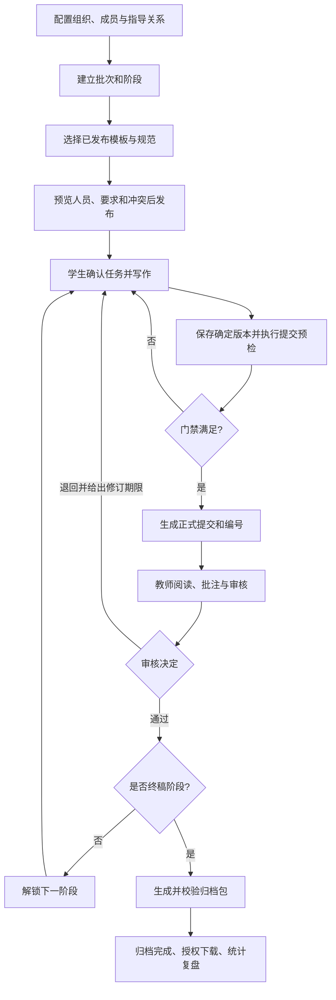

# PaperGuard 完整业务闭环设计方案

> 版本：v1.0
>
> 日期：2026-09-11
>
> 状态：核心闭环已落地，完成本地验收，进入专业增强与试点运营
>
> 现状依据：本地 `main`，当前工作区实施；后端全量回归 `525 passed`，前端生产构建和工作台运行态检查通过。
>
> 关联：[产品对象模型](./产品对象模型.md)；`商业产品设计方案.md`、`多层级规范体系设计.md`、`需求模型.md` 为本地设计稿，未纳入仓库。

## 1. 产品目标与边界

PaperGuard 帮助学生依据明确规范完成论文，帮助教师完成指导与审核，帮助学院掌握进度并形成可追溯的终稿档案。

核心闭环为：**配置组织与人员 → 发布任务和写作依据 → 学生写作与检查 → 正式提交 → 教师审核与反馈 → 修改再提交 → 通过 → 归档 → 统计复盘**。

产品交付结果不是一份“零报错”的检查报告，而是一份具有确定正文版本、适用规范、审核结论和完整归档材料的论文。

### 1.1 首轮设计假设

- 先面向单学校或单学院部署，支持内部多组织范围；跨机构 SaaS 租户隔离另行建设。
- 首轮以一名主指导教师负责审核，协助教师只在明确授权后参与；多级会签、匿名外审后置。
- 同一学生在同一批次中只有一篇有效主论文，可关联不同阶段成果。
- 桌面端承担长篇写作和审核，移动端优先支持查看任务、消息和反馈。
- 通知先使用站内消息；学校邮件、短信和即时通信渠道后续接入。
- 不覆盖选题分配、答辩排程、成绩计算或完整教务管理。
- 查重或 AI 辅助结果属于参考材料，不自动形成学术不端判定。

### 1.2 完整闭环的完成条件

1. 每个参与学生知道当前任务、写作依据、截止时间和提交要求。
2. 每次正式提交都有不可变正文版本与可核对的提交编号。
3. 每个审核决定有操作者、时间、理由和所针对的提交版本。
4. 被退回的学生有可执行的修改任务和有效修订期限。
5. 通过后的终稿可归档、校验、下载，历史记录不会被草稿修改覆盖。
6. 管理员能识别尚未完成的学生及阻塞原因，持续跟进至完成或明确退出。

## 2. 现有能力与新增边界

以下“已有”仅指本地代码存在，不代表本轮重新验收通过。

| 能力 | 当前基础 | 本方案处理方式 |
|---|---|---|
| 模板与结构化写作 | 模板、章节、封面、文本/图片/表格、DOCX 导出 | 复用，增加任务上下文和历史恢复 |
| 自动保存 | 页面保存队列、保存状态、revision 冲突校验 | 增加本地恢复、失败重试和冲突处理 |
| 多层级规范 | 组织作用域、规范发布版本、项目快照 | 复用，绑定阶段配置版本 |
| 合规检查 | 项目统一检查、检查记录、报告、自动修复 | 增加提交门禁和版本绑定 |
| 规范例外 | 豁免、申诉、确认、升级记录 | 复用对象，补齐审批职责和任务联动 |
| 师生管理 | 学生导入、指导关系、账号管理、简单进度 | 改造为批次内有效指导关系与待办 |
| 正式提交与审核 | 未见完整业务实体与流程 | 新增提交快照、审核轮次、批注和撤回 |
| 批次与阶段任务 | 已有组织/批次作用域不等于任务调度 | 新增阶段发布、成员快照、期限与延期 |
| 消息与归档 | 未见完整闭环 | 新增站内消息、持久任务和归档包 |
| AI | 润色、续写、摘要与规范辅助 | 增加接受确认、用量和预算控制 |

源代码参考：`backend/app/models/project.py`、`backend/app/api/projects.py`、`backend/app/api/teacher.py`、`backend/app/db.py`、`frontend/src/views/Writer.vue`。

历史设计文档中的“缺失”可能已被后续实现覆盖。实施时以当前代码为准，避免重建规范、组织或检查实体。

## 3. 角色、责任和权限

| 角色 | 主要责任 | 允许的数据范围 | 关键限制 |
|---|---|---|---|
| 学生 | 写作、自检、提交、修改、查看档案 | 本人项目和分配任务 | 不能审核本人论文或改变已发布要求 |
| 主指导教师 | 指导、批注、退回、通过、处理本人要求例外 | 当前有效指导关系和获授权历史提交 | 不能放宽学校硬性要求 |
| 协助教师 | 受邀阅读与批注 | 指定学生、阶段或提交 | 默认没有最终审核决定权 |
| 学院管理员 | 成员分配、批次发布、延期、学校授权的例外审批、归档 | 本学院管理范围 | 统计管理权限不自动授予全文阅读 |
| 学校管理员 | 学校规范、学院范围、学校级统计和授权 | 本校 | 访问正文须有明确业务授权 |
| 运维人员 | 运行监控、升级、备份恢复 | 系统运行信息 | 不通过业务界面默认浏览论文正文 |

权限判断同时考虑：账号状态、组织范围、角色能力、有效指导关系、资源归属和业务状态。正文、图片、附件、导出、报告、统计、归档下载使用同一授权原则。

旧 `admin/teacher/student` 角色保留兼容映射。不能仅因账号是旧管理员而自动授予全校正文访问；导入不能仅凭相同用户名自动绑定跨组织账号。

### 3.1 指导关系变更

- 指导关系记录批次、生效时间、结束时间和变更原因。
- 转交后未完成审核归新教师处理，旧教师不能继续提交决定。
- 旧教师的历史批注、签署结论保留；历史只读访问需单独授权，默认撤销。
- 转交与审核并发时，后端按有效关系版本原子检查，失效操作返回冲突。
- 学生、原教师和新教师收到转交通知；不会因此重写历史审核者。

## 4. 业务对象与版本关系

| 对象 | 业务含义 | 关键约束 |
|---|---|---|
| 批次 Cohort | 一届毕业论文或一次课程论文活动 | 归属组织明确，发布后人员变动留痕 |
| 阶段 Stage | 开题、中期、初稿、终稿等交付节点 | 时间、材料、门禁、前置阶段可配置 |
| 阶段配置版本 StageConfigVersion | 一次发布的任务规则 | 已使用版本不可原地修改 |
| 阶段参与记录 StageParticipant | 一个学生在一个阶段的任务 | 学生与阶段唯一，记录个别延期 |
| 写作项目 WritingProject | 可持续修改的工作空间 | 同批次仅一个有效主项目绑定 |
| 论文版本 ProjectVersion | 某一时刻正文及附件的快照 | 被提交引用后不可变 |
| 检查运行 CheckRun | 针对确定输入的一次检查 | 绑定内容、规范和引擎版本，失败独立表示 |
| 提交 Submission | 对阶段任务的正式交付 | 引用论文版本、配置版本、检查与材料 |
| 审核 Review | 对一次提交的最终决定 | 一个审核轮次仅有一个有效决定 |
| 批注 Comment | 针对提交内容的问题或建议 | 绑定稳定段落 ID 和原文片段 |
| 归档 Archive | 已通过终稿的固定交付包 | 完成后只读，更正产生新档案 |

一个写作项目可以产生多个论文版本；每个阶段可以多次提交。已提交版本不随工作区编辑变化。组织“批次作用域”可以关联业务批次，但不能替代阶段、成员或提交实体。

## 5. 端到端主流程

### 5.1 管理员准备与发布

1. 创建批次：名称、组织、学年、负责人、活动起止时间。
2. 导入或选择成员，预检重复身份、组织范围、未分配教师和无效账号。
3. 分配主指导教师，保存成员清单版本；存在阻断错误时不可发布。
4. 创建阶段，设置开放时间、首次提交截止时间、默认修订天数、前置阶段。
5. 配置必交材料、模板版本、规范版本、自动与人工门禁、审核责任人。
6. 预览一名典型学生实际收到的任务、有效要求和期限。
7. 发布：冻结配置和成员依据，生成参与记录、站内通知及审计事件。

导入提供逐行结果与可下载错误清单。重试只处理失败行；账号绑定需要确认身份和组织归属，不能把同名用户直接归入教师名下。

### 5.2 学生领取任务与准备写作

- “我的任务”展示当前阶段、截止时间、状态、待处理反馈和唯一主操作。
- 可创建新项目，或关联本人已有项目；关联前检查模板/规范差异并预览迁移影响。
- 已有项目不得通过关联任务静默改变旧提交的依据。
- 学生确认已阅读当前要求；确认记录绑定规范摘要值，新版本须重新确认。
- 未通过前置阶段时可阅读后续任务；是否允许提前写作由配置控制，默认不能提前正式提交。

### 5.3 写作、保存与历史恢复

- 自动保存显示“本地已保留”“同步中”“已同步”“同步失败”“存在冲突”等实际状态。
- 本地恢复数据按账号与项目隔离，并包含服务器基础 revision；恢复前显示时间和差异。
- 退出账号清理本地敏感缓存；浏览器存储不可用时明确提示恢复能力不可用。
- 保存失败保留待发送数据，提供手动重试和受限自动重试；不能只留下无法处理的错误提示。
- 多端冲突禁止静默覆盖，允许查看服务器版本、保留本地副本、按章节选择合并。
- 定期或关键操作生成草稿检查点；提交、修复、模板迁移前必须有可恢复版本。
- 恢复历史内容创建新草稿 revision，原提交和检查记录不变。
- 删除草稿先进入回收站；被提交或归档引用的文件不得随草稿删除回收。

### 5.4 检查与问题处理

检查分为三类：自动可判定项、人工确认项、只读参考文档。AI 辅助意见不能自动完成教师人工确认。

问题清单按章节、来源、严重性聚合，支持定位段落、查看当前值/目标值/依据，以及筛选未解决项。自动修复先预览，可选择具体修改；执行后生成新版本并重新检查。

报告结果使用：通过、不通过、待人工确认、未覆盖、运行失败、已豁免。不得把没有发现问题解释成所有要求均已检查。

### 5.5 正式提交

采用“准备候选版本 → 检查 → 确认提交”的流程，避免长时间检查占用数据库事务。

1. 学生请求提交预检，服务器确认最新正文 revision 已保存且任务允许提交。
2. 生成不可变候选版本，冻结正文、附件引用、模板与规范依据、阶段配置版本及内容摘要值。
3. 对候选版本执行检查，返回检查状态、阻断项、人工确认和材料缺失情况。
4. 用户确认提交，携带候选版本 ID 和幂等键。
5. 事务内重新检查权限、期限、参与状态、配置版本、候选 revision、豁免有效性与检查结论。
6. 任一关键依据已变化则拒绝复用旧预检，要求重新准备；检查期间编辑正文后不能误提交旧稿。
7. 创建提交记录、更新参与状态、写入通知事件；成功后返回唯一提交编号和时间。

同一幂等键重复请求返回同一结果；同键不同请求内容返回冲突。幂等键作用域包括用户和动作。提交结果不明时可查询请求状态，禁止要求用户盲目重复提交。

### 5.6 教师审核

- 教师工作台展示待审核列表：学生、阶段、提交时间、迟交标记、检查摘要和等待时长。
- 打开只读提交版本，查看完整正文、材料和检查覆盖范围。
- 添加普通建议或必须处理的阻断批注；批注绑定提交版本、段落 ID 和原文片段。
- 学生可回复并标记“已修改待复核”，由教师确认解决；学生不能自行关闭阻断意见。
- 通过前须完成配置中的教师人工确认，关闭阻断批注，并确认附件完整。
- 退回必须填写原因、修改要求和修订截止时间。
- 最终决定提交时验证审核轮次、当前教师关系和提交状态，禁止两个并发决定同时生效。

学生修改草稿不影响教师正在阅读的内容。下一次提交展示前后差异和上轮未解决意见；不能因段落顺序变化把批注错误定位到其他段落。段落已删除时保留原文并标记锚点失效。

### 5.7 修改、再提交与撤回

- 退回后进入“需修改”，保留旧提交及全部意见；新提交引用前次提交形成修订链。
- 再提交要求学生填写简短修改说明，逐条回应阻断意见。
- 一名学生在一个阶段最多有一份有效待审核提交。
- 学生可在尚无最终决定且有效提交窗口内撤回，撤回记录保留。
- 撤回不删除教师已写批注；再提交产生新记录。
- 撤回与审核同时发生时，通过同一状态版本校验只允许一方成功。

### 5.8 通过与归档

非终稿阶段通过后解锁后续阶段。终稿通过后进入“待归档”，由具有归档权限的管理者发起生成。

归档包至少包含：最终 DOCX、结构化内容快照、提交材料、检查报告、模板和规范版本依据、有效豁免、审核决定、修订说明及文件清单摘要值。

归档流程：创建持久任务 → 生成临时包 → 校验必需文件与摘要值 → 原子发布文件引用 → 标记完成并通知。失败显示原因并可重试，不能先标记成功后生成文件。

归档包不得包含模型密钥、其他学生信息或无关内部日志。模板源文件存在授权限制时，归档保留可审计摘要与获许可内容，下载范围按授权控制。

已完成归档只读。更正需管理员重开并填写理由，产生新提交与修订归档，关联前版；旧档案标记已被替代但继续保留。

## 6. 状态机与期限规则

### 6.1 阶段参与状态

| 状态 | 进入条件 | 允许的主要动作 | 下一状态 |
|---|---|---|---|
| 未开始 | 任务已发布但未到开放时间或前置未满足 | 查看要求 | 进行中 |
| 进行中 | 开放且满足前置条件 | 写作、预检、提交 | 待审核 |
| 待审核 | 正式提交成功 | 教师审核、符合条件时撤回 | 需修改、已通过、进行中 |
| 需修改 | 教师退回 | 修改、回复、再次提交 | 待审核 |
| 已通过 | 有有效通过决定 | 查看记录、进入下一阶段 | 待归档或重开后的进行中 |
| 待归档 | 终稿已通过 | 发起/重试归档 | 已归档 |
| 已归档 | 有完整有效归档包 | 授权下载、更正申请 | 更正流程产生新审核轮次 |
| 已退出 | 管理员记录退学、退出或任务取消 | 查看获授权历史 | 管理员显式恢复 |

逾期是根据当前时间计算的标记，不替代业务状态；“需修改且逾期”和“未提交且逾期”必须可区分。归档生成中的排队、运行、失败属于任务状态，不冒充参与记录完成。

### 6.2 提交和任务状态

- 提交：`submitted → returned | approved | withdrawn`，终态记录不可改写。
- 重开：生成新审核轮次，原通过记录仍保留，但不再作为当前轮次的有效通过依据。
- 检查/归档任务：`queued → running → succeeded | failed | cancelled`；重试记录关联前次尝试。
- 批注：`open → addressed → resolved`；教师可在当前修订轮次重新打开，历史事件追加保留。

### 6.3 截止时间

- 存储 UTC 时间，界面按学校时区展示完整日期与时区。
- 首次提交有效截止时间为阶段截止或管理员明确批准的个别延期截止。
- 退回生成独立修订截止，默认取“现有有效截止”和“退回时间加配置修订时长”中较晚者。
- 补交必须由管理员授权并留下理由；首次迟交标记根据原首次截止计算，不被延期静默抹除，批准提前延期需记录统计口径。
- 服务器最终确认事务的时间不晚于有效截止时才接受提交；截止前启动检查不等于已提交。
- 新修订期限超过批次计划结束时标记批次存在未完成任务，不自动关闭学生入口；批次关闭需管理员解决或明确处置这些任务。

## 7. 提交门禁、规范变更与例外

### 7.1 门禁矩阵

| 情况 | 允许提交 | 允许通过 |
|---|---|---|
| 自动硬性项不通过且无有效豁免 | 否 | 否 |
| 自动检查失败或必要检查未运行 | 否 | 否 |
| 警告/建议未满足 | 确认提示后允许 | 教师结合内容判断 |
| 学生必填声明未确认 | 否 | 否 |
| 教师人工项待确认 | 允许送审 | 否 |
| 必交附件缺失 | 否 | 否 |
| 存在未关闭的阻断批注 | 修订回复完整后可再次送审 | 否 |
| 申诉处理中 | 原门禁仍生效 | 原门禁仍生效 |

### 7.2 规范冲突与版本升级

- 复用现有规范解析器，不以新界面替代底层规则能力。
- 可比较的阈值按受控规则组合；出现下限大于上限或不可同时满足的结构要求时阻断发布，要求责任人裁决。
- 教师可加严或补充，不可自行放宽上级硬性条款。
- 发布后的阶段引用确定模板/规范版本，不能随全局最新版本自动变化。
- 要求升级先生成差异和受影响名单，再发布新配置版本；学生显式迁移草稿并重新确认。
- 默认让已待审核提交按旧版本完成本轮；确需强制应用新规时，以有理由的退回启动新轮次，并给予修订时间。
- 已通过或归档成果不自动重算；新的复核报告必须标明新依据且不覆盖原结论。

### 7.3 豁免与申诉

复用现有记录，补充适用阶段、规则版本、审核责任、有效期和处理结果。教师处理本人要求，学院或学校授权人员处理上级硬性条款，申请者不能自行批准。

申诉确认误报后，可以产生受控豁免或修正规范新版本；两者不得混为删除原问题。豁免在提交时冻结证据，但通过前仍检查当前有效性；被撤销时阻止继续通过并要求复核。历史审核结论保留撤销后的关联事件。

## 8. 页面与日常工作流

| 页面 | 主要用户 | 核心内容和操作 |
|---|---|---|
| 我的任务 | 学生 | 当前阶段、期限、审核状态、继续写作或修改 |
| 写作工作台 | 学生 | 章节、正文、检查/意见侧栏、保存状态、提交与导出 |
| 提交确认 | 学生 | 确定版本、门禁、必交材料、声明与提交编号 |
| 提交历史 | 师生 | 版本、修改说明、检查摘要、审核决定、差异 |
| 审阅工作台 | 教师 | 只读正文、段落批注、人工确认、退回与通过 |
| 教师待办 | 教师 | 待审核、待复核、申诉、学生进度与筛选 |
| 批次与阶段 | 管理员 | 配置、预览、发布、延期、退出、重开 |
| 组织与成员 | 管理员 | 导入预检、身份确认、指导关系与转交 |
| 消息中心 | 全角色 | 未读、事件来源、直达任务、已读状态 |
| 归档中心 | 授权用户 | 生成状态、失败重试、下载、修订关系 |
| 统计与审计 | 管理员 | 完成进度、异常清单、变更与访问记录 |

写作页复用现有 Writer，不把所有管理功能堆入侧栏。正文编辑时保持主要操作位置稳定；检查问题定位后仍能返回原列表位置。

所有页面提供加载、空数据、失败重试、无权限和操作过期状态。按钮禁用需让用户知道具体阻断条件；不能只显示“操作失败”。

## 9. 事件与通知闭环

| 事件 | 接收人 | 通知内容与后续动作 |
|---|---|---|
| 任务发布/要求升级 | 受影响学生、教师 | 查看要求、确认新版本 |
| 正式提交 | 当前审核教师 | 进入对应提交审核 |
| 批注与回复 | 对方及获授权关注者 | 查看具体意见；短时间事件聚合 |
| 退回 | 学生 | 修改原因、修订截止、继续修改 |
| 通过 | 学生、阶段负责人 | 下一阶段或归档状态 |
| 临近截止/逾期 | 未完成学生、责任教师 | 提交、申请延期或跟进 |
| 豁免/申诉决定 | 申请者、责任教师 | 查看决定及门禁变化 |
| 指导转交 | 学生、新旧教师 | 查看生效范围 |
| 归档成功/失败 | 发起人及授权责任人 | 下载或处理失败 |

业务事务同时写入持久事件/outbox，通知异步发送。按事件、接收人和渠道去重；失败重试不重复生成业务提交。提醒发送前重新检查状态，已通过、已退出或已延期的任务不得收到过期催办。

站内消息只读状态不等于业务任务完成。通知列表避免显示整段正文；点击链接时重新授权。权限撤销后保留合适的事件摘要但不泄露正文。

## 10. 异常与恢复规则

| 场景 | 系统处理 | 用户可执行的恢复动作 |
|---|---|---|
| 写作时断网 | 保留本地草稿和待同步队列 | 联网重试、查看恢复副本 |
| 多标签页保存冲突 | 拒绝旧 revision 覆盖 | 比较并选择合并 |
| 提交成功但响应丢失 | 幂等记录可查询 | 查询提交结果 |
| 检查过程中正文变化 | 候选版本与最新版本不一致 | 重新预检 |
| 检查服务失败 | 记为失败，保留诊断编号 | 重试，不显示通过 |
| 教师审核与学生撤回并发 | 原子状态变更只接受一个 | 刷新当前决定 |
| 退回时已过首次截止 | 生成修订期限 | 按新期限再提交 |
| 教师转交后旧教师操作 | 拒绝失效授权 | 新教师接手 |
| 归档生成时服务重启 | 持久任务租约过期后恢复 | 查询状态或重试 |
| 生成成功但数据库未标记完成 | 重试校验已有制品并完成登记 | 无需重复创建有效档案 |
| 账号禁用或任务退出 | 停止新业务动作，保留历史 | 管理员处置或恢复 |
| 通过后发现错误 | 追加重开事件，新轮次修订 | 再审并生成修订档案 |
| 附件丢失或摘要不符 | 阻断归档/下载并告警 | 从备份恢复，不替换成空文件 |

后台任务使用幂等执行、明确重试上限与失败原因；达到上限后进入人工处理队列。错误反馈提供可追踪编号，日志不包含模型密钥或完整论文正文。

## 11. 数据与接口实施设计

### 11.1 逻辑数据模型

沿用现有项目和规范存储，以下新增实体在实施时通过版本化迁移落地。

| 实体 | 关键字段 |
|---|---|
| cohort | id、organization_id、name、status、负责人、时间、revision |
| supervision | teacher_id、student_id、cohort_id、生效区间、变更原因 |
| stage/config_version | cohort_id、配置版本、前置关系、时间、材料、门禁、依据摘要 |
| stage_participant | stage_id、student_id、project_id、state、review_cycle、有效期限、revision |
| project_version | project_id、source_revision、内容快照、附件清单、content_hash、创建原因 |
| submission | participant_id、project_version_id、check_run_id、config_version_id、前次提交、state |
| review | submission_id、review_cycle、reviewer_id、决定、理由、人工确认、时间 |
| comment/event | submission_id、block_id、原文、级别、状态、回复、操作者 |
| artifact/reference | 文件摘要、存储位置、所属对象、引用类型、保留状态 |
| archive | submission_id、manifest_hash、任务状态、归档位置、previous_archive_id |
| task/outbox/notification | 类型、业务对象、去重键、状态、租约、尝试数、接收人 |
| audit_event/idempotency | 操作者、范围、动作、理由、请求摘要、结果引用、时间 |

关键唯一约束：学生与阶段唯一；同阶段仅一份有效待审核提交；同轮次仅一个有效审核决定；幂等键按用户和动作唯一；同一最终提交仅一个有效完成归档。

附件引用必须覆盖草稿、历史版本、提交和归档。仅当所有引用解除且达到保留期限时才允许物理回收。

### 11.2 建议接口组

以下为拟定契约方向，不代表现有接口已提供。最终命名应沿用仓库风格。

| 接口组 | 主要动作 |
|---|---|
| `/api/cohorts` | 批次管理、成员预检导入、关闭与恢复 |
| `/api/stages` | 阶段草稿、发布预览、发布新配置版本 |
| `/api/my-tasks` | 当前用户任务、状态和待办 |
| `/api/stage-participants/{id}` | 延期、退出、重开、主论文绑定 |
| `/api/projects/{id}/versions` | 历史版本、比较、恢复为草稿 |
| `/api/submission-candidates` | 创建候选版本、运行预检、查询结果 |
| `/api/submissions` | 确认提交、历史、撤回、只读内容 |
| `/api/submissions/{id}/reviews` | 审核决定与人工确认 |
| `/api/submissions/{id}/comments` | 批注、回复、解决和重新打开 |
| `/api/notifications` | 站内消息、未读数、已读 |
| `/api/archives`、`/api/tasks` | 发起归档、查询、重试、授权下载 |
| `/api/reports`、`/api/audit-events` | 范围内统计、审计查询 |

写操作使用 revision 或等价条件更新。权限不足返回 403 或按资源隐匿策略返回 404；状态或版本冲突返回 409；字段错误返回 422。耗时任务返回 202 和可查询任务 ID，不能把任务入队解释为处理成功。

### 11.3 一致性与部署

提交、审核、参与状态及 outbox 事件在同一数据库事务中提交。文件生成在事务外进行，通过临时制品、摘要校验和原子登记衔接。SQLite 单实例阶段验证真实事务竞争与恢复能力；是否迁移 PostgreSQL 由并发和运维需求决定。

重启后检查租约超时的后台任务并恢复；不能只使用进程内异步任务承担正式提交检查或归档。检查引擎、导出器版本写入结果，升级后能解释历史差异。

## 12. 数据保护、备份与保留

- 学生能下载自己的正文和获授权提交材料；教师和管理员下载范围与业务权限一致。
- 下载链接短期有效，生成链接与实际读取均需防止绕过资源授权。
- 账号删除、退出批次和删除草稿不自动删除审核或归档记录。
- 正式上线前由学校确定草稿、附件、提交、归档、审计和本地缓存的保留期限；未配置保留策略时不执行自动物理删除。
- AI 调用明确发送范围，用户接受修改后才写入正文；AI 输出不自动成为审核决定。
- 备份同时涵盖数据库、上传文件、版本引用与归档制品，采用一致性备份方式。
- 恢复演练验证登录、随机论文版本、附件摘要、历史提交与归档下载，而非只确认文件解压成功。
- RPO、RTO 由试点规模与校方要求确定；未演练前不得承诺恢复指标。

## 13. 运营看板与成效指标

| 指标 | 口径 | 业务用途 |
|---|---|---|
| 按时首次提交率 | 截止前首次有效提交人数 / 应提交人数 | 发现阶段组织问题 |
| 当前待审核数量和等待时长 | 当前有效 submitted 提交，等待时间到当前时刻 | 教师安排审核 |
| 首次审核周转时间 | 首次有效提交到首次最终决定，中位数与 P90 | 判断反馈速度 |
| 修订轮次 | 阶段有效提交次数及退回次数 | 识别要求不清或集中问题 |
| 格式问题改善率 | 相同规范和引擎版本下前后问题变化 | 评估检查价值 |
| 归档完成率 | 有当前有效归档的学生 / 应归档人数 | 交付收口 |
| 保存失败与恢复成功率 | 有效同步失败事件及最终恢复结果 | 评估写作可靠性 |

成员分母以发布成员快照及有记录的增补/退出调整计算，报表展示统计时点和调整口径。迟交、延期、退回、退出分别统计；不能通过删除未完成学生提高完成率。原问题数为零或版本不同的改善率标记不适用。

看板必须能下钻到获授权待处理任务；跨组织统计只提供授权汇总，不泄露其他组织学生身份和正文。

## 14. 分期实施与依赖

| 阶段 | 交付内容 | 放行条件 |
|---|---|---|
| M0：基线与数据设计 | 核对当前实体、角色映射、迁移和验收样本 | 现有项目可继续写作导出，迁移可恢复 |
| M1：写作可靠性 | 本地恢复、重试、冲突、历史版本、附件引用保护 | 断网/刷新/多端冲突后可恢复内容 |
| M2：任务与发布 | 批次、阶段、成员、指导关系、版本化配置 | 目标学生准确收到任务，越权被拒绝 |
| M3：提交与审核 | 候选版本、门禁、幂等提交、批注、退回、通过 | 师生完成两轮审核且历史不变 |
| M4：消息与归档 | 事件通知、提醒、持久任务、归档、更正 | 重启后可恢复，终稿完整可下载 |
| M5：试点运营 | 看板、审计、恢复演练、真实样本 UAT | 异常有责任人和处理入口，完成试点验收 |
| M6：专业增强 | DOCX 正文导入、文献引用、公式、复杂表格、导出预览 | 输入保真边界明确，真实论文往返验证 |

依赖顺序：M1 的版本和文件引用保护是 M3 的基础；M2 的授权和配置是正式提交门禁的基础；M3 的不可变提交是 M4 归档的基础。消息 outbox 应随 M2/M3 业务事件建立，M4 完成消费、提醒和界面。

完整计费、支付、实时多人协同、匿名外审、答辩与评分不作为首轮放行条件。开放平台默认 AI 前应有开关、用量和预算控制。

## 15. 验收场景与证据

准备至少两个组织、两名教师、多名学生、两个阶段、两个规范版本和含图表附件的论文。使用独立测试数据。

| 编号 | 场景 | 通过标准 |
|---|---|---|
| AC-01 | 发布任务 | 只有目标成员获得任务，未分配教师等阻断项不可发布 |
| AC-02 | 正常往返 | 学生提交、教师退回、学生修订、教师通过、归档成功 |
| AC-03 | 草稿与提交隔离 | 提交后编辑草稿，教师读取的内容和附件摘要不变 |
| AC-04 | 保存恢复 | 断网、刷新、恢复网络后可找回未同步内容，冲突不覆盖 |
| AC-05 | 检查绑定 | 检查后改正文或规范，旧结果无法确认新提交 |
| AC-06 | 门禁准确 | 硬性失败阻断，人工待确认可送审但不可通过 |
| AC-07 | 幂等与并发 | 重复提交仅一条有效记录，撤回与审核只有一方成功 |
| AC-08 | 时间边界 | 截止前后由服务器判定，退回后可在修订期限内提交 |
| AC-09 | 规范升级 | 差异可预览，旧提交依据不变，新提交采用明确新版本 |
| AC-10 | 例外审批 | 未授权者不能批准，申诉不自动放行，撤销后触发复核 |
| AC-11 | 指导转交 | 新教师可接手，旧教师新操作被拒绝，历史作者不变 |
| AC-12 | 对象级授权 | 交换项目、图片、报告、提交、归档 ID 均不能越权访问 |
| AC-13 | 归档恢复 | 生成中重启和响应丢失后仍仅一份有效完整档案 |
| AC-14 | 删除与恢复 | 删除草稿不损坏提交附件；备份恢复后摘要一致 |
| AC-15 | 归档更正 | 新旧档案关联清晰，旧审核记录不可被覆盖 |
| AC-16 | 消息与报表 | 不重复提醒已完成任务，报表分母和实际成员一致 |

验收证据记录源码提交、迁移版本、测试环境、模板/规范/引擎版本、参与者范围、提交编号、归档摘要与结果。接口测试覆盖状态与权限，浏览器测试覆盖主要角色往返，真实 DOCX 样本验证导出与归档内容。

负载验收使用试点实际峰值假设，重点测并发保存、集中提交、检查排队和批量归档。目标响应时间和并发量在试点前确定，不能以单用户测试代替容量结论。

## 16. 待业务确认事项

以下不阻碍建立通用数据和状态模型，但对应配置上线前必须确定；表中默认值是方案建议。

| 事项 | 建议默认 | 影响 |
|---|---|---|
| 首批试点范围 | 一个学院、一个批次 | 成员权限与容量验收 |
| 审核责任 | 主指导教师单人决定 | 是否需要多级审核模型 |
| 修订期限 | 阶段配置天数，不硬编码 | 退回后任务可执行性 |
| 最终归档责任 | 获授权学院管理员 | 操作权限与待办分配 |
| 学校硬性条款豁免 | 学校授权审批者 | 门禁与审批职责 |
| 论文与审计保留期 | 由学校确定 | 自动清理和备份策略 |
| 通过后更正 | 管理员重开并说明理由 | 新轮次与修订档案 |
| AI 使用范围 | 用户主动触发、修改需接受 | 数据发送与成本控制 |
| 移动端范围 | 任务、消息和反馈为主 | 首轮页面验收边界 |

## 17. 示例：一名学生完成终稿

1. 学院发布“2027届本科论文”批次，包含初稿和终稿阶段，绑定模板 v3、学校规范 v2 和教师要求 v1。
2. 学生领取初稿任务并确认要求，写作中断网后恢复本地草稿并同步。
3. 初稿预检发现摘要字数不足，学生修改后重新检查并正式提交，获得提交编号 S1。
4. 教师阅读 S1 的固定版本，提出一条实验分析阻断意见，退回并设置修订截止。
5. 学生修改草稿、回复意见、生成 S2。教师比较 S1/S2，确认意见解决并通过初稿。
6. 终稿阶段开放，学生补齐终稿材料，经预检形成 S3；教师完成最终人工确认并通过。
7. 学院发起归档 A1，后台生成文件清单和摘要，校验完成后通知学生下载。
8. 学院看板显示该学生已归档，可追溯 S1、S2、S3 的依据、意见、决定和时间。
9. 若终稿存在需更正错误，管理员记录原因重开，新版本审核后形成 A2，并保留 A1 与替代关系。

至此，任务、正文、规则、反馈、决定、档案和统计形成可追溯的完整链路。
