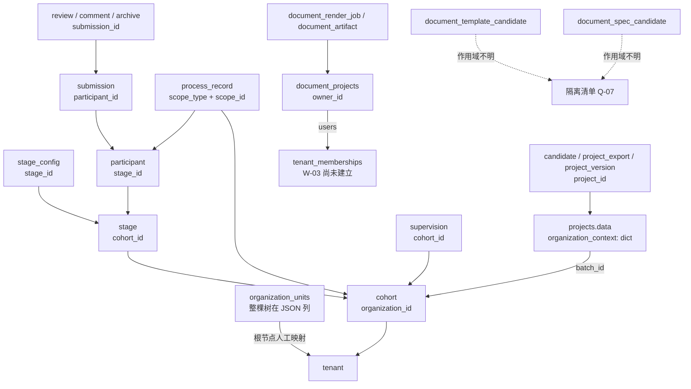

# workflow_records 的 kind 清单与租户归属推导（Q-04 处置）

> 状态：**design_ready** — 解决登记表隔离项 **Q-04**，解锁 W-02 T-02.4 DDL 定稿。
> 日期：2026-10-01。基线：HEAD `e166f97`。上游：`docs/tenancy/resource-registry.yaml`（`workflow_records` 条目）。
> 授权边界：本文件是**只读代码分析产物**。未执行任何 DDL/DML，未查询生产库，未重启生产。

## 0. 结论摘要

`workflow_records` 实际存在 **17 种 `kind`**。全部 17 种**都能找到归属推导路径**，但路径质量差异极大：

| 类别 | 数量 | 含义 |
|---|---|---|
| **A 类：直接可归属** | 2 | 记录自带 `organization_id` |
| **B 类：单跳可归属** | 2 | 记录自带业务父键 |
| **C 类：多跳可归属（含未索引 JSON）** | 11 | 需 3～5 跳，其中 4 种经过 `projects.data` 的 JSON |
| **D 类：作用域不明** | 2 | 平台级队列，无租户路径，需人工裁决 |

**对 W-02 T-02.4 的结论**：`workflow_records` **可以**加单一 `tenant_id` 列，不需要为它拆表——但必须**同时**加一列 `owner_ref`（业务父资源引用）并在回填阶段固化，否则每次查询都要重走 3～5 跳。

## 1. 证据边界（先说清楚这份清单的强度）

| 项 | 状态 | 说明 |
|---|---|---|
| kind 集合 | **已验证** | AST 解析全部 `store.<workflow_record 方法>(kind, ...)` 调用点的实参 + 常量定义 |
| 各 kind 记录含哪些字段 | **代码级已验证** | 逐条核对写入点构造的 dict 字面量，标注 `file:line` |
| 各字段在**真实数据**中是否非空 | **未验证** | 本地 `backend/data/paperguard.db` 的 `workflow_records` **共 0 行**，取不到数据样本 |
| 生产数据的实际形态 | **未查询** | 未连生产库；U-09 只读诊断亦未执行 |

> **因此本清单能证明"代码会写入这些字段"，不能证明"存量数据里这些字段都填了"。**
> 字段空值率必须在 M3 回填前用**生产只读快照**实测——这是 W-02 T-02.6 校验器的必检项（见 §6）。

## 2. kind 清单（17 种）

按归属推导质量分组。`跳数`指从该记录到 `organization_id` 需要经过的关联层数。

### A 类：记录自带组织标识（2 种）

| kind | 归属字段 | 证据 | 跳数 | 置信度 |
|---|---|---|---|---|
| `cohort` | `organization_id` | `api/workflow.py:636` `"id": new_id("cohort"), ..., "organization_id": req.organization_id` | 1 | 高 |
| `supervision` | `cohort_id` + `student_id` + `teacher_id` | `api/workflow.py:153-156` 可见性判定按 `cohort_id` + `student_id` 匹配 | 1 | 高 |

> `cohort.organization_id` 是**整个教学域的租户锚点**。总设计第 10 节的「根组织经人工确认映射租户」就落在这里——`organization_id` 必须能解析到 `tenant_organizations` 中的同租户节点。

### B 类：单跳（2 种）

| kind | 归属字段 | 证据 | 跳数 | 置信度 |
|---|---|---|---|---|
| `stage` | `cohort_id` | `api/workflow.py:848` `"id": new_id("stage"), "cohort_id": cohort_id, ...` | 2 | 高 |
| `process_record` | `scope_type` + `scope_id` | `api/process_records.py:102,109,325,361` 取值 `participant` \| `cohort` | 2～3 | 中（**多态**） |

> `process_record` 是**多态归属**：`scope_type=cohort` 直达；`scope_type=participant` 需再经 `participant.stage_id → stage.cohort_id`。回填时必须按 `scope_type` 分支处理，不能统一套一条规则。

### C 类：多跳，含未索引 JSON（11 种）

| kind | 归属字段 | 派生链 | 跳数 | 证据 |
|---|---|---|---|---|
| `stage_config` | `stage_id` | → `stage` → `cohort` | 3 | `api/workflow.py:844,852`（创建时 `stage_id` 先空后回填 `:852`）；升级路径经 `dict(current)` 继承（`:907`） |
| `participant` | `stage_id` + `student_id` | → `stage` → `cohort` | 3 | `api/workflow.py:929-931` |
| `submission` | `participant_id` | → `participant` → `stage` → `cohort` | 4 | `api/workflow.py:216` `submission.get("participant_id")` |
| `review` | `submission_id` | → `submission` → `participant` → `stage` → `cohort` | 5 | `api/workflow.py:602` `item.get("submission_id")` |
| `comment` | `submission_id` | 同 `review` | 5 | `api/workflow.py:220` `comment.get("submission_id")` |
| `archive` | `submission_id` | 同 `review` | 5 | `models/workflow.py:110-111` `ArchiveCreate.submission_id`；写入 `api/workflow.py:1960` |
| `candidate` | `project_id` | → `projects.data.organization_context.batch_id` → `cohort` | 3（含 JSON） | `api/projects.py:1207` `item.get("project_id") == proj_id`；`:1210-1211` 经 `organization_context.batch_id` 找 cohort |
| `project_export` | `project_id` | 同 `candidate` | 3（含 JSON） | `services/export_jobs.py:151,180,196` |
| `project_version` | `project_id` | 同 `candidate` | 3（含 JSON） | `api/projects.py:741` |
| `document_render_job` | `project_id` | → `document_projects.owner_id` → `users` → `membership` | 3 | 常量 `services/document_render_jobs.py:32`；`:156` 取 `project.organization_context.school_id` |
| `document_artifact` | `project_id` | 同上 | 3 | 常量 `services/document_render_jobs.py:33`；读取 `:168` |

### D 类：作用域不明（2 种）— 需人工裁决

| kind | 常量定义 | 现状 | 问题 |
|---|---|---|---|
| `document_template_candidate` | `services/document_candidates.py:20` | API 为 `api/templates.py:257` `require_manager` + `require_general_document_platform`，**无任何租户参数** | 模板按设计是租户资产或公共资产，但候选记录**不携带 template_id**，无法推导租户 |
| `document_spec_candidate` | `services/document_candidates.py:21` | API 为 `api/specs.py:113` `require_manager`，**无任何租户参数** | 同上，规范的租户归属无载体 |

> 这两条是 `manager` 级全局解析队列。**它们既可能是平台公共资产的候选，也可能是某个租户上传的模板/规范——现有代码无法区分。**
> 归 Q-07（新增隔离项），**不得猜测归属**。

## 3. 派生链全景



## 4. 三个必须写进 W-02 DDL 的结论

### 4.1 不需要为 `workflow_records` 拆表

原判断是「一个 `kind` 内部混装多种业务对象 → 单列 `tenant_id` 无法表达」。**枚举后这个顾虑不成立**：17 种 kind 全部有确定归属路径，混装的是「不同业务实体共用一张表」，而单列 `tenant_id` 正是解决这个的。**维持单表 + 单列方案。**

但必须**同时**加第二列：

```sql
ALTER TABLE workflow_records ADD COLUMN tenant_id text;      -- 回填后 SET NOT NULL
ALTER TABLE workflow_records ADD COLUMN owner_ref jsonb;     -- 固化业务父引用
CREATE INDEX idx_workflow_records_tenant_kind
    ON workflow_records (tenant_id, kind, updated_at DESC);
```

`owner_ref` 固化 `{stage_id|participant_id|submission_id|project_id|cohort_id|scope}`，否则每次查询都要重走 3～5 跳关联，且 `projects.data` 的 JSON 无法走索引。

### 4.2 索引必须替代现有的 SQLite 表达式索引

现有 `db.py:293-294`：
```sql
CREATE INDEX idx_workflow_records_document_project
    ON workflow_records (kind, json_extract(data, '$.project_id'), updated_at DESC);
```

这是 SQLite 表达式索引，**PostgreSQL 无等价直接翻译**。迁移时用 `owner_ref->>'project_id'` 上的 GIN 索引或生成列，并在 contract 阶段删除原表达式索引。

### 4.3 第三处 JSON 隐藏归属

除 `workflow_records.data` 和 `organization_units.data` 外，`projects.data.organization_context`（`models/project.py:93`，类型 `dict[str, str]`，注释明写"school/college/major/batch/course 等作用域"）是**第三处**把组织归属藏在 JSON 里。

`candidate` / `project_export` / `project_version` / `document_render_job` 四种 kind 的归属全部经过它。**必须纳入 T-02.5 expand 范围**，否则这 4 种 kind 回填时会全表扫描 + 应用层解析。

## 5. 登记表现状更新

`resource-registry.yaml` 中 `workflow_records` 的 `open_question` 可关闭，改为已解决：

- ~~"kind 清单未枚举——须在 W-02 T-02.4 前完成"~~
- **已枚举 17 种**，派生路径见本文件
- `registry_status` 仍为 `registered_gap`，但**阻塞原因从"无法判定"变为"需回填实测字段空值率"**
- 新增隔离项 **Q-07**（2 种 candidate 作用域不明）

## 6. 交给 W-02 的必检项

| 编号 | 检查 | 为什么 | 何时 |
|---|---|---|---|
| CHK-01 | 17 种 kind 各自的字段**空值率** | 代码会写 ≠ 存量都填了；本地库 0 行无法验证 | M3 回填前，生产只读快照 |
| CHK-02 | `stage_config.stage_id` 空值率 | 创建时先写空串再回填（`:844→:852`），**崩溃窗口会留下空值** | 同上 |
| CHK-03 | `process_record` 按 `scope_type` 分组的多态完整性 | 未知 `scope_type` 取值会导致静默漏归属 | 同上 |
| CHK-04 | `projects.organization_context` 含 `batch_id` 的比例 | 决定 4 种 kind 能否自动回填 | 同上 |
| CHK-05 | 出现但不在 17 种清单内的 `kind` | 代码外的存量数据可能含已废弃 kind | 同上 |
| CHK-06 | 派生环（`cohort_id` 指向不存在的 cohort） | 断链不能猜归属 | 回填校验器负例 |

## 7. 明确不做

- 不为 `workflow_records` 编写任何 DDL（本文件只定形态，不建表）
- 不查询生产库取字段空值率（需单独授权，且应在 M3 前的只读预检中做）
- 不处置 Q-07 的 2 种 candidate（需产品/商业侧裁决其作用域）
- 不把「代码中存在归属字段」表述为「数据已可归属」

## 8. 未决

| 编号 | 问题 | 需要谁 |
|---|---|---|
| Q-07 | `document_template_candidate` / `document_spec_candidate` 是平台公共资产候选还是租户资产候选？ | 产品 + D-01/D-08 裁决 |
| CHK-01～06 | 生产只读快照实测 | 需生产只读授权 |
