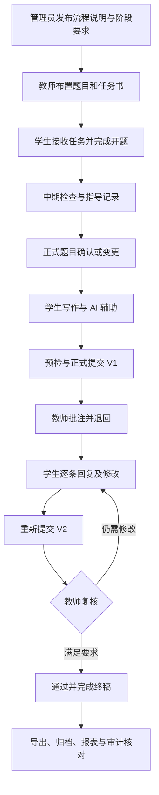

# PaperGuard 生产环境全角色与 AI 协同测试计划书

编制日期：2026-10-14（Asia/Shanghai）  
版本：V1.0，评审稿  
文档状态：测试计划；生产测试尚未执行，本文不包含通过结论。  
适用对象：试点学校业务负责人、学校管理员、学院管理员、指导教师、学生及测试执行人员。

## 1. 目标与范围

本轮围绕一篇论文走完真实用户操作链路：学校发布流程说明和阶段要求，教师布置题目与任务书，学生完成开题、中期、论文写作和提交，教师批注、退回，学生修改后再次提交，最终完成审核、导出与归档。AI 穿插在各角色的实际工作中，分别检验管理文案辅助、教师审阅辅助和学生写作辅助。

测试采用“角色功能清点 + 同一业务对象贯穿 + 异常分支 + AI 专项”的方式。每个角色能看到的菜单、按钮和业务状态均须登记，防止只验证登录和首页。完整范围以单学校试点为边界；学校、学院、专业是组织层级，本次结果不能作为完整多租户 SaaS 的验收依据。

本计划属于系统级黑盒用户验收测试（UAT），以浏览器实际操作为主。开发侧单元、集成测试和 CI 是独立准入证据，不能代替生产角色操作；本轮尚未重新核验这些证据。

题目暂按两个环节设计：前期完成选题和任务书中的题目登记，中期后复核正式论文题目，必要时走课题变更。学校如果要求中期后才正式申报题目，应调整阶段配置并记录依据，不自行假定所有学校执行同一顺序。

## 2. 功能基线与待核实差距

以下判断来自当前本地 README、源码和历史记录，仅用于制定计划；上线状态统一待生产核验。

| 能力 | 本地依据 | 本轮处理 |
|---|---|---|
| 批次、阶段、前置条件、截止时间、规范版本 | README、工作流模型已有相关定义 | 纳入主流程，核对生产页面和实际行为 |
| 任务书、开题报告、中期检查、指导记录、课题变更 | 过程材料目录已有对应类型 | 验证谁创建、谁填写、谁签审以及如何绑定阶段；目录存在不等于入口可用 |
| 提交快照、教师批注、回复、退回、重提、通过 | 工作流状态及闭环设计已有定义 | 安排两轮修改；核对正文、快照、批注和审核历史 |
| AI 润色、续写、扩写、中文摘要、英文摘要、关键词 | AI 接口列有这些操作 | 纳入学生写作场景；逐项核实前端入口和生产授权 |
| AI 生成公告、流程解释、流程配置建议 | 本次用户明确提出；本轮定向检查未确认完整专用入口 | 保留为需求验收项；入口缺失记 GAP，不以 AI 设置页或普通通知冒充 |
| 教师 AI 辅助批注；学生根据批注定向修改 | 本次用户明确提出；通用写作 AI 不足以证明该闭环存在 | 核实能否选定正文和批注、预览建议并人工采纳；缺失单列 GAP |
| 审核通知、报表、导出、归档 | README 有实现说明；历史未决项记载过归档失败 | 使用本轮新测试对象重新核验，不沿用历史 PASS |
| 评阅、答辩、成绩、评优等材料 | 过程材料目录可见；完整专用业务界面未核实 | 列入角色功能盘点和扩展验收，不据材料名称宣称已具备完整模块 |
| 微信小程序 | 已有代码与历史本地测试，真机仍需独立验收 | 单列受阻专项；Web 通过不能关闭真机项 |

系统管理员与学校管理员是本计划区分的两类职责。当前基础 Web 角色主要为 `admin`、`college_admin`、`teacher`、`student`，未确认独立的学校管理员角色代码。执行前登记真实账号、服务端角色与可操作范围；即使两类职责由同一账号承担，也分别验收，不能据称已实现平台与学校权限完全分离。

## 3. 生产测试准入

| 准入项 | 核对内容 | 当前状态 |
|---|---|---|
| 目标地址 | 历史文档记录 `paper.thunderuni.com`；执行前确认仍为目标生产站点 | 待确认，未探测 |
| 发布身份 | 核对服务器发布标记、后端源码摘要、前端产物摘要；记录完整部署提交 | 待读取；本地 HEAD 不能代替生产版本 |
| 健康与后台任务 | `/api/health/live`、`/api/health/ready` 返回 200；核对实际 OpenAPI、worker、当前失败任务 | 待验证；不存在的 `/api/version` 不作为入口 |
| 账号及权限 | 受控测试账号、组织范围、指导关系、登录方式；不绕过邮箱验证码或身份认证 | 待准备；报告不写密码、令牌或 Cookie |
| 测试对象 | 专用批次、测试组织范围、虚构论文和材料、允许创建的对象清单 | 待确认 |
| 发布与通知范围 | 流程发布、公告和提醒只面向指定测试账号，避免触达真实师生 | 待确认收件范围；站外消息另行授权 |
| AI 数据与费用 | 允许发送的合成文本、供应商、模型、调用次数上限、费用上限及承担方 | 待确认；不沿用历史模型名称推定现配置 |
| 测试窗口与响应人 | 开始/结束时间、业务负责人、运维联系人、暂停后的处理方式 | 待安排 |
| 数据保留和恢复 | 当前备份状态、测试数据保留期限、误写恢复负责人及可执行方案 | 待确认；不为测试主动还原生产 |

执行规则：先完成只读核验，再在明确对象范围内运行写入场景。部署、生产配置变更、数据库迁移、数据删除以及真实数据导出按项目约定逐项确认。AI 未启用时记录受阻；不能为测通而擅自修改生产 AI 配置。既有失败归档任务先核对对象与日志，未经确认不重试。

本计划不安排现网压测、批量枚举、停服务故障注入或真实库恢复。需要制造依赖故障、触发大量限流、验证升级与恢复时，转到可重置环境；这些证据与生产 UAT 分开记录。

## 4. 测试账号与数据设计

以下为建议测试夹具，均使用虚构信息，具体账号由负责人提供或授权建立。

| 标识 | 角色与关系 | 用途 |
|---|---|---|
| SYS-A | 系统管理员职责 | 用户认证、运行状态、AI 配置只读检查和审计 |
| SCH-A | 学校管理员职责，账号映射待确认 | 发布学校流程、规范和要求，查看学校范围进度 |
| COL-A / COL-B | 同一试点学校下两个获准测试学院的管理员 | 本院操作、兄弟学院隔离对照 |
| T-A / T-B | 两名测试教师 | T-A 指导主线学生，T-B 用于非指导关系隔离 |
| S-A | T-A 指导的主线学生 | 同一篇论文贯穿所有阶段和两轮修改 |
| S-B | T-A 指导的另一名学生 | 同教师下不同学生的数据隔离 |
| S-C | T-B 指导的对照学生 | 跨指导关系隔离，必要时置于 COL-B |

SYS-A 与 SCH-A 若由同一实际账号承担，记录复用原因及无法验证的权限分离项。其他测试身份宜使用独立浏览器会话，避免切换账号时串用登录状态。

测试批次统一加前缀 `UAT-20261014-`。建议虚构论文题目为“校园图书借阅服务体验研究”。准备任务书、开题报告、中期检查、指导记录及正文初稿；另准备缺少必交材料、题目不一致、格式违规和过期候选版本等反例。

论文样本包含标题、摘要、关键词、正文、表格、图片、参考文献及一段可润色文本。所有实验数字与参考资料均为明确标识的测试材料，不伪装成真实科研成果。每个对象登记批次、学生、项目、阶段、提交、批注和导出/归档编号，避免不同论文的证据拼成一个闭环。

## 5. 全流程执行顺序

以下为测试场景包和预期业务结果。涉及尚未确认的产品能力，先核对需求及入口，再展开操作；不得把计划中的预期写成已实现事实。

| 编号 | 主责角色 | 操作范围 | 验证重点与留证 |
|---|---|---|---|
| F01 | 各角色 | 登录、首次引导、工作台、退出后重新登录 | 身份及组织正确；菜单与权限一致；深链接可达；退出后受保护页面不可继续操作 |
| F02 | 学校管理员、学院管理员 | 发布论文工作流程解释、阶段顺序、截止日期、材料清单及提交要求 | 教师和学生可看到同一有效版本；说明明确“何时、交什么、谁审核、退回后怎么改”；未发布草稿不提前生效 |
| F03 | 管理员 | 建立测试批次、绑定模板/规范、导入或分配师生关系 | 导入错误可定位；重复导入不重复建任务；任务落到指定学生和教师；组织范围正确 |
| F04 | 教师 | 设置题目、任务标题、研究目标、内容要求、预期成果，填写并发出任务书 | 区分流程名称、任务标题和论文题目；任务书与学生、阶段绑定；学生可读取正确版本；不能误发给其他学生 |
| F05 | 学生 | 领取或查看题目、确认要求、完成任务书相关填写 | 教师端可核对学生收到的内容；必填项和附件约束有效；学生不能改教师审核结论。若无“领取”机制，记录实际可达方式及需求差异 |
| F06 | 学生、教师 | 填写开题报告，提交、审核、退回后修订 | 题目、目标、研究方法与任务书一致；材料状态与审批人正确；退回原因可见；完成后按前置规则进入下一阶段 |
| F07 | 学生、教师、学院管理员 | 记录指导过程，填报中期进度、问题与计划，提交中期检查 | 教师负责字段不能被学生越权填写；检查材料、审批顺序和批次汇总一致；未通过不得绕过阶段门禁 |
| F08 | 学生、教师、学院管理员 | 复核正式论文题目；另走课题变更申请、退回/批准分支 | 对照任务书、开题、项目标题、提交封面、导出题目；变更按规则影响后续版本，历史快照保留当时题目 |
| F09 | 学生 | 基于模板写正文、插入图表与引用、保存、刷新和重新登录 | 内容不丢失；结构和格式约束生效；标题及封面一致；草稿与历史提交互不覆盖；AI 场景按第 7 节插入 |
| F10 | 学生 | 绑定必交材料、生成候选版本、预检、确认提交 V1 | 缺材料、格式阻断、过期正文、截止限制和前置阶段可识别；重复点击只形成一次有效提交；学生和教师看到同一提交编号 |
| F11 | 教师 | 打开 V1，定位段落并添加普通建议与阻断意见，填写退回原因和修订截止 | 批注绑定正确段落、原文及版本；教师阅读期间学生改草稿不改变 V1；退回后通知、队列和状态一致 |
| F12 | 学生 | 查看退回意见，逐条修改和回复，使用 AI 辅助部分修订，提交 V2 | 区分未处理、已回应和教师已解决；保存修改说明；旧意见仍可追踪；AI 采纳不自动关闭批注 |
| F13 | 教师、学生 | 教师复核 V2，保留一项未解决问题再退回；学生再修订提交 V3 | 完成第二轮循环；历史意见与版本不串；第二轮新增意见可追踪；已通过旧记录不得被覆盖 |
| F14 | 教师 | 检查 V3，核对必交材料、人工确认项和阻断批注，作出通过决定 | 有阻断项时不能提前通过；正式决定由教师执行；通过后历史审阅按权限只读；未授权角色不能代审 |
| F15 | 学生、管理员 | 导出终稿、下载并打开文件，生成归档包，核对进度和审计 | DOCX 可读、图表/题目/格式正确；归档包含正确版本与材料；任务状态与实际文件一致；报表可与本轮对象对账 |

每个场景至少记录“操作前—操作—操作后”，并在下一角色视角确认交接结果。后台接口返回成功但页面无法完成操作时，场景不能判通过。

## 6. 多轮批注与版本核对

建议主线采用 V1 → V2 → V3 三次正式提交，形成两次完整修改循环。V1 设置可复核的意见，例如术语不统一、论证缺少依据、表格说明不充分；至少一条标为必须处理。V2 解决部分问题，并保留一条供教师再次退回。V3 关闭遗留问题后完成通过。

| 检查对象 | 核对要求 |
|---|---|
| 提交快照 | 提交后的正文和材料保留原样；后续草稿修改不能影响教师正在阅读的版本 |
| 批注定位 | 修改、移动、删除段落后，不将旧意见错误挂到其他段落；失去锚点仍保留原文和意见 |
| 回复与解决 | 学生说明修改位置和处理方式；“已回复”不能自动等同于“教师确认解决” |
| 版本比较 | 可核对本轮修改内容、提交时间、操作者与修改说明；没有可用比较入口时如实记录差距 |
| 退回与再次送审 | 退回原因、有效截止时间和剩余阻断明确；修改后重新预检，生成新的提交记录 |
| 通知和待办 | 退回提醒对应正确轮次，重提进入教师队列，通过后离开待审队列；无重复有效决定 |
| 并发操作 | 同一测试提交的撤回与审核、两次审核、双标签保存冲突有明确结果，不静默覆盖 |

## 7. AI 融入各角色的验收场景

AI 测试分别记录功能可达性、输出质量、人工采纳、业务回写和运行记录。先验证无 AI 时论文流程可完成，再验证启用 AI 的辅助链路。生成出一段文字不代表业务闭环通过。

| 编号 | 角色与触发位置 | 输入与操作 | 验证目标 |
|---|---|---|---|
| AI01 | 学校/系统管理员，流程发布前 | 依据已确认的阶段、材料、截止日期生成流程解释和公告草稿，人工修改后向测试对象发布 | 时间、对象、材料及责任人不被编造；发布前可审阅；草稿生成不自动发布。专用入口待核实 |
| AI02 | 管理员，流程管理 | 请求解释现有阶段顺序、指出配置遗漏或生成配置建议 | 建议基于当前流程；如支持应用配置，必须预览影响并由有权限者确认；AI 不自行变更已发布流程。能力待核实 |
| AI03 | 教师，任务书与开题指导 | 基于已定题目整理任务要求或指导建议 | 不改变学校硬性要求，不虚构研究结果；教师确认后保存。能力待核实 |
| AI04 | 教师，审阅 V1/V2 | 选择测试段落与问题，生成批注建议；教师编辑后发布为正式意见 | 明确对应哪个版本和段落；建议可编辑/放弃；不得自动退回、通过或直接改写学生正文。能力待核实 |
| AI05 | 学生，正文润色 | 对指定段落执行润色，比较前后内容，再接受或放弃 | 原意、术语、数字、引用不被改变；仅作用于所选范围；放弃后原文保留 |
| AI06 | 学生，续写与补写 | 基于已有提纲和事实执行续写/扩写 | 与上文连贯；不凭空增加实验结果、样本量或文献；人工核对后插入正确位置。是否有独立“补写”入口待核实 |
| AI07 | 学生，按批注修改 | 选定某条教师批注及关联段落，生成修改建议，确认后回复该意见 | 建议回应具体问题，保留未采纳内容；不误改其他段落；不能因采纳而自动完成教师验收。定向入口待核实 |
| AI08 | 学生，定稿 | 根据当前正文生成中文摘要、英文摘要和关键词 | 内容与正文一致，不出现正文没有的结果；中英文关键结论一致；写入目标位置并可再次编辑 |
| AI09 | 系统管理员、各使用者 | 核对供应商披露、可用状态、权限、运行用量、失败提示 | 展示配置来源和必要披露；不暴露密钥或完整正文；用量记录不冒充财务账单；AI 不可用时保留人工流程 |

质量评估使用固定的虚构输入及人工核对清单，不要求每次输出逐字相同。逐项判断事实保持、意见覆盖、段落范围、语言质量和可恢复性。错误输出或空结果不得显示“已成功修改”，不能仅凭有响应或 HTTP 200 判通过。

异常覆盖：空内容、过长内容、连续点击、取消、保存失败、超时、供应商不可用、额度不足、权限撤销和结果未知。生产仅执行获准的小规模场景；限流、熔断及未知结果的故障制造在可控环境完成。未知结果不得盲目重发；按实际版本的治理机制记录并交由负责人处理。

运行记录留存角色、场景编号、供应商/模型标识、调用时间、结果状态、采纳情况和脱敏请求关联信息。除经批准的合成材料外，不把真实论文、个人信息或密钥发送给外部 AI。

## 8. 每个角色的功能盘点与异常分支

执行前从实际生产菜单建立清单；每个入口至少登记正常路径、可见状态、关键异常和操作权限。清单条目必须能映射到 F、AI 或下表 X 编号。下面是初始盘点范围，不能作为所有入口已穷尽的声明。

| 编号 | 角色/范围 | 补充测试范围 |
|---|---|---|
| X01 | 系统管理员 | 用户审核与角色认证、禁用测试账号后的访问、AI 设置只读检查、审计查询、运行与后台任务；配置修改和真实恢复单独确认 |
| X02 | 学校管理员 | 学校流程说明、模板与规范发布、版本变更、批次管理、跨学院授权范围内的进度与材料统计 |
| X03 | 学院管理员 | 本院组织、规范、批次、师生关系、选题汇总、中期汇总、归档；不能越权操作兄弟学院 |
| X04 | 教师 | 指导学生、任务书、材料审核、批注、延期、申诉/豁免、历史审阅、消息；非指导学生数据拒绝访问 |
| X05 | 学生 | 任务与要求、个人草稿、过程材料、格式检查/修复、撤回、重提、课题变更、延期申请、申诉、导出及历史记录 |
| X06 | 评阅与答辩扩展 | 盘点评阅教师、答辩审批职责是否为实际登录角色；核对评阅材料、答辩申请/安排/记录、成绩汇总与评优入口。材料审批标签不自动等同独立角色 |
| X07 | 规范与流程异常 | 未开放/逾期/前置未通过、必填缺失、附件不符、格式阻断、规范升级、已发布阶段变更对在途任务的影响；使用测试配置，禁止改系统时间 |
| X08 | 权限与数据隔离 | 学生互换项目/附件/提交 ID，非指导教师访问，学院越界，深链接和直接下载；只使用已知测试对象 ID，不枚举真实数据 |
| X09 | 中断与重试 | 刷新、重新登录、客户端断网后的未保存提示、重复提交/审批/导出；恢复后明确哪些内容已保存、哪些需重试 |
| X10 | 消息与统计 | 任务发布、退回、重提、通过、截止提醒与已读状态；按测试对象核对人数、提交数和归档数，避免汇总口径混淆 |
| X11 | 微信小程序 | 若纳入本轮，使用真机完成身份绑定、任务、提交、教师审阅和消息交接；长篇写作继续桌面端；前置门禁不能代替真机 |
| X12 | 浏览器与可访问性 | 确认实际支持的浏览器/设备，检查核心页布局、错误状态、键盘焦点、表单标签、长标题及中英文摘要；中文时间显示与有效截止一致 |

所有新增发现的入口先进入清单，标记“本轮必测、另行安排、无权限或能力缺口”，并写明理由。无法验证的必测项不能从覆盖分母中删除。

## 9. 执行组织与顺序

| 阶段 | 工作内容 | 退出条件 |
|---|---|---|
| A：准入和盘点 | 核对目标版本、账号、数据、角色菜单、AI 范围和费用 | 准入表有明确结论；缺失项有负责人及补齐动作 |
| B：基础流程 | 执行 F01—F10，确认任务书、开题、中期和初稿交接 | 同一测试论文到达有效 V1 提交，证据连贯 |
| C：反复修改 | 执行 F11—F14，完成两轮退回修改 | V1/V2/V3 可追踪，问题逐条复核，满足通过条件 |
| D：AI 与异常 | 在对应角色阶段穿插 AI01—AI09，补测 X 系列 | 每项有结果、证据或明确阻塞；AI 人工采纳与业务回写已核对 |
| E：归档与复测 | 执行 F15，对缺陷修复版本复测并汇总 | 导出归档可用；报告区分通过、缺陷、能力缺口和未执行项 |

业务负责人确认学校流程及验收口径；各角色代表确认操作结果；测试人员记录证据和缺陷；运维人员提供版本、运行及恢复信息；AI 费用负责人确认调用边界。具体姓名、执行日期、时长和设备列表待安排，不以本计划编制日代替执行日。

建议首轮以浏览器人工串行为主。自动化用于稳定流程、权限矩阵与幂等检查，先在可重置环境验证脚本，再评审允许进入生产的对象和操作。当前已有 E2E 文件不能直接假定适合指向生产，必须先检查其建号、清理和写入范围。本轮只提出自动化方案，不运行生产脚本。

## 10. 结果、缺陷与暂停规则

| 结果 | 使用条件 |
|---|---|
| PASS | 已执行，实际结果满足确认后的预期，证据可追溯 |
| FAIL | 已执行，产品行为与确认后的要求不符 |
| BLOCKED | 因账号、权限、配置、环境或外部依赖无法执行 |
| GAP | 本轮要求的产品能力未确认存在或确认为缺失；如已承诺交付，进一步登记为缺陷 |
| NOT RUN | 计划内尚未执行 |
| N/A | 经范围负责人确认不适用，记录理由；不能用来隐藏 BLOCKED 或 GAP |

建议将数据越权、非测试数据被修改、正文/快照丢失、审核结果被错误覆盖、非预期 AI 外发列为立即暂停条件。发现生产健康异常、任务明显积压或费用边界触发时暂停新增操作，由负责人评估影响。暂停后保留脱敏证据，不自行删数据或重启服务。

缺陷记录包含：编号、角色、场景、部署版本、测试对象 ID、前置条件、操作步骤、预期与实际、截图/请求关联、影响范围、复现次数、处理人和复测结果。缺陷严重度按影响确定；风险排序和用例优先级提案见配套《测试策略》，并非已经发生的事故。

修复与测试分任务处理。修复后的本地门禁通过、最新提交 CI 通过、经授权部署并核验版本后，才可把复测结果绑定到新生产版本。旧版本证据不能自动沿用。

## 11. 验收与交付

建议在执行前确认以下验收条件：

1. 所有实际角色的入口均已盘点；本轮必测项有结论，范围外项有明确理由。
2. F01—F15 完成同一学生、同一论文的连续业务链，两轮修改和角色交接有可核对证据。
3. 不存在未解决的数据泄露、数据丢失、越权或主流程阻断缺陷；一般缺陷由负责人明确是否接受及后续安排。
4. 任务书、开题、中期、正式题目、正文、批注、提交快照、导出和归档互相对应；状态和统计可对账。
5. AI 必测项有“触发—建议—人工采纳/放弃—保存—后续业务验证”的结果；未实现能力、未启用功能和费用受限项如实列出。AI 必测项受阻或缺失时，整体结果不能写“全功能通过”。
6. 若微信真机、评阅答辩或其他扩展项未完成，结论明确限定为已完成的 Web 角色与论文阶段，不扩大范围。

本轮计划交付物包括本计划书、配套[测试策略](测试策略.md)和受阻专项移交信息。执行阶段另形成角色功能清单、执行记录、脱敏截图、缺陷清单、AI 质量检查记录、测试对象与产物索引、最终测试报告。测试结束先保留对象清单，清理/删除按对象、用途、备份及授权单独处理。

执行记录建议字段：

| 场景编号 | 角色 | 部署版本 | 测试对象/提交版本 | 预期 | 实际 | 状态 | 证据 | 缺陷/阻塞与负责人 |
|---|---|---|---|---|---|---|---|---|
| F01（S-A工作台UI子项） | S-A | `98b51d74cdf0785970d2d42cb8bb5431ae898046` | `/workspace` | 确认账号、学生角色和工作台摘要 | 用户截图显示`UAT-20261014-S-A`、学生、进行中阶段1、需处理0、提交记录5、未读消息19、阶段任务2 | NOT RUN（partial） | [S-A工作台观察](evidence/ui-student-workspace-s-a-20261015-r1.json)、[截图](evidence/ui-student-workspace-s-a-20261015-r1.png)、[场景矩阵r46](evidence/scenario-results-r46.json) | 其他角色/菜单、首次引导、退出后保护路由未全部核验；未读消息待同一时点API对账 |
| F02/F03/F09/F10–F12/F14/X04（API子项） | COL-A/T-A/S-A | `98b51d74cdf0785970d2d42cb8bb5431ae898046` | `stage-dde2f988be51`、`participant-e7b399a3625e`、V1/V2、教师规范草稿 | 按已确认的合成范围验证阶段、草稿、项目、材料、提交、退回、重提与批准 | API子项已验证；SYS-A原生AX只读看到指定批次两个已发布阶段及成员导入空表单，其他角色UI与完整字段一致性仍未验证 | NOT RUN（partial） | [执行记录](执行记录_第二轮_20261014.md)、[合成批次配置页原生AX检查](evidence/ui-uat-cohort-config-native-ax-r1.json)、[场景矩阵 r43](evidence/scenario-results-r43.json) | 成员导入/预检未执行；AI、V3、导出和归档未执行 |
| X10（报表/消息 API 与UI子项） | COL-A/T-A/S-A/S-B/T-B | `98b51d74cdf0785970d2d42cb8bb5431ae898046` | `cohort-ed0046d38402`、`stage-dde2f988be51` | 核对成员、阶段任务、提交、归档和通知范围；比例应与状态对账 | 及时率返回2.0，源码对应200%；仍有待归档任务却报归档率100%。S-A截图显示未读19；较早API记录为21条/20条未读，时点不同，需同点对账 | FAIL（partial） | [报表与消息核对](evidence/api-cohort-report-notifications-r1.json)、[缺陷记录](evidence/defect-X10-report-rates-r1.json)、[S-A工作台观察](evidence/ui-student-workspace-s-a-20261015-r1.json)、[场景矩阵r46](evidence/scenario-results-r46.json) | 指标口径待修复复测；同一时点消息计数、消息页和已读写回仍未核验 |
| X08（合成批次/阶段/参与者/项目/候选/提交/材料API子项） | S-B/T-B | `98b51d74cdf0785970d2d42cb8bb5431ae898046` | `cohort-ed0046d38402`、`stage-dde2f988be51`、`participant-e7b399a3625e`、`proj-d148a21068b3`、`candidate-c7ba5186dffd`、`submission-dd4e694e69c5`、`record-01b387680b0f`（均为已知合成对象） | 同学院无关学生与非指导教师直访均应拒绝 | 批次/阶段/参与者/候选/提交/材料及participant材料列表GET均拒绝；项目GET均403，其余均404 | NOT RUN（partial） | [组织/任务ID访问检查](evidence/api-x08-cohort-stage-participant-direct-access-r1.json)、[项目访问检查](evidence/api-x08-project-direct-access-r1.json)、[提交访问检查](evidence/api-x08-submission-direct-access-r1.json)、[候选访问检查](evidence/api-x08-candidate-direct-access-r1.json)、[材料访问检查](evidence/api-x08-process-material-direct-access-r1.json)、[participant列表检查](evidence/api-x08-participant-record-list-r1.json)、[测试执行缺陷](evidence/test-execution-issue-x08-login-cleanup-r1.json)、[场景矩阵 r41](evidence/scenario-results-r41.json) | 附件、下载、全局搜索/列表与导出越权仍未测；提交检查时多建2个未跟踪会话，预期24小时过期 |
| X12（Chrome原生AX子项） | 未登录及既有SYS-A会话 | `98b51d74cdf0785970d2d42cb8bb5431ae898046` | 登录页、指定合成批次配置页 | 读取登录页及核心页控件名称、键盘焦点 | 登录页控件可见；批次成员导入文本区和禁用按钮可见；键盘焦点顺序受中间控件错误干扰，不能定论。另开Chrome窗口请求未获可核验结果，是否弹出无法确认 | NOT RUN（partial） | [登录页原生AX观察](evidence/ui-login-page-native-ax-r1.json)、[批次配置页原生AX检查](evidence/ui-uat-cohort-config-native-ax-r1.json)、[浏览器控制通道恢复记录](evidence/browser-control-status-20261015-r7.json)、[内置浏览器实际ID诊断](evidence/browser-control-status-20261015-r8.json)、[另开Chrome及暂停记录](evidence/browser-control-status-20261015-r9.json)、[场景矩阵 r46](evidence/scenario-results-r46.json) | 内置浏览器可列出标签，但标签绑定/页面读取仍超时；新Chrome窗口未能确认；学生/教师/学院页面、真机、长中英文摘要及完整键盘顺序未验证 |

## 12. 执行前待确认清单

1. 目标已确认为 `https://paper.thunderuni.com`；受控合成账号 COL-A/T-A/S-A 已用于本轮。测试窗口及业务、运维响应人仍待登记。
2. 系统管理员与学校管理员的真实角色映射；本轮Chrome原生AX观察中，账号别名`UAT-20261014-SYS-A`的页面角色显示为“学校管理员”，而现有矩阵将SYS-A标为系统管理员，待业务负责人核实。学院、教师、学生的测试组织范围也需确认。
3. 学校正式阶段顺序、任务书及开题/中期审批人尚未完整确认；本轮只在既有合成批次新增一个终稿测试阶段。是否纳入答辩、评分和微信真机仍待确认。
4. 用户已授权在既有 UAT 批次使用 S-A/T-A/COL-A 创建一个合成项目、任务和材料，执行提交、教师退回、学生重提、教师批准，并创建/编辑一份未发布的教师规范草稿；站内消息仅发给合成账号。不发布规范、不触达站外、不修改真实业务对象、不删除数据。
5. 用户明确本轮不测试 AI；AI 管理公告、流程建议、教师批注及按批注修改等 AI 场景均未执行。
6. 因本轮不调用 AI，供应商、外发文本、次数和费用上限不适用；后续如启动 AI 测试，须另行确认数据与费用范围。
7. 测试数据保留期限、备份和恢复信息，以及缺陷验收与暂停处理人。

上述清单记录了尚未覆盖的准入信息。本计划已在明确授权范围内执行部分生产合成数据 API UAT，详见[第二轮执行记录](执行记录_第二轮_20261014.md)和[场景矩阵 r46](evidence/scenario-results-r46.json)。截至2026-10-15 14:29 CST，矩阵为36项、0 PASS、2 FAIL、1 BLOCKED、33 NOT RUN；新增S-A工作台截图仅覆盖该账号身份标签与首页摘要，不能代表场景通过。AI依用户要求不测；未读消息19与较早API计数待同一时点对账。测试仍未完成，后续继续按既有授权边界执行。

## 附录：依据与证据边界

- 用户本轮需求：全角色流程、任务书、开题、中期、题目、论文写作、教师批注与多轮修改，以及各角色 AI 辅助。
- [README](../../../README.md)：工作流、AI 操作、发布身份、测试与运行治理。
- [项目工作约定](../../../AGENTS.md)：单学校试点、生产授权、测试门禁、AI 和小程序边界。
- [未决项](../../evidence/未决项_20260913.md)：历史生产目标、归档与真机未决项，仅作复核线索。
- [租户实施状态](../../tenancy/implementation-status-20261004.md)：局部实现与完整 SaaS 的边界。
- [完整业务闭环设计](../../product/完整业务闭环设计方案.md)：设计中的快照、批注、审核和 AI 人工确认，不自动视为生产实现。
- [工作流模型](../../../backend/app/models/workflow.py)、[过程材料目录](../../../backend/app/models/process_record.py)、[状态定义](../../../backend/app/domain/workflow_states.py)、[AI 接口](../../../backend/app/api/ai.py)、[Web 角色权限](../../../frontend/src/shared/auth/permissions.ts)。

本地阅读基线：分支 `fix/ui-review-findings-20260929`，HEAD `a64e8cdc56e3db76b691c4d4c054452d9f759173`；工作区有既存未提交改动。本文没有修改这些改动，未把工作区内容、历史部署记录或历史测试结果当作当前生产事实。当前部署版本、CI 和运行状态仍需执行阶段重新读取。

## 2026-10-15 14:32 CST续测：写作页保存冲突用户报告

用户报告AI续写无法正常保存。所附写作页截图提示当前阶段已通过或归档、同步失败且待发送内容留在本地恢复区、服务器版本已变化。由于阶段写入限制与版本冲突同时出现，现有证据不能判定AI续写是故障原因；测试人员未触发AI或执行重试/合并。F09、X09保持未完成，AI06继续按用户此前要求暂缓。证据：[保存冲突观察](evidence/ui-writer-save-conflict-20261015-r1.json)、[场景矩阵r47](evidence/scenario-results-r47.json)。截至2026-10-15 14:32 CST，36项、0 PASS、2 FAIL、1 BLOCKED、33 NOT RUN。

## 2026-10-15 14:36 CST补充：普通新写内容无法保存

用户澄清直接新写的内容也不能保存，问题不限于AI续写。截图同时显示阶段已通过/归档及服务器版本冲突，当前不能隔离根因；F09仍未在符合编辑条件的阶段完成验证，AI06仍按此前要求暂缓。截至14:36 CST矩阵为36项、0 PASS、2 FAIL、1 BLOCKED、33 NOT RUN。证据：[用户补充说明](evidence/ui-writer-save-conflict-20261015-r2.json)、[场景矩阵r48](evidence/scenario-results-r48.json)。
