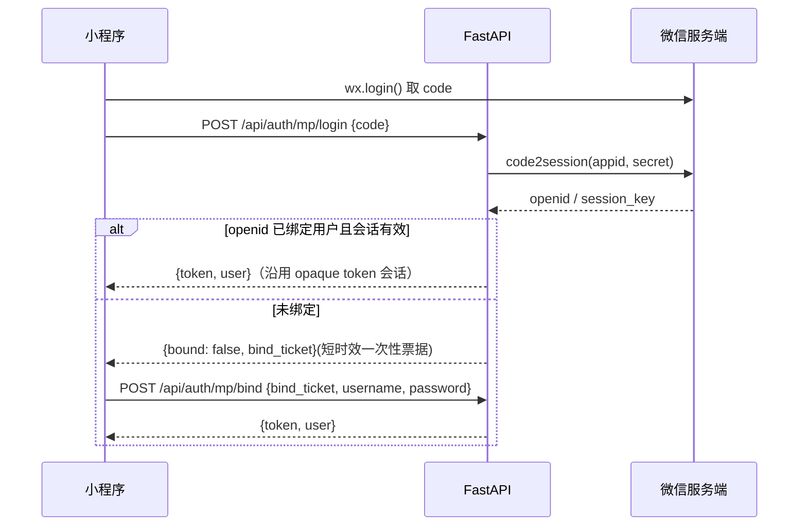
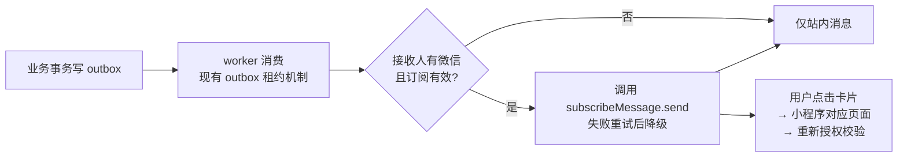

# PaperGuard 小程序端设计方案

> 版本：v1.2（设计定稿：§5.2 全部页面 + 关键交互态共 14 张视觉稿齐备，见 §8.1）
>
> 日期：2026-09-12
>
> 状态：**设计完成**。MP0 已实施并入 main（PR #23/#24），MP1/MP2 按 §10 分期实施；真机验收待微信主体、合法域名和开发者工具凭据
>
> 命名：小程序对用户的展示名定为**「论文卫士Pro」**（2026-09-13）；PaperGuard 为英文品牌，仅用于代码标识（npm 包名、appid、仓库）与登录页品牌字标，用户可见文案（导航标题、manifest 名称、H5 title、法务与消息文案）统一使用「论文卫士Pro」。
>
> 现状依据：`phase/1-miniprogram` 基于已收口合并 phase/0-13 的 `main`（`1c63cb3`）；当前工作区新增 MP0 后端契约与 `miniprogram/` 工程，后端全量回归 608 passed，通知中心 `/api/notifications`、任务聚合 `/api/my-tasks`、提交/审核/批注/归档接口均已存在。
>
> 关联：[完整业务闭环设计方案](./完整业务闭环设计方案.md)、[产品对象模型](./产品对象模型.md)、[SaaS产品设计补齐评估](./SaaS产品设计补齐评估.md)、[架构与UI调整方案](./架构与UI调整方案.md)、[商业产品设计方案](./商业产品设计方案.md)、[需求模型](./需求模型.md)、[Advisory 复核记录](./docs/security/advisory-review-2026-09-12.md)

## 1. 定位与范围

PaperGuard 小程序端（微信小程序）承接既有设计的一贯定位：**"桌面端承担长篇写作和审核，移动端优先支持查看任务、消息和反馈"**（需求模型.md、完整业务闭环设计方案 §1.1、商业产品设计方案 §6.4）。

一句话定位：**把"学生知道自己该干什么、干得怎么样、老师说了什么"和"教师随时掌握待办并给出决定"放进微信，长篇写作、导出、归档与系统管理仍留在桌面端。**

设计原则：

1. **手机不是第二写作台。** 不在小程序复刻 Writer 长文编辑器；正文在移动端默认只读。
2. **任务驱动，单屏一事。** 每个首屏只突出当前待办、截止时间与唯一主操作（完整业务闭环设计方案 §5.2"我的任务"原则的移动化）。
3. **订阅消息是小程序相对 H5 的核心增量。** 复用 outbox 事件源，把"退回、通过、临近截止"送达微信服务通知。
4. **复用优先。** 全部业务状态机、门禁、幂等、授权留在后端；小程序是新的呈现层与渠道，不是新的业务实现。

### 1.1 端能力边界矩阵

| 能力 | 桌面 Web | 小程序 | 说明 |
|---|---|---|---|
| 我的任务 / 截止 / 状态 | ✔ | ✔（一等入口） | 小程序首屏 |
| 消息中心 / 未读 | ✔ | ✔（一等入口） | 另加微信订阅消息推送 |
| 提交历史 / 审核结果 / 差异查看 | ✔ | ✔（只读） | 复用版本快照与 compare 接口 |
| 批注查看 / 学生回复与标记已修改 | ✔ | ✔ | 轻文本交互，适合手机 |
| 教师批注 / 退回 / 通过 / 人工确认 | ✔ | ✔（MP2 起） | 审阅为只读正文 + 决定操作 |
| 提交预检与正式提交（幂等） | ✔ | ✔（MP1 末） | "轻量提交"，复用候选版本流程 |
| 结构化写作（章节编辑、锁定样式） | ✔ | ✘ 只读进度 | 正文编辑留在桌面 |
| 检查问题处理 / 自动修复 | ✔ | ✘ 仅查看摘要 | 修复动作留在桌面 |
| DOCX 导出 / 上传检查 / 归档下载 | ✔ | ✘（可分享链接） | 文件类操作留在桌面 |
| 批次/阶段/成员/规范/模板管理 | ✔ | ✘ | 管理员首轮不进小程序 |
| 统计看板 / 审计 / 数据治理 | ✔ | ✘ | 桌面专属 |
| AI 写作助手 | ✔ | ✘ | 长文场景，留在桌面 |

### 1.2 非目标

- 不做正文编辑、公式/表格/图片插入、自动修复执行。
- 不做管理员工作台、批次配置、成员导入、规范治理。
- 不做支付、计费、积分（与商业产品设计方案一致，商业规则未裁决前不进入任何端）。
- 不做消息聊天式 IM；批注/回复沿用现有 `comment` 对象与状态机。

## 2. 角色与端内范围

首轮只服务两类角色，管理员维持桌面端入口：

| 角色 | 小程序能力 | 明确不做 |
|---|---|---|
| 学生 | 我的任务、确认阅读要求、查看有效规范摘要、提交历史与审核结果、批注查看与回复（标记"已修改待复核"）、提交预检与正式提交、消息中心、修改说明填写 | 编辑正文、执行修复、豁免申诉发起（后续评估） |
| 主指导教师 | 待审核列表、只读审阅提交版本、添加批注、确认学生回复、退回（原因+修订期限）、通过、人工确认项处理、消息中心 | 放宽硬性要求、审批上级条款豁免（门禁矩阵不变）、批次与成员管理 |
| 协助教师 | MP2 仅只读审阅与批注，无最终决定（与既有权限模型一致） | 最终决定 |
| 学院/学校管理员 | 不提供（消息推送可后续按需开放归档/统计摘要） | 管理操作 |
| 平台运维 | 不提供 | —— |

权限判断完全复用后端现有逻辑（组织范围、指导关系、资源归属、账号状态），小程序端不自行推断任何授权。对象级授权验收沿用 AC-12 口径：交换任意项目/提交/归档 ID 必须被拒绝。

## 3. 技术选型与工程布局

### 3.1 框架决策

| 方案 | 优势 | 劣势 | 结论 |
|---|---|---|---|
| **uni-app（Vue 3 + Vite + TS）** | 与现有前端同为 Vue 3 技术栈，心智一致；可同时编译 H5 作为移动 Web 兜底；社区与组件库成熟 | 编译层对新特性支持滞后；调试链路多一层 | **推荐** |
| 微信原生（WXML/WXSS + TS + Skyline） | 平台贴合度最高、渲染性能上限高、无编译层 | 团队需维护两套前端范式；无法复用 Vue 生态 | 备选（若后续重度依赖 Skyline 长列表可再评估） |
| Taro（React） | 生态好 | 与团队 Vue 栈不一致 | 不推荐 |

决策：**uni-app（Vue 3 + Vite + TypeScript）**，编译目标为微信小程序，保留 H5 产物作为低资料学生端的应急通道（不承诺首轮交付）。

### 3.2 工程布局

```
paperguard/
├── backend/            # 现有 FastAPI（新增 /api/auth/mp/* 与订阅消息消费）
├── frontend/           # 现有 Vue 3 Web（不动）
└── miniprogram/        # 新增 uni-app 工程（独立 package.json / pnpm）
    └── src/
        ├── api/        # 请求封装：token 注入、401 恢复、幂等键、202 轮询
        ├── stores/     # pinia：session、任务、消息
        ├── pages/      # 主包：任务、消息、我的、登录/绑定
        └── pages-sub/  # 分包：提交确认、审阅、提交详情/差异
```

网络约束：小程序 `wx.request` 合法域名要求 HTTPS + ICP 备案，生产复用现有反代架构（腾讯云 Nginx → `:8080`），为小程序域名单独签发证书即可；开发期在开发者工具勾选"不校验合法域名"。

## 4. 账号、登录与身份绑定

### 4.1 原则

小程序**不新建用户体系**：微信 openid 只是既有账号的一种登录凭证，全部业务身份仍走现有 `users` 表与角色模型。未绑定账号的微信用户只能看到"绑定引导页"。

### 4.2 登录与绑定时序



- `code2session` 只在服务端发生；`session_key` 不下发客户端。
- 绑定校验复用 `POST /api/auth/login` 的口令验证路径；绑定即建立 openid ↔ user 一一映射（一人一微信、一微信一账号），重复绑定返回 409。
- 换绑/解绑（`/api/auth/mp/unbind`）要求输入账号口令确认，防止微信丢失后被他人接管。
- 会话沿用现有 opaque Bearer token（服务端 `token_hash` 会话记录）；小程序会话建议独立的有效期策略（默认 30 天滑动过期，见 §7.2），token 存 `wx.setStorageSync`，401 时静默走一次 `wx.login` 重登，失败才落到绑定页。
- `must_change_password` 用户在小程序内强制先改密（复用 `POST /api/auth/change-password`，新密码 ≥12 位含字母数字）后进入业务。
- 账号被 `suspended/deactivated` 或退出批次时，后端拒绝发 token；已登录会话在下次请求即 401，小程序展示"账号不可用"而非无限重试。

### 4.3 信息收集最小化

不申请手机号、不强制头像昵称（如需展示头像，使用微信头像昵称填写能力，用户主动触发）；端内展示一律使用现有 `username`/姓名与角色。

### 4.4 微信直接注册与邮箱绑定（v1.3 新增）

新微信用户无需预先拥有校内账号，两条路径二选一：

- **绑定已有账号**：校内账号或邮箱 + 密码（邮箱标识由登录解析器统一支持）；
- **微信一键注册**：`POST /api/auth/mp/register`（凭 bind_ticket）以 openid 直接创建学生账号——`username` 自动生成（`wx_<hash10>`）、`password_set=0`（占位随机密码，账号密码登录不可用），小程序内始终微信一键登录。

注册后**必须绑定邮箱并设置密码**（`POST /api/auth/mp/bind-email`，视觉稿 15）：邮箱全局唯一（部分唯一索引），作为桌面端「邮箱+密码」登录与找回凭证；邮件通道（推荐 Resend：`PAPERGUARD_RESEND_API_KEY/FROM`，备选 SMTP：`PAPERGUARD_SMTP_*`）已配置时强制 6 位验证码校验（`POST /api/auth/email/code`，10 分钟有效、限 5 次尝试、60s 重发冷却），未配置时允许免验证但账号标记「邮箱未验证」。会话守卫与「我的」页对 `password_set=false` 账号一次性引导去绑定。Web 注册表单同步支持邮箱（选填）与验证码；登录解析器（用户名或邮箱任一命中）对所有端生效。

## 5. 信息架构与页面设计

### 5.1 底部导航（角色自适应）

| Tab | 学生呈现 | 教师呈现 | 内容 |
|---|---|---|---|
| 1 | 我的任务 | 待我审核 | 角色化待办首屏 |
| 2 | 消息 | 消息 | 站内信 + 未读角标 |
| 3 | 我的 | 我的 | 账号、绑定管理、规范入口 |

单一壳工程、按 `user.role` 渲染首屏与文案，不做两套小程序。

### 5.2 页面清单

| 页面 | 角色 | 核心内容与操作 | 复用接口 | 分期 |
|---|---|---|---|---|
| 登录 / 绑定引导 | 全部 | 微信静默登录、账号绑定、改密、解绑 | `/api/auth/mp/*`、`/api/auth/change-password` | MP0 |
| 我的任务（学生首屏） | 学生 | 当前阶段卡片：批次/阶段名、状态、截止倒计时、逾期标记、唯一主操作（继续写作→提示去桌面 / 预检提交 / 查看反馈）；历史阶段折叠 | `GET /api/my-tasks` | MP1 |
| 提交详情 | 学生 | 提交编号、状态、检查摘要、门禁结论、材料清单、时间线（submitted/returned/approved） | `GET /api/submissions/{id}`、`/api/jobs` | MP1 |
| 批注与回复 | 学生 | 阻断/建议批注列表（锚点原文摘要）、回复、"已修改待复核"；不能自行关闭阻断意见 | `GET/POST /api/submissions/{id}/comments`、`/comments/{id}/response`、`/comments/{id}/status` | MP1 |
| 提交确认 | 学生 | 有效截止、门禁阻断项、必交材料缺失、声明确认、幂等提交按钮 | `POST /api/submission-candidates`、`GET /api/submission-candidates/{id}`、`POST /api/submissions` | MP1 |
| 提交历史 / 差异 | 学生 | 修订链 S1→S2→S3、修改说明、上轮未解决意见 | `GET /api/projects/{id}/versions`、`/versions/compare` | MP1 |
| 待我审核（教师首屏） | 教师 | 待审核/待复核列表：学生、阶段、提交时间、迟交标记、等待时长、检查摘要 | `GET /api/my-tasks`（教师视角） | MP2 |
| 审阅页 | 教师 | 只读正文（按章节懒加载）、批注（新增/回复/确认解决）、人工确认清单、退回（原因+修订截止必填）、通过 | `GET /api/project-versions/{id}`、批注接口、`POST /api/submissions/{id}/reviews` | MP2 |
| 消息中心 | 全部 | 未读/已读、事件来源、点击重授权后跳转对应任务 | `GET /api/notifications`、`POST /notifications/{id}/read` | MP1 |
| 我的 | 全部 | 账号信息、角色、绑定状态与解绑、改密、关于与隐私政策 | `/api/auth/me`、mp 接口 | MP0 |

写作、修复、导出、归档、管理类页面在小程序中一律不出现；学生首屏主操作若指向这些能力（如"继续写作"），明确提示"请使用电脑端"并给出桌面端地址的复制按钮。

### 5.3 关键页面状态规范

沿用架构与UI调整方案的状态色体系与双表达原则：

| 状态 | 颜色 | 文案 + 图标 + 动作 |
|---|---|---|
| 进行中 | 蓝（`--primary #004ac6` 系） | "进行中" + 主操作"预检提交/去写作" |
| 待审核 | 蓝 | "已提交待审核" + 提交编号 |
| 需修改 | 橙 | "需修改" + 修订截止 + "查看意见" |
| 已通过 / 已归档 | 绿 | "已通过" / "已归档" + 查看记录 |
| 阻断 / 失败 | 红（`--error #ba1a1a`） | 阻断原因 + 修复指引（去桌面） |
| 未开始 / 未覆盖 | 灰 | 原因说明 |
| 逾期 | 逾期标记独立于状态显示（如"需修改 · 已逾期"），不替代业务状态（完整业务闭环设计方案 §6.1） |

每个页面必须覆盖：加载、空数据、失败重试、无权限/隐匿 404、操作过期（409）五种状态；按钮禁用必须说明具体阻断条件（门禁矩阵逐条映射），不允许只弹"操作失败"。

## 6. 关键流程设计

### 6.1 学生提交（轻量提交）

复用"候选版本 → 检查 → 确认提交"既有流程，小程序不引入新的提交语义：

1. 任务详情点"预检提交"→ `POST /api/submission-candidates`（202/同步返回候选）。
2. 提交确认页展示门禁结论；存在 `BLOCKING_FINDINGS`、材料缺失、未确认声明时按钮禁用并逐条列出原因。
3. 确认提交携带候选版本 ID + 幂等键（客户端生成 UUID，请求超时后重试复用同一键）；`DEADLINE_PASSED`、`CHECK_STALE`、`SUBMISSION_ALREADY_PENDING`、`REVISION_CONFLICT` 等错误按 §7.3 映射为具体指引。
4. 成功展示提交编号与时间；同一幂等键重复请求返回同一结果。
5. 检查期间正文若在桌面端被修改导致 `CHECK_STALE`，提示"正文已更新，请重新预检"。

**提交前是订阅消息授权的自然时机**：在提交确认页以用户点击触发 `wx.requestSubscribeMessage`，申请"审核结果""退回提醒"模板。

### 6.2 教师审核（MP2）

1. 待审列表 → 审阅页读取**提交版本的只读快照**（`GET /api/project-versions/{version_id}`），学生草稿修改不影响阅读内容。
2. 批注绑定段落 ID 与原文片段；手机端不提供复杂定位，批注列表按"必须处理的阻断/普通建议"分组。
3. 退回必须填写原因 + 修改要求 + 修订截止（日期选择器默认值取后端规则）；通过前完成人工确认项并确认无未关闭阻断批注。
4. 并发保护完全由后端事务保证（撤回与审核只允许一方成功），小程序端对 409 展示"状态已变化，请刷新"。

### 6.3 订阅消息链路（MP3，核心增量）



| 事件（现有 outbox 事件源） | 建议模板 | 跳转 |
|---|---|---|
| 退回 | 审核结果通知 | 提交详情 |
| 通过 | 审核结果通知 | 提交详情 |
| 正式提交 | 新提交待审 | 教师待审列表 |
| 批注/回复 | 互动提醒 | 批注页 |
| 临近截止 / 逾期 | 截止提醒 | 我的任务 |

约束：一次性订阅需用户每次主动授权，模板按"最值得打扰"收敛（结果类优先）；发送前重查状态，已通过/已退出/已延期任务不发过期催办（完整业务闭环设计方案 §9）；`subscribeMessage.send` 失败（授权用尽/43101）记入 outbox 重试后降级站内，不阻塞业务。

### 6.4 内容安全与 UGC 合规

批注、回复、修改说明属于用户生成内容且对他人可见，按微信平台要求接入 `msgSecCheck`：后端在持久化上述文本前调用内容安全接口，命中风险返回 422 并提示修改。该检查属于新增后端逻辑（见 §7.2），对所有端生效。

## 7. 接口复用与新增

### 7.1 直接复用（已核对存在）

| 接口 | 用途 |
|---|---|
| `POST /api/auth/login`、`GET /api/auth/me`、`POST /api/auth/change-password` | 绑定校验、身份、改密 |
| `GET /api/my-tasks` | 学生/教师首屏（服务端已按角色过滤） |
| `GET /api/stage-participants/{id}`、`POST .../acknowledge` | 任务详情、确认已阅读要求 |
| `POST /api/submission-candidates`、`GET .../{id}`、`POST /api/submissions` | 轻量提交全流程 |
| `GET /api/submissions/{id}`、`POST /api/submissions/{id}/withdraw` | 提交详情、撤回 |
| `GET/POST /api/submissions/{id}/comments`、`/comments/{id}/response`、`/comments/{id}/status` | 批注闭环 |
| `POST /api/submissions/{id}/reviews` | 教师决定（MP2） |
| `GET /api/project-versions/{id}`、`GET /api/projects/{id}/versions`、`/versions/compare` | 只读正文、修订链与差异 |
| `GET /api/notifications`、`POST /notifications/{id}/read` | 消息中心 |
| `GET /api/policies`、`GET /api/policies/{id}` | 有效规范摘要（只读） |
| `GET /api/jobs` | 202 任务轮询 |

请求封装统一约定：`Authorization: Bearer <token>`；列表 `{items, next_cursor}` 分页；错误按 `detail.code` 分发（不按中文文案匹配）；耗时任务 202 + job_id 轮询（3s，`onHide` 降频为 15s 或暂停）。

### 7.2 新增（后端）

| 接口/模块 | 契约方向 | 说明 |
|---|---|---|
| `POST /api/auth/mp/login` | `{code}` → `{token,user}` 或 `{bound:false,bind_ticket}` | code2session 仅服务端；bind_ticket 短时效一次性 |
| `POST /api/auth/mp/bind` | `{bind_ticket, username, password}` → `{token,user}` | 一人一微信唯一映射，冲突 409 |
| `POST /api/auth/mp/unbind` | 口令确认 | 保留既有账号 |
| 会话策略 | 小程序会话独立有效期（默认 30 天滑动） | 存储区分来源（web/mp），便于单端吊销 |
| 订阅消息消费者 | worker 内新增微信渠道 | 复用 outbox 租约/重试/封顶；模板 ID 走环境变量 |
| `msgSecCheck` 前置 | comments/response/修改说明写入前 | 命中返回 422 |

以上为拟定契约方向，最终命名沿用仓库风格（完整业务闭环设计方案 §11.2 同款约定）；实施时以当前代码为准，禁止为小程序重建业务实体。

### 7.3 错误码 → 小程序呈现映射

| code | 呈现 |
|---|---|
| `CHECK_PENDING` / `CHECK_FAILED` | "检查未完成/失败"，提供重试与诊断编号 |
| `CHECK_STALE` | "正文已更新，请重新预检" + 重新预检按钮 |
| `BLOCKING_FINDINGS` | 禁用提交，逐条列出阻断项与依据 |
| `DEADLINE_PASSED` | 明确截止时间 + "联系教师/管理员申请延期" |
| `SUBMISSION_ALREADY_PENDING` | 展示现有待审提交入口 |
| `REVISION_CONFLICT` | "内容已在他端修改"，引导桌面端处理合并 |
| 401 | 静默重登一次，失败落绑定页 |
| 403 / 404 | 无权限或资源隐匿，统一空态文案，不泄露存在性 |
| 409 | "状态已变化，请刷新" |
| 429 / 503 | 降频提示 + 稍后重试 |

## 8. 设计语言与组件（与 Web 同源）

- **色彩**：主色 `#004ac6`、主容器 `#2563eb`、背景 `#f8f9ff`、正文 `#0b1c30`、次要 `#434655`、错误 `#ba1a1a`（与 `frontend/src/style.css` CSS 变量同源，落地时抽为 uni-app `uni.scss` 变量表并保持单向同步）。
- **字体**：小程序使用系统字体栈（iOS 苹方 / 鸿蒙 / MIUI），不引入 Web 字体；标题层级对齐 Web 的字号阶梯并按 rpx 收敛（参考 Stitch 落地 0.7~0.8x 收敛经验）。
- **组件映射**：`TaskCard`（阶段卡：状态徽标 + 截止 + 唯一主操作）、`StatusBadge`（文字+图标+颜色三表达）、`DeadlineLabel`（倒计时 + 逾期标记）、`CommentItem`（锚点原文 + 级别 + 回复）、`JobStatus`（202 轮询）、`EmptyState/ErrorState`。
- **可访问性**：状态不只靠颜色（同 Web 规范）；点击目标 ≥ 44px；正文阅读支持系统字号跟随（`page` 使用 rpx + 关键正文用默认字号）。
- **深浅色**：首轮只交付浅色（与 Web 一致），预留 token 化能力。

### 8.1 关键页面视觉稿（Stitch）

已用 Google Stitch 生成 6 张移动端高保真视觉稿，配套沉淀 "Academic Precision System" 设计系统（色板/字阶/圆角与 Web 令牌同源，可直接作为 uni-app `uni.scss` 依据）：

| 页面 | 视觉稿（`docs/miniprogram-mockups/`） |
|---|---|
| 学生 · 我的任务 | `01-student-tasks.png` |
| 学生 · 提交确认（门禁） | `02-student-submit-confirm.png` |
| 学生 · 审阅意见/批注回复 | `03-student-comments.png` |
| 教师 · 待我审核 | `04-teacher-review-queue.png` |
| 教师 · 审阅（只读快照） | `05-teacher-review-readonly.png` |
| 消息中心 | `06-messages.png` |
| 登录 · 校内账号绑定 | `07-login-bind.png` |
| 学生 · 提交详情（时间线/退回理由） | `08-submission-detail.png` |
| 学生 · 提交历史（修订链/差异） | `09-submission-history.png` |
| 我的（账号/绑定/解绑） | `10-profile.png` |
| 教师 · 退回弹窗（原因必填+修订截止） | `11-return-modal.png` |
| 学生 · 提交成功凭证（编号/订阅授权引导） | `12-submission-success.png` |
| 教师 · 审阅批注页签（确认解决闭环） | `13-review-comments-tab.png` |
| 教师 · 审阅检查页签（人工确认完成/通过激活态） | `14-review-checks-tab.png` |
| 微信注册 · 绑定邮箱完成注册（两步向导） | `15-wechat-register-email.png` |

每张 PNG 附同名 HTML 源码（Tailwind 实现，含设计令牌），供 1:1 还原与组件抽取。**设计覆盖度：§5.2 全部 10 个页面 + 4 个关键交互态（教师退回弹窗、提交成功凭证、审阅批注页签、检查页签通过激活态）均有高保真视觉稿，设计阶段无遗留**；教师审阅页三页签由 05（正文）/13（批注）/14（检查）构成完整故事。Stitch 远端项目：`projects/7991510628310547176`（PaperGuard 小程序端设计），设计系统资产：`assets/06d2e289a0624ec4be302ed9edc46ebf`。落地时按既定经验对 Headline 字号与 padding 做 0.7~0.8x 收敛。

## 9. 性能、安全与平台合规

| 主题 | 约束 |
|---|---|
| 包体 | 主包 ≤ 1.5M（Tab 三页 + 登录绑定），提交确认/审阅/差异放分包；不内嵌大字体/图标库 |
| 长正文渲染 | 教师审阅与学生查看均按章节懒加载快照内容；段落锚点用提交版本的稳定段落 ID，不做全量一次性渲染 |
| 生命周期 | `onShow` 拉取任务/未读数；`onHide` 停止轮询；弱网请求 15s 超时 + 幂等重试（提交类请求必须复用幂等键） |
| 凭据 | token 仅存本机 storage，退出登录/解绑时清除；不在日志与分享卡片中出现 token/openid |
| 分享 | 仅允许分享小程序首页（不携带资源 ID）；提交/正文页面禁用分享与复制敏感摘要，归档下载继续引导桌面端 |
| 隐私 | 首启展示隐私协议（采集范围：登录凭证、账号绑定关系、消息推送标识）；不采集手机号/位置 |
| 平台资质 | 需非个人主体（学校/企业）认证；教育类目按微信要求准备资质；订阅消息模板需主体内申请 |
| 兼容 | 基础库 ≥ 2.30；首轮不适配 iPad 分栏（锁竖屏） |

## 10. 分期实施与放行条件

| 阶段 | 交付 | 放行条件 |
|---|---|---|
| MP0：契约与骨架 | mp 契约冻结（§7.2）、uni-app 工程落地、微信登录+绑定+改密、TabBar 三页、请求封装 | 微信工具真机预览可登录绑定既有账号；401/改密/解绑路径可走通 |
| MP1：学生端 | 我的任务、提交详情、批注回复、消息中心、提交预检与正式提交、提交历史 | 真机完成"领任务→查看反馈→回复批注→预检→提交"全链路；重复提交/截止边界/幂等与 AC-07/AC-08 同口径 |
| MP2：教师端 | 待我审核、审阅、批注、人工确认、退回/通过 | 真机完成两轮审核往返；AC-06/AC-07/AC-11 在移动端复验 |
| MP3：订阅消息与增强 | outbox→订阅消息消费者、模板配置、降级策略；差异查看体验优化；H5 产物评估 | 断网/拒绝授权仅降级不丢通知；AC-16 消息不重复口径复验 |

依赖：MP0 依赖后端 mp 契约；MP1 提交依赖既有候选版本/门禁（无新增门禁逻辑）；MP2 依赖批注与审核接口（已存在）；MP3 依赖 worker 与微信模板资质。

## 11. 验收场景

| 编号 | 场景 | 通过标准 |
|---|---|---|
| AC-MP-01 | 首次绑定 | 微信新用户绑定期有账号成功登录；错误口令 401 不产生绑定 |
| AC-MP-02 | 换绑与解绑 | 解绑需口令；解绑后旧微信无法登录该账号 |
| AC-MP-03 | 会话失效 | token 过期/服务端吊销后 401 → 静默重登或落绑定页，无死循环 |
| AC-MP-04 | 任务准确性 | 学生只见本人任务，教师仅见有效指导关系内学生（服务端过滤） |
| AC-MP-05 | 越权 | 交换提交/批注/版本/归档 ID 均被拒绝或隐匿（AC-12 同口径） |
| AC-MP-06 | 轻量提交幂等 | 双击/超时重试/断网重发复用幂等键，仅产生一份提交（AC-07） |
| AC-MP-07 | 截止边界 | 小程序与桌面端时间判断一致，均以服务器时间为准（AC-08） |
| AC-MP-08 | 草稿隔离 | 提交后桌面端改草稿，小程序审阅展示的仍是提交快照（AC-03） |
| AC-MP-09 | 批注闭环 | 学生回复并标记已修改，教师确认解决；学生不能关闭阻断批注 |
| AC-MP-10 | 订阅消息 | 授权后收到退回通知并直达提交详情；拒绝授权仅站内提醒；已完成任务不收催办（AC-16） |
| AC-MP-11 | 弱网 | 断网重试不重复提交；`onHide` 停轮询、恢复后刷新 |
| AC-MP-12 | UGC 安全 | 违规文本被 422 拦截且不出现在对方界面 |
| AC-MP-13 | 状态表达 | 所有状态文字+图标+颜色；逾期与业务状态可区分（§5.3） |

## 12. 待业务确认事项

| 事项 | 建议默认 | 影响 |
|---|---|---|
| 小程序主体与 AppID | 学校/机构主体认证 | 订阅消息、类目资质、msgSecCheck 可用性 |
| 订阅消息模板清单 | 结果类 3 个 + 截止提醒 1 个 | MP3 交付范围 |
| 小程序会话有效期 | 30 天滑动 | 安全 vs 体验 |
| 学生端是否开放正式提交 | MP1 末开放（轻量提交） | 门禁展示与幂等验收提前量 |
| 教师端审阅深度 | 只读快照 + 批注，不做差异逐段定位 | MP2 工作量 |
| 归档/导出类请求 | 引导桌面端 + 站内消息带桌面链接 | 学生预期管理 |
| H5 兜底产物 | 暂不承诺，MP3 评估 | 非微信环境学生覆盖 |
| 小程序命名与品牌 | PaperGuard 论文护航（待定） | 类目审核资料 |
